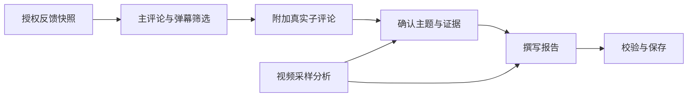

<div align="center">

# EchoFrame

**视频社区与创作者个人助手**

观看与发布视频，理解观众反馈，查看助手的每一步执行。

[](https://github.com/blackirlsama/EchoFrame/actions/workflows/ci.yml)
[](LICENSE)
[](pom.xml)
[](front/package.json)

[界面预览](#界面预览) · [快速开始](#快速开始) · [系统概览](#系统概览) · [文档导航](#文档导航)

</div>

## 界面预览

**视频社区** · 发现视频、分类浏览、播放与互动。


**视频与个人助手** · 在观看页面讨论内容，创作者可以整理弹幕和评论、生成反馈报告及互动草稿。


**Trace Studio** · 执行图、时间线与节点详情联动，查看模型和工具调用、上下文、Token 用量及响应耗时。


截图来自实际部署。项目持续开发中；本地 Demo 使用模拟数据，真实模型与完整网站需要额外配置。

## 可以做什么

| 能力 | 用法 |
| --- | --- |
| 视频社区 | 上传、播放、搜索与分类浏览，发送弹幕、评论和回复 |
| 视频助手 | 讨论当前视频或指定片段，生成评论与弹幕草稿，由用户确认后发送 |
| 观众反馈报告 | 创作者分析自己的评论与弹幕，结合采样画面生成带原话引用的报告，支持预览和 HTML 下载 |
| 个人记忆 | 查看、修改、忘记或暂停记忆，让后续对话使用相关信息 |
| 运行追踪 | 按 Trace ID 查询有权限的运行，也可以离线导入 JSON / JSONL |

可以向助手提问：

```text
分析这个视频的弹幕和评论，结合画面生成观众反馈报告。
概括这个视频最后一个片段的画面内容。
生成几条引导观众讨论的作者评论，先给我草稿。
```

## 快速开始

### 选择运行方式

| 我想体验 | 必要条件 | 入口 |
| --- | --- | --- |
| Agent 执行流程 | JDK 17、Maven 3.6.3+ | [无密钥 Demo](#体验-agent-demo) |
| Trace 日志可视化 | Node.js 22、npm | [Trace Studio](#体验-trace-studio) |
| 完整视频社区 | Java、Node.js、业务库与中间件 | [完整网站接入](docs/QUICKSTART.md#方式三运行完整网站) |
| 真实创作者 Agent | 业务登录与数据、模型凭据、Agent 持久化服务 | [运行模式与依赖](docs/QUICKSTART.md#选择运行方式) |

```bash
git clone --depth 1 https://github.com/blackirlsama/EchoFrame.git
cd EchoFrame
```

模块目录、构建产物与配置键仍沿用 `tianmu`。仓库包含[视频素材](materials/README.md)，首次克隆会一并下载。

### 体验 Agent Demo

无需模型 Key、数据库或中间件。在仓库根目录执行：

```bash
mvn -B -f agent/pom.xml package
java -jar agent/target/operations-agent-0.7.0-SNAPSHOT.jar
```

另开 Bash 终端创建任务：

```bash
curl -s -X POST http://127.0.0.1:8201/api/agent/runs \
  -H 'Authorization: Bearer demo-alice' \
  -H 'Content-Type: application/json' \
  -d '{"message":"查询视频1001昨天的弹幕数"}'
```

将返回的 `runId` 替换到 `RUN_ID`，查询任务结果；若仍在运行，稍后再次查询：

```bash
curl -s -H 'Authorization: Bearer demo-alice' \
  http://127.0.0.1:8201/api/agent/runs/RUN_ID
```

Demo 使用模拟身份、脚本模型和内存存储，用于体验流程，不代表真实模型分析效果。[PowerShell 示例与完整启动说明 →](docs/QUICKSTART.md#方式一体验-agent-demo)

### 体验 Trace Studio

从仓库根目录执行：

```bash
cd front
npm ci
npm run serve
```

打开开发服务器的 `/trace` 页面，通常为 `http://localhost:8080/trace`。内置演示日志，也支持导入 JSON / JSONL 文件，在浏览器本地解析，无需后端。

本地可直接使用演示日志或导入文件；接入网站并登录后，还可按 Trace ID 在线查询本人有权查看的运行。[前端开发说明 →](front/README.md)

### 接入真实业务与模型

完整网站需要 MySQL、Redis、MinIO、Elasticsearch（IK）、RocketMQ 与 Canal；真实 Agent 还需要模型凭据，持久化模式使用 Agent 专用 MySQL、Redis 和私有对象存储。画面理解另需 FFmpeg / ffprobe 与视觉模型，转写单独配置。

按[运行与接入指南](docs/QUICKSTART.md#方式三运行完整网站)准备依赖、配置登录与模型，再启动业务后端、Agent 和前端。模型调用可能产生费用。现有[网站容器部署](deploy/site/README.md)依赖既有共享网络与服务，不是空环境的一键启动脚本。

## 系统概览

前端使用 Vue 3，业务后端与独立 Agent 使用 Java 17 / Spring Boot。业务服务负责视频、用户和互动；Agent 通过授权接口读取业务数据，执行模型与工具调用。Trace 记录执行过程，便于检查耗时与证据来源。

反馈报告的主要处理过程：



大材料使用向量粗排与精排，每桶最多选取五个素材，再附加子评论；报告每主题最多展示三个素材。视频理解依据采样画面和可选转写，主题结论依据代表反馈，不等于逐条分析全部互动。

- [业务与 Agent 架构](docs/ARCHITECTURE.md)：服务依赖、任务执行与数据边界。
- [反馈报告工程说明](agent/docs/Agent架构与工程治理技术设计.md)：当前选材、回复关联及两阶段写作规则。
- [记忆方案](agent/docs/记忆召回重构技术方案.md)：记忆整理、召回和管理。

## 开发与测试

在仓库根目录验证业务后端与 Agent：

```bash
mvn -B verify
mvn -B -f agent/pom.xml verify
```

验证前端：

```bash
cd front
npm ci
npm run test:agent
npm run build
```

[GitHub Actions](https://github.com/blackirlsama/EchoFrame/actions/workflows/ci.yml) 覆盖前端、业务后端、Agent、发布规范与隔离数据库集成测试，不调用付费模型。配置与验证要求见[贡献指南](CONTRIBUTING.md)。

## 文档导航

| 文档 | 内容 |
| --- | --- |
| [运行与接入](docs/QUICKSTART.md) | 运行方式、Bash / PowerShell 示例、真实模型与完整网站接入 |
| [架构说明](docs/ARCHITECTURE.md) | 业务链路、任务准备、Harness 与反馈处理边界 |
| [前端开发](front/README.md) | 页面、Trace Studio、代理与构建 |
| [Agent 开发](agent/README.md) | 模型、工具、存储与配置 |
| [Agent 治理与文档索引](agent/docs/README.md) | 当前架构、配置目录、开发维护、验收与独立审查 |
| [网站部署](deploy/site/README.md) / [独立 Agent 部署](deploy/README.md) | 容器与环境配置 |
| [部署参考](docs/DEPLOYMENT.md) | 环境与集成测试 |
| [项目路线图](docs/ROADMAP.md) | 开发方向与待完善能力 |

源码入口：[业务后端](src/) · [前端](front/) · [Agent](agent/) · [脚本](scripts/)。

## 参与贡献

欢迎通过 [Issue](https://github.com/blackirlsama/EchoFrame/issues) 反馈问题和使用场景，或提交 [Pull Request](https://github.com/blackirlsama/EchoFrame/pulls) 改进体验、测试与文档。

从最新 `master` 创建分支，按 [CONTRIBUTING.md](CONTRIBUTING.md) 完成修改与验证。安全问题请按 [SECURITY.md](SECURITY.md) 反馈。感谢所有[贡献者](https://github.com/blackirlsama/EchoFrame/graphs/contributors)。

## 许可证与素材

项目代码采用 [MIT License](LICENSE)。第三方组件、视频素材、首页插画与图标保留各自权利，不随项目代码重新授权；详见 [NOTICE](NOTICE)、[第三方说明](docs/THIRD_PARTY.md) 与[素材来源](front/src/assets/img/home/README.md)。
