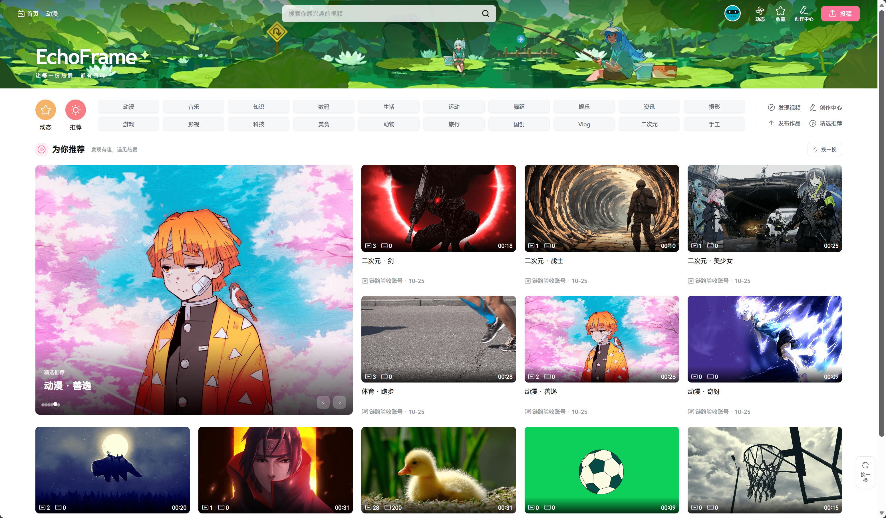
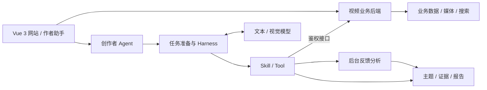

<div align="center">

# EchoFrame

**开源视频社区与创作者 Agent**

发布视频，与观众互动，让弹幕和评论成为下一次创作的线索。

[](https://github.com/blackirlsama/EchoFrame/actions/workflows/ci.yml)
[](LICENSE)
[](pom.xml)
[](front/package.json)

[功能与展示](#功能与展示) · [快速开始](#快速开始) · [架构概览](#架构概览) · [文档](#文档) · [参与贡献](#参与贡献)

</div>



EchoFrame 基于 **Spring Boot + Vue 3**，提供视频上传、播放、搜索、弹幕、评论和用户互动。独立部署的创作者 Agent 将视频内容与观众反馈连接起来，支持反馈分析、报告生成和互动草稿。

> **开发预览版本。** 想先了解执行流程，可以运行无需模型 Key 和中间件的 [Agent Demo](#体验-agent-demo)；想体验日志可视化，可以单独运行 [Trace Studio](#体验-trace-studio)。真实视频分析需要业务数据与模型服务。

## 功能与展示

| 场景 | 你可以做什么 |
| --- | --- |
| 视频社区 | 上传和播放视频，按分类浏览、搜索内容，关注作者并参与互动 |
| 弹幕与评论 | 发送弹幕、评论与回复，围绕视频交流 |
| 观众反馈 | 分析弹幕与评论，结合采样画面生成含主题、原话与建议的 HTML 报告 |
| 视频理解 | 概括画面、分析指定片段，讨论下一条视频的选题 |
| 智能互动 | 生成作者评论或弹幕草稿，编辑确认后发布 |
| 执行观察 | 查看任务进度、取消执行，通过 Trace Studio 检查调用关系与时间线 |

### 面向创作者的 Agent


接入真实业务与模型后，作者可以在自己的视频页打开助手，例如：

```text
分析这个视频的弹幕和评论，结合画面生成观众反馈报告。
概括这个视频的画面内容，重点描述最后一个片段。
结合当前视频，给我几个下一条视频的选题方向。
生成几条引导观众讨论的作者评论，先给我草稿。
```

反馈报告以实际入库的互动为依据。画面理解来自采样帧，未配置转写时不包含音频理解；分析受数据量、模型上下文、预算与时限约束，超限会明确失败。发布操作需要用户确认。

## 快速开始

### 选择运行方式

| 我想体验 | 必要条件 | 入口 |
| --- | --- | --- |
| Agent 执行流程 | JDK 17、Maven 3.6.3+ | [无密钥 Demo](#体验-agent-demo) |
| Trace 日志可视化 | Node.js 22、npm | [Trace Studio](#体验-trace-studio) |
| 完整视频社区 | Java、Node.js、业务库与中间件 | [完整网站接入](docs/QUICKSTART.md#方式三运行完整网站) |
| 真实创作者 Agent | 业务登录与数据、模型凭据、Agent 持久化服务 | [运行模式与依赖](docs/QUICKSTART.md#选择运行方式) |

```bash
git clone --depth 1 https://github.com/blackirlsama/EchoFrame.git
cd EchoFrame
```

模块目录、构建产物与配置键仍沿用 `tianmu`。仓库包含[视频素材](materials/README.md)，首次克隆会一并下载。

### 体验 Agent Demo

无需模型 Key、数据库或中间件。在仓库根目录执行：

```bash
mvn -B -f agent/pom.xml package
java -jar agent/target/operations-agent-0.7.0-SNAPSHOT.jar
```

另开 Bash 终端创建任务：

```bash
curl -s -X POST http://127.0.0.1:8201/api/agent/runs \
  -H 'Authorization: Bearer demo-alice' \
  -H 'Content-Type: application/json' \
  -d '{"message":"查询视频1001昨天的弹幕数"}'
```

将返回的 `runId` 替换到 `RUN_ID`，查询任务结果；若仍在运行，稍后再次查询：

```bash
curl -s -H 'Authorization: Bearer demo-alice' \
  http://127.0.0.1:8201/api/agent/runs/RUN_ID
```

Demo 使用模拟身份、脚本模型和内存存储，用于体验流程，不代表真实模型分析效果。[PowerShell 示例与完整启动说明 →](docs/QUICKSTART.md#方式一体验-agent-demo)

### 体验 Trace Studio

从仓库根目录执行：

```bash
cd front
npm ci
npm run serve
```

打开开发服务器的 `/trace` 页面，通常为 `http://localhost:8080/trace`。内置演示日志，也支持导入 JSON / JSONL 文件，在浏览器本地解析，无需后端。

当前为离线可视化，尚未接入在线 Trace 查询。[前端开发说明 →](front/README.md)

### 接入真实业务与模型

完整网站需要 MySQL、Redis、MinIO、Elasticsearch（IK）、RocketMQ 与 Canal；真实 Agent 还需要模型凭据，持久化模式使用 Agent 专用 MySQL、Redis 和私有对象存储。画面理解另需 FFmpeg / ffprobe 与视觉模型，转写单独配置。

按[运行与接入指南](docs/QUICKSTART.md#方式三运行完整网站)准备依赖、配置登录与模型，再启动业务后端、Agent 和前端。模型调用可能产生费用。现有[网站容器部署](deploy/site/README.md)依赖既有共享网络与服务，不是空环境的一键启动脚本。

## 架构概览

业务后端采用模块化单体，Agent 作为独立服务运行，通过鉴权接口访问业务数据，分别开发、测试和部署。



| 部分 | 职责 |
| --- | --- |
| 业务后端 | 处理用户、视频、互动、上传、检索与弹幕连接，维护业务数据 |
| 任务准备与 Harness | 明确目标和访问范围，组织上下文、模型决策与工具调用，控制轮次、时限与预算 |
| Skill / Tool | Skill 描述任务流程并激活工具；Tool 提供数据读取、视频理解、反馈分析和产物生成能力 |
| 后台反馈分析 | 读取有界快照、去重与计数，按已有主题分批分类并由代码累计，保留原始成员与证据 |
| 存储与追踪 | 保存会话、任务与私有产物，记录调用过程，支持恢复和问题排查 |

全量弹幕与评论由后台分批处理，主对话通过工具读取结果。统计、权限与报告渲染由代码完成，模型负责理解、归纳与建议。Agent 不直接修改业务数据库，发布经用户确认后交给业务后端。

[查看业务链路、任务准备与 Harness 详细设计 →](docs/ARCHITECTURE.md)

## 开发与测试

在仓库根目录验证业务后端与 Agent：

```bash
mvn -B verify
mvn -B -f agent/pom.xml verify
```

验证前端：

```bash
cd front
npm ci
npm run test:agent
npm run build
```

[GitHub Actions](https://github.com/blackirlsama/EchoFrame/actions/workflows/ci.yml) 覆盖前端、业务后端、Agent、发布规范与隔离数据库集成测试，不调用付费模型。配置与验证要求见[贡献指南](CONTRIBUTING.md)。

## 文档

| 文档 | 内容 |
| --- | --- |
| [运行与接入](docs/QUICKSTART.md) | 运行方式、Bash / PowerShell 示例、真实模型与完整网站接入 |
| [架构说明](docs/ARCHITECTURE.md) | 业务链路、任务准备、Harness 与反馈处理边界 |
| [前端开发](front/README.md) | 页面、Trace Studio、代理与构建 |
| [Agent 开发](agent/README.md) | 模型、工具、存储与配置 |
| [Agent 治理与文档索引](agent/docs/README.md) | 当前架构、配置目录、开发维护、验收与独立审查 |
| [网站部署](deploy/site/README.md) / [独立 Agent 部署](deploy/README.md) | 容器与环境配置 |
| [部署参考](docs/DEPLOYMENT.md) | 环境与集成测试 |
| [项目路线图](docs/ROADMAP.md) | 开发方向与待完善能力 |

源码入口：[业务后端](src/) · [前端](front/) · [Agent](agent/) · [脚本](scripts/)。

## 参与贡献

欢迎通过 [Issue](https://github.com/blackirlsama/EchoFrame/issues) 反馈问题和使用场景，或提交 [Pull Request](https://github.com/blackirlsama/EchoFrame/pulls) 改进体验、测试与文档。

从最新 `master` 创建分支，按 [CONTRIBUTING.md](CONTRIBUTING.md) 完成修改与验证。安全问题请按 [SECURITY.md](SECURITY.md) 反馈。感谢所有[贡献者](https://github.com/blackirlsama/EchoFrame/graphs/contributors)。

## 许可证与素材

项目代码采用 [MIT License](LICENSE)。第三方组件、视频素材、首页插画与图标保留各自权利，不随项目代码重新授权；详见 [NOTICE](NOTICE)、[第三方说明](docs/THIRD_PARTY.md) 与[素材来源](front/src/assets/img/home/README.md)。
