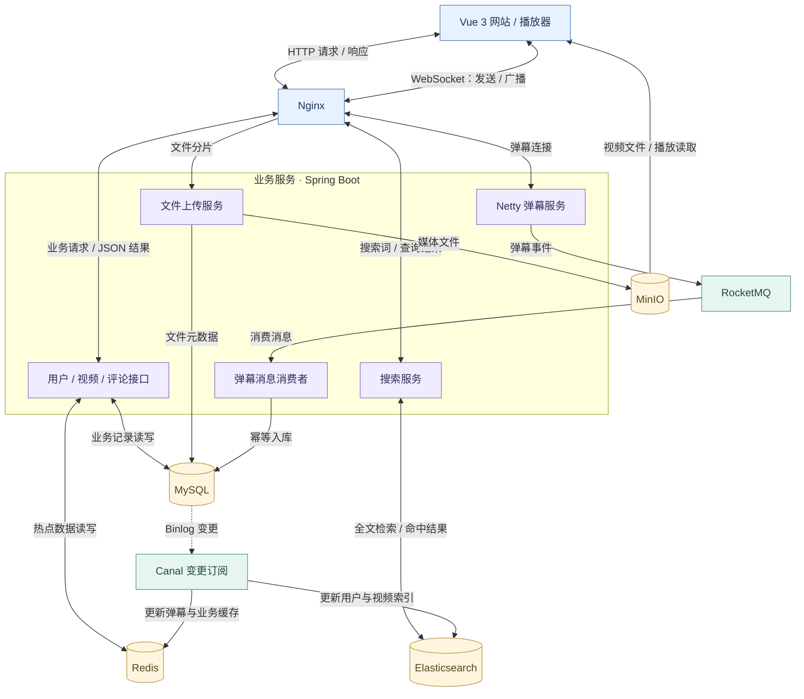
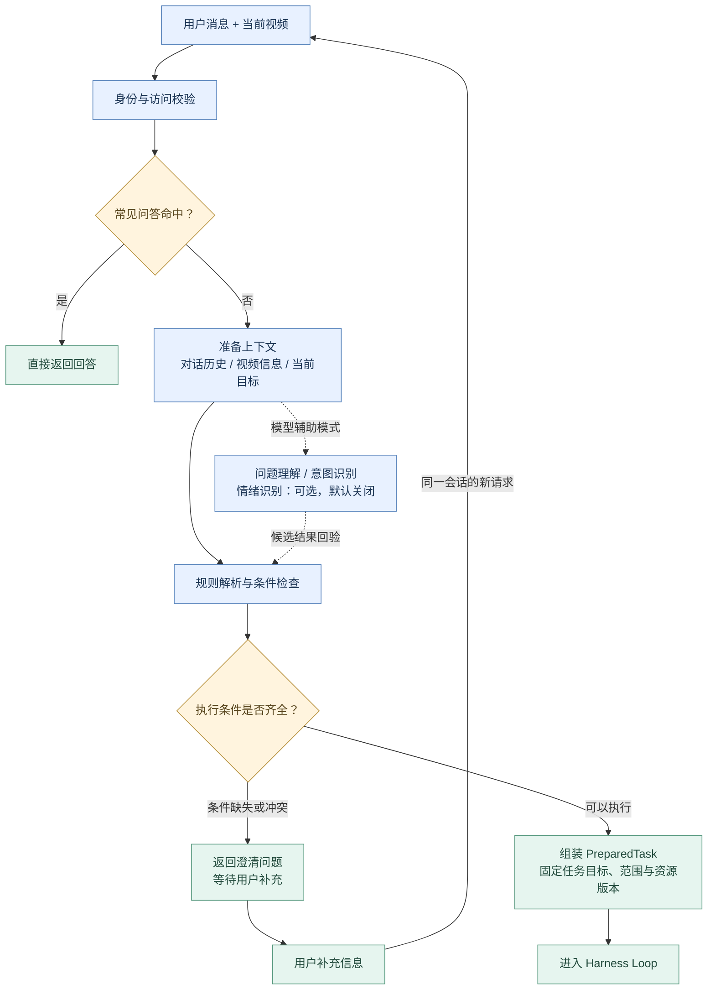
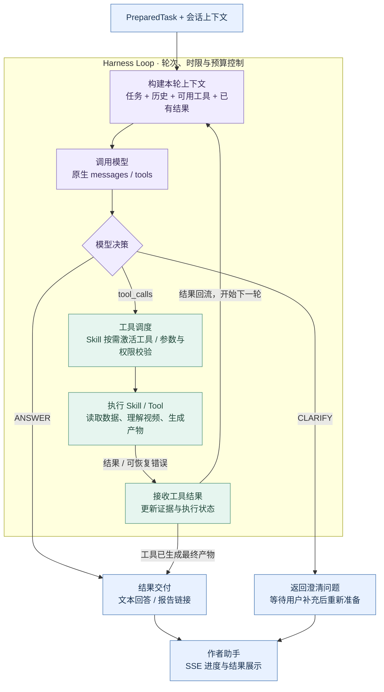

<div align="center">

# EchoFrame

**开源视频社区 · 弹幕互动 · 创作者 Agent**

连接视频内容、弹幕与评论，让创作者更好地理解观众，规划内容，开展互动。

[](https://github.com/blackirlsama/Tianmu/actions/workflows/ci.yml)
[](LICENSE)
[](pom.xml)
[](tianmu-front/package.json)

[功能特性](#功能特性) · [后端架构](#后端架构) · [Agent 架构](#agent-架构) · [快速开始](#快速开始) · [文档](#文档) · [贡献](#参与贡献)

</div>


## 项目介绍

EchoFrame 是一套基于 **Spring Boot + Vue 3** 的视频平台，提供视频上传、播放、搜索、弹幕、评论和用户互动能力，并集成独立部署的 **创作者 Agent**，帮助创作者从观众反馈中发现内容方向。

视频后端负责业务与数据，Agent 负责理解需求、调用工具和生成结果。两者通过鉴权接口连接，可以分别开发、测试与部署。

> 当前为开发预览版本。可以先运行无需模型 Key 的 Agent Demo，或独立体验 Trace Studio，再接入完整网站和真实模型。

## 功能特性

| 模块 | 能力 |
| --- | --- |
| **视频平台** | 视频上传与播放、内容分类、检索、关注及互动 |
| **弹幕与评论** | 弹幕发送与展示、评论及回复、互动数据统计 |
| **观众反馈报告** | 联合分析弹幕与评论，结合画面生成可阅读的 HTML 报告 |
| **视频理解** | 画面概括、指定片段分析、内容选题建议 |
| **智能互动** | 生成作者评论与弹幕草稿，编辑确认后发布 |
| **对话助手** | 多轮沟通、任务进度、取消与结果查看 |
| **Trace Studio** | 调用关系图、时间线、节点详情与日志导入 |

接入真实业务与模型后，登录作者可在自己的视频页打开助手：

```text
分析这个视频的弹幕和评论，结合画面生成观众反馈报告。
概括这个视频的画面内容，重点描述最后一个片段。
结合当前视频，给我几个下一条视频的选题方向。
生成几条引导观众讨论的作者评论，先给我草稿。
```

报告以实际入库的互动为依据；画面理解来自采样帧，未配置转写时不包含音频理解。联合分析受任务时限、上下文与数据量限制，超限会明确失败；能力边界见 [Agent 文档](tianmu-agent/README.md)。

## 后端架构

视频后端采用模块化单体结构。网站通过 HTTP 读写业务数据，通过 WebSocket 收发弹幕；媒体文件、业务记录、缓存与搜索索引分别流向对应的存储服务。



| 层次 | 技术与职责 |
| --- | --- |
| 业务请求 | 网站 → Nginx → 业务接口 → MySQL / Redis，查询结果返回网站 |
| 视频上传与播放 | 上传服务写入 MinIO，并保存文件元数据；播放器读取媒体文件 |
| 弹幕发送 | WebSocket → Netty → RocketMQ → 消费者 → MySQL；Netty 同时负责连接与广播 |
| 数据同步与搜索 | MySQL 变更经 Canal 更新 Redis 与 Elasticsearch，搜索服务读取索引返回结果 |

业务后端代码位于 [`src/`](src/)，部署说明见[完整网站部署](deploy/site/README.md)。

## Agent 架构


Agent 是独立的 Spring Boot 服务，分为**前置处理**和 **Harness Loop** 两个阶段。前置处理确定“用户要做什么、能访问什么、执行条件是否齐全”；Harness 根据准备好的任务，组织模型与工具协作完成工作。

### 前置处理：从用户请求到执行任务

请求先经过身份与访问校验。常见问答可以直接返回；其他请求加载会话历史、补全当前视频信息，再解析任务和检查条件。按配置也可以启用模型辅助的问题理解、意图识别和情绪识别。条件不足或存在冲突时向用户澄清，条件齐全时组装执行任务。



默认优先采用规则解析；无法明确解析的请求可进入模型理解与意图识别。情绪识别可选且默认关闭。模型辅助准备的结果仍须经过条件校验，不会直接改变用户权限或任务范围。

### Harness Loop：模型决策与工具结果形成闭环

每轮重新组织上下文，将用户需求、历史信息、可用工具和已有结果交给模型。模型可以直接回答、请求澄清，也可以调用工具；工具结果返回后，更新证据与执行状态，再进入下一轮。



| 组件 | 职责 |
| --- | --- |
| 前置处理 | 完成身份校验、FAQ 路由、上下文准备与任务条件检查；按配置启用意图、理解和情绪识别 |
| 澄清 | 在准备阶段或模型决策中发现需要补充的信息，返回问题，待用户回复后继续处理 |
| PreparedTask | 将准备结果固定为明确的执行目标、数据范围和资源版本 |
| Harness | 组织每轮上下文、模型决策、工具调用与结果反馈，控制执行边界 |
| 模型适配器 | 文本模型负责决策，视觉模型提供采样画面事实 |
| Skill / Tool | Skill 组织能力，Tool 通过业务接口读取数据或执行操作 |
| 存储与追踪 | 保存对话、任务和产物，记录调用过程，支持恢复与排查 |

这套设计将三件事分开：**前置处理明确任务，模型决定下一步，Harness 组织受控执行。** 统计计算、权限校验和报告渲染由代码完成；工具结果作为后续推理和最终交付的依据。达到执行限制、发生不可恢复错误或用户取消时，请求终止，不会无限循环。

Agent 不直接修改业务数据库，发布操作由用户确认后交给业务后端执行。详细开发与配置说明见 [`tianmu-agent/README.md`](tianmu-agent/README.md)。

## 快速开始

### 选择运行方式

| 方式 | 必要依赖 | 可选接入 |
| --- | --- | --- |
| Agent Demo | JDK 17、Maven 3.6.3+ | 无需模型 Key 或中间件 |
| Trace Studio | Node.js 22、npm | 导入真实 Trace 文件；无需后端 |
| 完整视频社区 | JDK 17、Maven、Node.js、MySQL、Redis、MinIO、Elasticsearch（IK）、RocketMQ、Canal | 创作者 Agent 与模型服务 |
| 真实创作者 Agent | 业务后端与登录、文本模型凭据；持久化模式另需 Agent 专用 MySQL、Redis 与私有对象存储 | 画面理解需 FFmpeg / ffprobe 与视觉模型；转写单独配置；Kafka / ClickHouse 用于可选 Trace 存储 |

```bash
git clone --depth 1 https://github.com/blackirlsama/Tianmu.git
cd Tianmu
```

项目对外名称为 **EchoFrame**；仓库地址、目录、构建产物与配置键仍沿用 `Tianmu` / `tianmu`，以下命令保留实际名称。仓库包含[视频素材](materials/README.md)，首次克隆会一并下载。

### 方式一：体验 Agent Demo

**无需模型 Key、数据库或中间件。** 在仓库根目录执行：

```bash
mvn -B -f tianmu-agent/pom.xml package
java -jar tianmu-agent/target/operations-agent-0.7.0-SNAPSHOT.jar
```

服务默认运行在 `http://127.0.0.1:8201`。另开终端创建任务：

```bash
curl -s -X POST http://127.0.0.1:8201/api/agent/runs \
  -H 'Authorization: Bearer demo-alice' \
  -H 'Content-Type: application/json' \
  -d '{"message":"查询视频1001昨天的弹幕数"}'
```

将返回的 `runId` 替换到下方命令中，查看执行结果：

```bash
curl -s -H 'Authorization: Bearer demo-alice' \
  http://127.0.0.1:8201/api/agent/runs/RUN_ID
```

Demo 使用模拟身份、脚本模型和内存存储，适合验证任务流程，不代表真实视频分析效果。以上请求使用 Bash；PowerShell 可使用：

```powershell
$headers = @{ Authorization = "Bearer demo-alice" }
$body = @{ message = "查询视频1001昨天的弹幕数" } | ConvertTo-Json
$run = Invoke-RestMethod -Method Post -Uri "http://127.0.0.1:8201/api/agent/runs" -Headers $headers -ContentType "application/json; charset=utf-8" -Body ([Text.Encoding]::UTF8.GetBytes($body))
Invoke-RestMethod -Uri "http://127.0.0.1:8201/api/agent/runs/$($run.runId)" -Headers $headers
```

任务异步执行；若仍在运行，稍后再次查询。

### 方式二：体验 Trace Studio

```bash
cd tianmu-front
npm ci
npm run serve
```

打开终端显示的开发服务器地址，访问 `/trace`，通常为 `http://localhost:8080/trace`。页面内置演示日志，也支持导入真实的 JSON / JSONL 日志；文件在浏览器本地解析。

当前版本提供离线可视化，尚未连接在线 Trace 查询。更多说明见[前端文档](tianmu-front/README.md)。

### 方式三：运行完整网站

先按[部署参考](docs/DEPLOYMENT.md)准备业务库和中间件，再参考 [`.env.example`](.env.example) 设置 `TIANMU_*`、登录密钥与邮件配置。直接运行 Java 不会自动读取 `.env` 文件。

[网站容器部署说明](deploy/site/README.md)面向已有单机验收环境，依赖既有共享网络与服务，不是空环境一键启动脚本。以下命令用于依赖就绪后的本地启动。

在仓库根目录构建后端与 Agent：

```bash
mvn -B package
mvn -B -f tianmu-agent/pom.xml package
```

分别在两个 Bash 终端启动服务。真实 Agent 需先配置 `DEEPSEEK_API_KEY`、Agent 专用 `AGENT_JDBC_URL` / `AGENT_DB_*`、`AGENT_REDIS_*` 与 MinIO 凭据。业务桥接须使用与网站登录一致的 JWT 密钥和 Redis 会话配置：

```bash
# 视频业务后端
AGENT_BRIDGE_ENABLED=true java -jar target/tianmu-0.0.1-SNAPSHOT.jar
```

```bash
# 接入真实业务、模型和持久化存储的 Agent
BUSINESS_BASE_URL=http://127.0.0.1:8101/api \
SPRING_PROFILES_ACTIVE=business,deepseek,persistent \
  java -jar tianmu-agent/target/operations-agent-0.7.0-SNAPSHOT.jar
```

需要画面理解时，再启用视觉模型并为业务后端安装 FFmpeg / ffprobe，配置见[网站部署的视频内容理解说明](deploy/site/README.md#视频内容理解)。`deepseek` 配置默认开启视频工具；视觉服务不支持图片输入时，应设置 `VIDEO_CONTENT_ENABLED=false`，或配置可用的 `VIDEO_MODEL_*`。

然后启动前端（默认代理指向本地 8101 / 8201）：

```bash
cd tianmu-front
npm ci
npm run serve
```

| 服务 | 默认地址 |
| --- | --- |
| 业务 API | `http://127.0.0.1:8101` |
| Agent API | `http://127.0.0.1:8201` |
| 弹幕 WebSocket | 端口 `9101` |
| 前端 | 以开发服务器输出为准 |

真实模式需配置数据库、登录、中间件及模型凭据，模型调用可能产生费用。前端代理和模型参数的配置分别见[前端说明](tianmu-front/README.md)、[Agent 说明](tianmu-agent/README.md)。容器部署可选择[独立 Agent 栈](deploy/README.md)或[完整网站栈](deploy/site/README.md)。

## 项目结构

```text
Tianmu/
├── src/                  视频业务后端
├── tianmu-front/         视频网站、作者助手与 Trace Studio
├── tianmu-agent/         独立 Agent 服务
├── materials/            视频素材与文件清单
├── deploy/               容器与部署配置
├── scripts/              测试、冒烟与发布检查
└── docs/                 专题文档与路线图
```

## 开发与测试

后端与 Agent：

```bash
mvn -B verify
mvn -B -f tianmu-agent/pom.xml verify
```

前端：

```bash
cd tianmu-front
npm ci
npm run test:agent
npm run build
```

[GitHub Actions](https://github.com/blackirlsama/Tianmu/actions/workflows/ci.yml) 检查前端、业务后端、Agent 与发布规范，并在隔离环境中运行数据库集成测试。测试不调用付费模型；完整验证流程见[贡献指南](CONTRIBUTING.md)。

## 文档

| 文档 | 内容 |
| --- | --- |
| [前端开发](tianmu-front/README.md) | 页面、Trace Studio、代理与构建 |
| [Agent 开发](tianmu-agent/README.md) | 执行框架、模型、工具与配置 |
| [网站部署](deploy/site/README.md) | 完整网站与真实 Agent 接入 |
| [独立 Agent 部署](deploy/README.md) | 单独运行 Agent 与存储服务 |
| [部署参考](docs/DEPLOYMENT.md) | 环境与集成测试 |
| [项目路线图](docs/ROADMAP.md) | 开发方向与待完善能力 |

## 参与贡献

欢迎提交问题、改进体验、补充测试或完善文档。

1. 在 [Issue](https://github.com/blackirlsama/Tianmu/issues) 中说明问题或使用场景。
2. Fork 仓库，从最新 `master` 创建开发分支。
3. 完成修改与相关测试，提交 [Pull Request](https://github.com/blackirlsama/Tianmu/pulls)。

提交前请阅读 [CONTRIBUTING.md](CONTRIBUTING.md)。安全问题请通过 [SECURITY.md](SECURITY.md) 中的方式反馈。感谢每一位[贡献者](https://github.com/blackirlsama/Tianmu/graphs/contributors)，欢迎分享使用反馈。

## 许可证

项目代码采用 [MIT License](LICENSE)。第三方组件与视频素材遵循各自的授权条款，详见 [NOTICE](NOTICE) 与[第三方说明](docs/THIRD_PARTY.md)。
