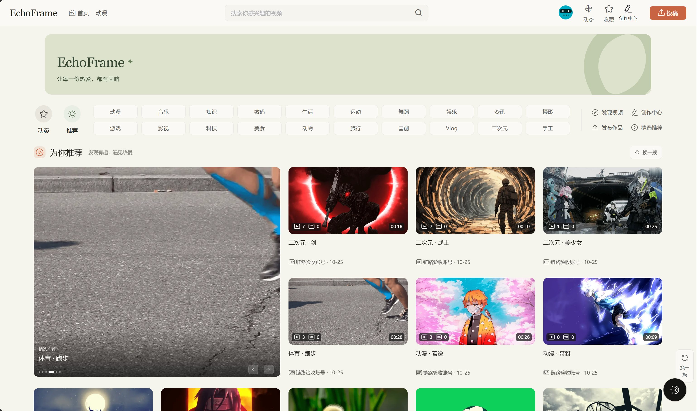
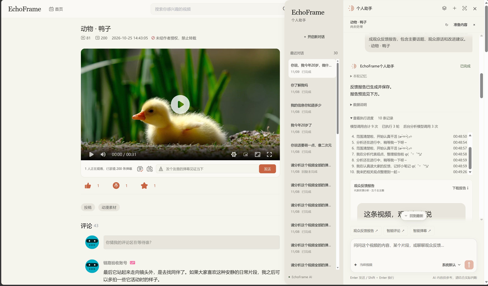
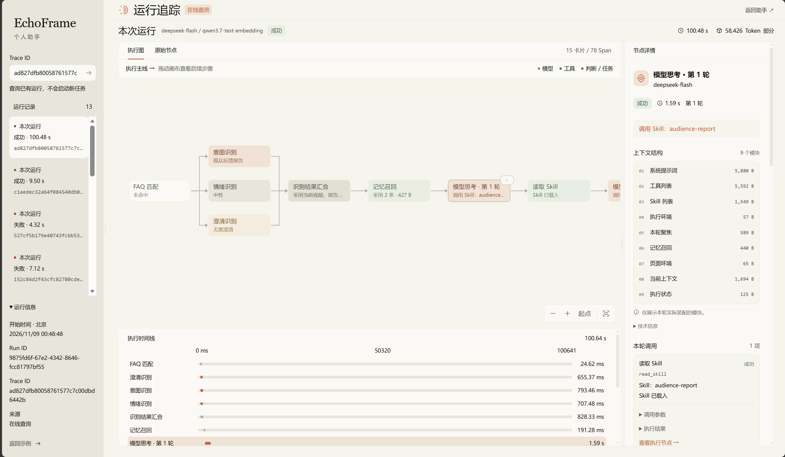
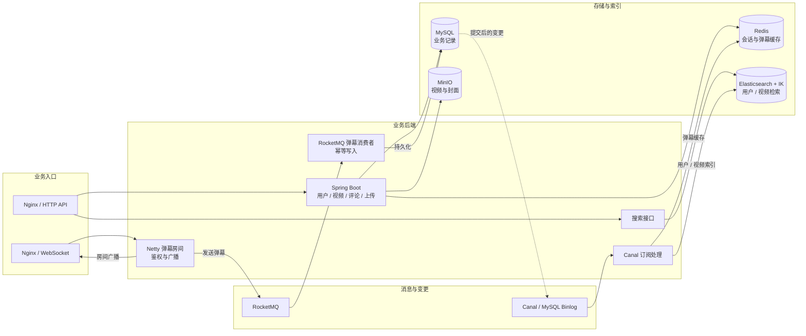
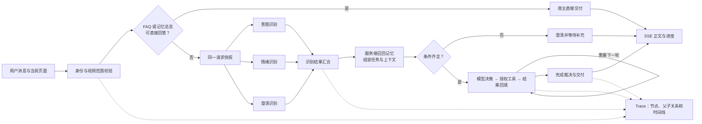
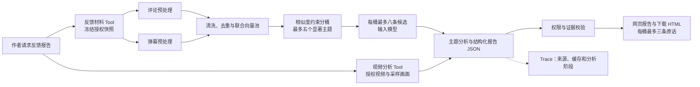
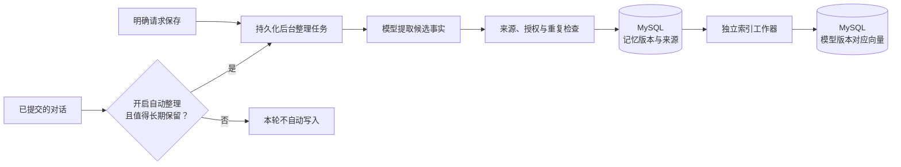
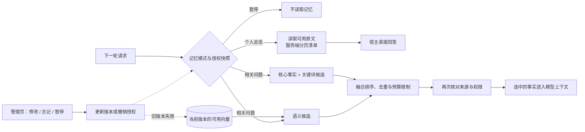

<div align="center">

# EchoFrame

**开源视频社区 · 个人助手 · 可追溯的创作者工具**

发布视频，与观众互动，让弹幕和评论成为下一次创作的线索。

[](https://github.com/blackirlsama/EchoFrame/actions/workflows/ci.yml)
[](LICENSE)
[](pom.xml)
[](front/package.json)

[产品体验](#产品体验) · [快速开始](#快速开始) · [系统如何工作](#系统如何工作) · [文档导航](#文档导航) · [参与贡献](#参与贡献)

</div>



EchoFrame 将视频发布与观看、弹幕评论和个人助手放在同一个产品里。创作者可以让助手阅读自己视频的观众反馈、结合采样画面生成报告，再把观察转成下一次创作的线索。任务执行过程可在 Trace 中检查。

> 当前是持续开发中的开源项目。下方截图来自已部署的真实网站；本地 Agent Demo 使用模拟身份和数据。完整网站与真实模型需要单独配置依赖和凭据。

## 产品体验

| 场景 | 当前能力 |
| --- | --- |
| 视频社区 | 上传、播放、搜索与分类浏览视频；弹幕、评论、回复和用户互动 |
| 个人助手 | 在视频页讨论内容与指定片段，生成评论或弹幕草稿；创作者可分析自己的观众反馈 |
| 反馈报告 | 评论与弹幕去重后联合向量分桶，选取最多五个显著主题；每桶向模型提供有界候选，报告展示最多三条代表原话及建议 |
| 记忆 | 后台整理适合长期保留的信息；由服务端按权限召回，可在记忆管理页查看、修改、忘记或暂停 |
| 运行追踪 | 查看任务进度，并按 Trace ID 查询已授权的运行，检查节点、模型调用与时间线；也可导入日志离线查看 |

### 视频与助手



登录后可以在视频页提问。创作者在自己的视频上可以尝试：

```text
分析这个视频的弹幕和评论，结合画面生成观众反馈报告。
概括这个视频的画面内容，重点描述最后一个片段。
结合当前视频，给我几个下一条视频的选题方向。
生成几条引导观众讨论的作者评论，先给我草稿。
```

报告使用实际入库的互动；视频理解依据采样画面。未配置转写时不包含音频理解。报告主题来自有相似度约束的代表反馈，未归类反馈不会被强行写进主题。发送评论或弹幕前，用户仍需检查并确认草稿。

### 运行追踪



Trace Studio 展示准备阶段、记忆召回、模型与工具调用、后台分析和交付。登录用户可以查询自己有权限查看的 Trace；本地也能打开示例或导入 JSON / JSONL。它帮助定位一次任务为什么慢、用了哪些证据，不能代替报告本身的内容质量评估。

## 快速开始

### 选择运行方式

| 我想体验 | 必要条件 | 入口 |
| --- | --- | --- |
| Agent 执行流程 | JDK 17、Maven 3.6.3+ | [无密钥 Demo](#体验-agent-demo) |
| Trace 日志可视化 | Node.js 22、npm | [Trace Studio](#体验-trace-studio) |
| 完整视频社区 | Java、Node.js、业务库与中间件 | [完整网站接入](docs/QUICKSTART.md#方式三运行完整网站) |
| 真实创作者 Agent | 业务登录与数据、模型凭据、Agent 持久化服务 | [运行模式与依赖](docs/QUICKSTART.md#选择运行方式) |

```bash
git clone --depth 1 https://github.com/blackirlsama/EchoFrame.git
cd EchoFrame
```

模块目录、构建产物与配置键仍沿用 `tianmu`。仓库包含[视频素材](materials/README.md)，首次克隆会一并下载。

### 体验 Agent Demo

无需模型 Key、数据库或中间件。在仓库根目录执行：

```bash
mvn -B -f agent/pom.xml package
java -jar agent/target/operations-agent-0.7.0-SNAPSHOT.jar
```

另开 Bash 终端创建任务：

```bash
curl -s -X POST http://127.0.0.1:8201/api/agent/runs \
  -H 'Authorization: Bearer demo-alice' \
  -H 'Content-Type: application/json' \
  -d '{"message":"查询视频1001昨天的弹幕数"}'
```

将返回的 `runId` 替换到 `RUN_ID`，查询任务结果；若仍在运行，稍后再次查询：

```bash
curl -s -H 'Authorization: Bearer demo-alice' \
  http://127.0.0.1:8201/api/agent/runs/RUN_ID
```

Demo 使用模拟身份、脚本模型和内存存储，用于体验流程，不代表真实模型分析效果。[PowerShell 示例与完整启动说明 →](docs/QUICKSTART.md#方式一体验-agent-demo)

### 体验 Trace Studio

从仓库根目录执行：

```bash
cd front
npm ci
npm run serve
```

打开开发服务器的 `/trace` 页面，通常为 `http://localhost:8080/trace`。内置演示日志，也支持导入 JSON / JSONL 文件，在浏览器本地解析，无需后端。

本地可直接使用演示日志或导入文件；接入网站并登录后，还可按 Trace ID 在线查询本人有权查看的运行。[前端开发说明 →](front/README.md)

### 接入真实业务与模型

完整网站需要 MySQL、Redis、MinIO、Elasticsearch（IK）、RocketMQ 与 Canal；真实 Agent 还需要模型凭据，持久化模式使用 Agent 专用 MySQL、Redis 和私有对象存储。画面理解另需 FFmpeg / ffprobe 与视觉模型，转写单独配置。

按[运行与接入指南](docs/QUICKSTART.md#方式三运行完整网站)准备依赖、配置登录与模型，再启动业务后端、Agent 和前端。模型调用可能产生费用。现有[网站容器部署](deploy/site/README.md)依赖既有共享网络与服务，不是空环境的一键启动脚本。

## 系统如何工作

### 业务后端与弹幕链路

第一张图只画视频业务后端。Spring Boot 业务服务处理用户、视频、评论、上传与搜索；Netty 负责弹幕长连接，RocketMQ 承接持久写入。MySQL 是业务记录的权威来源，Redis、Elasticsearch 和 MinIO 分别承担缓存、搜索索引与媒体对象存储。



弹幕发送走 **WebSocket → Netty → RocketMQ → 消费者 → MySQL**；Netty 同时向房间广播。MySQL 提交后的变更由 Canal 同步到缓存或搜索索引。业务后端的边界和其他数据流见[架构说明](docs/ARCHITECTURE.md)。独立 Agent 如何使用业务接口，见下面的请求与报告图。

### 一次请求如何执行



FAQ 命中或纯记忆总览可由宿主直接回答；其他请求的三路识别共享同一输入，汇合后才固定任务范围。模型与工具循环受轮次、时限、权限和预算控制。Trace 记录真实执行，节点并非额外模型步骤。

### 观众反馈如何变成报告



评论与弹幕的来源准备可以重叠；视频 Tool 与材料 Tool 在当前原生调用批次中可能顺序执行，图中两路箭头只表示生成报告需要两类证据。未满足相似度要求的反馈留在桶外；全量文本只用于程序统计和向量处理，不送入报告模型。数据稀少时按实际数量生成，不凑满五桶。

### 记忆如何写入与召回

写入和读取是两条独立链路。对话提交后，只有开启自动整理且内容合格，才会入后台整理队列；用户明确说“请记住”也可进入保存流程。后台提取候选事实后，再核对来源、权限和重复项，写入带版本的 MySQL 记忆。索引工作器扫描已提交版本生成向量；向量是可重建的检索索引。



下一轮请求由 Agent 宿主先读取授权快照。问“你了解我吗”一类个人总览时，宿主直接分页列出可读原文；普通问题则合并核心事实、关键词与语义候选，按相关性和上下文预算选择，再交给模型回答。两条路径都重新检查来源和当前权限。



“只使用”模式允许读取已有记忆，但不自动新增。管理页修改、忘记或暂停后，旧版本与对应向量不能继续作为可读事实。模型不持有搜索、保存或删除记忆的 Tool。

更细的边界、失败与恢复规则见[架构说明](docs/ARCHITECTURE.md)、[报告实现](agent/docs/代表材料三工具实施与验收.md)和[记忆方案](agent/docs/记忆召回重构技术方案.md)。

## 开发与测试

在仓库根目录验证业务后端与 Agent：

```bash
mvn -B verify
mvn -B -f agent/pom.xml verify
```

验证前端：

```bash
cd front
npm ci
npm run test:agent
npm run build
```

[GitHub Actions](https://github.com/blackirlsama/EchoFrame/actions/workflows/ci.yml) 覆盖前端、业务后端、Agent、发布规范与隔离数据库集成测试，不调用付费模型。配置与验证要求见[贡献指南](CONTRIBUTING.md)。

## 文档导航

| 文档 | 内容 |
| --- | --- |
| [运行与接入](docs/QUICKSTART.md) | 运行方式、Bash / PowerShell 示例、真实模型与完整网站接入 |
| [架构说明](docs/ARCHITECTURE.md) | 业务链路、任务准备、Harness 与反馈处理边界 |
| [前端开发](front/README.md) | 页面、Trace Studio、代理与构建 |
| [Agent 开发](agent/README.md) | 模型、工具、存储与配置 |
| [Agent 治理与文档索引](agent/docs/README.md) | 当前架构、配置目录、开发维护、验收与独立审查 |
| [网站部署](deploy/site/README.md) / [独立 Agent 部署](deploy/README.md) | 容器与环境配置 |
| [部署参考](docs/DEPLOYMENT.md) | 环境与集成测试 |
| [项目路线图](docs/ROADMAP.md) | 开发方向与待完善能力 |

源码入口：[业务后端](src/) · [前端](front/) · [Agent](agent/) · [脚本](scripts/)。

## 参与贡献

欢迎通过 [Issue](https://github.com/blackirlsama/EchoFrame/issues) 反馈问题和使用场景，或提交 [Pull Request](https://github.com/blackirlsama/EchoFrame/pulls) 改进体验、测试与文档。

从最新 `master` 创建分支，按 [CONTRIBUTING.md](CONTRIBUTING.md) 完成修改与验证。安全问题请按 [SECURITY.md](SECURITY.md) 反馈。感谢所有[贡献者](https://github.com/blackirlsama/EchoFrame/graphs/contributors)。

## 许可证与素材

项目代码采用 [MIT License](LICENSE)。第三方组件、视频素材、首页插画与图标保留各自权利，不随项目代码重新授权；详见 [NOTICE](NOTICE)、[第三方说明](docs/THIRD_PARTY.md) 与[素材来源](front/src/assets/img/home/README.md)。
