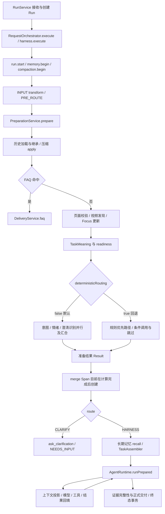
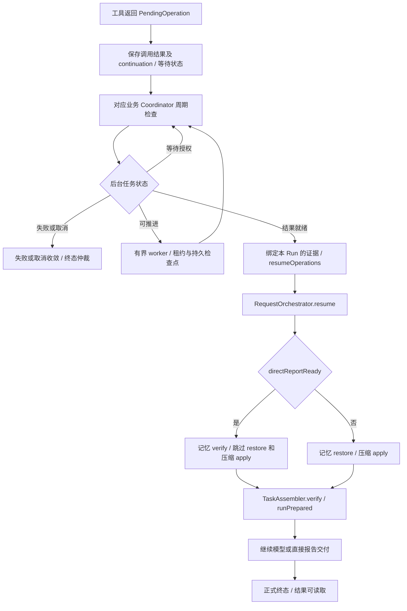
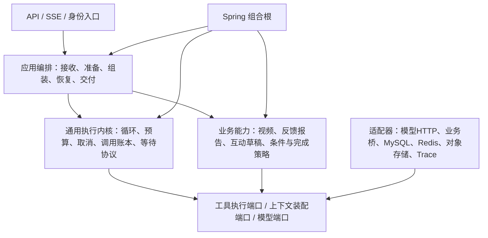

# EchoFrame / DokiTV Agent 架构与工程治理技术设计

日期：2026-11-07。版本：设计基线 v2，独立复审通过，用户已确认开始分批实施。范围：`agent`，以及与业务后端、前端的契约。本文是本次治理的统一入口；目标设计不表示已全部实现，也不是发布验收证明。研究证据见 [DSH 与 Claude 调研](DSH与Claude架构治理调研.md)，重构前配置证据见附录，实际落地状态见第16节。第15节给出恢复、预算、策略快照、完成协议等可执行细则；原始审查记录保留，不将作者修订等同于审查通过。

## 1. 目标、边界与证据标准

目标是建立职责清楚、状态可恢复、配置可解释、扩展可约束、文档可持续维护的 Java/Spring Agent。评判解耦的标准是：新增业务能力时不修改通用循环；业务决定具有唯一负责人；上下文只能投影权威事实；恢复执行维持权限、幂等和终态约束；开发者能够从一个入口找到当前规范和验收依据。

研究、审计和设计阶段已完成独立复审，用户已授权按计划分批实施，并于本轮明确授权部署、中文提交推送和真实测试；实际发布结果见[发布与真实Trace验收](治理发布与真实Trace验收.md)。保持 Java/Spring、MySQL、Redis、既有对象存储，不引入新的 Agent 框架、插件运行时或全量事件溯源存储。现有上传与对象存储工作区改动不属于本次范围。

事实分四层：①源码可确认的行为；②测试已验证的行为；③真实模型场景验收；④线上版本实际生效。任何一层都不能替代下一层。本文源码链接相对 `agent/docs`；基线为 `5cd3cc84a4fe4e02e97ee0870b3747241637d554`。运行环境有效值未重新采集，附录数值是仓库声明与覆盖关系，不冒充生产有效值。

交接记录显示线上为 `d02db575b045fed7c1d80c5e909d71873d549bbd`，发布目录 `/opt/tianmu-site/releases/20261107-d02db57-memory`；这是设计阶段交接基线；后续本轮已授权连接服务器、部署并真实验证，当前版本以[发布记录](治理发布与真实Trace验收.md)为准。此前较新版本遇上游故障曾回滚，不将该历史状态当作当前发布结果。此前测试通过情况是交接证据，本轮未重跑，也不等于全部真实模型场景通过。

## 2. 外部架构研究与采用判断

| 来源与固定版本 | 已检查内容 | 可借鉴的边界 | 局限与不采用内容 |
|---|---|---|---|
| [DeepSeek Harness](https://github.com/deepseek-ai/deepseek-harness/tree/fcc0ad462172522aaf5c93a7b2e01f6b9f0b0159) `fcc0ad4` | 默认循环、dispatch、Session/header、提示词装配、settings、压缩配置 | 步骤边界固定模型与工具；通知/裁决/包装语义分离；事实与模型视图分离；模块声明配置及校验 | 不移植 Cordis；不复制 JSONL 存储；不把所有业务步骤改为插件 |
| [Claude Python SDK](https://github.com/anthropics/claude-agent-sdk-python/tree/2209f2c134fee914c0f75733b631a5fc238ca846) `2209f2c` | CLI 参数映射、控制请求与应答、权限和 Hook 回调、取消处理 | 数据流与控制流分开；请求标识配对；会话、预算、Hook 契约明确 | SDK 是 CLI 桥接，不等于公开完整核心循环；部分回调 signal 仍为 None |
| [learn-claude-code](https://github.com/shareAI-lab/learn-claude-code/tree/7226f555d48900076eba126acf37c9ed5f002b5d) `7226f55` | s02 工具、s05 Skill、s06 压缩、s07 持久任务、s08 后台执行 | 注册能力而非修改循环；Skill 元数据与正文分层；任务状态独立于对话压缩；后台完成与上下文注入分离 | 教学实现：大量硬编码、粗略 Token 估计、内存通知、文件写入缺少事务；不能作为生产恢复证明 |
| [claude-code-reverse](https://github.com/Yuyz0112/claude-code-reverse/tree/c0d99ea1ab7168c12ba74838cfea355ce10f6c56) `c0d99ea` | 仓库定位、日志和提示词目录 | 可作为行为观察线索 | 非完整核心实现；本轮未逐文件审计 |
| `dnakov/claude-code` | GitHub 及 API 返回 451 | 无实现结论 | 未读取，不借其他仓库名冒充已研究 |

Claude 官方契约作为交叉核对：[循环](https://code.claude.com/docs/en/agent-sdk/agent-loop)、[权限](https://code.claude.com/docs/en/agent-sdk/permissions)、[Hooks](https://code.claude.com/docs/en/hooks)、[Sessions](https://code.claude.com/docs/en/agent-sdk/sessions)、[配置](https://code.claude.com/docs/en/settings)。网页文档是本次读取时的公开契约，没有固定到 SDK 提交对应版本。

关键判断：

1. DSH 循环的错误路径会收敛流式尝试、补工具结果并释放步骤工具集合。本站解耦必须保存这些执行不变量，不能只复制顺利调用图。
2. Claude 同一事件 Hook 可能并行，不能用于隐含先后依赖的业务流水线。强制权限也不能仅放进可能被提前批准路径跳过的可选回调。
3. learn-claude-code 的 s07 把任务保存到对话之外，说明业务进度应独立于压缩；但逐文件保存不提供本站需要的事务、租约和重放保证。
4. s05 的分层 Skill 加载适合控制上下文成本；Skill 文本不承担授权职责。s06 的工具结果裁剪和摘要是不同机制；其原地修改消息方式不适合作为本站权威历史模型。
5. 配置平台应统一发现、校验、解释和脱敏；配置语义归模块所有。外部项目里的默认阈值不直接成为本站默认值。

## 3. 重构前实际流程与耦合证据（5cd3cc8基线）

### 3.1 首次请求

下图从已创建 Run、身份与作用域已取得的应用执行入口开始；API、幂等接收和存储实现见 `RunService` 与运行存储接口。具体方法应随迁移批次补充执行 Trace，图中路径不是重新运行得到的验收结果。



主证据：[RequestOrchestrator](../src/main/java/com/tianmu/agent/runtime/RequestOrchestrator.java)、[PreparationService](../src/main/java/com/tianmu/agent/preparation/PreparationService.java)、[TaskAssembler](../src/main/java/com/tianmu/agent/application/TaskAssembler.java)、[AgentRuntime](../src/main/java/com/tianmu/agent/runtime/AgentRuntime.java)。上图压缩和记忆步骤受条件 Bean 开关影响，默认关闭时不会执行相应服务。

### 3.2 后台等待与恢复



证据：[FeedbackPreparationCoordinator](../src/main/java/com/tianmu/agent/application/FeedbackPreparationCoordinator.java)、[FeedbackOperationCoordinator](../src/main/java/com/tianmu/agent/application/FeedbackOperationCoordinator.java)、[RequestOrchestrator.resume](../src/main/java/com/tianmu/agent/runtime/RequestOrchestrator.java)。这是进程内 continuation 路径。启动时 MysqlRunRepository 将 RUNNING 标为 FAILED/RUNNER_LOST，仅接管 QUEUED/WAITING_OPERATION；结果绑定提交会先清空 continuation 并转 RUNNING，再提交恢复执行，因此两者之间崩溃也会 RUNNER_LOST。首轮重构保留这一行为，不承诺任意步骤续跑；完整状态与崩溃窗口见15.1。

### 3.3 已确认问题及保留机制

| 位置 | 当前事实 | 风险 / 设计方向 |
|---|---|---|
| PreparationService | 同时处理历史、压缩、页面、发现、Focus、三路识别、规则与准备结果 | 多个原因促使同一类修改；按应用阶段与业务策略分责 |
| deterministicRouting | 两条准备路径长期并存 | 契约、错误与 Trace 容易分歧；先统一结果契约，再决定回退路径寿命 |
| AgentRuntime / ExecutionState | 识别 `create_feedback_report`，报告就绪直接交付；识别评论/弹幕工具组合 | 通用循环依赖业务名称和业务成功语义；改由业务结果处理器贡献结构化完成结果 |
| TaskAssembler | 知道反馈任务并延长执行窗口；对完整资源目录取指纹并要求恢复完全相同 | 组装与业务预算耦合；无关资源变更也影响恢复。先保留严格兼容行为，后续单独评估按依赖资源版本校验 |
| AnalysisExecutionPolicy | 报告轮数为 `max(configured,min(32,modelCalls-1))` | 默认 6 轮并非报告有效上限，16 次预算时可达 15 轮；抽出命名策略并暴露有效值 |
| HarnessContextBuilder | 固定近期 4 条/8192 字节，并拼业务语气与目标提示 | 配置最大历史 16384 仍受隐藏上限约束；装配入口与业务贡献分离 |
| RunState / MemoryTypes.View | 生命周期、模型、预算、任务、执行、记忆视图及回调混合 | 可写范围过大；按所有权拆分，保留协调外观逐批迁移 |
| HookDispatcher | 已有 GATE/OBSERVER；观察者同步执行，隔离异常 | 不是没有中间件设计；需补时间隔离、取消与投递契约 |
| TransformDispatcher | 已有变换类型和不变量校验，存在多层固定字节上限 | 保留校验，明确每层上限和失败语义 |
| Trace merge | 在准备已完成后包一层返回结果 | 节点耗时无法解释真实汇合；将 Span 包住实际合并计算 |
| DeepSeekClient | 保留 HTTP 状态，多类错误对外汇总 MODEL_UNAVAILABLE | 分类不足影响重试和排障；新增细分类别并保留外部兼容映射 |

必须保留：实时权限复核；用户确认条件与来源；终态持久化/仲裁；原生工具调用与结果配对；有界并行；记忆来源、撤销和来源失效检查；已确认固定上下文槽位。不同信任边界重复安全校验是纵深约束，不以减少重复为理由删除。

## 4. 目标职责与决策优先级

### 4.1 决策所有者

下列名称为职责名，实施时优先复用已有类，不要求每行新建接口。

| 决策 | 唯一所有者 | 输入 / 输出 | 禁止覆盖的内容 |
|---|---|---|---|
| 意图与能力目标识别 | SemanticPreparation | 同一输入快照、候选目录 → 主/关联目标和理由 | 权限、资源范围、已确认条件 |
| 情绪 | SemanticPreparation 的情绪分支 | 用户表达 → 语气提示/UNKNOWN | 任务目标、事实、准入 |
| 是否需要澄清 | ReadinessPolicy 汇合业务必填校验与语义歧义 | 缺失/冲突项 → 可执行或结构化澄清 | 不把超时、上游错误当用户歧义 |
| Query 改写 | QueryProjection，由宿主校验 | 原文与已确认事实 → 派生执行表达、改写理由 | 原文、视频/时间/来源/操作权限；不得补造用户确认 |
| 规则解析 | 所属业务 ConditionsPolicy | 原文、日期锚点、已确认上下文 → 条件与字段来源 | 用户显式指定与确认 |
| 默认补齐 | 所属业务 DefaultPolicy | 缺失且可默认字段 → 默认值、策略版本 | 显式值、真实歧义和不可默认字段 |
| Skill 候选与激活 | CapabilityCatalog / SkillRegistry | 注册元数据、准入过滤 / 模型选择 → 候选、已激活集合 | 激活不授予新权限，不扩大任务范围 |
| 下一行动 | 通用循环中的模型决策 | 允许的工具与上下文 → 调用/回答提案 | 硬限制、业务完整性和实时授权 |
| 执行准入 | ToolAdmission + 实时业务授权端口 | 调用、任务范围、实时资源 → 允许/拒绝及原因 | 不允许模型、缓存或旧授权快照绕过 |
| 业务完成与交付 | 业务 CompletionPolicy / DeliveryService | 已提交结果、证据覆盖 → 结构化交付 | 模型“完成了”声明不作为完成事实 |

### 4.2 冲突规则

权限裁决、业务条件裁决和语义提案属于不同维度，先分别验证，不使用一个统一置信分数互相覆盖。权限或资源失效直接阻止执行；已确认条件保持稳定，用户明确修改需创建有来源的新修订或新承接 Run。显式条件与默认值冲突时显式条件优先；两个显式条件互相冲突时澄清。页面、Focus 和历史只能提供带来源候选；来源选择没有可靠优先关系时澄清。改写只能改变表达；校验不通过回到原文或明确失败，不能通过静默缩小任务来“成功”。

每个字段保存 `value / sourceKind / sourceRef / policyVersion / confirmed`；每个裁决保存 `decision / reasonCode / inputsRevision / policyRevision`。Trace 只记录可公开的依据摘要，不记录模型隐藏思维。

## 5. 目标架构与依赖边界



依赖箭头表达源码依赖意图；具体端口只在存在实现替换、跨边界调用或需要约束时建立。通用内核依赖稳定协议，不导入 feedback、video、具体业务 tool 实现或 Spring Controller。业务能力可以使用通用协议；基础设施实现端口，由 Spring 装配。业务完整性校验仍位于业务层；内核不能把任意工具结果当作正式成功。

目标应用阶段：恢复会话事实 → 校验页面与资源上下文 → 快捷回答查询 → 语义识别与业务条件汇合 → 澄清或生成 PreparedRequest → 召回 → PreparedTask 与执行策略 → 通用循环 → 业务完成校验 → 正式交付。此顺序是目标建议；相对当前 FAQ/页面校验的顺序变化需验证权限与快捷回答行为，不能在“移动代码”中悄悄改变。

目标协议：工具结果统一表达 `Completed / Pending / Failed`；Completed 仅表示调用结束。业务决策以整个已结算批次及只读 Run 事实为输入，唯一任务所有者输出 `Continue / AwaitOperation / Clarify / Deliver / Reject`。纯评估不持有终态 reservation、不写状态；交付服务才做复核、reservation与持久提交。具体时机、选择和四场景演算见15.4，包含 PendingOperation kind 与 ReportTaskStateView 的迁移。已有证据校验在正式交付前继续执行。

预算在 TaskAssembler 之前由执行策略解析完成；TaskAssembler 只验证并固定输入和版本。策略产物需说明请求截止时间、前置/循环/后台预算分别计量的关系，保留当前有效数值与例外，不借重构顺带调参。

## 6. 状态所有权、读写与恢复矩阵

“持久”表示目标权威位置；当前 memory 模式明确只用于开发。数据库与对象表名在实施前对照现有 schema 复用，避免本设计凭空承诺新表。

| 状态 | 权威来源与唯一写者 | 读取者 | 持久化及恢复规则 |
|---|---|---|---|
| 原始消息 | 请求接收/ConversationStore，接收后不可改 | 准备、历史、审计 | 保存原文、主体、会话序号；恢复读取原文，不用改写覆盖 |
| 派生 Query | Preparation 产物写者 | 条件校验、任务与模型投影 | 随准备结果保存原文引用、转换版本和校验结果；恢复不重新自由改写 |
| PreparedRequest | 准备协调器一次提交 | TaskAssembler、上下文 | 包含目标、条件来源、情绪和降级；需按记录版本恢复 |
| PreparedTask | 任务组装器一次提交 | 内核、工具准入、恢复 | 固定用户目标、业务条件、资源/模型版本、预算基线；权限仍实时复核 |
| Focus | 会话应用服务按turn_seq单调更新 | 准备、上下文 | 带sourceRun；保留现有轮次upsert，真正CAS变更需另列数据迁移；Run内视图不能反向写事实 |
| 生命周期与终态 | Run 生命周期服务/既有终态仲裁 | API、恢复、调度 | 持久状态先于正式可见成功；终态唯一；提交故障重试仍走同一仲裁 |
| 调用/结果/证据 | 执行账本与证据服务 | 模型投影、业务完整性 | 调用 ID、分组、结果及提交状态配对；未提交结果不作为事实 |
| PendingOperation/continuation | Operation 服务与业务 worker 分权写入 | Coordinator、恢复器 | 持久操作标识、代次、租约与关联调用；旧代次晚到结果不可提交 |
| 模型选择与有效配置 | 请求策略解析器 | 每次调用、恢复、Trace | 保存版本与可恢复引用；版本不可用明确失败，不静默换模型 |
| 长期记忆 | MemoryLedger/PersonalMemoryStore | 召回、管理工具、装配 | 保存来源与版本；读取/交付边界检查撤销；不可仅恢复缓存文本 |
| 压缩摘要 | Compaction 服务 | 历史投影/装配 | 保存来源范围、摘要版本和来源有效性；不替代原始消息记录 |
| 上下文视图 | 单一装配入口派生 | 模型适配器 | 默认可重建；若保存，仅作诊断快照；不能作为授权或任务权威 |
| Trace/SSE | 观察适配器/事件投递器 | 排障、前端 | Trace 为观测投影；SSE 游标支持重放；均不自行裁决业务完成 |

RunState 初期保留兼容外观，逐步委托给生命周期、执行账本、上下文输入和策略快照；先收窄写方法，再拆字段。恢复必须从权威记录重建，不能反序列化一个混合对象就认定状态完整。

目标恢复顺序：校验主体与实时资源 → 校验 Run/operation 代次与租约 → 恢复准备结果和任务 → 恢复模型/配置与资源版本 → 对齐调用和结果 → 重新验证来源/记忆 → 按任务声明且读取器支持的投影协议装配 → 继续执行或交付。适用范围受15.1启动恢复表约束。任何重试先核对已提交事实。外部副作用的至多一次效果依赖业务幂等键及服务端确认，单靠本地“已开始”标记无法保证。

## 7. 中间件与执行契约

| 类型 | 输入输出与写权限 | 顺序/并行 | 超时、失败与恢复 |
|---|---|---|---|
| 强制策略 Gate | 只读操作视图 → 允许/拒绝与原因；不改业务条件 | 显式排序，安全裁决拒绝优先；按边界执行 | 超时/故障不放行；不自动重试有副作用逻辑；恢复重新做实时校验 |
| 纯变换 Transform | 不可变输入 → 同类型新值；只改白名单字段 | 有先后依赖则串行；保留确定顺序与不变量 | 类型/范围错误拒绝；可选变换仅在明确契约下回退原值；记录版本 |
| 观察者 Observer | 已发生事件 → 无业务返回值；无状态裁决权 | 独立事件可有界异步，顺序需求单独声明 | 故障隔离、队列和时限有界；普通观测可丢弃并计数；法定/业务必需审计应走持久事务机制 |
| 包裹执行 Around | 调用上下文与 next → 调用结果；不得扩大权限 | 顺序嵌套；每次最多调用 next 一次 | 取消向下传递；重试必须由拥有幂等/预算语义的执行器负责，禁止多层独立重试 |

注册时验证唯一 ID、支持的阶段、模式和依赖。禁止运行时隐式拓扑猜测；没有必要先实现通用依赖图框架。Hook 与业务阶段共享取消/截止时间，但各自有预算。观察者开始异步后必须处理关闭排空、拒绝计数和 Trace 上下文传递。

现有 TransformInvariants 与 Gate 边界继续使用；新契约通过适配层迁移。不能将准备、召回、压缩、任务组装都改成任意可插拔 Hook。

## 8. 上下文、记忆与压缩

保留 `ContextEnvelope` 已有固定槽位及原生工具配对。实施前从枚举生成清单，禁止手写另一个不一致槽位列表。现有 SYSTEM_PROMPT、TOOL_CATALOG、SKILL_CATALOG、EXECUTION_CONTEXT、FOCUS、MEMORY_CONTEXT、ENVIRONMENT_CONTEXT、RUNTIME_STATE、OUTPUT_CONTRACT、CURRENT_CONTEXT 等槽位的顺序和角色投影以当前协议为基线。

职责划分：历史恢复只加载会话事实；长期召回只选取当前有效记忆并携带来源；自动写入独立后台作业，不因生成文字就获得记忆授权；压缩只生成历史摘要与替换投影；工具结果投影只做确定性裁剪与可回读引用；装配入口统一决定槽位顺序、必需项、预算和信任边界；模型适配器只做提供方 wire-format 映射。

首次与恢复共用 `ContextInputs → Envelope → ProviderRequest`，允许输入来源不同，不能有两套槽位装配规则。报告直接交付可以省略模型装配，但交付证据、来源、实时权限和终态校验必须相同。

预算同时控制请求字节与提供方 Token：必需系统提示+工具 Schema+当前请求+配对记录+输出预留必须先计入，再分配历史、召回和摘要。可选历史按完整回合裁剪，不能拆开调用/结果组。装不下必需内容时明确失败；不能删权限或用户确认条件来腾空间。

压缩配置分为触发、保留、目标、输出预留、压缩调用预算和溢出重试。先保持当前 5632 字节触发的行为，记录与 8192 字节近期上限及 98304 字节整请求上限的关系；后续按模型容量调整需独立评测。字节不是 Token，不能直接用统一比例宣称精确。摘要来源失效必须失效或重建；缓存命中不绕过来源撤销。

## 9. 配置治理

### 9.1 配置分类、覆盖与生效

可因部署/容量/模型差异调整的预算、时限、频率、容量、窗口和策略阈值进入模块强类型配置。协议版本、安全不变量、合法状态枚举保留为代码约束。业务默认规则与提示词版本作为受审查资源管理，避免变成可任意修改的环境变量。

目前配置同时分布于 YAML、`@ConfigurationProperties`、`@Value`、构造默认值和硬编码。Spring 常见覆盖链可概括为构造默认 < 基础 YAML < 激活 profile/外部配置 < 环境变量/启动参数，但确切顺序受启动配置源影响；环境占位符是取值表达式，不是独立万能优先级。上线时必须从实际 Spring Environment 输出来源与有效值，而非仅检查 `.env` 文本。Java 直接运行不会自动读取 `.env`。

目标每项提供：完整键、类型、单位、默认、当前声明值、覆盖来源、合法范围/交叉校验、拥有模块、生效边界、敏感级别、旧键兼容期。部署类配置启动生效；预算与模型选择按 Run 或调用边界形成快照；缓存/清理等可动态参数在声明边界生效；账号停用、授权撤销与资源删除实时复核。动态更新先验证再原子发布，非法更新保留旧实例并明确报错。所有参数首批维持原有效值。

### 9.2 重点配置清单（仓库声明值）

表中“启动”指当前普通绑定，未证明支持热更新。候选键为设计名，不表示已可用。附录保留完整配置声明及校验代码，弥补此处汇总的字段分组。

| 模块 / 键或候选 | 当前值及单位 | 来源、覆盖与现有约束 | 目标生效边界 |
|---|---|---|---|
| harness.loop.max-turns | 6 轮；报告派生可为 15 | YAML/LoopPolicy 1..100；报告规则上限 32，受调用数影响 | Run 策略快照，记录 configured/effective/reason |
| harness.loop.max-model-calls | 16 次共享前台上限 | AGENT_MAX_MODEL_CALLS；1..500；准备+loop+工具内外部调用共享，反馈后台独立，见15.2 | 账本累计，恢复不重置 |
| harness.loop.max-tokens / token-reservation | 64000 / 8192 Token | AGENT_MAX_TOKENS/AGENT_TOKEN_RESERVATION；0 表示关闭总 Token 上限 | Run 快照，调用先预留后结算 |
| request/model/tool/finalize-timeout | 30s/5s/5s/3s；deepseek 为 120s/30s/5s/15s | profile 覆盖；LoopPolicy 1ms..10min | 分别计时，恢复使用持久截止时间 |
| consecutive-tool-failures / finalize-enabled | 3 / true | LoopPolicy；失败数 1..10 | Run 策略 |
| agent.preparation.* | FAQ 300ms；三识别各8s；rule-only false；emotion true | 同一 AGENT_PREPARATION_TIMEOUT 覆盖三识别；1ms..30s | Run 前置策略；FAQ/情绪降级规则独立 |
| agent.execution.* | runs 2/4/32；preparation 6/6/48；model 2/4/16；tools 2/4/16；video 2/4/8；sse 4/4/128；termination 2/4/32 | core/max/queue；core≥1,max≥core,max≤128,queue 1..4096 | 启动；禁止在线缩容破坏在途任务 |
| agent.tools.parallel.* | enabled false；per-run 2 | @Value + YAML | 启动；并发变化与调用分组约束兼容 |
| agent.models.* | 三类模型均 deepseek-flash；连接3s；前置384/循环3072 输出Token | profile/env；连接≤30s；输出限制分别64..2048、128..8192 | 请求选择/调用快照；秘密仅引用 |
| agent.models.catalog | 未配置；目录≤32项/64KiB | RuntimeModelCatalog；版本选择、文件原子更新 | 已有目录刷新语义保留；旧版本恢复失败明确 |
| agent.context.* | max-input 98304B；max-history 16384B | 环境覆盖；整请求1024..4194304B，历史≤整请求 | Run/调用策略；同装配入口 |
| context.recent-* 候选 | 实际硬编码4条、8192B | HarnessContextBuilder 取 min(8192,maxHistoryBytes) | 抽出后保持值，完整回合裁剪 |
| agent.compaction.* | enabled false；trigger-bytes 5632B | AGENT_COMPACTION_ENABLED/TRIGGER_BYTES；@Value | 启动开关；每次压缩记录策略 |
| compaction retain/target/reserve/retries 候选 | 尚未形成统一配置；不得借填默认虚构已实现 | CompactionService 与模型预算逐项迁移 | 设计确认后先映射既有行为 |
| agent.memory.* | enabled false；consolidation.enabled false | 条件 Bean；无需以代码存在推断功能已开放 | 启动开关；授权和撤销始终实时 |
| memory.guard-interval 候选 | 100000000ns =100ms | MemoryRecallService；交付另有强制 barrier | 可配置节流不能取消关键边界强制复核 |
| agent.feedback.* | 5000条/64MiB；24000B/批、80组/批；2000调用/16000000 Token；总1h/模型30s；读并行1 | FeedbackPolicy；条数≤100000；总时限1min..6h；读并行1..4 | 后台任务快照；与前台循环预算明确分账 |
| agent.feedback.reuse.* | true / 10min / 1024项 | YAML + FeedbackReusePolicy，环境覆盖 | 仅复用有效同范围结果；权限实时 |
| feedback source worker 候选 | 2线程/队列4/keepalive30s；轮询500ms | FeedbackPreparationCoordinator 内嵌 | 启动容量/调度；拒绝继续等待，不丢状态 |
| agent.video.cache.* | memory-ttl1h；retention0s；1024项 | YAML/VideoCachePolicy；0含义以现实现为准 | 启动/后续声明缓存边界 |
| 视频索引预算与调度 | 源码确认2 worker/16队列、单用户2；30min/120调用/250000 Token；120s切片；10s心跳/120s失联 | VideoIndexService，细项见15.5 | 索引任务快照/租约 |
| agent.qa.* | true；5独立会话/0.9占比；30天窗口/7天有效/256观察 | YAML/QaPolicy；至少一次安全准入复核 | 启动；已有缓存按策略版本隔离 |
| embedding / milvus | 均false；embedding维度1024；Milvus维度0、timeout5s | YAML + 对应配置适配器；秘密文件引用 | 启动；启用时维度与模型/集合交叉校验 |
| harness.trace.* | file；10000文件/64MiB待发；65536B记录；5MiB归档×3；详情131072B/Run8MiB | TraceProperties/TraceDetails，目录与 sink 环境覆盖 | 启动；脱敏规则更新需定义版本 |
| Transform payload 候选 | 中间1MiB；最终CONTEXT256KiB/其他64KiB | TransformDispatcher 硬编码 | 模块配置，不能低于必要协议负载 |
| storage/business/HTTP | 连接、池、对象、Redis和业务桥声明见附录 | 分散配置；凭据不纳入明文有效值输出 | 启动；连接/排队/读取超时各自命名 |
| lease/retry/cleanup/memory-window 候选 | 尚有散落常量，见附录扫描 | 在实施配置批次逐条分配所有者、单位和校验 | 持久 lease 不因重启重新计时；重试单一所有者 |

未核对值明确标为候选或待核对；这是设计评审文档，不把扫描命中都宣称成可用配置。实施前配置清单必须完成逐项消费点映射，所有候选结案后才能通过该批验收。

### 9.3 必须验证的跨参数关系

线程池 core≤max、队列有界；每 Run 并行≤全局可承受并发；模型/工具有效超时取自身配置与剩余总时限的较小值。排队时间计入总截止时间，其独立上限不能延长总期限。租约续期频率和失联阈值保证有足够裕量，并以持久时间/版本判定。保留预算小于压缩触发预算，触发预算与输出/压缩余量不超过模型容量。详情单项≤Run总额，缓存保留规则不延长授权或来源有效期。

配置不是越多越好：协议安全上限保持受控，不开放关闭权限/幂等/配对的开关；同义参数去重并给旧键兼容映射。运行有效值解释应显示 configured/effective/source/profile/revision/derivedReason，隐藏 key、password、token 与凭据路径敏感细节。

## 10. 错误、取消、重试与 Trace

| 错误类别 | 行为 | 重试策略 |
|---|---|---|
| 参数/模型输出格式 | 明确字段或协议错误；不交付半截成功 | 用户输入不自动重试；模型修正调用计预算 |
| 权限/资源失效 | 阻止执行/交付；取消关联在途操作或丢弃晚到结果 | 不按瞬时故障重试放行 |
| 限流/排队拒绝 | 明确容量不足与 Retry-After（若有） | 有界退避，仍计入总时限 |
| 排队/模型/工具/总超时 | 保留具体阶段、是否已提交副作用 | 仅可幂等阶段按预算重试 |
| 上游503/网络中断 | 内部保留状态、阶段、提供方错误类别 | 区分可重试与不可重试；不能解释成用户歧义 |
| 存储/终态提交故障 | 正式成功不可提前可见；继续仲裁恢复 | 复用既有终态提交策略 |
| 用户取消/进程关闭 | 停止新调用，传递取消，收敛在途结果与配对 | 用户取消不自动重开任务 |

Trace 节点围绕真实执行创建：history.load、page.validate、semantic.intent/emotion/clarification、conditions.resolve、preparation.merge、memory.recall、task.assemble、context.assemble、model.call、tool.admit/execute、operation.wait/resume、delivery.validate/commit。命名须兼容既有查询与 schema，不一次性改断消费端。

每次决定记录原因码、输入/策略版本、有效配置摘要、预算预留/消耗、重试序号、Run/operation/call 关联标识。记录跳过与降级原因；等待时长与实际执行时长分开。原始消息、密钥和私有工具结果按脱敏策略处理，详情截断也保留完整性标识。Trace 失败不得伪造业务成功或直接成为业务权威状态。

## 11. 文档体系与持续治理

目标入口为 README（启动与导航）→ 当前架构与能力状态 → 配置参考 / 扩展指南 / 验收与运维。本文在评审期是唯一治理设计主文档；实施后将“当前事实”和“下一批设计”明确分节，稳定后再按明确链接拆成参考文档，避免复制多份规范正文。

| 文档职责 | 唯一内容 | 更新触发 |
|---|---|---|
| README | 项目入口、启动、导航、重要限制 | 启动与公共入口变化 |
| 当前架构 | 模块依赖、主流程与恢复、状态所有权、能力完成度 | 职责/调用/状态契约变化 |
| 配置参考 | 从声明核对的键、单位、默认、覆盖、生效、校验 | 配置声明或消费语义变化 |
| 扩展指南 | 新增能力、工具、Skill、阶段、Hook、槽位、配置的步骤和验收 | 扩展契约变化 |
| 验收记录 | 提交、环境、模型、配置版本、案例、结果、Trace与缺陷 | 每批验收/发布 |
| 运维手册 | 等待恢复、租约、取消、排障、回滚、数据兼容 | 运行契约变化 |
| ADR/历史归档 | 决定、备选、原因、替代关系；历史方案原貌 | 重要取舍或方案被替代 |

已有文档迁移：`总体架构`、`架构与分工方案`、`架构评审与演进方案`、`架构边界与组件选型`等架构类先逐段标注现状/目标/历史，再选定唯一正文；`请求准备与任务包设计`、`统一入口与并行预处理`并入准备与恢复规范；`动态上下文架构`、`上下文与记忆管理设计`、`多层记忆技术方案`、压缩相关文档统一协议与状态口径；`模型调用预算`、`上下文预算`并入配置与预算参考。`验证记录`、专项验收、JSON结果保留证据，不重写成“全部通过”。数据库 SQL 与 Trace schema 仍为机器消费契约，不能当普通历史文档归档。

每篇有效文档带 owner（模块角色）、状态、适用提交、最近核查时间、被替代链接；归档页顶端明确不再作为现状依据。移动前检查相对链接，不批量删除旧材料。RAG 状态继续标为“未形成完整链路”：分段资产、证据类或索引适配器存在，不等于召回、排序、证据装配和问答验收完成。

建议持续节奏：每次功能 PR 自查职责/状态/配置/文档影响；每两周一次轻量架构与文档巡检；每个里程碑或连续出现同类跨层修改时做专项重构评审。此为治理建议，未创建任何自动任务。巡检输出问题、源码证据、影响、优先级、负责人和验收条件；没有证据时不定期大拆。

触发信号：新增能力必须改循环；同一事实新增第二写者；新增裸时限/预算未登记；恢复旁路出现；单一需求跨多个不相关模块；文档对同一行为相互冲突；相同故障多次无法从 Trace 解释。数字门槛先统计基线，再决定，不凭空规定类行数即质量标准。

## 12. 开发扩展规范

新增业务能力：定义用户目标和适用范围 → 定义结构化条件、默认与澄清 → 注册 Skill/工具/能力元数据 → 在业务模块实现执行、证据与完成策略 → 验证实时权限和幂等 → 补场景和配置文档。验收时确认内核无需新增业务名称判断。

新增工具：Schema、注册元数据和执行器同源；声明同步/后台、副作用、幂等键、时限和结果投影；原生调用 ID 与结果绑定；Pending 带持久 continuation；业务错误不伪装空成功。

新增配置：声明模块所有者与类型/单位 → 提供默认和校验 → 明确覆盖与生效边界 → 保留有效值解释 → 配置目录和非法值测试同步更新。新增 Hook：先判断是否其实是业务阶段；确需扩展才选 Gate/Transform/Observer/Around 并满足第7节契约。新增槽位必须评审信任级别和版本兼容，不能由业务随意新增 wire 消息角色。

## 13. 分批迁移、验收与回滚

| 批次 | 具体产物与范围 | 通过条件 | 回滚边界 |
|---|---|---|---|
| 0 设计与基线 | 本文、研究、配置声明证据、行为/版本状态、文档冲突清单 | 用户对齐职责/状态/配置/迁移；未知项有验证任务 | 文档变更，无运行影响 |
| 1 约束与基线测试 | 关键场景固定输入、真实调用记录、依赖检查、配置消费映射 | 能检测权限旁路、业务耦合、配对破坏；现有行为保持 | 独立测试与检查提交 |
| 2 配置归属 | 迁移裸参数、强类型绑定、有效值说明、旧键兼容 | 默认/profile/env覆盖与非法值通过；有效数值保持 | 兼容旧键；必要时回退代码，数据不变 |
| 3 准备职责 | 拆历史/页面/Focus与语义/条件策略；统一准备结果与真实merge | 两路径差异有明确处置；歧义/默认/改写/故障场景通过 | 每阶段兼容适配，避免永久双流水线 |
| 4 内核与业务 | 报告交付、来源组合、业务预算从循环迁出；收窄RunState写权 | 内核无业务名称分支；报告和普通对话行为一致 | 保持结果/任务版本兼容；按批切回适配层 |
| 5 上下文与恢复 | 统一装配、首次/恢复来源检查、结果投影分责 | 等待/取消/重启/撤销与来源失效故障注入通过 | 保留旧记录读取；新格式先有兼容读取器 |
| 6 中间件与Trace | 时间隔离、取消传播、受控观察者、真实阶段与错误类别 | 执行契约/背压/关闭/错误查询可验证 | Trace schema兼容；不回退安全不变量 |
| 7 文档收口与场景验收 | 当前规范、扩展指南、历史归档、真实模型Trace、运维记录 | 所有待核对关闭或明确排除；关键场景有证据 | 发布另行授权；数据库/对象格式回滚可读性先验 |

文档随每批同步更新，第7批是收口而非首次补文档。每批独立可构建、可运行、可验证；不以全部迁移完成为单次提交。数据库或对象格式如需变更，先做兼容读取，再写新格式，最后才考虑删除兼容；不能仅用 feature flag 假设可回滚。

### 13.1 必需验收集合

1. 行为：FAQ不进入循环；普通对话；视频页面承接；缺视频/时间/来源；可默认字段；真实歧义；显式改范围；情绪仅改语气；改写不扩权；模型故障不转澄清。
2. 权限：非作者访问私有数据、公开转私有、撤销记忆、等待期间账号/资源失效；首次、恢复和交付三边界一致。
3. 报告：评论/弹幕/组合来源、空结果、全量覆盖与分页、后台等待完成、直接报告交付、完整性不足拒绝成功。
4. 恢复：进程内 continuation、重启、重复完成通知、租约过期、新旧 worker竞争、终态提交故障、模型/资源版本不匹配、取消后晚到结果。
5. 协议：原生调用/结果一一配对、多工具分组、流中断、失败配对补全、预算累计不重置、不可用旧模型明确报错。
6. 架构：内核依赖规则、业务工具名禁入、状态写权；允许明确登记的迁移适配例外并设移除批次，避免约束失去作用。
7. 配置：默认与profile/环境/启动参数覆盖；单位和边界；非法更新；跨参数关系；有效值脱敏；等待任务策略保持与实时权限撤销。
8. 上下文：固定槽位、必需内容不丢、来源可信度不升级、整回合裁剪、首次/恢复一致、摘要失效和工具回读。
9. 真实模型：记录提交、模型和提供方、配置版本、场景、调用计数、时延、Trace、结果与缺陷。提供方不可用标为未完成，不冒充业务失败或通过。

当前测试可作为基线候选：PreparationFlow/Defaults/TraceState、DeterministicPreparation、ParallelPreparationEntry、AgentRuntime、HarnessContextBuilder、FeedbackPreparationRecovery、MemoryRuntimeIntegration 等。已有测试是否覆盖上述故障必须逐项映射；不能只以测试总数验收。运行 `mvn -B -f agent/pom.xml verify` 前明确数据库与条件集成测试要求；缺专用库的测试不能悄悄跳过后宣称完整通过。

## 14. 设计待对齐与实施前阻塞项

需用户对齐：目标职责与依赖方向；语义建议/条件裁决/权限裁决分离；保持固定槽位和现存可靠机制；模块配置与分边界生效；分批迁移顺序；文档唯一入口和持续巡检节奏。

需工程验证：线上版本与有效配置只读采集；所有裸参数消费点和实际单位核对；持久重启恢复入口与 continuation 完整性；三路识别质量/成本基线；配置上下限兼容性；旧模型版本恢复和资源指纹粒度；Trace查询兼容；新对象格式的回滚读取能力。完成设计文件不代表这些验证已完成。

用户“开始”已解除运行时代码重构的设计对齐门禁，按第16节记录各批落地与验证；不需要重复请求相同设计方向的确认。部署仍需另行授权。

## 15. v2 可执行契约与审查整改

### 15.1 R1：持久状态机与崩溃窗口

依据：MysqlRunRepository.recoverInterrupted/materialize/Backend.save；RunState.waitFor/completeOperations/publish；RunService.resumeOperations。以下为现状，不是推演已经发生的事故。

| 持久状态 / 窗口 | 当前写入与事务边界 | 当前启动行为 | 本轮目标 |
|---|---|---|---|
| QUEUED | 接收事务保存Run、原文、事件与会话代次 | 接管lease_owner/token后重新提交，仍受原deadline约束 | 保留 |
| RUNNING、尚未waitFor持久化 | start或执行中save；执行事实不保证任意步骤有可恢复快照 | 有效开放会话中的RUNNING收敛FAILED/RUNNER_LOST | 保留，不猜测或重放副作用 |
| WAITING_OPERATION | waitFor一次save保存operation、continuation、预算和配对记录；失败恢复内存旧状态 | 接管后materialize(true)，恢复continuation；仍需当前会话/主体/权限有效 | 保留 |
| 后台结果就绪，尚未completeOperations提交 | 后台资产已独立持久化，Run仍WAITING | 从业务任务读取结果并再次绑定，按operation和fence去重 | 保留 |
| completeOperations提交成功，尚未executor.execute | 内存ExecutionState替换结果，save持久转RUNNING并清空operation/continuation；该save不持久完整exchanges，后台资产/证据另有记录 | RUNNER_LOST；不能按WAITING继续 | 保留并记录已知交接窗口 |
| 恢复提交被线程池拒绝 | Run已RUNNING；RunService随后fail(QUEUE_FULL) | 若失败提交未完成即崩溃，仍由RUNNER_LOST收敛 | 保留 |
| 恢复已排队/执行但尚未终态 | 当前持久状态RUNNING | RUNNER_LOST | 保留 |
| 终态提交成功、通知未投递 | Backend.commit事务保存终态、正式事件、历史及outbox | 不重新执行任务；通过持久事件/outbox补投递 | 保留；通知不是二次终态 |

首轮职责迁移不新增 RESUME_READY 状态、不自动恢复普通 RUNNING。若后续需要消除交接窗口，应单独设计“结果+可派发标记+预算”同事务提交、持久派发、代次fencing和重复认领；那是可靠性增强，不属于本次保持行为的机械迁移。部署仍以现有单写实例约束为准，不因lease字段存在宣称多实例安全。

验收故障点：waitFor保存前/后，后台资产提交后，completeOperations保存前/后，executor提交前/后，恢复首调用前，终态事务提交前/后。分别核对上表状态、唯一终态、原生工具配对、已提交副作用不重做。可以先用无模型故障注入验证，不依赖供应商可用性。

### 15.2 R2：计账与执行窗口

当前公式：`foregroundUsed = preparationCalls + modelCalls + externalModelCalls`；`foregroundRemaining = max(0,maxModelCalls-foregroundUsed)`。默认三次识别真实派发后，前台调用剩13次；跳过、缓存命中和FAQ不能虚增次数。展示的 `totalModelCalls = foregroundUsed + backgroundModelCalls`，不是前台准入计数。backgroundModelCalls由持久反馈账本单调对账，不在每次tick重复加总。

| 调用类型 | 调用准入 / Token归属 | 预留、结算与持久事实 | 失败和恢复 |
|---|---|---|---|
| 前置意图/情绪/澄清 | 前台共享次数与Run ModelBudget | preparationCallStarted在派发前save计数；ModelBudget先reserve后网络，usage完整才settle | 已派发失败仍计数；部分/缺usage保留预留；分支并行共享同步预算 |
| loop/收尾模型 | 同一前台账本；modelCallStarted | 调用计数入snapshot；Token当前主要在内存，WAITING时写continuation.Budget | 普通RUNNING重启不续跑，不能声称Token任意步骤已持久可恢复 |
| 工具内视频/转写模型 | 前台共享，externalModelCallStarted | ModelBudget.execute(external=true)在派发前计数；计数由total差额恢复 | 工具缓存不产生供应商调用；嵌套调用不得同时按loop再计一次 |
| 反馈分析模型 | FeedbackJobStore持久调用数及Token，不扣前台16次 | FeedbackBudget.store.reserve按job/work/fence先持久预留，usage结算；默认最小8192 | 尝试失败仍计费预留；重新认领按持久余额；Run后台计数只是对账 |
| 旧自动提取EXTRACT | 独立每尝试ModelBudget 8192/预留4096，输出1024，15s | agent_memory_job.model_calls记录尝试；Token预算当前每尝试重建，非整job累计 | 正常可重试错误attempts<4；过期认领另有>=5判死规则，保持差异并分别命名 |
| 会话整理CONSOLIDATE | 独立每尝试16384/4096，输出3072，30s | agent_memory_job/plan/window记录模型调用与来源manifest；提交才推进游标 | 来源撤销不重试发布；当前无整job持久Token总额，不能宣称有 |
| 压缩COMPACT | 独立每尝试65536/8192，输出2048，25s | job.model_calls先增；projection/member持久来源和摘要；budget当前每次创建 | 原始来源不变；摘要无效失败，不能以空摘要推进 |
| 独立视频索引 | 独立任务120调用、250000/8192 Token、1800s | 当前control/计数内存；索引分段和状态持久，jobId代次隔离 | 重启不承诺保留在途Token余额，按失联检测与用户重试；不混进聊天Run账本 |

这些是不同账本，不把所有计数强行合并。Trace给出ledgerKind、attemptId、parentRunId（若有）与jobId；同一次供应商调用只能归一个准入账本，可在总成本视图聚合，但不可重复扣款。

时间基线：`acceptedAt=Run.createdAt`；普通Run初始deadline=acceptedAt+requestTimeout（deepseek profile 120s）。当前排队和准备均计入。`dispatchAt`、`phaseStartedAt`只作观测，不重置deadline。准备完成后、绑定PreparedTask前，TaskAssembler对符合反馈策略的任务调用executionWindow：先checkpoint验证旧deadline未过，再设deadline=acceptedAt+feedback.timeout（默认1h），不是“当前时刻+1h”。准备超过旧窗口，不能靠报告窗口补救。循环模型/工具时限取各自超时与Run剩余时间较小值；后台自身deadline与调用时限另按所属job约束。

职责拆分时保留窗口切换点：条件裁决完成 → checkpoint旧窗口 → 解析符合反馈任务的执行策略 → 原子绑定最终deadline及PreparedTask（当前两次save的兼容迁移需故障注入）→ loop。把策略提前到接收阶段会改变行为，必须单独评审。配置数字相同不等于时间行为相同。

### 15.3 R3：策略快照与版本恢复

现状：max_model_calls和deadline_at已持久；continuation.Budget包含Token计量；模型Choice保存到request_json。轮数派生规则、单调用时限、context上限等仍会读取当前harness policy，不能称作已完整冻结。v2目标将这些值固定是显式语义变化，单列批次2B验收，2A仅抽取配置且保持当前读取时点。

最小持久结构 `ExecutionPolicySnapshot v1`：

| 字段 | 内容 / 权威 |
|---|---|
| schemaVersion / semanticsVersion / contentHash | 数据结构版本、执行语义兼容ID、规范序列化内容哈希；哈希不代替兼容版本 |
| acceptedAt / initialDeadline / effectiveDeadline / windowReason | 接收时间、准备窗口、最终窗口与切换依据；deadline_at保留为查询投影，写入必须一致 |
| foreground | maxCalls、tokenLimit、tokenReservation、configuredTurns、effectiveTurns、turnRuleVersion、consecutiveFailures、finalizeEnabled；计量余额另存，不混进配置哈希 |
| timeouts | model/tool/finalize及前置各分支时限；按调用开始固定，且不越总deadline |
| context | maxInputBytes/maxHistoryBytes/recentMessageLimit/recentBytes；envelopeSchema、projectionVersion、slotPolicyVersion |
| business | conditionsPolicyVersion、completionPolicyVersion、任务实际依赖资源指纹；后台job保存自己的快照，不借前台引用替代 |
| model | 复用Choice的ID/revision与适配兼容ID；不保存key；凭据从受保护secret引用实时解析 |

PreparedTask持有policySnapshotId/hash；Run受理后先持久initial策略，组装后一次事务绑定final策略、任务、effectiveDeadline，continuation引用同一hash并存计量余额。既有prepared_task_json/snapshot_json保持原读取投影；新增策略JSON与字段一致性用存储适配器维护，业务模块不能分别写两份。必须先发布能读新旧格式的兼容读取器，才允许新写者写入；老二进制未验证可读时禁止作为回滚版本。

恢复规则：策略保存实际标量值，不依赖环境中仍存在同一份YAML；代码/提示词/模型资源用版本引用。后台任务、压缩/提取分别有自己的scope与快照，不继承前台Token总额。旧记录无snapshot时唯一默认是legacy-v0：按现有当前配置读取行为继续，并在运行与Trace标明来源为LEGACY_CURRENT_POLICY，不补造接收时值，也不在恢复途中自动写成v1快照。v1只用于启用2B写者后创建的新Run，旧Run直到终态均由legacy读取器执行。严格历史策略重现不适用于无快照记录；如果业务未来要求，必须另作用户可见迁移，而非本批自行失败旧任务。

兼容承诺：当前及上一已发布schema必须可读，并覆盖所有仍保留的非终态任务，不能仅用“两版”忽略长时间等待。发布前查询在途任务的schema/semanticsVersion，任一不支持则阻止该发布或先有批准的迁移，不自动批量杀任务。终态记录保留期内继续兼容读取。资源/模型具体版本不可用分别明确失败；策略实现不支持报POLICY_VERSION_UNAVAILABLE，不能用当前代码静默解释旧语义。权限、账号状态、资源版本有效性、来源撤销始终实时检查，不在快照内保存“永久允许”。

上下文恢复使用任务记录的兼容projectionVersion；新实现可兼容读旧版本，不自动升级槽位含义。计量余额恢复自等待continuation与相应job持久账本；不以策略快照重置charged/unknown。验收：旧WAITING任务期间更改配置并重启，旧/新任务按各自契约执行；无快照记录走明确legacy路径；撤销仍立即阻止；缺失不同版本报不同原因；升级和回滚读取都跑同一记录。

### 15.4 R4：业务完成协议和四场景演算

处理单位是“已完整结算的调用批次 + 全Run已提交事实”，不是按结果到达顺序逐个抢答。调用时机：接收模型提案后（含无工具回答）、完整工具批次结算后、后台结果重新绑定后；每次以executionRevision去重。单任务在PreparedTask固定一个DecisionOwner；它可调用业务子策略，但注册时必须证明唯一所有者。无所有者/多所有者是配置或编程错误，不能按order取第一个。业务组合由拥有者显式组合，不建另一个任意事件竞争总线。

只读输入包括任务条件、有效策略、配对执行记录、已持久证据及覆盖、活动operation、模型回答提案和executionRevision。输出是以下封闭联合，不产生外部副作用：

| 决定 | 内容 | 应用服务执行 |
|---|---|---|
| Continue | 缺失步骤/证据原因、允许的下一阶段提示 | 仅在预算和deadline允许时继续loop；不伪造完成 |
| AwaitOperation | 已创建且已持久operation引用、关联调用及deadline | OperationService验证代次与权限，再waitFor；评估器不能现场创建job |
| Clarify | 结构化缺失/歧义、问题文本与继承条件 | DeliveryService走澄清工具与既有校验，提交NEEDS_INPUT |
| Deliver | AnswerDraft或ArtifactDraft、证据ID、业务验证要求、stopReason | 复核完整性和实时权限，取得reservation，变换后再验证并终态提交 |
| Reject | 稳定错误码、不可交付原因、是否可由后续模型修正 | 不可修复者交生命周期错误收敛；可修复者计入已有修正预算，不能无限循环 |

协议优先约束：已有终态/取消赢得仲裁 → 禁止所有后续提交；已持久副作用失败/资源失效 → Reject；需要资源选择 → Clarify；未解决后台operation → Await；完整性交付条件不足 → Continue或明确耗尽失败；满足全部条件 → Deliver。复合任务是否允许部分回答必须在任务条件中显式声明，默认不以一个READY报告替代尚未满足的用户目标。

reservation只归DeliveryService/既有TurnControl。纯评估不持有它；交付前获取一次，澄清转换沿用同一reservation。取消可以抢占RESERVED。变换、证据校验失败由既有失败仲裁收敛，不另发一条成功；重复事件先核对executionRevision及持久终态。Backend.commit是正式可见边界，保存终态、正式事件、会话历史、必需审计和outbox；不把网络模型调用放进事务。当前SUCCEEDED/NEEDS_INPUT的commit抛错不创建PendingTerminal，异常经编排转fail后才进入失败终态仲裁；本轮保留此规则，不重试成功草案。提交结果未知时必须先refresh持久终态，已成功则采用持久结果，不再发失败；仍非终态才走失败提交/重试，不能清空记录重做副作用。若要可靠重试成功交付，需另批引入持久交付意图，不能假称现有支持。artifact先持久且可验证，不等于已交付；取消后孤立artifact按现有保留/清理处理。

| 场景 | 评估输入与选择 | 复核/提交 |
|---|---|---|
| 报告直接交付 | ReportOwner核验READY、artifact/evidence、source与任务报告范围全部满足，输出ArtifactDraft | DeliveryService仍校验当前资源权限、报告存在和证据覆盖；TOOL_DELIVERY，只提交一次 |
| 资源选择澄清 | 搜索返回多候选或无法唯一绑定目标；ResourceOwner输出Clarify，不能靠模型随意选一个 | 保留原确认条件与日期锚点，ask_clarification后NEEDS_INPUT；新承接Run再授权 |
| 互动草稿 | InteractionOwner识别已持久可确认草稿与凭据，不将草稿视为已发布评论/弹幕 | Draft交付要求保持DRAFT_REQUIRED与证据规则；正文说明需用户确认；发布副作用另走授权流程 |
| 多结果继续 | 同批评论/弹幕一项READY而另一项pending，或还没读完要求的topics | 有pending则Await；无pending但覆盖不足Continue；结果列表反序不改变决定；不抢先交付部分报告 |

完整迁移范围：AgentRuntime直接报告判断与文本、评论/弹幕组合、ExecutionState.readyReports → 业务结果解释器；PendingOperation三种feedback kind → 稳定operationKind/version与Spring注册的业务handler，内核只验证通用标识、期限和关联；ReportTaskStateView → 业务贡献的只读上下文payload，由固定RUNTIME_STATE槽位承载；DeliveryService中的业务完整性/阅读覆盖/草稿要求 → 业务验证器（交付服务统一调用），通用证据归属、文本边界和reservation仍保留。注册操作类型不授予新权限，未知/旧类型恢复明确失败或走已注册兼容handler。

边界测试：增加非反馈后台能力仅注册handler/策略/工具，通用内核和PendingOperation不增加业务枚举；多结果换序；重复通知；评估后取消；artifact已存在但缺阅读覆盖；模型提前宣称完成；终态提交故障。每种均验证原完整性和配对约束。

### 15.5 R5：新增逐项参数目录与分类

下表补充第9节和附录的语义，不以正则命中数量作为覆盖率。下列目标键尚未实现；默认值按当前消费点保持。`S`=启动生效，`T`=新任务/新job快照，`C`=单次调用边界，`L`=实时权威检查；四者不混淆。当前硬编码均无环境覆盖，抽出后由Spring统一覆盖；已有配置覆盖沿第9节。标为“常量”的数字不开放为运行参数。源码路径统一相对 `src/main/java/com/tianmu/agent/`，具体方法可直接定位；同键多消费点需共享同一拥有模块而非复制默认。

| 目标键（建议）/所属模块 | 当前值、单位 | 消费点 | 校验与生效/恢复 |
|---|---|---|---|
| agent.compaction.max-input-bytes / compaction | 32768B | memory/CompactionService.enqueue/generate；planner.plan | ≥trigger；T，保存到job plan |
| agent.compaction.model-timeout | 25s | CompactionService.generate CallControl | >0且≤job剩余；C，不重置job期限 |
| agent.compaction.max-tokens | 65536 Token/尝试 | 同上ModelBudget | ≥reservation；C，保持每尝试语义 |
| agent.compaction.token-reservation | 8192 Token | 同上 | >0；C |
| agent.compaction.output-tokens | 2048 Token | 同上summarize | ≤供应商输出上限；C |
| agent.compaction.summary-max-bytes | 3500B | planner.validate调用 | >0且<input；T |
| agent.compaction.min-messages | 4条 | memory/CompactionPlanner.plan | ≥4且完整回合；T，改变值需质量验收 |
| agent.compaction.retain-recent-turns | 2轮 | CompactionService.enqueue的turn_seq-2 | ≥0；T，源范围已保存则恢复不重选 |
| agent.compaction.source-page-size | 200消息 | CompactionService.sourceMessages LIMIT | ≥minMessages，分页完整回合；T |
| agent.compaction.max-segments | 16段 | CompactionService.apply LIMIT | >0；T，初始投影引用列表恢复固定 |
| agent.compaction.context-max-bytes | 4096B | 同上selected累计 | ≤context输入；T |
| agent.memory.jobs.poll-interval | 2s | MemoryBackground @Scheduled | >0；S |
| agent.memory.jobs.heartbeat-interval | 10s | MemoryBackground.heartbeat调度 | <lease；S，L续租只当前token |
| agent.memory.jobs.lease | 30s | heartbeat/claim SQL INTERVAL | >heartbeat且考虑DB时限；新认领固定，现有lease不重算 |
| agent.memory.jobs.expired-max-attempts | 5次 | MemoryBackground.claim过期处置 | ≥1；T，区别正常错误重试 |
| agent.memory.jobs.failure-max-attempts | 4次 | MemoryBackground.run异常retry判断 | ≥1；T，保留attempts<4 |
| agent.memory.jobs.retry-delay | 10s | finish SQL available_at | ≥0且不跨job源有效期；T |
| agent.memory.extraction.model-timeout | 15s | MemoryBackground.run EXTRACT | >0；C |
| agent.memory.extraction.max-tokens | 8192 Token/尝试 | 同上ModelBudget | ≥reservation；C |
| agent.memory.extraction.token-reservation | 4096 Token | 同上 | >0；C |
| agent.memory.extraction.output-tokens | 1024 Token | 同上evaluate | >0且≤预算；C |
| agent.memory.consolidation.model-timeout | 30s | MemoryConsolidation.propose evaluate | >0；C |
| agent.memory.consolidation.max-tokens | 16384 Token/尝试 | 同上ModelBudget | ≥reservation；C |
| agent.memory.consolidation.token-reservation | 4096 Token | 同上 | >0；C |
| agent.memory.consolidation.output-tokens | 3072 Token | 同上evaluate | >0且≤预算；C |
| agent.memory.consolidation.source-sequence-window | 10消息序号跨度 | MemoryConsolidation.load through-10 | ≥0，非10轮；T，manifest首次确定后不重选 |
| agent.memory.consolidation.source-max-bytes | 32768B | 同上load累计 | 当前消息必须装得下；T |
| agent.memory.recall.core-candidates | 6项 | MemoryRecallService.recall USER偏好 | >0；T |
| agent.memory.recall.query-candidates | 16项 | 同上USER匹配 | >0；T |
| agent.memory.recall.scoped-candidates | 12项/作用域 | 同上VIDEO/TOPIC | >0；T |
| agent.memory.recall.max-items | 12项 | 同上accepted | ≤来源root硬限；T |
| agent.memory.recall.max-bytes | 6144B | 同上packet累计 | ≤context输入；T |
| agent.memory.guard-interval | 100ms | MemoryRecallService.begin | ≥0；S；交付/派发强制barrier仍L |
| agent.memory.candidate-fetch-limit | 40项 | MemoryLedger.candidates Math.min | >0；T |
| agent.memory.topic-list-limit | 100项 | MemoryLedger.topics LIMIT | >0；T，超限不能称穷尽召回 |
| agent.execution.memory.{core,max,queue} | 1/1/4 | config/ExecutionConfiguration.memory | Pool现有校验；S |
| agent.execution.tool-batch.{core,max,queue} | 4/8/32 | 同上toolBatch | 同上；S，不提前释放在途许可 |
| agent.execution.shutdown-wait | 2s | 同上configured | ≥0；S，不代表worker已确认停止 |
| agent.execution.deadline-threads | 1线程 | 同上scheduler | ≥1；S，回调只快控制信号 |
| agent.execution.maintenance-threads | 2线程 | 同上maintenanceScheduler | ≥1；S，不挤占deadline |
| agent.feedback.export-timeout | 90s | FeedbackAnalysisService.advance export | 与job剩余取min；C |
| agent.feedback.snapshot-work-lease | 60s | 同上store.claim快照阶段 | >0；每claim固定 |
| agent.feedback.model-lease-margin | 30s | 同上modelTimeout+30 | >0且覆盖结算；每claim固定 |
| agent.feedback.max-attempts | 3次 | 同上failure处理 | ≥1；T，使用work.attempts |
| agent.feedback.retry-step | 2s/attempt | 同上Math.min(30,attempts*2L) | ≥0；T，等待≤剩余job时间 |
| agent.feedback.retry-max-delay | 30s | 同上 | ≥step；T |
| agent.feedback.preparation.lease | 10min | FeedbackPreparationService.advance | >0；新claim固定 |
| agent.feedback.preparation.workers | 2线程 | application/FeedbackPreparationCoordinator | ≥1；S |
| agent.feedback.preparation.queue | 4位置 | 同上 | >0有界；S，满时不删持久工作 |
| agent.feedback.preparation.keep-alive | 30s | 同上ThreadPoolExecutor | ≥0；S，core超时行为不改 |
| agent.feedback.preparation.poll-interval | 500ms | 同上tick | >0；S |
| agent.feedback.token-reservation | 8192 Token | FeedbackBudget.reserve | >0；T，与job预算关联 |
| agent.feedback.cache.flight-margin | 5s | FeedbackResultCache.control.deadline+5 | ≥0；claim固定，不延长用户deadline |
| agent.feedback.cache.cleanup-batch | 100项 | 同上DELETE LIMIT100 | >0；S；LIMIT1淘汰为一次只驱逐一个的策略 |
| agent.feedback.topics.max-directories | 32项 | FeedbackTopicDirectory缓存 | >0；S |
| agent.feedback.topics.idle-ttl | 1h | 同上expireAfterAccess | >0；S，恢复从账本重建 |
| agent.feedback.object-cleanup-interval | 5s | FeedbackObjects调度 | >0；S |
| agent.video.index.workers | 2线程 | video/index/VideoIndexService.workers | ≥1；S |
| agent.video.index.queue | 16位置 | 同上 | >0有界；S |
| agent.video.index.per-user-active | 2任务 | 同上start活跃计数 | >0；S，当前进程内限制，不称全局配额 |
| agent.video.index.max-duration | 3600000ms | 同上start源校验 | ≥segment且在模型能力内；T |
| agent.video.index.segment-duration | 120000ms | start total及run start/end | >0；T，全部算术同源且保存分段计划 |
| agent.video.index.timeout | 1800s | start job.deadline | >0；T，保留原绝对期限 |
| agent.video.index.max-calls | 120次 | start control回调 | >0；T，当前内存预算局限见15.2 |
| agent.video.index.max-tokens | 250000 Token | 同上 | ≥reservation；T |
| agent.video.index.token-reservation | 8192 Token | 同上 | >0；T |
| agent.video.index.source-timeout | 15s | control() | >0；C |
| agent.video.index.heartbeat-interval | 10s | heartbeat调度 | <staleAfter；S |
| agent.video.index.stale-after | 120s | status读取失联判断 | >heartbeat并留IO裕量；S，已存updatedAt权威 |
| agent.video.index.max-attempts | 2次/片 | run attempt<2 | ≥1；T，不更改可重试错误集合 |
| agent.video.index.cas-attempts | 5次 | update循环 | ≥1；C，仍须jobId匹配 |
| agent.video.cache.local-cap | 128项 | VideoContentCache min(128,maxEntries) | 1..全局maxEntries；S |
| agent.video.cache.storage-retry-delay | 2s | 同上unavailable | ≥0；S |
| agent.models.quota-cooldown | 5min | DeepSeekClient.QUOTA_COOLDOWN_NANOS | ≥0；S；不能把503当余额错误 |
| agent.conversation.history-turns | 10轮 | MysqlConversationStore.history/cacheExpiry LIMIT | >0；T，缓存key含相应策略版本 |
| agent.conversation.cache-max-ttl | 24h | 同上cacheExpiry | >0且≤来源expiry；S，权限L |
| agent.storage.run-retention | 30天 | MysqlRunRepository.create/finish/artifact/evidence | >0；新记录固定expiresAt，不追溯延长 |
| agent.storage.events-retention | 7天 | 同上create/insertEvent | >0；新事件固定 |
| agent.storage.audit-retention | 90天 | 同上audit/deleteSession审计 | >0；新审计固定 |
| agent.storage.event-page-size | 200条 | 同上Events.after LIMIT | >0；C，与游标契约兼容 |
| agent.storage.recovery-batch | 32Run | recoverQueued/recoverWaiting LIMIT | >0；S，不改变RUNNING恢复政策 |
| agent.storage.outbox.poll-interval | 1s | deliverOutbox调度 | >0；S |
| agent.storage.outbox.batch-size | 20条 | 同上LIMIT | >0；S |
| agent.storage.outbox.lease | 15s | 同上claim | >0；claim固定，token L |
| agent.storage.outbox.max-attempts | 10次 | 同上失败SQL | ≥1；T |
| agent.storage.cleanup.interval | 5s | cleanup调度 | >0；S |
| agent.storage.cleanup.session-batch | 10会话 | 同上LIMIT10 | >0；S |
| agent.storage.cleanup.event-batch | 500条 | 同上DELETE LIMIT500 | >0；S |
| agent.storage.run.query-timeout | 5s | MysqlRunRepository构造 | >0；S，SQL独立于请求deadline |
| agent.storage.run.transaction-timeout | 5s | 同上TransactionTemplate | >0；S |
| agent.memory.storage.query-timeout | 3s | MemoryLedger/Background/Consolidation/CompactionService构造 | >0；S，同模块共享声明 |
| agent.memory.storage.transaction-timeout | 5s | 上述TransactionTemplate | >0；S |
| agent.memory.personal-store.query-timeout | 5s | memory/MysqlPersonalMemoryStore构造 | >0；S，独立于其他memory SQL的3s，禁止误合并改值 |
| agent.memory.personal-store.transaction-timeout | 5s | 同上TransactionTemplate | >0；S，模块拥有且可独立覆盖 |
| agent.memory.personal-store.max-items | 1000项/用户 | 同上默认构造quota与写入配额校验 | 1..1000；S，不自动删除超额旧记录，不改变来源撤销 |
| agent.execution.batch-ledger.query-timeout | 3s | runtime/ToolBatchLedger构造JdbcTemplate | >0；S，独立于Run存储5s |
| agent.models.catalog.connect-timeout | 3s | model/RuntimeModelCatalog加载目录时构造DeepSeekProperties | >0且≤30s；目录新revision构建实例时固定，恢复沿模型revision |
| agent.models.catalog.preparation-max-tokens | 384 Token | 同上DeepSeekProperties构造参数 | 64..2048；目录新revision固定；只是目录实例内部构造值，不改变全局前置模型路由 |
| agent.feedback.cache.query-timeout | 5s | FeedbackResultCache构造 | >0；S |
| agent.feedback.cache.transaction-timeout | 5s | 同上TransactionTemplate | >0；S |

继续核对适配器、SQL日期算术和Trace内部后，补充如下条目（同一缩写的单位/生效约定仍适用）：

| 目标键 / 所属模块 | 当前值、单位 | 消费点 | 校验与生效/恢复 |
|---|---|---|---|
| agent.storage.clarification-retention | 24h | MysqlRunRepository.finishLocked | >0且受原始来源有效期限制；新记录固定expiresAt |
| agent.storage.outbox.retry-delay | 5s | deliverOutbox异常分支plusSeconds | ≥0；T，不重新创建eventId |
| agent.storage.outbox.sent-retention | 7天 | cleanup SQL INTERVAL7DAY | >0；S，单独于事件保留 |
| agent.storage.cleanup.clarification-batch | 100条 | cleanup DELETE LIMIT100 | >0；S |
| agent.storage.cleanup.audit-batch | 500条 | cleanup DELETE审计LIMIT500 | >0；S |
| agent.storage.cleanup.outbox-batch | 500条 | cleanup SENT outbox LIMIT500 | >0；S |
| agent.storage.cleanup.run-batch | 20Run | cleanup过期Run LIMIT20 | >0；S，不清在期限内任务 |
| agent.storage.cleanup.pending-artifact-age | 1h | cleanup PENDING artifact INTERVAL1HOUR | >0；S，不处理可提交在途对象 |
| agent.storage.cleanup.artifact-batch | 20项 | 同上LIMIT20 | >0；S |
| agent.storage.memory.terminal-retention | 3600s | MemoryRunRepository.create清理 | >0；S，仅开发内存库 |
| agent.storage.pool.max-size | 8连接 | StorageConfiguration.agentDataSource | ≥minIdle；S |
| agent.storage.pool.min-idle | 1连接 | 同上 | ≥0且≤max；S |
| agent.storage.pool.acquire-timeout | 2500ms | 同上 | >0；S，与Hikari支持边界校验 |
| agent.storage.pool.validation-timeout | 1000ms | 同上 | >0且<acquire；S |
| agent.storage.jdbc.connect-timeout | 2000ms | 同上DataSourceProperty | >0；S |
| agent.storage.jdbc.socket-timeout | 5000ms | 同上DataSourceProperty | >0；S |
| agent.storage.redis.command-timeout | 300ms | RedisMemoryCache构造RedisURI | >0；S，失败回源策略保留 |
| agent.storage.redis.connect-timeout | 300ms | 同上SocketOptions | >0；S |
| agent.storage.redis.retry-delay | 2s | RedisMemoryCache.failed | ≥0；S |
| agent.storage.feedback.query-timeout | 5s | MysqlFeedbackJobStore/PreparationStore/ObjectIndex构造 | >0；S，共用feedback storage所有者 |
| agent.storage.feedback.transaction-timeout | 5s | JobStore/PreparationStore构造 | >0；S |
| agent.feedback.object-retention | 30天 | MysqlFeedbackObjectIndex.register SQL | >0；新记录固定，不延长源权限 |
| agent.feedback.object-cleanup-batch | 100项 | FeedbackObjects.cleanup index.expired | >0；S |
| agent.feedback.embedding.connect-timeout | 3s | QwenFeedbackEmbedding构造 | >0且≤call；S |
| agent.feedback.embedding.read-timeout | 30s | 同上readTimeout | >0；S |
| agent.feedback.embedding.call-timeout | 30000ms | embed call.timeout | 与control剩余取min；C |
| agent.feedback.milvus.connect-timeout | 2000ms | MilvusFeedbackVectorIndex构造 | 与已配timeout取min；S |
| agent.feedback.milvus.batch-size | 128条 | MAX_BATCH与upsert分批 | >0且≤服务协议硬上限；T |
| agent.business.credential-reference-ttl | 600s | BusinessCredentials.capture/refresh | >0；S，缓存有效不取代实时业务授权 |
| agent.business.receipt-clock-skew | 5s | BusinessAdapters导出receipt.dataAsOf检查 | ≥0；C，过大不得掩盖时间口径错误 |
| agent.business.danmaku-timeout | 10000ms | BusinessAdapters.query(DanmakuTypes.Query)的request参数 | 与control剩余取min；C |
| agent.business.media-timeout | 60000ms | BusinessAdapters.media的request参数 | 同上；C，媒体包含画面与可选音轨 |
| agent.video.model.connect-timeout | 3s | VideoModelClient默认HttpClient | >0；S |
| agent.video.model.call-timeout | 60000ms | VideoModelClient.request | 与control剩余取min；C |
| agent.video.flights.capacity | 128项 | VideoAnalysisFlights.Semaphore | >0；S，实际退出才释放 |
| agent.video.flights.wait-poll | 50ms | 同上future.get | >0；C，独立取消仍有效 |
| agent.video.cache.cleanup-batch | 100项 | VideoContentCache.put过期DELETE | >0；S |
| agent.video.cache.query-timeout | 5s | 同上JdbcTemplate | >0；S |
| agent.qa.memory-cache.max-entries | 1024项 | MemoryQaStore.states | >0；S |
| agent.qa.memory-cache.idle-ttl | 90天 | 同上expireAfterAccess | >0；S，QaPolicy有效性继续校验 |
| agent.qa.list-limit | 100项 | QaCatalog.list | >0；C，分页协议另验 |
| agent.qa.observation-clock-skew | 5s | QaCatalog.observe | ≥0；C |
| harness.trace.kafka.max-in-flight | 5请求 | TraceConfiguration生产者 | 1..5且保持idempotence；S |
| harness.trace.kafka.max-block | 1000ms | 同上MAX_BLOCK_MS | >0；S |
| harness.trace.kafka.request-timeout | 2000ms | 同上REQUEST_TIMEOUT | >0；S |
| harness.trace.kafka.delivery-timeout | 5000ms | 同上DELIVERY_TIMEOUT | ≥request+linger；S |
| harness.trace.kafka.linger | 5ms | 同上LINGER | ≥0；S |
| harness.trace.kafka.buffer-bytes | 8388608B | 同上BUFFER_MEMORY | >0且承受record上限；S |
| harness.trace.kafka.close-timeout | 2s | KafkaTraceSink.close | ≥0；S，不称全量发送成功 |
| harness.trace.otlp.timeout | 3s | TraceConfiguration.otlpExporter | >0；S |
| harness.trace.otlp.queue | 2048Span | BatchSpanProcessor | >0有界；S |
| harness.trace.otlp.schedule-delay | 200ms | 同上 | >0；S |
| harness.trace.export.initial-delay | 100ms | OutboxSpanExporter构造schedule | ≥0；S |
| harness.trace.export.poll-interval | 200ms | 同上schedule | >0；S |
| harness.trace.export.max-batch | 100条/tick | drainSafely循环 | >0；S |
| harness.trace.export.retry-base | 250ms | drain失败退避 | >0；S |
| harness.trace.export.retry-cap | 30000ms | 同上min | ≥base；S |
| harness.trace.export.retry-jitter | [0,100)ms | 同上nextLong(100) | ≥0；S |
| harness.trace.export.warning-interval | 10000ms | warn节流 | ≥0；S |
| harness.trace.export.close-wait | 10s | close awaitTermination | ≥0；S，未发留spool重启续发 |
| harness.trace.export.forced-close-wait | 2s | shutdownNow后第二次awaitTermination | ≥0；S，超时返回失败，不冒充排空 |
| harness.trace.query.parallelism | 4查询 | ClickHouseTraceArchive.permits | >0；S |
| harness.trace.query.max-spans | 2000Span | find计数，SQL取2001探测超限 | >0；C，SQL=limit+1派生 |
| harness.trace.query.max-bytes | 10485760B | MAX_BYTES和查询max_result_bytes | >0；C，同一声明 |
| harness.trace.query.execution-timeout | 5s | ClickHouse max_execution_time | >0且<read；C |
| harness.trace.query.connect-timeout | 2000ms | URLConnection | >0；C |
| harness.trace.query.read-timeout | 7000ms | 同上 | >执行时限；C |
| harness.terminal.retry-cap | 30s | RunState.retryPendingTerminal | ≥1s；S，初始1s指数退避结构不变 |

保留为受版本约束的协议/结构常量：完整历史回合恰好user+assistant两条及连续序号；ContextEnvelope槽位/trust/版本；原生call ID格式和分组最多4；continuation最多64 exchanges；来源root最多32；摘要claims≤16、pending≤8、pending单项≤300字符；提取items≤8及严格引用；整理支持来源≤6及身份字段边界；ANSWER文本≤8000字符、证据≤10；Transform中间1MiB/最终context256KiB/其他64KiB暂作受控安全边界；Embedding/Milvus响应4MiB、凭据文件8KiB、普通业务响应65536B/弹幕分析响应4194304B/视频媒体响应8000000B、WAV4MB、单帧base64最多140000字符及尺寸≤1280、采样≤12帧、显式片段≤120000ms均为当前受控媒体/协议边界，与指纹版本`sampled12`一致。图像拼版1920宽/3列/640×360及字幕栏为呈现格式常量，不作容量旋钮；JSON字段数、ID长度、LIMIT1锁定单工作、状态枚举、SHA256长度等保留为结构契约。业务可调预算先不能突破这些结构安全界限，修改安全界限需要协议版本和兼容验收，不提供关闭开关。

Kafka acks=all、enable.idempotence=true保留可靠性不变量；retries=Integer.MAX_VALUE是当前生产者策略上限，实际仍受delivery-timeout约束，不能解释为无限阻塞。指数退避的移位上限7只是溢出与cap计算保护，随retry-cap推导，不另设同义变量。模型HTTP禁止重定向、Milvus/Embedding禁止自动连接重试保留信任/重试所有权约束。Trace默认alwaysOn改采样是可观测性策略变更，单列评审，不当作本批数值抽取。

目录覆盖的验收口径：第9节已绑定配置按附录A.2每个record字段映射单位、所有者与边界；本节补未经绑定的运行参数，并补查SQL INTERVAL/LIMIT、plus/minus日期算术、生产者配置、IO超时、队列/缓存构造、媒体限制等原扫描漏网形式。每个消费点归为已绑定配置/新增配置/受控协议常量/纯算法或格式常量，检查反向映射而非只数行。此目录是本地静态基线，线上profile/env/启动参数仍待只读采集；不影响列出当前源码值，但阻止宣称线上有效值已核对。R5由独立复审核验是否达到语义覆盖，不由作者自行标通过。实施中若再发现未登记的运行旋钮，先补此目录并评审，再迁移消费点，禁止隐藏默认值。

### 15.6 R6：当前权威到目标所有者映射

| 状态 | 当前写方法 / 持久位置 | 当前读取与事务 | 迁移与回滚 |
|---|---|---|---|
| 原文 | MysqlRunRepository.create → agent_message.content/hash、agent_run.request_json.message | 同一接收事务；materialize从request构造；history从message读 | 批次3接收/会话服务唯一写，原字段不迁移，二者一致性测试 |
| 派生Query | create时agent_run.execution_query；prepared(result).request.query进入snapshot_json | run.query为接收执行query，preparedRequest.query为准备改写；二者不能混称同一字段 | 批次3显式命名receivedQuery/preparedQuery，保持旧读取适配；不回写原文 |
| PreparedRequest | RunState.prepared → Backend.save snapshot_json.preparation | 原子save；restore从Snapshot恢复 | 批次3由准备服务提交，仍保存旧JSON；新版本先兼容读 |
| PreparedTask | RunState.task → prepared_task_json及snapshot_json.task | 同save两投影；materialize经snapshot恢复task | 批次2B/4策略绑定事务；若两投影不符拒绝，不择一猜测 |
| Run内Focus | PreparationService.prepare → run.memory.withContext，普通memory setter不自动save | 仅内存；waitFor将去除长期记忆/压缩后的View放continuation.memory | 批次3运行投影写者独立，禁止假称已更新会话Focus |
| 会话Focus | ConversationStore.focus/MysqlConversationStore.focus → agent_conversation_focus.focus_json/turn_seq | SQL upsert仅同序或更新轮次覆盖，evict Redis；不是新设计的CAS版本字段 | 批次3保留turn_seq单调规则；若要真正CAS另列迁移，不作为重命名顺带改动 |
| 生命周期/截止/次数 | start/wait/complete/publish → agent_run列与snapshot_json | Backend.save/commit分别事务；启动接管规则15.1 | 批次4只收窄写入口，不先改SQL政策；旧投影保留 |
| exchanges/activeSkills | ExecutionState追加，waitFor → continuation_json | 恢复仅WAITING恢复continuation；普通RUNNING不保证可重放 | 批次4分离执行账本外观，保持等待格式；新增账本另定schema |
| operation/continuation | RunState.waitFor/completeOperations → snapshot.operation、continuation_json | save同事务；结果绑定后clear；进程内执行恢复 | 批次4操作kind兼容handler；批次5保持R1边界，不制造双写者 |
| evidence/artifact/report | EvidenceRecords/Reports等存储适配器 → agent_evidence/agent_artifact及私有对象 | 证据元数据提交和对象可用性分别验证；恢复以已提交记录查对象 | 批次4保持读取协议与owner/run校验；对象新格式先兼容读取 |
| 长期召回与初始来源 | MemoryLedger + personal store → memory account/revision/source/dependency及Run边界记录 | restoreInitial恢复初始引用，guard实时校验epoch和来源；不从continuation恢复长期正文 | 批次5所有权不变，统一读取适配，不能只复制文本 |
| 压缩摘要 | Compaction.generate → agent_memory_projection/member；apply关联初始projection | 生成网络调用在事务外；发布事务校验源manifest与epoch | 批次5保留来源重验；失效不能用旧snapshot复活 |
| 模型与策略 | request_json.model，max_model_calls/deadline；无完整policy快照 | materialize选择模型，普通policy读取当前值 | 批次2A保留现状；2B新增结构15.3，先读后写 |
| Trace/SSE/必需审计 | HarnessSession/Events、Backend.commit.audit/outbox | Trace可失败；终态/事件/审计/outbox有事务边界 | 批次6分类后迁移，不能把事务动作改为Observer |

单写者迁移方式：先新增只读适配和调用转发，旧唯一写者仍生效；再在同一批切换新所有者，旧方法只委托，不双写。删除兼容入口前用调用/依赖检查证明无旧写者。memory模式没有持久保证，不能用于证明MySQL回滚可读性。

### 15.7 R7：超时、在途容量和现有订阅者分类

超时表示停止等待与撤销本次提交资格，不证明线程/外部IO已停止。每次调用带invocationId、attemptId、runGeneration、executionRevision与deadline；收到超时/取消后标记失效，晚到结果只能记录诊断和释放资源，不再驱动策略或终态。工具已有幂等与证据提交接口继续在持久边界验证代次，不能仅依赖回调内一个布尔值。

实际worker退出前仍占用其容量许可，future.cancel不归还实际在途许可。观察者独立有界池，满时普通通知丢弃并计数；Gate/必需变换满时明确拒绝，不能走caller-runs阻塞deadline控制线程或放行。关闭先拒绝新投递，再取消与有界排空；未退出worker仍占容量，记录泄漏/不可中断故障，必要时由运维重启，不靠无限增线程补偿。

Around的next最多一次，执行器创建调用身份；外层超时后不能再次next，重试只能由执行器核对幂等结果/副作用状态再创建有界attempt。next开始前超时不派发；开始后超时副作用未知则返回明确未知状态/进入现有恢复或失败路径，不能宣称没执行并盲重试。纯变换使用不可变副本并在接受输出前再次校验invocation有效性，避免超时worker晚改共享状态。

| 当前订阅/动作 | 目标分类 | 原因与迁移 |
|---|---|---|
| LifecycleLogHook | 普通Observer | 日志失败隔离；可有界异步，禁止以其成功决定业务 |
| InputNormalizationHook | 同步纯变换 | 保留任务条件不变量，接受结果前校验期限 |
| ToolResultRedactionHook | 必需纯变换 | 失败拒绝输出，不能因Observer丢弃绕过脱敏 |
| AnswerFormattingHook | 纯变换 | 仍验证证据/文本与条件，不允许改变归属 |
| Backend.commit中的audit/历史/outbox、MemoryBackground.enqueue | 事务动作 | 不注册异步Hook，失败随业务事务处理；网络模型调用不在其中 |
| LoopControl.onTerminal取消deadline、RunService移除排队工作 | 生命周期内核动作 | 不是可丢通知；快且幂等，保留同步控制 |
| HarnessSession.onTerminal与workers收敛 | Trace生命周期动作 | 业务终态不依赖Trace成功，但不能在worker退出前假装所有执行结束 |
| QaCatalog.completed | 可丢弃的学习Observer | 仅积累符合条件的稳定问答；失败可影响学习进度但不改变已提交答案，去重按会话/Run保持 |
| FeedbackJobCompletionListener.completed/discarded | 必需的业务生命周期动作 | 取消非READY后台job，不能作为队列满即可丢弃的普通Observer；保留显式调用并补持久取消意图/定期对账后才可异步化 |

验收使用忽略中断的插件：触发超时后实际在途不越界、队列持续有界；晚到不能覆盖取消、重复完成不提交；Around不二次next；必需审计事务回滚则不存在，成功则存在；普通日志失败不改变终态。

### 15.8 文档逐篇去向与批次准入

以下为设计期逐篇去向表。文档治理实施结果见16.5：已逐篇分类、历史提案加替代说明，保留路径与原始证据；运行职责迁移仍按各批次推进。

| 现有文档 | 目标去向 / 处理批次 |
|---|---|
| 总体架构、架构与分工方案、架构边界与组件选型 | 当前架构参考；批次0逐段标注，批次7归档被替代正文 |
| 架构评审与演进方案、产品与技术迭代方案、Agent执行与记忆体系升级技术方案 | 历史提案/ADR来源；有效决定提取到主规范，批次0/7 |
| 请求准备与任务包设计、统一入口与并行预处理 | 准备/决策/恢复参考，批次3；保留旧方案日期 |
| 动态上下文架构、上下文管理实施方案、上下文与记忆管理设计、上下文预算 | 上下文协议与预算参考，批次5；固定槽位以源码协议为准 |
| 多层记忆技术方案、上下文压缩调研与实施方案、记忆压缩与上下文审查记录 | 记忆/压缩参考+历史审查证据，批次5 |
| 模型调用预算、DeepSeek模型接入 | 模型/预算配置参考，批次2A/2B |
| Harness-Trace与Hook设计、Hook变换链设计、Trace业务语义与字段 | 中间件/Trace契约，批次6；schema链接保持 |
| 工程目录与扩展规范、接口契约 | 开发扩展/API规范，逐批同步 |
| 存储体系设计、持久化存储接入 | 存储/运维参考，批次2/5；schema SQL不归档 |
| 报告分析复用与并行、大规模反馈增量报告技术方案、弹幕分析报告、视频分析并发与缓存、缓存与Q&A准入 | 业务模块参考，批次4；历史性能数字保留场景与版本 |
| 全流程模拟结果/验收及JSON、P0业务接入/结果/验收、Kafka-ClickHouse验收、验证记录 | 只作对应版本验收证据；索引链接，禁止概括为当前全部通过 |
| 项目进度 | 能力状态入口，逐项列设计/接通/测试/真实模型/线上版本，随批更新 |
| DSH与Claude架构治理调研 | 外部证据，不另维护目标方案 |
| 本文 / Agent架构治理设计审查 | 唯一治理设计 / 独立评审记录；保留v1发现和复审意见 |
| storage-schema.sql、storage-queries.sql、trace-envelope*.schema.json | 可执行/机器契约，版本管理并检查消费方，禁止随历史方案移动 |

准入顺序修订：批次0先复审R1–R4、R6目标定义；批次1建立崩溃窗口、预算分账、四场景完成协议测试基线；批次2A必须关闭R5未结案参数，并只改变归属不改变读取时点；2B单独引入持久策略快照与兼容读取，验收显式语义变化；批次4必须关闭kind/ReportTaskStateView及写者映射；批次6异步化前关闭R7所有监听器分类。任何P1未关闭均不进入代码实施。

设计修订状态：R1–R7已通过独立复审，均在设计层面关闭；完整结论见 [独立审查记录](Agent架构治理设计审查.md) 最终复审部分。此为进入实施前的设计结论，不代表运行验收通过；其后的实际代码与验证见第16节。

## 16. 实施记录（与设计结论分开）

### 16.1 批次1：行为基线与架构约束

| 约束/场景 | 执行证据入口 | 覆盖及限制 |
|---|---|---|
| 前台共享调用/后台展示分账 | runtime/GovernanceBehaviorBaselineTest.preparationLoopAndNestedCallsShareAdmissionWhileBackgroundOnlyChangesTheDisplayTotal | 准备3次、loop与工具嵌套共享上限；后台重复对账不重复计数 |
| WAITING序列化和未知Token用量 | 同类waitingJsonPreservesUnknownTokenChargesAndSharedCallAdmission | JSON往返后保留charged/unknown、call ID及剩余调用准入；不冒充SQL重启 |
| 结果绑定交接窗口 | 同类successfulCompletionPersistsRunningWithoutAContinuationBeforeAnyResumeDispatch | 捕获真实save产物，证明清空continuation而未持久完整exchanges；无数据库恢复证明 |
| 真实MySQL重启交接 | MysqlStorageIntegrationTest.restartAcrossResultBindingRetainsTheDocumentedHandoffBoundary | 同一操作绑定前/后重建Repository：WAITING可恢复、RUNNING→RUNNER_LOST；需专用_it库及显式启用 |
| 报告窗口与派生轮数 | GovernanceBehaviorBaselineTest的reportWindow及taskAssembly两例 | 保持从acceptedAt延长、旧窗口过期不补救、任务绑定后不可改；默认报告派生15轮 |
| 报告快捷交付 | 同类reportReadyShortcutRequiresHostRegistrationAndCannotAcceptAPendingReply | 工具声明READY不等于宿主登记；Pending不能带伪造evidence；检查不提交终态 |
| 成功提交失败 | 同类failedSuccessCommitDoesNotCreateAnAutomaticSuccessRetry | 没有成功PendingTerminal、不自动重发成功草案；原失败仲裁用TerminalRecoveryTest覆盖 |
| 配置覆盖及非法值 | GovernanceConfigurationBaselineTest | 实际application与deepseek profile、环境别名、显式键覆盖、预算/时限/线程池交叉校验 |
| 新耦合禁止增长 | GovernanceArchitectureTest | runtime包（显式应用协调器除外）禁止新增业务依赖及注册工具名；删除旧耦合也须移除例外 |
| 资源选择、草稿、组合来源、阅读覆盖 | ResourceSelectionTest、CreatorInteractionTest、PendingOperationTest、FeedbackReadCoverageTest、NativeToolBatchTest | 复用已存在的行为用例，不将尚未实现的Completion协议当成已验收 |
| 权限与原生工具配对 | AssistantScopeTest、AnalysisAdmissionTest、TaskContractTest、NativeToolHistoryTest | 随全量回归执行，作为后续职责迁移的保护 |

批次1建立时的架构旧债：AgentRuntime依赖AnalysisExecutionPolicy/DeliveryService/ReportTaskStateView，并包含analyze_comments/analyze_danmaku/create_feedback_report/ask_clarification等工具名。此项已在16.4的SPI迁移中移除，当前规则中不得再保留这些例外。ToolBatchLedger对FileObjectStore.hash的具体适配器依赖单列为精确债务，规则禁止新增任何adapters.*依赖，后续把通用hash归到合适模块后移除。RequestOrchestrator目前承担显式应用编排，从通用内核规则排除，后续移包时同步移除例外。例外不能扩大成整个业务包放行。

CompactionOnlyIntegrationTest补了与父类一致的AGENT_MEMORY_IT环境门禁：无专用_it库时明确跳过，防止子类单独启动数据库上下文。这是测试入口修正，不放宽生产准入；启用后仍检查专用库后缀。

批次1首次全量验证：`mvn -B -ntp -f agent/pom.xml verify`，746项、失败0、错误0、跳过77（执行通过669）；日志var/governance-batch1-verify.log。环境门禁的DB/外部集成/真实模型用例未开启，跳过不计通过。架构规则随后扩展为整个runtime包；最终代码与批次2A首片共同重新全量验证，下节记录最终结果。没有调用付费模型，没有数据库/生产变更。

### 16.2 批次2A首片：已落地配置归属

这里只实现以下条目，不将第15.5节全部目标键标为可用。其余参数仍按设计分批迁移。附录A为重构前声明证据；当前配置的新增/替换以本节与源码为准。

| 已可用键 | 默认 / 单位 / 环境别名 | 拥有者与消费点 | 校验 / 生效 |
|---|---|---|---|
| agent.context.recent-max-messages | 4条；AGENT_CONTEXT_RECENT_MAX_MESSAGES | ContextPolicy → HarnessContextBuilder历史窗口 | 0..1000；0不装入近期历史；启动绑定，每次装配读取，不创建新快照 |
| agent.context.recent-max-bytes | 8192 UTF-8序列化字节；AGENT_CONTEXT_RECENT_MAX_BYTES | 同上，实际取min(recent-max-bytes,max-history-bytes) | 0..4194304；0不装入近期历史；不放宽max-input-bytes |
| agent.execution.deadline-threads | 1线程；AGENT_EXECUTION_DEADLINE_THREADS | ExecutionProperties → deadlineScheduler | 1..128；启动生效，仍与maintenance分池 |
| agent.execution.maintenance-threads | 2线程；AGENT_EXECUTION_MAINTENANCE_THREADS | ExecutionProperties → maintenanceScheduler | 1..128；启动生效 |
| agent.tools.parallel.enabled | false；AGENT_TOOLS_PARALLEL_ENABLED（既有） | ToolParallelPolicy → ToolBatchExecutor | boolean；由@Value迁为强类型，启动生效 |
| agent.tools.parallel.per-run | 2调用；AGENT_TOOLS_PARALLEL_PER_RUN（既有） | 同上 | 1..4，与原校验一致；实际worker许可归属不变 |

行为保持：ContextPolicy二参构造仍补4/8192；完整回合裁剪未变，奇数消息上限也不会保留半个回合；清空近期历史不移除当前请求、固定槽位或原生工具配对。线程数只改变对应池的配置来源，不修改deadline回调职责、取消和队列策略。工具并行保留既有键和测试构造，生产由Spring唯一强类型构造注入。

有效值解释：四个新键由application.yml占位符与record默认声明给出基线；既有工具并行两键保持原环境别名。Spring直接属性覆盖环境别名占位符的回退值；新增配置未实现热更新，恢复时仍按既有读取规则，不能称作批次2B策略快照。非法值启动失败，不静默夹取。配置测试同时验证实际profile、环境覆盖与消费结果。

最终全量验证：`mvn -B -ntp -f agent/pom.xml verify`，749项、失败0、错误0、跳过77（执行通过672），打包成功；日志var/governance-batch2a-verify.log。独立实现审查未发现P0/P1，并指出架构检查未覆盖adapters.*的P2；补齐规则与精确旧债后，最终定向复测2项通过（var/governance-batch2a-architecture-final.log）。

打包Demo默认并行与显式`--rule-only`两条路径均通过HTTP/SSE/私有报告/Trace阶段与脱敏检查，日志分别为var/governance-batch2a-smoke-parallel.log与governance-batch2a-smoke-rule.log；两者paidModelCalls=0。首次冒烟因旧脚本仍断言默认准备调用数为0而失败，保留失败日志governance-batch2a-smoke.log；修正为默认3次、规则回退0次，并分别核对真实Trace，不通过切换运行默认来迎合旧断言。CI增加规则回退冒烟，README同步默认路径口径。

源码改动仅限上述配置及消费点，未引入2B快照结构、数据库迁移、权限/恢复语义变更或部署。77项跳过仍不代表持久故障注入或真实模型验收完成，后续相应批次须补齐专用环境证据。

### 16.3 批次2A扩展：模块数值配置

本轮增加CompactionProperties、MemoryRuntimeProperties、FeedbackRuntimeProperties、VideoRuntimeProperties、StorageRuntimeProperties、TraceDeliveryProperties，分别由所属模块声明并通过GovernanceConfiguration绑定。执行池补充memory/toolBatch及关闭等待参数。精确可用键、默认值和消费点见[配置目录](配置目录.md)，由源码生成并在CI检查漂移；第15.5目标表中未进入当前目录/现有配置类的键仍是设计项，不能假设全部可用。

生产工厂显式把绑定策略传给服务；旧构造仅为兼容现有测试/独立装配委托默认策略。范围包含压缩模型/窗口预算、记忆召回与后台租约重试、反馈准备/分析/缓存/清理、视频索引/模型/在途容量、MySQL/Redis/会话与Run保留、Kafka/OTLP/Trace发送重试及查询边界。SQL时限/容量转参数时保留原默认，相关lease/重试参数保持SQL占位顺序。

默认与范围校验位于各record，包括输出/预留不得超过总Token、lease长于heartbeat、池min/max及校验/获取时限、Trace查询/重试和Kafka时限关系。GovernanceConfigurationBaselineTest覆盖六组非默认绑定与非法关系。目录中的消费者是源码引用证据，不宣称已穷尽非默认值的所有运行行为。

生效仍为启动绑定；未修改旧Run恢复读取规则，没有数据库格式变更，没有热更新或新持久策略快照。尚未迁出的运行旋钮保留第15.5清单，例如动态模型目录内部构造、业务/向量适配器IO边界、部分内存模式容量；后续每项迁移都须同步目录和实际消费测试。发布前修复新增harness.trace.delivery.kafka-ack-millis（默认8000ms），实际传入sink且必须覆盖delivery时限；旧的固定8秒限制已移除。

### 16.4 业务解耦及完成裁决入口

AgentRuntime构造只依赖ModelPort、ToolDispatcher、RuntimeHarness、PromptCatalog和ResponseDelivery、TaskExecutionPolicy、CompletionEvaluator三个SPI；业务组合由AgentRuntimeFactory/Spring装配。ContextAuthority复验端口替代直接依赖MemoryRecallService；MemoryRecallService实现该端口，实时来源屏障继续执行。

工具通过Role.CLARIFICATION和suspensionGroup注册角色/共享等待元数据；循环不再解释具体业务工具名，注册/执行准入仍由ToolRegistry/Dispatcher控制，不增加权限。ExecutionState报告就绪恢复依据已登记产物而非具体工具名。架构测试覆盖整个runtime（显式RequestOrchestrator应用协调器除外），只保留ToolBatchLedger→FileObjectStore.hash精确旧债。

完成协议使用不可变Input（PreparedTask、已提交ToolExchange、登记产物、回答/澄清提案），只返回Continue/Await/Deliver/Clarify/Reject。CompletionOwner按taskType唯一注册并有唯一fallback。模型回答、工具终态、整批结算、恢复和收尾都共用AgentRuntime.complete；串/并行批次先全部结算再决定，且使用变换后已接纳的结果，不使用原始结果绕过变换。决定应用仍复用reservation、Delivery实时权限、证据/完整性验证和正式终态事务。

本轮先落实唯一裁决入口。ReportOwner筛选已登记报告回执，DraftOwner拒绝普通模型答案替代草稿，GeneralOwner处理通用提案；完整来源/阅读覆盖仍由DeliveryService/AnalysisExecutionPolicy承担。Owner选择最后匹配回执并不是通用多目标规划，组合条件协议、操作kind注册及RunState所有权迁移仍按原设计后续完成。新增接口不表示已完成全部解耦。

I2初次实现遗漏模型/工具旁路，独立审查提出P1后已补齐；CompletionRoutingTest验证模型提案由Owner改澄清、工具终态受Owner拒绝、整批结算以及重复Owner拒绝。35项针对性验证通过，审查已关闭I2，详见独立审查记录。完整回归发现一个Dispatcher mock缺少新角色查找契约，补齐mock后保留原有读取顺序/结果数断言，未放宽验收。

补充落地：新增应用层ContextLifecycle，统一持有history→inherit→compaction加载顺序和begin/recall/resume生命周期，PreparationService不再直接持有MemoryLedger/Recall/Compaction；RequestOrchestrator通过该协调器显式调用。旧独立测试构造保留无持久服务的本地装配，Spring生产使用完整协调器。该步不等于页面/Focus纯解析器或RunState写者迁移已完成。

默认并行路径agent.prepare.merge现包住实际await及合并决策，三个识别Span与它仍为同父并行分支；汇合结束在各已完成分支之后。规则回退无三路fan-in，不再补造一个计算后空merge节点。ParallelPreparationEntryTest从旧的“分支结束早于merge开始”改为“分支结束早于merge结束”，验证真实等待范围，不改变三路同快照/先汇合再loop的断言。

### 16.5 文档治理落地

[文档索引](README.md)逐篇分类全部Markdown；当前跨模块设计只以本文为入口。历史提案加替代说明，模块文档注明局部参考范围，历史验收保留原日期、数据、路径及适用版本；SQL/Schema/验收JSON保留原路径。采用就地逻辑归档保持链接，不复制一份互相竞争的当前架构。

新增开发维护规范、运维验收手册、源码生成配置目录及agent/AGENTS.md。scripts/check_agent_governance.py检查文档未分类、当前入口本地链接、六组配置目录漂移和字段消费引用；已接入CI publication任务。项目进度已改为当前状态矩阵，原2026-10记录保留在历史节，避免旧的“已完成/未完成”列表误导后续开发。

每次相关PR同步当前文档和证据；每两周或连续三个业务能力合入后检查依赖增长、配置遗漏、过时文档和跳过测试，按实证安排小步重构。没有创建外部提醒或自动任务。

### 16.6 本轮验收边界与后续准入

本轮交付覆盖研究、完整设计及独立审查、目录清理、行为/架构保护、已列配置和SPI实施、文档治理机制。第13节剩余迁移是明确的后续工程：2B持久策略快照、Preparation/Context生命周期拆分、RunState写者收敛与操作kind注册、Hook超时隔离/完整错误治理。各批次已有契约、准入/回滚和验收要求，不能把本次文档完成写成这些实现已经完成。

截至上述离线治理验收阶段尚未部署；之后用户明确授权的部署与真实测试见[发布记录](治理发布与真实Trace验收.md)。上传与对象存储的独立工作区改动保持不提交、不发布。2026-11-07离线阶段验证记录如下（日志位于本地忽略目录var，可用手册命令复现）：

| 验证 | 最终结果 | 证据 |
|---|---|---|
| 当前Java完整verify及打包 | 754项，0失败/错误，77跳过，实际执行677项；BUILD SUCCESS | governance-final-verify-r3.log，17:39:36结束 |
| 打包Demo默认三路并行 | PASS，49个报告链路span，实际prepare计数3，paidModelCalls=0 | governance-final-smoke-parallel.log |
| 打包Demo显式规则回退 | PASS，47个报告链路span，prepare计数0，paidModelCalls=0 | governance-final-smoke-rule.log |
| 前端Agent相关测试/构建 | 85项通过；build成功，有既有体积/CSS弃用提示 | governance-final-front-tests.log、governance-final-front-build.log |
| 发布/部署/Trace脚本测试 | 4+11+4=19项通过 | governance-final-publication-tests.log、governance-final-deployment-tests.log、governance-final-trace-script-tests.log |
| 治理检查及反例测试 | PASS；主要入口坏链接、目录漂移和未分类页均被拒绝 | check_agent_governance.py / test_agent_governance.py |
| 工作区发布规范及空白检查 | PASS；没有输出匹配秘密值 | check_publication.py / git diff --check |

77项跳过细分：MysqlStorageIntegrationTest30、RedisMemoryIntegrationTest2、CompactionIntegrationTest5、CompactionOnlyIntegrationTest7、MemoryRuntimeIntegrationTest10、MysqlPersonalMemoryIntegrationTest10、NativeMemoryIntegrationTest9、CompactionRealModelTest2、PaidContextCostEvaluationTest2。当前没有可用Docker引擎/专用库环境，未启用真实模型费用测试；这些不计通过，补验条件见运维手册。

最终r3之前的失败日志保留：首次完整回归发现Dispatcher mock未实现角色查找；Context定向回归发现旧Trace时间断言与新真实fan-in冲突。两者修订均未降低业务顺序、权限、配对或证据要求，之后当前完整r3通过。独立审查的设计与已列实施批次结论见审查文档；不将其扩展为2B等后续代码完成或生产验收通过。

### 16.7 继续治理：策略、状态边界与扩展隔离（2026-11-07）

16.1–16.6记录首轮基线，本节记录后续新增源码。发布版本、门控测试及真实Trace证据另行记录，不继承首轮结论。15.3中的“现状”是2A基线；本节新增2B兼容实现，写者默认关闭。

**策略与持久化。** ExecutionPolicySnapshot v1保存Loop、Preparation、Context实际标量，以及模型、资源和解释规则版本；schema/semantics/各规则版本、范围和SHA256均校验。受理时持久initial策略，组装时一次save绑定最终策略、task、deadline和hash；continuation引用同一hash，继续恢复原charged/unknown余额。LoopControl、RuntimeHarness、循环、PreparationService及DeepSeek实际请求context检查消费冻结参数；后台job继续持有自己的预算，实时来源撤销和权限不冻结。`agent.policy-snapshot.enabled=false`，显式环境别名AGENT_POLICY_SNAPSHOT_ENABLED，只影响新Run创建；旧无snapshot记录始终LEGACY_CURRENT_POLICY，关闭写者仍读v1。必须先发布兼容reader、确认其为可回滚基线，再开启writer；开启后不能退回不支持v1的旧二进制。

**未知提交。** bindPreparedTask明确失败回滚内存；SQL可能已提交但ACK丢失时，失败/取消终态采用持锁权威行的task/policy，防止snapshot与deadline/prepared_task投影分裂。首次materialize独立校验row deadline，RunState回投权威effectiveDeadline。成功终态策略不一致则拒绝；不得为继续执行静默采用当前策略。门控测试新增commit-then-throw故障场景。

首次物化v1快照同时装入其冻结Token预算，随后continuation覆盖持久计量；已有policy的状态回投不重新清空usage。资源清单format2记录prompt-content SHA256，避免仅改提示词内容却复用声明版本。兼容reader对旧清单严格比较原字段，对format2严格比较完整字段；缺失/混合新字段均拒绝。无policy的legacy新任务继续写旧清单，不补造历史hash。兼容夹具来自上一发布59a1746真实记录，仅包含资源清单与工具集合，不包含用户正文；旧契约不能证明当时未记录的内容指纹。

跨平台补验发现旧artifact的8个Skill指纹受CRLF影响。format2对Skill及Prompt文本先仅将CRLF规范为LF；旧记录保留raw契约。精准别名来自旧59a1746实际jar的资源：只有完整旧raw清单相等且当前完整canonical清单也等于该artifact规范化值，才承认这一换行差异。ToolDispatcher按同一格式/别名复核Skill；Skill正文或引用实质变化仍拒绝。旧Prompt只有声明版本，无法补证同版本正文历史，不能将该范围冒充内容冻结。PortableResourceManifestTest模拟LF/CRLF资源，两边新清单相等、旧记录可读且Skill内容变化拒绝。

**Context与状态边界。** PreparationContextResolver只接收不可变Request、返回页面/Focus/lookup投影；保留权限、服务端元数据、唯一候选和来源切换隔离。搜索真正开始时才获取局部deadline。ContextLifecycle持有历史/记忆顺序及Focus落库。TaskExecutionPolicy.Input仅含不可变task、证据/产物快照和调用上限，业务策略不能持有RunState/ExecutionState；架构测试锁定prepared、task、executionWindow、bindPreparedTask、initializePolicy的确切写者。RunState本身仍为受控可变聚合，不把局部只读SPI称为全部状态迁移完成。

**完成与恢复注册。** Owner选择提案后，CompletionRequirement组合检查权威证据归属、任务来源完整性和连续主题阅读；自动报告回执条件不足返回Continue，有答案提案则Reject。Delivery保留实时校验和reservation。PendingOperation仅校验安全kind格式；OperationRegistry唯一注册真实OperationHandler，ToolDispatcher在等待前验证handler，OperationDispatcher按handler分组恢复。缺失kind报OPERATION_KIND_UNAVAILABLE，业务模块仍拥有有界worker、作业账本及独立孤儿清理。添加kind不修改core的业务switch。这不是任意自然语言多目标规划。

**Hook与配置。** GATE/OBSERVER使用独立有界线程池及队列，保留确定订阅顺序；gate超时/容量/中断fail closed，observer故障计数后可丢失。Future取消不释放仍执行的worker，已取消排队任务移出队列，无CallerRuns；shutdown只发中断、不无限等待扩展。Trace记录等待结果，超时不冒充完成。配置目录增加HookPolicy与OperationPolicy，构造器校验范围；前台snapshot不冻结这些基础设施容量。强制审计、outbox、记忆入队和取消清理仍走显式事务/生命周期。

必需Transform另有独立有界池，输入为既有不可变载荷，超时/容量/中断拒绝而非旁路；返回后先checkpoint，再过TransformInvariants及大小约束才能采纳。忽略中断的晚到结果不能执行后续变换或重新写正式投影。定向真实SQL/Spring/策略/Hook验证95项、0失败/错误/跳过，含36项MysqlStorageIntegrationTest；日志policy-isolated-contracts.log。完整回归和线上证据须按对应发布记录核验。

**输入与错误。** 报告支持数字1–30天、既有中文“七天”及两裸日期的半开区间；歧义/非法日期不退化全量。澄清保留评论/弹幕和不读视频约束，video-only补充以原受理时刻锚定相对时间。新增错误区分POLICY_VERSION_UNAVAILABLE、POLICY_SNAPSHOT_INVALID、MODEL_REVISION_UNAVAILABLE、RESOURCE_VERSION_MISMATCH、OPERATION_KIND_UNAVAILABLE、HOOK_TIMEOUT/HOOK_CAPACITY_EXCEEDED/HOOK_INTERRUPTED/HOOK_REJECTED。第15.5未逐项迁出的历史运行旋钮仍保留为后续模块工作，不能宣称所有硬编码已消除。

本节所列续项最终发布源码为5be4caf，当前线上writer已开启；源码默认开关仍为false。最终CI、专用库、七项真实场景、Trace图谱、writer关闭/重启读取和独立证据复核见[续项发布与验收](策略快照续项发布与验收.md)。该记录单独列出剩余治理路线，不能把本节验收扩大为整个项目已完成。

### 16.8 模型思考、正文保留与Trace汇合修正（2026-11-07）

本节描述本轮代码行为；发布及验证证据另见[策略快照续项发布与验收](策略快照续项发布与验收.md)末尾记录。不能用源码通过代替生产验收。

- **模型协议**：`agent.models.thinking-enabled=true`，环境别名`AGENT_MODEL_THINKING_ENABLED`，由DeepSeekProperties绑定、DeepSeekClient消费，重启生效。主循环原生工具请求和后台反馈分析开启DeepSeek thinking；前置意图/情绪/澄清、短输出记忆调用继续关闭。兼容端点仅在DeepSeek主机或deepseek模型名时发送thinking参数。开关及`native-thinking-v2`进入模型revision；发布必须排空QUEUED/RUNNING/WAITING_OPERATION，不能将旧模型revision当作新协议恢复。关闭开关同样改变revision。
- **思考与正文分离**：只收集服务商实际返回的`reasoning_content`，SSE逐块组装，绝不流入聊天正文。ToolCall追加可空reasoningContent，原生assistant消息回放完整内容；并行调用分组校验一致，Transform不得修改，WAITING持久化和恢复保留。旧数据缺字段仍读为null；兼容回放仅在线路上填空字符串，不补造历史思考。
- **私有Trace详情**：每个model.request保存独立reasoning引用，公共span仅导出引用、状态、字节数。既有provider_output仍对reasoning字段脱敏；详情执行凭据/邮箱/手机号清理以及既有单项和单Run限额、截断标记。memory或compaction保护开启时reasoning信封标记requiresSourceGuard；接口先验证Run所有权，再通过TraceSourceAuthority/MemoryLedger复验来源，缺authority拒绝返回。来源删除、暂停或撤权后不能重新读取衍生思考；私有对象遵循既有存储保留清理，不宣称即时物理抹除。
- **前端正文**：TEXT_END将已显示文字移入完成段落，下一轮继续追加。事件高水位保存在turn，重新订阅及游标重置不能重复追加；成功快照显示权威答案，无答案的失败/取消保留已流文字。完成段落目前是当前页面状态，刷新历史时以服务端已持久答案为准，不宣称保存所有中间措辞。
- **进度表达**：保留独立进度列表，合并连续重复阶段，隐藏加载Skill、逐工具完成等细碎提示；关键阶段采用适量萌系颜文字。正文、模型提示词和Trace技术字段不套用该风格。报告工具提交并不等于报告就绪，不能在tool_completed时提前显示“报告准备好了”。
- **图形语义**：识别汇合span测量等待全过程，图形转移点使用其结束时间；禁止把它归入重叠识别批次。连接同一父节点下已完成的三个识别分支，汇合后进入记忆召回。原始起止、耗时、调用统计保持不变；超时未被等待的晚到分支不能伪造为汇合前置。模型卡片沿真实父子关系定位reasoning载荷，不跨轮串接。

协议依据：[DeepSeek Thinking Mode](https://api-docs.deepseek.com/guides/thinking_mode/)，原生工具历史需保留assistant reasoning_content。历史Trace没有采集的内容无法追补。

生产报告对照暴露了旧30秒后台调用时限不足：三次model.request均在约30秒结束、没有HTTP响应头，终态MODEL_UNAVAILABLE，保留该失败证据。随后新增deepseek profile默认`agent.feedback.model-timeout=120s`、显式`FEEDBACK_MODEL_TIMEOUT`，基础profile保留30s；精确合法范围1–180秒。租约仍由modelTimeout加既有margin生成，调用受job剩余deadline、预算、取消和fence约束，不增加工作并发或重置预算。必须以真实报告复测成功作为验收，不能用延长配置代替上游诊断。

节点详情沿用workbench颜色、边框、字体及圆角：上下文模块采用名称/字节数行布局，协议版本收进技术信息；调用参数和执行结果统一折叠，真实正文仍可展开和复制。memoryProtected占位载荷显示中文保护说明，保留服务端保护策略，不把占位JSON当成真实调用参数；代码区统一字号并限制高度。已打开的SPA需刷新才能加载新脚本；用户确认bd231布局在刷新后正常，不能把旧脚本截图解释为新布局已验证失败。

120秒对照进一步暴露输出耗尽：第一批32.9秒正常返回，后续批次HTTP 200但finish_reason=length，8192个completion Token全部为reasoning，尚无最终JSON。为此将主循环thinking-effort（默认high）、后台analysis-thinking-effort（默认low）和analysis-max-tokens（默认16384，8192–32768 Token）纳入DeepSeekProperties启动配置；后台仍开启思考，预算包括思考与最终结果，调用/Token总上限不变。主循环模式及effort进入native-thinking-v2目录revision；后台baseUrl/model/mode/effort/maxTokens进入两种反馈policyHash，旧结果缓存与旧job不冒充新配置。finish_reason=length明确报MODEL_OUTPUT_LIMIT，在使用量结算及私有思考采集后失败，不再按同配置重复付费重试。配置边界见[配置目录](配置目录.md)。

来源复验区分运行凭据与查看者凭据：TraceSourceAuthority接受已认证caller，核对tenant/user后使用当前caller复验记忆来源，避免重启或重新登录后用Run中旧authorizationRef错误拒绝仍有权的用户。运行中guard(run)保持原有语义。真实SQL用VIDEO来源和已失效旧ref复现，新ref可读、缺authority或来源删除仍拒绝。

发送时退出的代码级复现确认两个触发点：旧请求晚到401无条件logout可清掉新会话，Host又把同账号token更新当作换账号关闭。Agent/业务请求现在捕获可见Pinia会话的token，仅当失败token仍对应当前state/storage时过期该会话；取消后的响应不更新认证状态。Host只按principal清理私有会话，同账号token更新保留正文和草稿并重接SSE，换账号或登出清空私有数据但保留已打开的面板，以登录界面承接。重登不自动重放提交请求；原idempotency请求语义保留。跨标签页同步走同一UserStore边界，不打印登录token。8项真实Store/HTTP边界及实际Workspace函数的受控测试、旧文件基线证据覆盖该行为；其中token更新保留正在加载的终态报告，不中止后留下空面板。Windows浏览器UI操作因工具无法可靠确认URL被中止，未声称完成实际GUI复现。

截至2026-11-07，官方`deepseek-flash`对应DeepSeek-V4.1-Flash-1017，[官方模型表](https://api-docs.deepseek.com/quick_start/pricing/)与服务端/models列表已核对。目录展示名为V4.1-Flash-1017；线路继续使用官方别名deepseek-flash，不伪造服务商未提供的固定版本ID。

16.1–16.6保留首轮实施和验收记录；后续策略快照、Context拆分、完成条件、操作恢复注册和Hook隔离的当前新增实现看16.7，不以历史“尚未实现”覆盖后续源码。

用户于2026-11-07明确开始实施，之后另行授权部署与真实测试，实际发布见对应验收记录。本节按批次记录实际产物，不改写独立设计审查历史结论。源码目录为agent/front，上传相关独立工作区改动不属于本轮治理修改。

## 17. 待实施：反馈报告向量压缩目标（2026-11-08）

用户已对齐将向量用于压缩模型输入：评论/弹幕并行预处理后，联合聚类，按代表性、点赞和差异选择每簇少量表达，仅代表材料进入LLM；分批分析后全局统一最多五个主主题，报告纯代码保存。目标四Tool为视频理解、材料准备、材料分析和报告保存，内部领域模块负责调度与恢复，不向通用AgentRuntime引入业务switch。

完整契约、配置建议、数据依赖、压缩及统计口径、预算、迁移和验收见[反馈报告向量压缩与四工具设计](反馈报告向量压缩与四工具设计.md)，设计审查见[独立审查](反馈报告向量压缩设计独立审查.md)。新方案替代旧模块方案的全量唯一表达阅读目标；不改写第16节历史实现。当前线上向量未启用、短文本过滤未实现、点赞字段未进入反馈快照；新设计尚未实现，不将设计交付当作生产发布。

## 附录 A：配置声明与散落参数证据

由本次只读扫描生成的附录随本文保存。范围与局限见附录开头；配置声明不是线上有效值。

扫描基线：2026-11-07 工作区。以下保留所有 application*.yml、全部 @ConfigurationProperties 类型，以及 @Value / 条件开关 / 调度与部分运行参数的带行号定位。未读取环境变量、凭据文件或服务器配置。数值扫描只是待分类证据，不代表所有数字均应配置化，也不保证动态表达式穷尽。

### A.1 配置文件声明（包含 profile 覆盖）

#### application-business.yml

```yaml
agent:
  business:
    base-url: ${BUSINESS_BASE_URL:http://127.0.0.1:8202}
    timeout-millis: 3000
```

#### application-deepseek.yml

```yaml
agent:
  video:
    provider: ${VIDEO_MODEL_PROVIDER:compatible}
    enabled: ${VIDEO_CONTENT_ENABLED:true}
    base-url: ${VIDEO_MODEL_BASE_URL:${DEEPSEEK_BASE_URL:https://api.deepseek.com}}
    api-key: ${VIDEO_MODEL_API_KEY:${DEEPSEEK_API_KEY:}}
    model: ${VIDEO_MODEL:deepseek-flash}
    transcription-model: ${VIDEO_TRANSCRIPTION_MODEL:}
  models:
    catalog: ${AGENT_MODELS_CATALOG:}
    base-url: ${DEEPSEEK_BASE_URL:https://api.deepseek.com}
    api-key: ${DEEPSEEK_API_KEY:}
    preparation-model: ${PREPARATION_MODEL:deepseek-flash}
    harness-model: ${HARNESS_MODEL:deepseek-flash}
    analysis-model: ${ANALYSIS_MODEL:deepseek-flash}
    connect-timeout: 3s
    preparation-max-tokens: 384
    harness-max-tokens: ${HARNESS_MAX_OUTPUT_TOKENS:3072}
  preparation:
    intent-timeout: ${AGENT_PREPARATION_TIMEOUT:8s}
    understanding-timeout: ${AGENT_PREPARATION_TIMEOUT:8s}
    emotion-timeout: ${AGENT_PREPARATION_TIMEOUT:8s}
harness:
  loop:
    request-timeout: 120s
    model-timeout: 30s
    finalize-timeout: 15s
```

#### application-persistent.yml

```yaml
agent:
  storage:
    mode: mysql
    jdbc-url: ${AGENT_JDBC_URL:}
    username: ${AGENT_DB_USER:}
    password: ${AGENT_DB_PASSWORD:}
    object-store: ${AGENT_OBJECT_STORE:minio}
    object-directory: ${AGENT_OBJECT_DIRECTORY:./var/artifacts}
    minio:
      endpoint: ${AGENT_MINIO_URL:${TIANMU_MINIO_URL:http://127.0.0.1:9000}}
      access-key: ${AGENT_MINIO_ACCESS_KEY:${TIANMU_MINIO_ACCESS_KEY:}}
      secret-key: ${AGENT_MINIO_SECRET_KEY:${TIANMU_MINIO_SECRET_KEY:}}
      bucket: ${AGENT_MINIO_BUCKET:tianmu-agent-artifacts}
      prefix: ${AGENT_MINIO_PREFIX:agent-artifacts/}
    redis:
      enabled: ${AGENT_REDIS_ENABLED:true}
      host: ${AGENT_REDIS_HOST:127.0.0.1}
      port: ${AGENT_REDIS_PORT:6379}
      password: ${AGENT_REDIS_PASSWORD:}
```

#### application.yml

```yaml
server:
  address: 127.0.0.1
  port: 8201
  shutdown: graceful
spring:
  application:
    name: Tianmu-operations-agent
  profiles:
    default: demo
  mvc:
    async:
      request-timeout: 60000
  jackson:
    time-zone: Asia/Shanghai
management:
  endpoints:
    web:
      exposure:
        include: health
  endpoint:
    health:
      show-details: never
      probes:
        enabled: true
      group:
        liveness:
          include: livenessState
        readiness:
          include: readinessState,agentStorage
agent:
  memory:
    # Personal memory is gated until lifecycle and real-model quality acceptance pass.
    enabled: ${AGENT_MEMORY_ENABLED:false}
    consolidation:
      enabled: ${AGENT_MEMORY_CONSOLIDATION_ENABLED:false}
  tools:
    parallel:
      enabled: ${AGENT_TOOLS_PARALLEL_ENABLED:false}
      per-run: ${AGENT_TOOLS_PARALLEL_PER_RUN:2}
  compaction:
    enabled: ${AGENT_COMPACTION_ENABLED:false}
    trigger-bytes: ${AGENT_COMPACTION_TRIGGER_BYTES:5632}
  video:
    cache:
      memory-ttl: ${VIDEO_CACHE_MEMORY_TTL:1h}
      retention: ${VIDEO_CACHE_RETENTION:0s}
      max-entries: ${VIDEO_CACHE_MAX_ENTRIES:1024}
  feedback:
    read-parallelism: ${FEEDBACK_READ_PARALLELISM:1}
    reuse:
      enabled: ${FEEDBACK_RESULT_REUSE_ENABLED:true}
      window: ${FEEDBACK_RESULT_REUSE_WINDOW:10m}
      max-entries: ${FEEDBACK_RESULT_REUSE_MAX_ENTRIES:1024}
    embedding:
      enabled: ${AGENT_FEEDBACK_EMBEDDING_ENABLED:false}
      endpoint: ${AGENT_FEEDBACK_EMBEDDING_ENDPOINT:https://maas.qianwenaiapi.com/compatible-mode/v1/embeddings}
      token-file: ${AGENT_FEEDBACK_EMBEDDING_TOKEN_FILE:}
      model: qwen3.7-text-embedding-flash
      revision: ${AGENT_FEEDBACK_EMBEDDING_REVISION:}
      dimension: ${AGENT_FEEDBACK_EMBEDDING_DIMENSION:1024}
    milvus:
      enabled: ${AGENT_FEEDBACK_MILVUS_ENABLED:false}
      endpoint: ${AGENT_FEEDBACK_MILVUS_ENDPOINT:}
      token-file: ${AGENT_FEEDBACK_MILVUS_TOKEN_FILE:}
      database: ${AGENT_FEEDBACK_MILVUS_DATABASE:default}
      collection: ${AGENT_FEEDBACK_MILVUS_COLLECTION:}
      dimension: ${AGENT_FEEDBACK_MILVUS_DIMENSION:0}
      timeout: ${AGENT_FEEDBACK_MILVUS_TIMEOUT:5s}
    max-records: 5000
    max-snapshot-bytes: 67108864
    batch-bytes: 24000
    batch-groups: 80
    max-model-calls: 2000
    max-tokens: 16000000
    timeout: 1h
    model-timeout: 30s
  faq:
    location: ${AGENT_FAQ_LOCATION:classpath:faq/business.json}
  qa:
    enabled: ${AGENT_QA_ENABLED:true}
    minimum-sessions: ${AGENT_QA_MINIMUM_SESSIONS:5}
    minimum-answer-share: ${AGENT_QA_MINIMUM_ANSWER_SHARE:0.9}
    window-days: 30
    valid-days: 7
    maximum-observations: 256
  execution:
    runs: {core: 2, max: 4, queue: 32}
    preparation: {core: 6, max: 6, queue: 48}
    model: {core: 2, max: 4, queue: 16}
    tools: {core: 2, max: 4, queue: 16}
    video: {core: 2, max: 4, queue: 8}
    sse: {core: 4, max: 4, queue: 128}
    termination: {core: 2, max: 4, queue: 32}
  context:
    max-input-bytes: ${AGENT_CONTEXT_MAX_INPUT_BYTES:98304}
    max-history-bytes: ${AGENT_CONTEXT_MAX_HISTORY_BYTES:16384}
  preparation:
    deterministic-routing: ${AGENT_PREPARATION_RULE_ONLY:false}
    emotion-enabled: ${AGENT_PREPARATION_EMOTION_ENABLED:true}
    faq-timeout: 300ms
    understanding-timeout: ${AGENT_PREPARATION_TIMEOUT:8s}
    intent-timeout: ${AGENT_PREPARATION_TIMEOUT:8s}
    emotion-timeout: ${AGENT_PREPARATION_TIMEOUT:8s}
harness:
  loop:
    max-turns: 6
    max-model-calls: ${AGENT_MAX_MODEL_CALLS:16}
    max-tokens: ${AGENT_MAX_TOKENS:64000}
    token-reservation: ${AGENT_TOKEN_RESERVATION:8192}
    request-timeout: 30s
    model-timeout: 5s
    tool-timeout: 5s
    finalize-timeout: 3s
    consecutive-tool-failures: 3
    finalize-enabled: true
  trace:
    query:
      endpoint: ${TRACE_QUERY_ENDPOINT:}
      user: ${TRACE_QUERY_USER:trace_reader}
      password-file: ${TRACE_QUERY_PASSWORD_FILE:}
    sink: ${HARNESS_TRACE_SINK:file}
    directory: ${HARNESS_TRACE_DIRECTORY:./var/trace}
    max-pending-files: 10000
    max-pending-bytes: 67108864
    max-record-bytes: 65536
    archive-max-bytes: 5242880
    archive-backups: 3
    details:
      enabled: ${HARNESS_TRACE_DETAILS_ENABLED:true}
      max-bytes: ${HARNESS_TRACE_DETAILS_MAX_BYTES:131072}
      max-run-bytes: ${HARNESS_TRACE_DETAILS_MAX_RUN_BYTES:8388608}
    kafka:
      bootstrap-servers: ${KAFKA_BOOTSTRAP_SERVERS:}
      topic: ${KAFKA_TRACE_TOPIC:Tianmu.agent.trace.v1}
      security-protocol: ${KAFKA_SECURITY_PROTOCOL:PLAINTEXT}
      sasl-mechanism: ${KAFKA_SASL_MECHANISM:}
      sasl-jaas-config: ${KAFKA_SASL_JAAS_CONFIG:}
logging:
  pattern:
    level: "%5p [trace=%X{trace_id:-} span=%X{span_id:-} run=%X{run_id:-}]"
```

### A.2 强类型配置及现有校验（源码快照）

#### BusinessProperties.java

来源：`agent/src/main/java/com/tianmu/agent/adapters/business/BusinessProperties.java`

```java
package com.tianmu.agent.adapters.business;

import org.springframework.boot.context.properties.ConfigurationProperties;
import org.springframework.boot.context.properties.bind.DefaultValue;
import java.net.URI;

@ConfigurationProperties("agent.business")
public record BusinessProperties(URI baseUrl, @DefaultValue("3000") int timeoutMillis) {
    public BusinessProperties {
        if (baseUrl == null || baseUrl.getHost() == null || baseUrl.getRawUserInfo() != null || baseUrl.getRawQuery() != null || baseUrl.getFragment() != null)
            throw new IllegalArgumentException("Configure a business service URL without credentials");
        boolean local = java.util.Set.of("localhost", "127.0.0.1", "[::1]", "host.docker.internal").contains(baseUrl.getHost());
        if (!"https".equals(baseUrl.getScheme()) && !(local && "http".equals(baseUrl.getScheme())))
            throw new IllegalArgumentException("Business service requires HTTPS outside loopback");
        if (timeoutMillis < 100 || timeoutMillis > 10000) throw new IllegalArgumentException("Invalid business timeout");
    }
}
```

#### FeedbackEmbeddingConfiguration.java

来源：`agent/src/main/java/com/tianmu/agent/adapters/embedding/FeedbackEmbeddingConfiguration.java`

```java
package com.tianmu.agent.adapters.embedding;

import com.fasterxml.jackson.databind.ObjectMapper;
import com.tianmu.agent.feedback.FeedbackEmbedding;
import org.springframework.boot.autoconfigure.condition.ConditionalOnProperty;
import org.springframework.boot.context.properties.*;
import org.springframework.boot.context.properties.bind.DefaultValue;
import org.springframework.context.annotation.*;
import java.nio.file.*;

@Configuration(proxyBeanMethods=false)
@ConditionalOnProperty(name="agent.feedback.embedding.enabled",havingValue="true")
@EnableConfigurationProperties(FeedbackEmbeddingConfiguration.Properties.class)
public class FeedbackEmbeddingConfiguration {
    @ConfigurationProperties("agent.feedback.embedding")
    public record Properties(String endpoint,String tokenFile,@DefaultValue("qwen3.7-text-embedding-flash") String model,String revision,@DefaultValue("1024") int dimension) {}
    @Bean FeedbackEmbedding feedbackEmbedding(Properties p,ObjectMapper json){
        String token;if(p.tokenFile()==null || p.tokenFile().isBlank())throw new IllegalArgumentException("Configure embedding token-file");
        try(var in=Files.newInputStream(Path.of(p.tokenFile()))){var bytes=in.readNBytes(8193);if(bytes.length>8192)throw new IllegalArgumentException("Embedding token file exceeds limit");token=new String(bytes,java.nio.charset.StandardCharsets.UTF_8).strip();}
        catch(java.io.IOException failure){throw new IllegalArgumentException("Embedding token file unavailable");}
        return new QwenFeedbackEmbedding(p.endpoint(),token,p.model(),p.revision(),p.dimension(),json);
    }
}
```

#### MilvusConfiguration.java

来源：`agent/src/main/java/com/tianmu/agent/adapters/storage/MilvusConfiguration.java`

```java
package com.tianmu.agent.adapters.storage;

import com.fasterxml.jackson.databind.ObjectMapper;
import com.tianmu.agent.feedback.FeedbackVectorIndex;
import org.springframework.boot.autoconfigure.condition.ConditionalOnProperty;
import org.springframework.boot.context.properties.ConfigurationProperties;
import org.springframework.boot.context.properties.EnableConfigurationProperties;
import org.springframework.boot.context.properties.bind.DefaultValue;
import org.springframework.context.annotation.*;
import java.nio.file.*;
import java.time.Duration;

@Configuration(proxyBeanMethods=false)
@ConditionalOnProperty(name="agent.feedback.milvus.enabled",havingValue="true")
@EnableConfigurationProperties(MilvusConfiguration.Properties.class)
public class MilvusConfiguration {
    @ConfigurationProperties("agent.feedback.milvus")
    public record Properties(String endpoint,String tokenFile,@DefaultValue("default") String database,
                             String collection,int dimension,@DefaultValue("5s") Duration timeout) {}

    @Bean FeedbackVectorIndex feedbackVectorIndex(Properties p,ObjectMapper json){
        if(p.tokenFile()==null || p.tokenFile().isBlank())throw new IllegalArgumentException("Configure Milvus token-file");
        String token;
        try(var in=Files.newInputStream(Path.of(p.tokenFile()))){
            byte[] bytes=in.readNBytes(8193);
            if(bytes.length>8192)throw new IllegalArgumentException("Milvus token file exceeds limit");
            token=new String(bytes,java.nio.charset.StandardCharsets.UTF_8).strip();
        }catch(java.io.IOException e){throw new IllegalArgumentException("Milvus token file is unavailable");}
        if(token.isBlank())throw new IllegalArgumentException("Milvus token file is empty");
        return new MilvusFeedbackVectorIndex(p.endpoint(),token,p.database(),p.collection(),p.dimension(),p.timeout(),json);
    }
}
```

#### ExecutionProperties.java

来源：`agent/src/main/java/com/tianmu/agent/config/ExecutionProperties.java`

```java
package com.tianmu.agent.config;

import org.springframework.boot.context.properties.ConfigurationProperties;
import org.springframework.boot.context.properties.bind.DefaultValue;

@ConfigurationProperties("agent.execution")
public record ExecutionProperties(@DefaultValue Pool runs, @DefaultValue Pool preparation,
        @DefaultValue Pool model, @DefaultValue Pool tools, @DefaultValue Pool video, @DefaultValue Pool sse,
        @DefaultValue Pool termination) {
    public record Pool(@DefaultValue("2") int core, @DefaultValue("4") int max, @DefaultValue("32") int queue) {
        public Pool {
            if (core < 1 || max < core || max > 128 || queue < 1 || queue > 4096)
                throw new IllegalArgumentException("Invalid executor capacity");
        }
    }
}
```

#### QaPolicy.java

来源：`agent/src/main/java/com/tianmu/agent/faq/QaPolicy.java`

```java
package com.tianmu.agent.faq;

import org.springframework.boot.context.properties.ConfigurationProperties;
import org.springframework.boot.context.properties.bind.DefaultValue;

@ConfigurationProperties("agent.qa")
public record QaPolicy(@DefaultValue("true") boolean enabled,@DefaultValue("5") int minimumSessions,
        @DefaultValue("0.9") double minimumAnswerShare,@DefaultValue("30") int windowDays,
        @DefaultValue("7") int validDays,@DefaultValue("256") int maximumObservations) {
    public QaPolicy {
        if(minimumSessions<2 || minimumSessions>100 || !Double.isFinite(minimumAnswerShare) || minimumAnswerShare<0.5 || minimumAnswerShare>1
                || windowDays<1 || windowDays>90 || validDays<1 || validDays>30 || maximumObservations<minimumSessions || maximumObservations>256)
            throw new IllegalArgumentException("Invalid Q&A admission policy");
    }
    public static QaPolicy defaults(){return new QaPolicy(true,5,0.9,30,7,256);}
}
```

#### FeedbackPolicy.java

来源：`agent/src/main/java/com/tianmu/agent/feedback/FeedbackPolicy.java`

```java
package com.tianmu.agent.feedback;

import org.springframework.boot.context.properties.ConfigurationProperties;
import org.springframework.boot.context.properties.bind.DefaultValue;
import java.time.Duration;

@ConfigurationProperties("agent.feedback")
public record FeedbackPolicy(@DefaultValue("5000") int maxRecords,
        @DefaultValue("67108864") long maxSnapshotBytes, @DefaultValue("24000") int batchBytes,
        @DefaultValue("80") int batchGroups,
        @DefaultValue("2000") int maxModelCalls, @DefaultValue("16000000") long maxTokens,
        @DefaultValue("1h") Duration timeout, @DefaultValue("30s") Duration modelTimeout,@DefaultValue("1") int readParallelism) {
    public FeedbackPolicy(int records,long bytes,int batchBytes,int groups,int calls,long tokens,Duration timeout,Duration modelTimeout){this(records,bytes,batchBytes,groups,calls,tokens,timeout,modelTimeout,1);}
    @org.springframework.boot.context.properties.bind.ConstructorBinding
    public FeedbackPolicy {
        if(readParallelism<1 || readParallelism>4 || maxRecords<1 || maxRecords>100000 || maxSnapshotBytes<1048576 || maxSnapshotBytes>536870912L
                || batchBytes<24000 || batchBytes>48000 || batchGroups<1 || batchGroups>100
                || maxModelCalls<1 || maxModelCalls>10000 || maxTokens<8192 || maxTokens>1000000000L
                || timeout==null || timeout.compareTo(Duration.ofMinutes(1))<0 || timeout.compareTo(Duration.ofHours(6))>0
                || modelTimeout==null || modelTimeout.toSeconds()<1 || modelTimeout.toSeconds()>60)throw new IllegalArgumentException("Invalid feedback execution policy");
    }
    public static FeedbackPolicy defaults(){return new FeedbackPolicy(5000,67108864,24000,80,2000,16000000,Duration.ofHours(1),Duration.ofSeconds(30));}
}
```

#### FeedbackReusePolicy.java

来源：`agent/src/main/java/com/tianmu/agent/feedback/FeedbackReusePolicy.java`

```java
package com.tianmu.agent.feedback;

import java.time.Duration;
import org.springframework.boot.context.properties.ConfigurationProperties;
import org.springframework.boot.context.properties.bind.DefaultValue;

@ConfigurationProperties("agent.feedback.reuse")
public record FeedbackReusePolicy(@DefaultValue("true") boolean enabled,@DefaultValue("10m") Duration window,@DefaultValue("1024") int maxEntries){
    public FeedbackReusePolicy{if(window==null || window.isNegative() || window.compareTo(Duration.ofDays(7))>0 || maxEntries<1 || maxEntries>8192)throw new IllegalArgumentException("Invalid analysis reuse limits");}
    public static FeedbackReusePolicy defaults(){return new FeedbackReusePolicy(true,Duration.ofMinutes(10),1024);}
}
```

#### TraceProperties.java

来源：`agent/src/main/java/com/tianmu/agent/harness/trace/TraceProperties.java`

```java
package com.tianmu.agent.harness.trace;

import org.springframework.boot.context.properties.ConfigurationProperties;
import org.springframework.boot.context.properties.bind.DefaultValue;
import java.nio.file.Path;

@ConfigurationProperties("harness.trace")
public record TraceProperties(@DefaultValue("file") String sink,
        @DefaultValue("./var/trace") Path directory,
        @DefaultValue("10000") int maxPendingFiles,
        @DefaultValue("67108864") long maxPendingBytes,
        @DefaultValue("65536") int maxRecordBytes,
        @DefaultValue("5242880") long archiveMaxBytes,
        @DefaultValue("3") int archiveBackups,
        @DefaultValue Kafka kafka) {
    public record Kafka(@DefaultValue("") String bootstrapServers,
            @DefaultValue("tianmu.agent.trace.v1") String topic,
            @DefaultValue("PLAINTEXT") String securityProtocol,
            @DefaultValue("") String saslMechanism,
            @DefaultValue("") String saslJaasConfig) {}
}
```

#### ContextPolicy.java

来源：`agent/src/main/java/com/tianmu/agent/model/ContextPolicy.java`

```java
package com.tianmu.agent.model;

import org.springframework.boot.context.properties.ConfigurationProperties;
import org.springframework.boot.context.properties.bind.DefaultValue;

/** Byte limits are deterministic; they are not a provider-specific token count. */
@ConfigurationProperties("agent.context")
public record ContextPolicy(@DefaultValue("98304") int maxInputBytes,
                            @DefaultValue("16384") int maxHistoryBytes) {
    public ContextPolicy {
        if (maxInputBytes < 1024 || maxInputBytes > 4_194_304
                || maxHistoryBytes < 0 || maxHistoryBytes > maxInputBytes)
            throw new IllegalArgumentException("Invalid model context limits");
    }
    public static ContextPolicy defaults() { return new ContextPolicy(98304, 16384); }
}
```

#### DeepSeekProperties.java

来源：`agent/src/main/java/com/tianmu/agent/model/deepseek/DeepSeekProperties.java`

```java
package com.tianmu.agent.model.deepseek;

import org.springframework.boot.context.properties.ConfigurationProperties;
import org.springframework.boot.context.properties.bind.DefaultValue;
import java.net.URI;
import java.time.Duration;

@ConfigurationProperties("agent.models")
public record DeepSeekProperties(@DefaultValue("https://api.deepseek.com") URI baseUrl,
        String apiKey, @DefaultValue("deepseek-flash") String preparationModel,
        @DefaultValue("deepseek-flash") String harnessModel,
        @DefaultValue("3s") Duration connectTimeout,
        @DefaultValue("384") int preparationMaxTokens, @DefaultValue("3072") int harnessMaxTokens,
        @DefaultValue("deepseek-flash") String analysisModel) {
    public DeepSeekProperties(URI baseUrl, String apiKey, String preparationModel, String harnessModel,
            Duration connectTimeout, int preparationMaxTokens, int harnessMaxTokens) {
        this(baseUrl, apiKey, preparationModel, harnessModel, connectTimeout, preparationMaxTokens, harnessMaxTokens, "deepseek-flash");
    }
    @org.springframework.boot.context.properties.bind.ConstructorBinding
    public DeepSeekProperties {
        if (apiKey == null || apiKey.isBlank()) throw new IllegalArgumentException("DEEPSEEK_API_KEY is required");
        boolean local = SetHolder.LOCAL.contains(baseUrl.getHost());
        if ((!"https".equals(baseUrl.getScheme()) && !(local && "http".equals(baseUrl.getScheme())))
                || baseUrl.getRawUserInfo() != null || baseUrl.getRawQuery() != null || baseUrl.getFragment() != null)
            throw new IllegalArgumentException("A secure model base URL is required");
        for (String model : new String[]{preparationModel, harnessModel, analysisModel})
            if (model == null || !model.matches("[a-zA-Z0-9_.:/-]{1,100}")) throw new IllegalArgumentException("Invalid model ID");
        if (connectTimeout == null || connectTimeout.toMillis() < 1 || connectTimeout.compareTo(Duration.ofSeconds(30)) > 0
                || preparationMaxTokens < 64 || preparationMaxTokens > 2048 || harnessMaxTokens < 128 || harnessMaxTokens > 8192)
            throw new IllegalArgumentException("Invalid model call limits");
    }
    private static class SetHolder { static final java.util.Set<String> LOCAL = java.util.Set.of("localhost", "127.0.0.1", "[::1]"); }
    @Override public String toString() { return "DeepSeekProperties[preparationModel=" + preparationModel + ", harnessModel=" + harnessModel + ", apiKey=REDACTED]"; }
}
```

#### PreparationPolicy.java

来源：`agent/src/main/java/com/tianmu/agent/preparation/PreparationPolicy.java`

```java
package com.tianmu.agent.preparation;

import java.time.Duration;
import org.springframework.boot.context.properties.ConfigurationProperties;
import org.springframework.boot.context.properties.bind.DefaultValue;

@ConfigurationProperties("agent.preparation")
public record PreparationPolicy(@DefaultValue("300ms") Duration faqTimeout,
                                @DefaultValue("8s") Duration understandingTimeout,
                                @DefaultValue("8s") Duration emotionTimeout,
                                @DefaultValue("8s") Duration intentTimeout,
                                @DefaultValue("false") boolean deterministicRouting,
                                @DefaultValue("true") boolean emotionEnabled) {
    /** Retains the model-first behavior of explicitly constructed legacy pipelines. */
    public PreparationPolicy(Duration faq, Duration understanding, Duration emotion, Duration intent) { this(faq, understanding, emotion, intent, false, true); }
    public PreparationPolicy(Duration faq, Duration understanding, Duration emotion) { this(faq, understanding, emotion, understanding); }
    public PreparationPolicy(Duration faq, Duration understanding) { this(faq, understanding, understanding); }
    @org.springframework.boot.context.properties.bind.ConstructorBinding
    public PreparationPolicy {
        for (Duration value : new Duration[]{faqTimeout, understandingTimeout, emotionTimeout, intentTimeout})
            if (value == null || value.toMillis() < 1 || value.compareTo(Duration.ofSeconds(30)) > 0)
                throw new IllegalArgumentException("Preparation timeout must be 1ms..30s");
    }
}
```

#### LoopPolicy.java

来源：`agent/src/main/java/com/tianmu/agent/runtime/control/LoopPolicy.java`

```java
package com.tianmu.agent.runtime.control;

import org.springframework.boot.context.properties.ConfigurationProperties;
import org.springframework.boot.context.properties.bind.DefaultValue;
import java.time.Duration;

@ConfigurationProperties("harness.loop")
public record LoopPolicy(@DefaultValue("6") int maxTurns,
        @DefaultValue("30s") Duration requestTimeout,
        @DefaultValue("5s") Duration modelTimeout,
        @DefaultValue("5s") Duration toolTimeout,
        @DefaultValue("3s") Duration finalizeTimeout,
        @DefaultValue("3") int consecutiveToolFailures,
        @DefaultValue("true") boolean finalizeEnabled,
        @DefaultValue("16") int maxModelCalls,
        @DefaultValue("64000") long maxTokens,
        @DefaultValue("8192") long tokenReservation) {
    public LoopPolicy(int turns, Duration request, Duration model, Duration tool, Duration fin, int failures, boolean finalizeEnabled, int maxModelCalls) {
        this(turns, request, model, tool, fin, failures, finalizeEnabled, maxModelCalls, 64000, 8192);
    }
    public LoopPolicy(int turns, Duration request, Duration model, Duration tool, Duration finalizeTimeout, int failures, boolean finalizeEnabled) {
        this(turns, request, model, tool, finalizeTimeout, failures, finalizeEnabled, 16);
    }
    @org.springframework.boot.context.properties.bind.ConstructorBinding
    public LoopPolicy {
        if (maxTokens < 0 || tokenReservation < 1 || tokenReservation > 1_000_000_000L) throw new IllegalArgumentException("Invalid token budget");
        if (maxTurns < 1 || maxTurns > 100 || consecutiveToolFailures < 1 || consecutiveToolFailures > 10 || maxModelCalls < 1 || maxModelCalls > 500)
            throw new IllegalArgumentException("Invalid loop limits");
        for (Duration timeout : new Duration[]{requestTimeout, modelTimeout, toolTimeout, finalizeTimeout})
            if (timeout == null || timeout.toMillis() < 1 || timeout.compareTo(Duration.ofMinutes(10)) > 0)
                throw new IllegalArgumentException("Timeout must be between 1ms and 10min");
    }
    public static LoopPolicy defaults() {
        return new LoopPolicy(6, Duration.ofSeconds(30), Duration.ofSeconds(5), Duration.ofSeconds(5), Duration.ofSeconds(3), 3, true);
    }
}
```

#### VideoCachePolicy.java

来源：`agent/src/main/java/com/tianmu/agent/video/VideoCachePolicy.java`

```java
package com.tianmu.agent.video;

import java.time.Duration;
import org.springframework.boot.context.properties.ConfigurationProperties;
import org.springframework.boot.context.properties.bind.DefaultValue;

@ConfigurationProperties("agent.video.cache")
public record VideoCachePolicy(@DefaultValue("1h") Duration memoryTtl,@DefaultValue("0s") Duration retention,@DefaultValue("1024") int maxEntries){
    public VideoCachePolicy{if(memoryTtl==null || memoryTtl.isZero() || memoryTtl.isNegative() || memoryTtl.compareTo(Duration.ofDays(1))>0 || retention==null || retention.isNegative() || retention.compareTo(Duration.ofDays(3650))>0 || maxEntries<1 || maxEntries>8192)throw new IllegalArgumentException("Invalid video asset cache limits");}
    public static VideoCachePolicy defaults(){return new VideoCachePolicy(Duration.ofHours(1),Duration.ZERO,1024);}
}
```

#### VideoModelProperties.java

来源：`agent/src/main/java/com/tianmu/agent/video/VideoModelProperties.java`

```java
package com.tianmu.agent.video;

import java.net.URI;
import org.springframework.boot.context.properties.ConfigurationProperties;
import org.springframework.boot.context.properties.bind.DefaultValue;

@ConfigurationProperties("agent.video")
public record VideoModelProperties(@DefaultValue("false") boolean enabled, @DefaultValue("compatible") String provider, URI baseUrl,
        @DefaultValue("") String apiKey, @DefaultValue("") String model,
        @DefaultValue("") String transcriptionModel) {
    public VideoModelProperties {
        if (!java.util.Set.of("compatible", "minimax").contains(provider)) throw new IllegalArgumentException("Unsupported video provider");
        if (enabled && (baseUrl == null || !"https".equals(baseUrl.getScheme()) || baseUrl.getHost() == null
                || baseUrl.getUserInfo() != null || baseUrl.getQuery() != null || baseUrl.getFragment() != null
                || apiKey.isBlank() || apiKey.contains("\n") || model.isBlank() || model.length() > 160))
            throw new IllegalArgumentException("Configure an HTTPS vision endpoint, model and private key");
    }
    @Override public String toString() { return "VideoModelProperties[enabled=" + enabled + "]"; }
}
```

### A.3 分散注入、开关和运行参数定位

下面条目需逐项标记：保留协议常量 / 迁入配置 / 业务规则资源 / 已由配置控制 / 非运行参数。完整代码以来源文件为准，过长行截到360字符。

```text
agent/src/main/java\com\tianmu\agent\adapters\business\BusinessAdapters.java:58:                    .timeout(Duration.ofMillis(millis)).header("Authorization","Bearer "+credentials.token(owner.authorizationRef()))
agent/src/main/java\com\tianmu\agent\adapters\business\BusinessAdapters.java:113:        http = HttpClient.newBuilder().connectTimeout(Duration.ofMillis(config.timeoutMillis())).followRedirects(HttpClient.Redirect.NEVER).build();
agent/src/main/java\com\tianmu\agent\adapters\business\BusinessAdapters.java:125:            HttpRequest request = HttpRequest.newBuilder(URI.create(base + path)).timeout(Duration.ofMillis(millis))
agent/src/main/java\com\tianmu\agent\adapters\storage\ClickHouseTraceArchive.java:24:            @Value("${harness.trace.query.endpoint:}") String endpoint,
agent/src/main/java\com\tianmu\agent\adapters\storage\ClickHouseTraceArchive.java:25:            @Value("${harness.trace.query.user:trace_reader}") String user,
agent/src/main/java\com\tianmu\agent\adapters\storage\ClickHouseTraceArchive.java:26:            @Value("${harness.trace.query.password-file:}") String passwordFile) {
agent/src/main/java\com\tianmu\agent\api\PersonalMemoryController.java:12:import org.springframework.boot.autoconfigure.condition.ConditionalOnProperty;
agent/src/main/java\com\tianmu\agent\api\PersonalMemoryController.java:21:@ConditionalOnProperty(name="agent.memory.enabled",havingValue="true")
agent/src/main/java\com\tianmu\agent\adapters\embedding\FeedbackEmbeddingConfiguration.java:5:import org.springframework.boot.autoconfigure.condition.ConditionalOnProperty;
agent/src/main/java\com\tianmu\agent\adapters\embedding\FeedbackEmbeddingConfiguration.java:12:@ConditionalOnProperty(name="agent.feedback.embedding.enabled",havingValue="true")
agent/src/main/java\com\tianmu\agent\adapters\storage\MemoryRunRepository.java:8:import org.springframework.boot.autoconfigure.condition.ConditionalOnProperty;
agent/src/main/java\com\tianmu\agent\adapters\storage\MemoryRunRepository.java:15:@ConditionalOnProperty(name="agent.storage.mode", havingValue="memory", matchIfMissing=true)
agent/src/main/java\com\tianmu\agent\adapters\storage\MilvusFeedbackVectorIndex.java:33:                || dimension<1 || dimension>32768 || timeout==null || timeout.compareTo(Duration.ofMillis(1))<0
agent/src/main/java\com\tianmu\agent\adapters\storage\MilvusFeedbackVectorIndex.java:34:                || timeout.compareTo(Duration.ofSeconds(60))>0)
agent/src/main/java\com\tianmu\agent\adapters\storage\MilvusConfiguration.java:5:import org.springframework.boot.autoconfigure.condition.ConditionalOnProperty;
agent/src/main/java\com\tianmu\agent\adapters\storage\MilvusConfiguration.java:14:@ConditionalOnProperty(name="agent.feedback.milvus.enabled",havingValue="true")
agent/src/main/java\com\tianmu\agent\adapters\storage\MysqlConversationStore.java:86:        Instant ttl = Instant.now().plus(Duration.ofHours(24)); return oldest != null && oldest.toInstant().isBefore(ttl) ? oldest.toInstant() : ttl;
agent/src/main/java\com\tianmu\agent\adapters\storage\MysqlQaStore.java:9:import org.springframework.boot.autoconfigure.condition.ConditionalOnProperty;
agent/src/main/java\com\tianmu\agent\adapters\storage\MysqlQaStore.java:19:@ConditionalOnProperty(name="agent.storage.mode",havingValue="mysql")
agent/src/main/java\com\tianmu\agent\adapters\storage\MysqlCreatorDraftStore.java:9:import org.springframework.boot.autoconfigure.condition.ConditionalOnProperty;
agent/src/main/java\com\tianmu\agent\adapters\storage\MysqlCreatorDraftStore.java:15:@ConditionalOnProperty(name="agent.storage.mode", havingValue="mysql")
agent/src/main/java\com\tianmu\agent\adapters\storage\StorageConfiguration.java:8:import org.springframework.boot.autoconfigure.condition.ConditionalOnProperty;
agent/src/main/java\com\tianmu\agent\adapters\storage\StorageConfiguration.java:17:    @ConditionalOnProperty(name="agent.storage.mode", havingValue="mysql")
agent/src/main/java\com\tianmu\agent\adapters\storage\StorageConfiguration.java:18:    HikariDataSource agentDataSource(@Value("${agent.storage.jdbc-url:}") String url,
agent/src/main/java\com\tianmu\agent\adapters\storage\StorageConfiguration.java:19:            @Value("${agent.storage.username:}") String username, @Value("${agent.storage.password:}") String password) {
agent/src/main/java\com\tianmu\agent\adapters\storage\StorageConfiguration.java:28:    @Bean @ConditionalOnProperty(name="agent.storage.mode", havingValue="mysql")
agent/src/main/java\com\tianmu\agent\adapters\storage\StorageConfiguration.java:33:    @Bean(destroyMethod="close") @ConditionalOnProperty(name="agent.storage.mode", havingValue="mysql")
agent/src/main/java\com\tianmu\agent\adapters\storage\StorageConfiguration.java:34:    RedisMemoryCache memoryCache(ObjectMapper mapper, @Value("${agent.storage.redis.enabled:false}") boolean enabled,
agent/src/main/java\com\tianmu\agent\adapters\storage\StorageConfiguration.java:35:            @Value("${agent.storage.redis.host:127.0.0.1}") String host, @Value("${agent.storage.redis.port:6379}") int port,
agent/src/main/java\com\tianmu\agent\adapters\storage\StorageConfiguration.java:36:            @Value("${agent.storage.redis.password:}") String password) {
agent/src/main/java\com\tianmu\agent\adapters\storage\StorageConfiguration.java:39:    @Bean(destroyMethod="close") @ConditionalOnProperty(name="agent.storage.mode", havingValue="mysql")
agent/src/main/java\com\tianmu\agent\adapters\storage\MysqlRunRepository.java:134:                m.id().toString(), outcome, "{}", stamp(Instant.now().plus(Duration.ofDays(90))));
agent/src/main/java\com\tianmu\agent\adapters\storage\MysqlRunRepository.java:158:                Instant now = Instant.now(), expiry = now.plus(Duration.ofDays(30));
agent/src/main/java\com\tianmu\agent\adapters\storage\MysqlRunRepository.java:195:                        java.sql.Date.valueOf(initial.businessDate), "Asia/Shanghai", stamp(deadline), stamp(now), stamp(now.plus(Duration.ofDays(7))), stamp(expiry), instance, stamp(deadline), maxCalls);
agent/src/main/java\com\tianmu\agent\adapters\storage\MysqlRunRepository.java:201:                insertEvent(m, 1, "PROGRESS", Map.of("stage", "queued", "run_id", id.toString()), false, now.plus(Duration.ofDays(7)));
agent/src/main/java\com\tianmu\agent\adapters\storage\MysqlRunRepository.java:275:        long seq = number(row, "last_event_seq"); Instant now = Instant.now(), expiry = now.plus(Duration.ofDays(30));
agent/src/main/java\com\tianmu\agent\adapters\storage\MysqlRunRepository.java:293:                    m.owner().tenantId(), m.owner().userId(), m.session().toString(), m.id().toString(), m.query(), encode(confirmed), encode(missing), m.historyVersion(), stamp(now.plus(Duration.ofHours(24))));
agent/src/main/java\com\tianmu\agent\adapters\storage\MysqlRunRepository.java:357:                        m.owner().tenantId(), m.owner().userId(), m.session().toString(), m.id().toString(), artifact, object, stamp(Instant.now().plus(Duration.ofDays(30)))); return null;
agent/src/main/java\com\tianmu\agent\adapters\storage\MysqlRunRepository.java:366:                        m.owner().tenantId(), m.owner().userId(), m.session().toString(), m.id().toString(), value.id(), hash(encode(evidenceQuery(value))), new String(body, StandardCharsets.UTF_8), digest, artifact, stamp(Instant.now().plus(Duration.ofDays(30))));
agent/src/main/java\com\tianmu\agent\adapters\storage\MysqlRunRepository.java:458:    @Scheduled(scheduler="maintenanceScheduler", fixedDelay=1000)
agent/src/main/java\com\tianmu\agent\adapters\storage\MysqlRunRepository.java:504:                    owner.tenantId(), UUID.randomUUID().toString(), owner.userId(), sid.toString(), sid.toString(), stamp(Instant.now().plus(Duration.ofDays(90))));
agent/src/main/java\com\tianmu\agent\adapters\storage\MysqlRunRepository.java:509:    @Scheduled(scheduler="maintenanceScheduler", fixedDelay=5000)
agent/src/main/java\com\tianmu\agent\adapters\storage\ObjectStorageConfiguration.java:10:@ConditionalOnProperty(name="agent.storage.mode", havingValue="mysql")
agent/src/main/java\com\tianmu\agent\adapters\storage\ObjectStorageConfiguration.java:13:    ObjectStore privateObjects(@Value("${agent.storage.object-store:minio}") String backend,
agent/src/main/java\com\tianmu\agent\adapters\storage\ObjectStorageConfiguration.java:14:            @Value("${agent.storage.object-directory:./var/artifacts}") String directory,
agent/src/main/java\com\tianmu\agent\adapters\storage\ObjectStorageConfiguration.java:15:            @Value("${agent.storage.minio.endpoint:http://127.0.0.1:9000}") String endpoint,
agent/src/main/java\com\tianmu\agent\adapters\storage\ObjectStorageConfiguration.java:16:            @Value("${agent.storage.minio.access-key:}") String accessKey,
agent/src/main/java\com\tianmu\agent\adapters\storage\ObjectStorageConfiguration.java:17:            @Value("${agent.storage.minio.secret-key:}") String secretKey,
agent/src/main/java\com\tianmu\agent\adapters\storage\ObjectStorageConfiguration.java:18:            @Value("${agent.storage.minio.bucket:tianmu-agent-artifacts}") String bucket,
agent/src/main/java\com\tianmu\agent\adapters\storage\ObjectStorageConfiguration.java:19:            @Value("${agent.storage.minio.prefix:agent-artifacts/}") String prefix) {
agent/src/main/java\com\tianmu\agent\core\DanmakuTypes.java:15:            if (videoId <= 0 || !start.isBefore(end) || start.getNano() != 0 || end.getNano() != 0 || !start.equals(ALL_TIME_START) && Duration.between(start, end).compareTo(Duration.ofDays(30)) > 0)
agent/src/main/java\com\tianmu\agent\feedback\FeedbackConfiguration.java:15:    @Bean @ConditionalOnProperty(name="agent.storage.mode",havingValue="mysql")
agent/src/main/java\com\tianmu\agent\feedback\FeedbackConfiguration.java:21:    @Bean @ConditionalOnProperty(name="agent.storage.mode",havingValue="mysql")
agent/src/main/java\com\tianmu\agent\feedback\FeedbackConfiguration.java:25:    @Bean @ConditionalOnProperty(name="agent.storage.mode",havingValue="mysql")
agent/src/main/java\com\tianmu\agent\harness\RuntimeHarness.java:73:        return loopControl.toolCall(run, true, java.time.Duration.ofSeconds(120), this::contextual, operation, timing());
agent/src/main/java\com\tianmu\agent\feedback\FeedbackObjects.java:39:    @org.springframework.scheduling.annotation.Scheduled(scheduler="maintenanceScheduler", fixedDelay=5000)
agent/src/main/java\com\tianmu\agent\feedback\FeedbackAnalysisService.java:25:            .maximumSize(16).expireAfterWrite(Duration.ofHours(1)).build();
agent/src/main/java\com\tianmu\agent\feedback\FeedbackAnalysisService.java:91:                        token.checkpoint();var claim=store.claim(id,Instant.now(),Duration.ofSeconds(60));if(claim==null)break;
agent/src/main/java\com\tianmu\agent\feedback\FeedbackAnalysisService.java:99:            work=store.claim(id,Instant.now(),Duration.ofSeconds(policy.modelTimeout().toSeconds()+30),pipeline(j.request())?policy.readParallelism():1);
agent/src/main/java\com\tianmu\agent\faq\MemoryQaStore.java:5:import org.springframework.boot.autoconfigure.condition.ConditionalOnProperty;
agent/src/main/java\com\tianmu\agent\faq\MemoryQaStore.java:11:@ConditionalOnProperty(name="agent.storage.mode",havingValue="memory",matchIfMissing=true)
agent/src/main/java\com\tianmu\agent\faq\MemoryQaStore.java:14:    private final Cache<Key,QaState> states=Caffeine.newBuilder().maximumSize(1024).expireAfterAccess(Duration.ofDays(90)).build();
agent/src/main/java\com\tianmu\agent\faq\QaCatalog.java:34:        Instant now=clock.instant(),cutoff=now.minus(Duration.ofDays(policy.windowDays()));
agent/src/main/java\com\tianmu\agent\faq\QaCatalog.java:49:            return new QaState(old.question(),answers,votes,admitted?winner:null,admitted?now.plus(Duration.ofDays(policy.validDays())):null,
agent/src/main/java\com\tianmu\agent\faq\QaCatalog.java:82:    private List<QaState.Vote> current(QaState state){Instant since=clock.instant().minus(Duration.ofDays(policy.windowDays()));return state.observations().stream().filter(v->!v.at().isBefore(since)).toList();}
agent/src/main/java\com\tianmu\agent\adapters\storage\RedisMemoryCache.java:26:        RedisURI.Builder uri = RedisURI.builder().withHost(host).withPort(port).withTimeout(Duration.ofMillis(300));
agent/src/main/java\com\tianmu\agent\adapters\storage\RedisMemoryCache.java:30:                .socketOptions(SocketOptions.builder().connectTimeout(Duration.ofMillis(300)).build()).build());
agent/src/main/java\com\tianmu\agent\harness\trace\KafkaTraceSink.java:23:    @Override public void close() { producer.close(Duration.ofSeconds(2)); }
agent/src/main/java\com\tianmu\agent\harness\trace\TraceDetails.java:32:            @Value("${harness.trace.details.max-bytes:131072}") int maxBytes,
agent/src/main/java\com\tianmu\agent\harness\trace\TraceDetails.java:33:            @Value("${harness.trace.details.enabled:true}") boolean enabled,
agent/src/main/java\com\tianmu\agent\harness\trace\TraceDetails.java:34:            @Value("${harness.trace.details.max-run-bytes:8388608}") long maxRunBytes,
agent/src/main/java\com\tianmu\agent\harness\trace\TraceDetails.java:35:            @Value("${agent.memory.enabled:false}") boolean memoryEnabled,
agent/src/main/java\com\tianmu\agent\harness\trace\TraceDetails.java:36:            @Value("${agent.compaction.enabled:false}") boolean compactionEnabled) {
agent/src/main/java\com\tianmu\agent\harness\trace\TraceConfiguration.java:48:    @org.springframework.boot.autoconfigure.condition.ConditionalOnExpression("'${harness.trace.sink:file}' != 'otlp'")
agent/src/main/java\com\tianmu\agent\harness\trace\TraceConfiguration.java:63:    @org.springframework.boot.autoconfigure.condition.ConditionalOnProperty(name="harness.trace.sink", havingValue="otlp")
agent/src/main/java\com\tianmu\agent\harness\trace\TraceConfiguration.java:67:                .setTimeout(java.time.Duration.ofSeconds(3)).build();
agent/src/main/java\com\tianmu\agent\harness\trace\TraceConfiguration.java:74:                                .setScheduleDelay(java.time.Duration.ofMillis(200)).build()).build();
agent/src/main/java\com\tianmu\agent\application\RoomSummaryService.java:29:    private final Cache<Key,Slot> cache=Caffeine.newBuilder().maximumSize(100).expireAfterAccess(Duration.ofMinutes(15)).build();
agent/src/main/java\com\tianmu\agent\application\RoomSummaryService.java:60:            if(Duration.between(slot.checked,clock.instant()).compareTo(Duration.ofSeconds(30))>=0 && !active.containsKey(key)){
agent/src/main/java\com\tianmu\agent\application\FeedbackPreparationCoordinator.java:20:    private final ThreadPoolExecutor workers=new ThreadPoolExecutor(2,2,30,TimeUnit.SECONDS,new ArrayBlockingQueue<>(4),r->{var t=new Thread(r,"feedback-source");t.setDaemon(true);return t;},new ThreadPoolExecutor.AbortPolicy());
agent/src/main/java\com\tianmu\agent\application\FeedbackPreparationCoordinator.java:24:    @Scheduled(scheduler="maintenanceScheduler",fixedDelay=500)
agent/src/main/java\com\tianmu\agent\interaction\MemoryCreatorDraftStore.java:4:import org.springframework.boot.autoconfigure.condition.ConditionalOnProperty;
agent/src/main/java\com\tianmu\agent\interaction\MemoryCreatorDraftStore.java:8:@ConditionalOnProperty(name="agent.storage.mode", havingValue="memory", matchIfMissing=true)
agent/src/main/java\com\tianmu\agent\interaction\MemoryCreatorDraftStore.java:11:            .maximumSize(2000).expireAfterAccess(java.time.Duration.ofDays(7)).<UUID,CreatorDraft>build().asMap();
agent/src/main/java\com\tianmu\agent\memory\MemoryBackground.java:12:import org.springframework.boot.autoconfigure.condition.ConditionalOnProperty;
agent/src/main/java\com\tianmu\agent\memory\MemoryBackground.java:26:@Service @org.springframework.boot.autoconfigure.condition.ConditionalOnExpression("${agent.memory.enabled:false} or ${agent.compaction.enabled:false}")
agent/src/main/java\com\tianmu\agent\memory\MemoryBackground.java:65:    @Scheduled(scheduler="maintenanceScheduler",fixedDelay=2000)
agent/src/main/java\com\tianmu\agent\memory\MemoryBackground.java:67:    @Scheduled(scheduler="maintenanceScheduler",fixedDelay=10000)
agent/src/main/java\com\tianmu\agent\memory\CompactionService.java:13:import org.springframework.boot.autoconfigure.condition.ConditionalOnProperty;
agent/src/main/java\com\tianmu\agent\memory\CompactionService.java:24:@Service @ConditionalOnProperty(name="agent.compaction.enabled",havingValue="true")
agent/src/main/java\com\tianmu\agent\memory\CompactionService.java:37:    public CompactionService(DataSource source,ObjectMapper json,MemoryLedger ledger,ObjectProvider<MemoryModelPort> models,ObjectProvider<VideoPagePort> pages,RuntimeHarness harness,@Value("${agent.compaction.trigger-bytes:5632}")int triggerBytes){
agent/src/main/java\com\tianmu\agent\memory\PersonalMemoryConfiguration.java:4:import org.springframework.boot.autoconfigure.condition.ConditionalOnProperty;
agent/src/main/java\com\tianmu\agent\memory\PersonalMemoryConfiguration.java:9:@org.springframework.boot.autoconfigure.condition.ConditionalOnExpression("${agent.memory.enabled:false} or ${agent.compaction.enabled:false}")
agent/src/main/java\com\tianmu\agent\memory\MemoryToolService.java:10:import org.springframework.boot.autoconfigure.condition.ConditionalOnProperty;
agent/src/main/java\com\tianmu\agent\memory\MemoryToolService.java:14:@Service @ConditionalOnProperty(name="agent.memory.enabled",havingValue="true")
agent/src/main/java\com\tianmu\agent\memory\MemoryRecallService.java:9:import org.springframework.boot.autoconfigure.condition.ConditionalOnProperty;
agent/src/main/java\com\tianmu\agent\memory\MemoryRecallService.java:15:@ConditionalOnProperty(name="agent.memory.enabled",havingValue="true")
agent/src/main/java\com\tianmu\agent\memory\MemoryRecallService.java:30:        run.memoryGuard(()->{long now=System.nanoTime(),next=nextCheck.get();if(now>=next && nextCheck.compareAndSet(next,now+100_000_000L))ledger.guard(run);},()->ledger.guard(run));
agent/src/main/java\com\tianmu\agent\memory\MemoryConsolidation.java:10:import org.springframework.boot.autoconfigure.condition.ConditionalOnExpression;
agent/src/main/java\com\tianmu\agent\memory\MemoryConsolidation.java:25:@ConditionalOnExpression("${agent.memory.enabled:false} and ${agent.memory.consolidation.enabled:false}")
agent/src/main/java\com\tianmu\agent\application\FeedbackOperationCoordinator.java:25:        workers=new ThreadPoolExecutor(Math.max(2,service.parallelism()),Math.max(2,service.parallelism()),30,TimeUnit.SECONDS,new ArrayBlockingQueue<>(Math.max(2,service.parallelism()*2)),r->{var t=new Thread(r,"feedback-worker");t.setDaemon(true);return t;},new Thr
agent/src/main/java\com\tianmu\agent\application\FeedbackOperationCoordinator.java:27:    @Scheduled(scheduler="maintenanceScheduler", fixedDelay=500)
agent/src/main/java\com\tianmu\agent\feedback\FeedbackResultCache.java:50:        memory=com.github.benmanes.caffeine.cache.Caffeine.newBuilder().maximumSize(policy.maxEntries()).expireAfterWrite(policy.window().isZero()?Duration.ofNanos(1):policy.window()).build();
agent/src/main/java\com\tianmu\agent\feedback\FeedbackTopicDirectory.java:16:            .maximumSize(32).expireAfterAccess(Duration.ofHours(1)).build();
agent/src/main/java\com\tianmu\agent\feedback\FeedbackReusePolicy.java:9:    public FeedbackReusePolicy{if(window==null || window.isNegative() || window.compareTo(Duration.ofDays(7))>0 || maxEntries<1 || maxEntries>8192)throw new IllegalArgumentException("Invalid analysis reuse limits");}
agent/src/main/java\com\tianmu\agent\feedback\FeedbackReusePolicy.java:10:    public static FeedbackReusePolicy defaults(){return new FeedbackReusePolicy(true,Duration.ofMinutes(10),1024);}
agent/src/main/java\com\tianmu\agent\feedback\FeedbackPolicy.java:19:                || timeout==null || timeout.compareTo(Duration.ofMinutes(1))<0 || timeout.compareTo(Duration.ofHours(6))>0
agent/src/main/java\com\tianmu\agent\feedback\FeedbackPolicy.java:22:    public static FeedbackPolicy defaults(){return new FeedbackPolicy(5000,67108864,24000,80,2000,16000000,Duration.ofHours(1),Duration.ofSeconds(30));}
agent/src/main/java\com\tianmu\agent\model\RuntimeModelCatalog.java:33:                               io.opentelemetry.api.trace.Tracer tracer,@Value("${agent.models.catalog:}") String file) {
agent/src/main/java\com\tianmu\agent\model\RuntimeModelCatalog.java:59:                var config=new DeepSeekProperties(URI.create(entry.baseUrl()),environment.apply(entry.keyEnv()),entry.model(),entry.model(),Duration.ofSeconds(3),384,entry.maxTokens(),entry.model());
agent/src/main/java\com\tianmu\agent\runtime\ToolBatchLedger.java:6:import org.springframework.boot.autoconfigure.condition.ConditionalOnProperty;
agent/src/main/java\com\tianmu\agent\runtime\ToolBatchLedger.java:15:@ConditionalOnProperty(name="agent.storage.mode",havingValue="mysql")
agent/src/main/java\com\tianmu\agent\runtime\ToolBatchExecutor.java:22:            @Value("${agent.tools.parallel.enabled:false}")boolean enabled,@Value("${agent.tools.parallel.per-run:2}")int parallelism){
agent/src/main/java\com\tianmu\agent\feedback\FeedbackPreparationService.java:48:            claim=store.claim(id,step,Instant.now(),Duration.ofMinutes(10));if(claim==null)return;
agent/src/main/java\com\tianmu\agent\model\deepseek\DeepSeekClient.java:26:    private static final long QUOTA_COOLDOWN_NANOS=Duration.ofMinutes(5).toNanos();
agent/src/main/java\com\tianmu\agent\model\deepseek\DeepSeekClient.java:115:                    .timeout(Duration.ofNanos(nanos)).header("Authorization", "Bearer " + config.apiKey())
agent/src/main/java\com\tianmu\agent\runtime\RunState.java:140:        checkpoint();if(task!=null || prepared==null || timeout.compareTo(Duration.ofHours(6))>0 || timeout.isNegative())throw new IllegalStateException("Execution window must be fixed before task assembly");
agent/src/main/java\com\tianmu\agent\runtime\RunService.java:138:    @org.springframework.scheduling.annotation.Scheduled(scheduler="maintenanceScheduler", fixedDelay = 1000)
agent/src/main/java\com\tianmu\agent\runtime\control\LoopPolicy.java:30:            if (timeout == null || timeout.toMillis() < 1 || timeout.compareTo(Duration.ofMinutes(10)) > 0)
agent/src/main/java\com\tianmu\agent\runtime\control\LoopPolicy.java:34:        return new LoopPolicy(6, Duration.ofSeconds(30), Duration.ofSeconds(5), Duration.ofSeconds(5), Duration.ofSeconds(3), 3, true);
agent/src/main/java\com\tianmu\agent\model\deepseek\DeepSeekProperties.java:28:        if (connectTimeout == null || connectTimeout.toMillis() < 1 || connectTimeout.compareTo(Duration.ofSeconds(30)) > 0
agent/src/main/java\com\tianmu\agent\video\VideoCachePolicy.java:9:    public VideoCachePolicy{if(memoryTtl==null || memoryTtl.isZero() || memoryTtl.isNegative() || memoryTtl.compareTo(Duration.ofDays(1))>0 || retention==null || retention.isNegative() || retention.compareTo(Duration.ofDays(3650))>0 || maxEntries<1 || maxEntries>8192)throw new IllegalA
agent/src/main/java\com\tianmu\agent\video\VideoCachePolicy.java:10:    public static VideoCachePolicy defaults(){return new VideoCachePolicy(Duration.ofHours(1),Duration.ZERO,1024);}
agent/src/main/java\com\tianmu\agent\video\VideoContentCache.java:30:        memory=com.github.benmanes.caffeine.cache.Caffeine.newBuilder().maximumSize(Math.min(128,policy.maxEntries())).expireAfterWrite(ttl).build();
agent/src/main/java\com\tianmu\agent\video\VideoContentCache.java:55:    private void unavailable(){retryAfter=System.nanoTime()+java.time.Duration.ofSeconds(2).toNanos();org.slf4j.LoggerFactory.getLogger(getClass()).warn("video_cache_storage_unavailable");}
agent/src/main/java\com\tianmu\agent\video\index\MysqlVideoIndexStore.java:6:import org.springframework.boot.autoconfigure.condition.ConditionalOnProperty;
agent/src/main/java\com\tianmu\agent\video\index\MysqlVideoIndexStore.java:12:@Component @ConditionalOnProperty(name="agent.storage.mode",havingValue="mysql")
agent/src/main/java\com\tianmu\agent\video\index\MemoryVideoIndexStore.java:6:import org.springframework.boot.autoconfigure.condition.ConditionalOnProperty;
agent/src/main/java\com\tianmu\agent\video\index\MemoryVideoIndexStore.java:9:@Component @ConditionalOnProperty(name="agent.storage.mode",havingValue="memory",matchIfMissing=true)
agent/src/main/java\com\tianmu\agent\preparation\PreparationPolicy.java:21:            if (value == null || value.toMillis() < 1 || value.compareTo(Duration.ofSeconds(30)) > 0)
agent/src/main/java\com\tianmu\agent\video\VideoModelClient.java:28:        this(config, json, HttpClient.newBuilder().connectTimeout(Duration.ofSeconds(3)).followRedirects(HttpClient.Redirect.NEVER).build());
agent/src/main/java\com\tianmu\agent\video\VideoModelClient.java:95:            var request=HttpRequest.newBuilder(URI.create(config.baseUrl().toString().replaceAll("/+$","")+path)).timeout(Duration.ofMillis(millis))
agent/src/main/java\com\tianmu\agent\video\index\VideoIndexService.java:20:    private final ThreadPoolExecutor workers=new ThreadPoolExecutor(2,2,0,TimeUnit.SECONDS,new ArrayBlockingQueue<>(16),r->{var t=new Thread(r,"video-index");t.setDaemon(true);return t;});
agent/src/main/java\com\tianmu\agent\video\index\VideoIndexService.java:99:    @org.springframework.scheduling.annotation.Scheduled(scheduler="maintenanceScheduler",fixedDelay=10000)
```

### A.4 固定槽位与信任级别（基线源码）

```java
package com.tianmu.agent.core;

import java.util.*;

/** Canonical logical model input. Provider transport and mutable runtime objects stay outside. */
public record ContextEnvelope(String schemaVersion,Phase phase,String policyVersion,List<Part> parts) {
    public enum Phase { PREPARATION, LOOP, EXTRACTION, COMPACTION, FINALIZATION }
    public enum Trust { POLICY, CAPABILITY, HOST_STATE, REFERENCE, CONVERSATION }
    public enum Slot {
        SYSTEM_PROMPT(Trust.POLICY), TOOL_CATALOG(Trust.CAPABILITY), SKILL_CATALOG(Trust.CAPABILITY),
        AGENT_CATALOG(Trust.CAPABILITY), EXECUTION_CONTEXT(Trust.HOST_STATE), FOCUS(Trust.HOST_STATE),
        MEMORY_CONTEXT(Trust.REFERENCE), ENVIRONMENT_CONTEXT(Trust.REFERENCE), REFERENCE_CONTEXT(Trust.REFERENCE),
        CURRENT_CONTEXT(Trust.CONVERSATION), RUNTIME_STATE(Trust.HOST_STATE), OUTPUT_CONTRACT(Trust.POLICY);
        private final Trust trust;
        Slot(Trust trust){this.trust=trust;}
        public Trust trust(){return trust;}
        public String key(){return name().toLowerCase(Locale.ROOT);}
    }
    public record Part(Slot slot,String revision,Map<String,Object> payload) {
        public Part {
            Objects.requireNonNull(slot);
            if(revision==null || !revision.matches("[A-Za-z0-9_.:/-]{1,128}"))throw new IllegalArgumentException("Invalid context revision");
            payload=ImmutablePayload.map(payload);
            if(payload.isEmpty())throw new IllegalArgumentException("Omit empty context slots");
        }
        public Trust trust(){return slot.trust();}
    }
    public ContextEnvelope {
        if(!"1.0".equals(schemaVersion) || phase==null || policyVersion==null || policyVersion.isBlank())throw new IllegalArgumentException("Invalid context envelope version");
        EnumMap<Slot,Part> ordered=new EnumMap<>(Slot.class);
        for(var part:Objects.requireNonNull(parts))if(ordered.putIfAbsent(part.slot(),part)!=null)throw new IllegalArgumentException("Duplicate context slot");
        if(!ordered.containsKey(Slot.SYSTEM_PROMPT) || !ordered.containsKey(Slot.CURRENT_CONTEXT))throw new IllegalArgumentException("System rules and current context are required");
        parts=List.copyOf(ordered.values());
    }
    public List<String> presentSlots(){return parts.stream().map(p->p.slot().key()).toList();}
}
```
