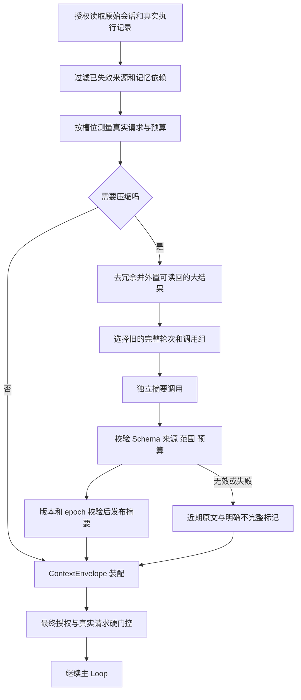

# 上下文压缩调研与实施方案

<!-- governance-classification -->
> 文档分类：模块参考，跨模块职责与当前落地状态以统一技术设计为准。本页保留原文和原日期，不能代替当前验收。见[统一技术设计](Agent架构与工程治理技术设计.md)和[文档索引](README.md)。

调研日期：2026-11-07。状态：第一批实现与验证中，未部署；下文区分目标设计与已接入范围。

本方案配合[多层记忆技术方案](多层记忆技术方案.md)与[动态上下文架构](动态上下文架构.md)实施。所有阈值和验收数字均为本项目的初始配置或目标，需要通过真实 Trace 和标注数据调整。

## 结论

采用宿主管理的三步策略：先减少工具结果冗余，再以有来源的结构化摘要替换旧的完整轮次，最后通过工具按需读回原始内容。近期原文继续保留。长期记忆与会话压缩分别管理，但共同使用来源、版本、删除失效、可靠任务和模型预算机制。

不直接依赖某个模型提供商的专有压缩块。当前工程基于 Java 与兼容 Chat API，并支持模型热切换；统一宿主协议能保留跨模型可迁移性。未来某提供商的原生压缩通过 CompactionPort 适配，需要独立验证兼容性，不能将不透明块直接转发给另一个模型。

## 调研证据与适用范围

以下为公开文档与开源实现的核验结果，不代表掌握 Claude 网页端的未公开内部算法。官方页面和 GitHub 默认分支会变化，后续实际引入代码必须锁定版本并复核许可；本次借鉴机制，不引入外部框架运行时。

| 方案 | 公开机制 | 本项目借鉴与取舍 |
| --- | --- | --- |
| Claude API Compaction | 支持按需和阈值触发；有保留近期轮次及后台压缩的模式 | 借鉴旧前缀摘要加新后缀的结构；不把供应商专有块作为跨模型存储协议 |
| Claude Context editing | 可清理旧工具结果，区别于摘要压缩 | 先做确定性结果精简，保留真实调用与读回引用 |
| Claude Code | 压缩后恢复系统与能力信息；会话摘要不承担全部持久状态 | 系统提示词、能力目录、任务状态从宿主重建，禁止靠摘要恢复权限 |
| LangChain SummarizationMiddleware | 独立配置触发与保留窗口；源码调整切点，避免拆开 AI 工具调用和结果 | 借鉴安全边界和可替换摘要模型，复用现有 Harness，不增加 LangGraph |
| Letta | 将会话 compaction 与记忆能力作为独立机制提供 | 会话摘要与个人记忆分开管理，不因压缩自动写入长期偏好 |

资料：[Claude Compaction](https://platform.claude.com/docs/en/build-with-claude/compaction)、[后台压缩](https://platform.claude.com/docs/en/build-with-claude/compaction-background)、[Context editing](https://platform.claude.com/docs/en/build-with-claude/context-editing)、[Claude Code 上下文](https://code.claude.com/docs/en/context-window)、[LangChain 源码](https://github.com/langchain-ai/langchain/blob/master/libs/langchain_v1/langchain/agents/middleware/summarization.py)、[Letta Compaction](https://docs.letta.com/v1-sdk/messages/compaction)。

Anthropic 将 compaction 与持久笔记分别讨论，并建议通过复杂执行记录评估压缩时的信息保留。[Context engineering](https://www.anthropic.com/research/effective-context-engineering-for-ai-agents)。我们据此选择分阶段、可回源的有损摘要，而不把“压得更短”单独作为成功标准。

## 现有工程现状

现有 MemoryBuilder 选择最近两轮，超过 6,000 字符时按完整轮次移除最早历史。HarnessContextBuilder 再限制历史最多四条消息、最多 min(8 KiB, maxHistoryBytes)，超总预算继续移除旧轮次。切换话题时可清空近期历史。数据库原文保留，通过 read_history 授权读回。

ModelContextBuilder 已能移除重复工具 Schema；旧结构中也有 olderSummary 字段，但现有 MemoryBuilder 始终生成空摘要。新 ContextEnvelope 已预留 current_context.compaction，主 Loop 暂只装入 messages。因此现在是窗口裁剪与去重，不是语义摘要压缩。

现有总预算按真实 UTF-8 请求字节做最终门控，不能称为模型 token 数。新压缩会保留该硬门控，token 估计只用于提前触发；有真实 tokenizer 或供应商计数时再使用 token 上限，不能简单把中文字符数换算为准确 token 数。

## 与记忆层次的关系

| 内容 | 放置位置 | 生命周期 |
| --- | --- | --- |
| 系统规则、工具与 Skill 目录 | 固定系统/能力槽位 | 从当前受版本管理的宿主配置重新装配 |
| 当前目标、用户确认条件 | focus | 使用当前结构化任务状态，不以摘要为权威 |
| 跨会话偏好、持续目标、主题与经历 | memory_context | 经记忆授权、召回与独立预算进入 |
| 旧会话摘要 | current_context.compaction | 当前会话作用域，受覆盖来源及依赖约束 |
| 近期用户/AI/工具消息 | current_context.messages | 保留原生角色、顺序和调用关联 |
| 等待操作、执行结果与剩余预算 | runtime_state | 使用真实运行和操作状态 |

压缩服务不修改 system_prompt、tool_catalog、focus 或 memory_context。摘要文本不自动变成长期记忆；自动记忆提取也不以摘要作为唯一事实来源。两者读取同一套认证来源，各自生成独立、有范围的派生产物。

## 压缩流程



### 先做确定性精简

保留实际发生的工具调用与结果配对，将已消费且可回源的大结果替换为有类型的紧凑视图：operation、evidence_id/artifact_id、数据版本、关键结构化事实、完整性和授权读回方式。调用参数、结果数量、错误与成功状态不能被改写。

不能把任意大 JSON 简单截取前若干字符作为有效结果。报告、完整评论与弹幕列表、字幕和画面分析保留在现有结果/产物存储，使用分页读取。图片和视频内容以授权引用及分析片段为主；文字摘要不等于完成了媒体压缩。

涉及未确认发布、等待操作、尚未返回的工具调用、当前失败的修正上下文，均不进入结果清理。外置前必须已持久化并验证可读回；不能为减少上下文删除唯一副本。

### 选择安全切点

会话跨轮摘要只覆盖一个连续的已完成旧前缀，近期至少保留两个完整轮次。当前用户消息不参与当前轮压缩；当前任务确认条件由宿主单独保持。一次工具调用组及其全部结果作为原子单元，切点不得落在中间。

主 Loop 内工具交换的压缩是另一种有明确范围的投影：仅处理已经闭合的旧调用组，保留当前尚待处理组及最近错误。它不冒充会话消息区间。现有持久化会话只保存用户/最终回答，不能凭这些消息重造原来未保存的逐步工具调用；实际调用数据必须从真实运行记录读取，否则只做会话摘要。

换话题可以清空不相关近期窗口，但不能删除数据库原文，也不能自动撤销仍存在的长期任务。与当前问题无关的旧摘要不注入，相关时按需检索或读回。

### 摘要结构

```text
compaction
├── id / revision / schema_version
├── session_id / source_history_version
├── covered_ranges
│   └── from_seq / through_seq / message_count / source_fingerprint
├── synopsis
├── claims[]
│   ├── type: decision | constraint | fact | open_question | rejected_option
│   ├── text
│   ├── source_refs[]
│   └── evidence_refs[]
├── pending_work[]
├── memory_dependencies[]: memory_id / version / original_snapshot_seq
├── resource_dependencies[]: resource_id / version
├── completeness / omitted_categories
└── model_revision / prompt_revision / created_at / expires_at
```

覆盖范围、消息数量、依赖、版本、指纹、时间和完整性由宿主写入，模型不能自报。模型只生成受 Schema 约束的 synopsis、claims 和 pending_work；source_refs 必须是本次传入的合法来源子集。保存“用户否决了什么”和否决原因，避免下一轮重复提出已拒绝方案。

引用合法只说明可追溯，不足以证明摘要语义忠实。需要固定质量样例、真实模型抽查和关键条件的确定性对比。金额、视频 ID、时间区间、数量和已确认操作不得依赖模型改写后的数字；从真实任务/证据取值。

摘要不可记录隐藏思维链。可见 AI 正文、真实工具动作和用户确认可被纳入，仍区分“用户明确要求”“模型建议”“工具已执行”“执行失败”，不把计划写成已完成事实。

## 触发、预算与失败

会话压缩与长期记忆开关独立配置。初始建议采用历史预算的 70% 提前触发，目标回落到 45%–50%；这些比例是待验证的项目配置，不是 Claude 的通用常数。还可使用最小新增轮次数、冷却间隔和最小预期节省字节防止每轮重复压缩。

第一期可保持近期原文 8 KiB 上限，为摘要独立预留不超过 4 KiB；实际装配仍受模型整体输入上限和输出预留约束。摘要生成输入、摘要输出、记忆召回、近期历史和工具 Schema 分别计量。模型热切换后重新按新模型上限投影，不能继承旧模型剩余预算。

后台生成优先：每会话同一范围只允许一个在途任务，压缩期间新消息正常追加。摘要成功后只替换它确切覆盖的旧前缀，新后缀全部保留。发布时重新校验前缀指纹、来源有效性、epoch 和摘要版本；有新消息不必无条件作废，有旧来源被修改或删除则必须拒绝发布。

到硬门槛但没有有效摘要时，允许一次受限同步压缩；失败则保留安全的近期完整轮次，明确 olderHistoryAvailable/incomplete 并允许 read_history。必要系统、当前请求、确认条件和最小工具组仍超限时，返回明确超限错误。禁止无限重试或把空摘要记为成功。

默认不连续压缩上一份摘要。增量按不重叠原始消息段生成、保存段摘要，再在预算内选择；全局整理从仍有效的原始来源重建。如果原始来源过期，应使相应派生产物失效，而非拿旧摘要继续滚动制造永久副本。

## 来源、遗忘与权限

摘要是派生数据，继承覆盖消息的生命周期、业务资源限制和所有记忆根引用。来源 A 的记忆影响回答 B，B 再进入摘要 C，C 必须继续依赖 A；不能只登记 B 的消息 ID。复用 MemoryLedger 的跨轮根引用机制与强制调用/交付屏障。

遗忘、清空、暂停、删除会话、视频下架/撤权、源版本变化均使相关摘要不可注入。无法逐句剥离的摘要整体失效，重新从当前有效来源生成。后台旧任务的延迟返回必须通过提交时的版本与 epoch 检查，不能复活已遗忘正文。

会话压缩本身不要求允许长期自动记忆。记忆 OFF 时可以整理不依赖长期记忆的普通会话，但不得借压缩重新引入已被记忆失效机制屏蔽的历史回答。对 VIDEO 来源继续在发送及交付前实时授权，缓存成员关系不替代授权。

Trace、continuation、Redis 和导出也属于副本范围。复用已有“引用优先、正文授权回源”的机制；压缩摘要正文不进入普通 span 属性，日志不打印模型原文或凭据。来源删除时物理清除可定位的派生正文，在线读取屏障在清理完成前立即阻止使用。

## 工程复用与架构位置

| 模块 | 职责 | 复用 |
| --- | --- | --- |
| CompactionPlanner | 测量、选择安全区间、触发与保留策略；不调用模型 | ContextPolicy、真实请求计量、原生工具配对检查 |
| CompactionService | 组装认证来源、生成与选择当前可用摘要 | 会话读取、MemoryLedger、模型调度与预算 |
| CompactionPort | 独立摘要模型调用与严格输出校验 | DeepSeekClient、CallControl、模型版本快照 |
| ProjectionStore | 保存摘要、覆盖范围及来源成员关系 | MySQL projection/projection_member，与主题摘要共享存储机制 |
| CompactionJob | 可靠后台生成、恢复、租约与失效检查 | 现有 outbox、memory worker 任务类型和受限线程池 |
| ContextAssembler | 将摘要放入 current_context.compaction | ContextEnvelope/NativeContextProjector |

不新建 Redis 集群、向量数据库、消息总线或 Agent 框架。会话压缩不依赖 embedding，关键词与语义召回只负责查找旧内容，不能替代当前压缩边界校验。模型目录可为 summary 配置独立模型与版本，默认复用现有连接配置；成本计入独立 background/compaction 分类。

前置识别只获得必要近期窗口与摘要的经过筛选部分，避免把全历史再次注入意图/情绪识别。澄清与任务条件以当前用户及结构化确认状态为准，摘要不能补造确认。主 Loop 在装配前读取已经准备好的压缩视图，ContextAssembler 内不隐藏额外网络或模型调用。

## Trace 与验收

增加真实的 agent.context.compact 节点，记录 trigger_reason、covered_from/through、source_message_count、input/output_bytes、saved_bytes、retained_messages、model/prompt_revision、状态与失效原因。比例只是展示指标，不能代替字节与真实 provider 请求核验。

context build 展示 current_context 中摘要与原文各占多少、覆盖范围是否连续、是否存在裁剪；memory recall 仍为独立节点。后台任务与来源运行通过 Trace link 关联，不能强行拼成主 Loop 的串行执行步骤。前端可显示“已整理此前 N 轮”，查看详情时按当前权限读取，不泄露失效正文。

| 验收场景 | 必须满足 |
| --- | --- |
| 连续 20–50 轮、多次压缩 | 用户目标、约束、否决方案与待办承接正确；摘要不重复覆盖原文 |
| 并行工具组与输入修正 | 无孤立 tool 结果；不把失败写成成功或重复执行已完成操作 |
| 后台压缩期间追加消息 | 新后缀全部保留，旧摘要不能覆盖新任务状态 |
| 故障与重试 | 模型超时、worker 重启、租约丢失不重复发布、不无限重试 |
| 删除/暂停/撤权发生在生成期间 | 提交拒绝，模型下一次调用不消费失效正文 |
| 模型热切换 | 摘要协议可读、按新预算装配，供应商专有块不串用 |
| 媒体与大工具结果 | 可授权回源，引用仍有效，未将文字摘要宣称为完整视频证据 |
| 语义质量 | 标注集关键条件保留率目标至少 95%；权限/确认/数值边界用例零失败 |

## 交付顺序

1. 完成记忆基础的正在进行的回归修复；保留 feature flag 默认关闭。
2. 在 M3 中共同实现 projection/source 成员存储、摘要端口、连续会话范围与确定性安全切点。
3. 接入后台生成与 ContextEnvelope.compaction；在 Trace 验证真实模型输入，不仅验证摘要 API 返回成功。
4. 补主 Loop 大工具结果精简与必要的运行中压缩，验证恢复及副作用操作。
5. 完成真实模型质量和删除传播测试，再与完整记忆功能一起推送、部署。

## 第一批实现记录

2026-11-07 已实现 V20–V22 的 projection/member、任务类型与 generation；CompactionPlanner 校验完整连续轮次、输入预算、输出 Schema 与引用；CompactionService 使用现有 MemoryModelPort/DeepSeekClient 生成摘要，并通过既有 outbox、受限 worker、租约与提交校验发布。后台处理期间追加的消息不被摘要覆盖；catchUp 继续整理新增的已完成前缀。

摘要以不可变结构进入 current_context.compaction，近期原文继续进入 messages。首次采用的摘要 ID 单独固定，续跑按原 ID 读回。共享 MemoryLedger 为近期历史和 read_history 继承记忆/摘要依赖，不绑定个人记忆开关。遗忘、模式变化与会话删除清除相关摘要正文；调用与最终提交继续检查来源和依赖。预算选择只装入有界片段，不宣称摘要涵盖了所有历史。

大工具结果精简已接入真实模型投影：只处理较早、带已登记 evidenceId、可用 read_result 读回的成功结果；保留最近四条结果、读回结果、错误、待操作和直接交付结果。真实调用 ID 与原始持久化结果保持不变。Trace 增加压缩节点、覆盖范围和字节详情。

隔离 MySQL 已执行 V1–V22 迁移；定向测试覆盖发布、失效、固定槽位和工具精简。真实模型两组样例已通过正常 DeepSeekMemoryModel/ContextEnvelope/预算链路，验证保留布局否决及待确认发布约束；输出真实 model.request 和 context.compact Trace。两组样例不等于已达到 95% 质量目标，完整质量评测与上线仍需后续验收。

后台生成失败时沿用安全近期窗口并标明旧历史可读回；尚未增加同步兜底摘要生成、用户手动 compact 命令及任意进行中调用组的语义压缩。默认 AGENT_COMPACTION_ENABLED=false；部署环境须显式开启，实际启用情况以发布 revision 与服务器验收记录为准。[独立审查记录](记忆压缩与上下文审查记录.md)列明本批发现与修复。
