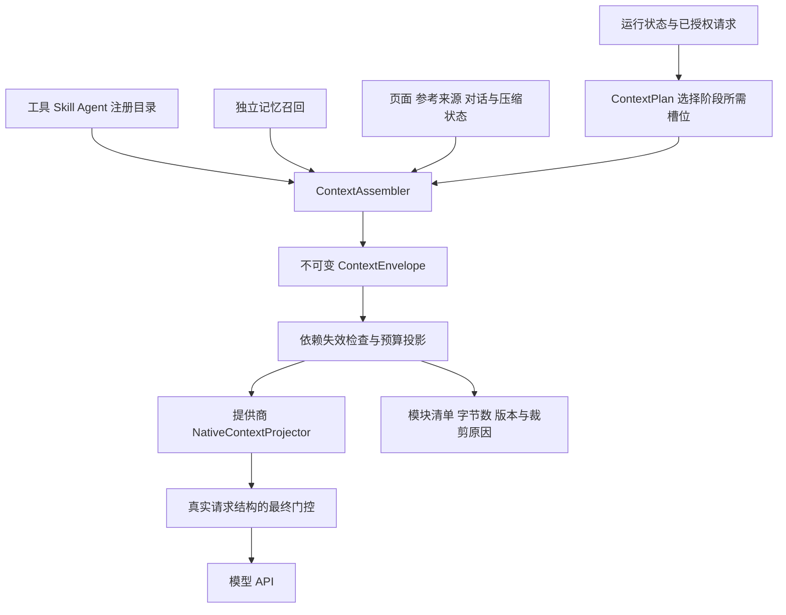

# EchoFrame 动态上下文架构

<!-- governance-classification -->
> 文档分类：模块参考，跨模块职责与当前落地状态以统一技术设计为准。本页保留原文和原日期，不能代替当前验收。见[统一技术设计](Agent架构与工程治理技术设计.md)和[文档索引](README.md)。

日期：2026-11-07。协议版本：ContextEnvelope 1.0。状态：已对齐的目标架构，按阶段接入现有模型调用。

Agent 的模型输入采用统一的结构化上下文协议。系统提示词、工具目录、Skill 目录、A2A Agent 目录、本轮聚焦、记忆和当前对话分别拥有固定槽位；模块不存在时省略，但其余模块的相对顺序不变。模型适配器将协议投影为提供商支持的 messages、tools 和输出参数。

该协议描述一次模型调用能看到什么。数据库中的原始聊天、完整业务数据和长期记忆库不直接等于模型上下文；它们经授权、检索、筛选和预算投影后，才进入对应模块。

## 固定结构

| 序号 | 模块名 | 负责内容 | 有效来源与边界 |
| --- | --- | --- | --- |
| 1 | system_prompt | 助手职责、行为和执行规则、参考数据处理原则 | 受版本管理的宿主提示词，不混入记忆正文 |
| 2 | tool_catalog | 本轮允许调用的工具定义与参数 Schema | ToolRegistry 与任务授权的交集；未激活业务工具不提前暴露 |
| 3 | skill_catalog | 可发现 Skill 的索引、版本、说明、激活状态 | SkillCatalog 与当前权限；默认仅目录，不默认注入所有正文 |
| 4 | agent_catalog | 可委派 Agent 的身份、职责、输入输出、限制及版本 | 未来真实 A2A 注册表；当前没有就省略，不构造假 Agent |
| 5 | execution_context | 业务日期、时区、已验证的能力与执行边界 | 服务端运行状态；不包含凭据和完整登录对象 |
| 6 | focus | 当前任务目标、确认条件、待澄清项和完成标准 | 当前请求、PreparedTask、结构化续接；记忆不能自行覆盖 |
| 7 | memory_context | 已召回的核心、主题与经历记忆及版本、出处、有效性 | 独立 MemoryRecallService；是参考数据，不是系统指令 |
| 8 | environment_context | 页面、视频、播放位置、用户选区等 | 已验证的页面信息；区分服务端事实和客户端提示 |
| 9 | reference_context | RAG 片段、附件、业务证据或产物的参考视图 | 授权后的真实读取结果；保留来源和完整性说明 |
| 10 | current_context | 压缩信息与未压缩的消息序列 | 会话存储和本轮实际执行记录，保留角色、顺序和调用关联 |
| 11 | runtime_state | 已完成或等待的步骤、可恢复错误、剩余预算 | 宿主维护的执行状态，不接受模型自报成功 |
| 12 | output_contract | 本次响应结构、引用要求、普通回答或收尾模式 | 受版本控制的输出约定，投影到提供商支持的参数 |

schema_version、phase、policy_version、projection_version、运行快照引用属于信封元数据，不占用业务模块槽位。禁止把未知字段作为第十三个任意提示词入口；新增模块需修改协议版本、投影器及兼容测试。

## 当前上下文内部结构

```text
current_context
├── compaction
│   ├── summary
│   ├── covered_ranges
│   ├── source_refs
│   └── completeness
└── messages
    ├── user
    ├── assistant
    │   ├── 可见正文
    │   └── tool_calls 与真实调用 ID
    ├── tool 与对应 tool_call_id
    └── 按原始先后顺序继续
```

messages 统一容纳近期历史、当前用户消息和本轮已发生的模型/工具交互。当前用户消息只出现一次；execution_context 可以携带请求 ID，focus 可以携带经验证的目标，但不能再编造一条“增强版用户消息”。历史与本轮消息通过 session_id、run_id 和 sequence 元数据区分，不能按角色重新分组。

压缩摘要只代表 covered_ranges 指定的历史范围。未真实生成摘要时，compaction 省略，历史窗口被截断则明确记录 truncated 与授权读回游标，不能用最后几条消息冒充完整摘要。保留原始来源，禁止无限摘要再摘要。模型隐藏思维链不纳入消息存储或压缩。

tool_call 与结果成对保留；同一批次的多个调用保持真实 group 和 ID。压缩或删除失效内容时可替换结果为同调用 ID 的不可用占位，不能留下孤立的工具消息或伪造未执行的工具调用。

## 能力目录与加载内容

tool_catalog 是此调用实际暴露的 Schema；skill_catalog 是按权限可发现的目录。激活某个 Skill 后，由已有注册流程增加允许工具；read_skill 实际返回的正文留在 current_context 的工具结果中，避免目录和结果双份注入。

后续 A2A 遵循相同边界：agent_catalog 描述可调用代理，委派及返回进入实际执行记录。代理返回属于有来源的结果，不能作为新系统提示词，不能自动提升工具或视频权限。当前阶段仅保留可选槽位，不引入新的 A2A 中间件。

reference_context 主要容纳进入调用前已确定的参考资料。本轮工具新获取的资料优先留在实际 tool 结果中；跨模块引用相同 evidence_id，不重复塞入全文。Memory 工具读回同理，memory_context 放初始选中投影，tool 结果保留真实读回记录。

## 装配流程与职责



ContextAssembler 负责归位和一致性检查，不在拼提示词时执行数据库搜索或额外 LLM 调用。MemoryRecallService、历史服务和业务端口在装配前完成有界读取，输出带引用的只读数据。Envelope 形成后不被 CONTEXT 插件原地修改；插件产生新版本，重新验证槽位、来源和预算。

模块最小公共字段为 slot、trust、revision、payload。payload 使用防御性复制的 JSON 值或不可变值对象；不持有 RunState、连接、凭据、回调或可变 JsonNode。记录缺失原因时使用安全诊断元数据，不向模型发送“没有记忆”“没有 Agent”等无意义占位。

trust 分为 POLICY、CAPABILITY、HOST_STATE、REFERENCE、CONVERSATION。标签由宿主按模块来源固定，不由检索正文或模型指定。标签用于投影与校验，不是新的权限授予机制。

## 阶段视图

| 调用阶段 | 默认选择 | 可选补充 |
| --- | --- | --- |
| FAQ 查询 | 当前问题、已验证的必要业务维度 | 必要近期指代，不加载完整记忆库 |
| 意图识别 | system_prompt、允许的能力目录、execution_context、必要 focus、current_context | environment_context；长期记忆默认不参与分类 |
| 情绪识别 | system_prompt、当前问题和必要近期对话 | 不从长期画像推断当前情绪 |
| 澄清识别 | system_prompt、执行条件与当前问题、结构化续接 | 页面和必要近期上下文，不用旧偏好替用户确认条件 |
| 主 Loop | 固定结构中实际存在的全部模块 | 记忆和参考内容仍受本轮预算限制 |
| 后台提取 | 提取规则、当前认证来源、已有待比对记忆、输出契约 | 不沿用主 Loop 的全部聊天或工具列表 |
| 收尾 | 主 Loop 视图、runtime_state、收尾 output_contract | 工具目录为空，保留必要证据与真实执行记录 |

固定的是模块位置和语义，不要求所有阶段具有完全相同的正文。独立召回在前置识别之后、主 Loop 上下文装配之前执行；本轮后续补查继续通过真实工具交互完成。

## 提供商投影

协议不是把整个 Envelope 序列化后一次塞进 system。投影器须按提供商原生接口表达：system_prompt 使用系统角色；tool_catalog 投影到原生 tools 参数；current_context 保持 user、assistant、tool 角色及真实调用 ID。

能力目录、宿主状态和输出约定使用宿主定义的结构化控制区。memory_context、environment_context 中的用户文本、reference_context 与 compaction 正文作为独立、清楚标记的参考数据消息，不提升成系统指令；其处理原则放在 system_prompt。JSON 编码及分隔符转义不能替代工具端授权。

投影后的消息顺序保持固定模块顺序及 current_context 内部原始顺序。提供商若要求控制消息前置，可将可信控制元数据前置，但必须记录 projection_version，并在测试中定义明确映射；不能静默把参考正文混入系统指令。API 不支持某种能力时显式降级或拒绝，不能靠伪造 tool 角色兼容。

逻辑固定顺序服务于审查、缓存和预算，不能被误当成“靠后就能覆盖权限”。当前用户明确要求优先于历史偏好，业务口径与资源权限始终由服务端事实和工具校验决定。

### 首个投影版本

`chat_native_v1` 的实际传输映射固定如下，不使用不存在的 reference 角色：先输出可信控制前缀，再输出独立参考块，最后输出完整原生消息序列。逻辑槽位顺序保持前述协议，wire 顺序由投影版本显式定义。

| 传输区域 | 槽位与表达 |
| --- | --- |
| System 控制前缀 | system_prompt、已注册能力索引、execution_context、runtime_state、output_contract；均按逻辑顺序投影 |
| 原生 tools 参数 | tool_catalog，仅发送一次实际 Schema，不重复放入 System |
| User 参考前缀 | focus、memory_context、environment_context、reference_context、compaction，使用宿主固定标签与 JSON 转义，按逻辑相对顺序输出 |
| 原生消息序列 | current_context.messages 原样保持 user/assistant/tool 顺序和调用 ID；原始当前问题不改写 |

focus 的自然语言目标、历史目标和 execution_query 全部按参考数据处理；HOST_STATE 标签只说明结构由宿主整理，不表示其中所有字符串都是高权限指令。服务端已确认约束仍通过 PreparedTask 与工具准入强制执行。runtime_state 只接受宿主推导的状态字段，不混入未经分类的工具正文。

工具调用所在 assistant 消息的可见正文以有界 assistantText 随调用记录保存，同一 providerGroupId 只投影一次；不记录隐藏推理。旧记录缺少该字段时使用空正文兼容，不能声称能恢复旧版本已经丢弃的文本。continuation 与 Trace 对该字段执行同样的来源依赖与脱敏规则。

### Harness 尾部投影

`chat_native_v2` 按实际发送顺序拼装以下内容。逻辑槽位和记忆条目结构沿用 Envelope 1.0。

1. 首条 `system` 由固定模板、公开工具短说明和可见 Skill 短说明组成。目录按名称排序，并使用现有可见性和权限判定。独立画像与 A2A 目录当前缺省。
2. 先发历史摘要，再按原序发近期对话。业务日期、焦点、长期记忆和页面参考资料紧接历史，当前用户原话保留独立消息。
3. 追加本轮原生工具组。每个 assistant 调用后的所有结果按调用 ID 连续配对。
4. 在工具组之后生成运行状态、必走动作或收尾约定。当前获准的 Skill 工具短说明放在最后。收尾时关闭原生工具，不输出动态目录。

原生 `tools` 继续携带实际可调用工具及完整 Schema。应用可验证消息序列和原生工具表的稳定性。工具表变化可能改变提供方的有效缓存前缀，需以供应商 usage 验证。DeepSeek 的 Chat Completions 支持在对话中加入 system 消息，具体部署组合仍需用真实流式请求验收。 [DeepSeek 工具调用](https://api-docs.deepseek.com/guides/tool_calls/#inserting-tool-calls-mid-conversation)

`AGENT_CONTEXT_TAIL_PROJECTION_ENABLED` 控制新任务采用 v2 或 v1。已有策略快照继续按冻结版本解释。部署时先以开关关闭的方式安装兼容读取 v2 的版本，再开启新投影并验收。回退时在兼容版本上关闭开关。只要库中仍保留 v2 快照，即使任务已终态，也不可切回只识别 v1 的二进制。

验收以同账号、同字面问题、同任务资料和同模型配置为对照。各自用新会话或等价的初始历史，避免 FAQ 命中及业务缓存变化造成不可比。Trace 的 `MODEL_REQUEST` 展示实际序列，`message.ordered_roles` 记录前 32 条角色。按相同模型步骤比较命中与未命中 token，以及 `model.first_token_state=RECEIVED` 的首段可见文本延迟。只产生工具调用的步骤单独比较 `model.response_ms`。

## 预算与裁剪

每个模块记录装配字节、投影字节、候选/采用数量和是否裁剪。预算按真实序列化 UTF-8 字节计量；适配器有可靠 tokenizer 时另计 token，不把字节直接标为 token。

最终门控覆盖 messages、tools 和输出 Schema 等实际请求字段。逻辑 Envelope 中的工具目录和 API tools 是同一份信息，预算不得漏算，也不因诊断快照重复计算两份。必须保留系统规则、当前问题、已确认任务边界和必要协议配对。

按模块策略先缩减低相关参考和记忆，再移除可读回的旧完整轮次；压缩摘要只有真实生成且通过来源验证才可替换原范围。输入仍超限则拒绝模型请求，不截断 JSON、不改写统计证据、不丢弃当前用户条件。

## 记忆与失效

MemoryRecallService 只产出 memory_context，不能修改 system_prompt、focus、tool_catalog 或 current_context。召回条目保留 ID、版本、scope、source_refs 和有效期。后续 read_memory 内容属于 current_context 的真实工具结果，两者共同进入消费依赖清单。

删除、暂停、来源撤权时检查所有消费副本，包括工具记录、历史派生回答、continuation、压缩摘要及 Trace。已经融合失效正文且无法安全剥离时，终止本轮或从安全检查点重新开始。冻结快照不延长授权，模块位置固定也不意味着正文永久有效。

## Trace 验收

每次 context build 展示实际 present_slots，顺序、模块来源、策略/投影版本、各项字节、使用引用与裁剪原因。缺省模块不伪造执行节点；A2A 未实现时不得显示已发现或已调用代理。

记忆召回是独立执行节点，context build 展示其产物如何装入 memory_context。敏感正文不进入通用 span 属性；详情按当前权限回源。应能从 Trace 回答“本轮加载了哪些模块”“记忆放在哪里”“压缩覆盖了哪里”“工具列表为何变化”，并与实际 provider payload 一致。

## 现有实现迁移

当前 ModelContext 已承载用户消息、会话、任务、工具、执行交换与报告状态；HarnessContextBuilder 将多种数据集中在控制消息中。继续复用这两者的调用入口、原生工具关联、JSON 转义、历史窗口和预算门控，在内部引入 ContextEnvelope 与投影器。

第一步固定纯数据协议及不变性校验；第二步把既有输入归入槽位并保持调用 ID；第三步接入 Skill 索引与 memory_context；第四步扩展压缩、主题与检索资料。agent_catalog 在真实 A2A 能力存在前省略。迁移后删除同一信息的旧拼接路径，避免“新协议只用于展示、真实请求仍走旧路径”。

## 验收清单

| 场景 | 通过标准 |
| --- | --- |
| 模块缺省或提供顺序不同 | 输出始终遵循固定槽位顺序；重复槽位和未知模块拒绝 |
| 不可变性 | 构造后修改原始 Map/List 不影响 Envelope |
| 当前请求与历史 | 当前用户消息仅一次，角色和时间顺序保留 |
| 原生工具调用 | 调用 ID、group、结果对应完整；目录不重复注入 |
| Skill 与 Agent 目录 | 只含实际可见目录，未注册的 A2A 槽位缺省 |
| 记忆提示注入 | 记忆正文不进入系统规则，不能扩大权限或任务范围 |
| 压缩与删除 | 覆盖范围、来源及失效传播可验证，不制造摘要 |
| 真实预算 | tools 与输出 Schema 计入最终 payload；核心超限拒绝 |
| 前置与主 Loop | 使用同一协议的阶段视图，各分支不会私自拼另一套全文 |
| 真实模型与 Trace | 模块清单、投影顺序、预算与 provider payload 相符 |

相关设计：[多层记忆技术方案](多层记忆技术方案.md)、[上下文压缩调研与实施方案](上下文压缩调研与实施方案.md)、[上下文管理实施方案](上下文管理实施方案.md)、[项目架构](../../docs/ARCHITECTURE.md)。

## 2026-11-07：一次召回与恢复边界（待实施）

Trace `78efea1319e97c586a0f69a6b3dbc0f0` 已确认：首次检索后，两次异步恢复再次进入 `agent.memory.recall`，后两次走 recalled 分支，按固定引用恢复，未重新关键词检索。三个 span 均称“召回”，恢复分支也没有记忆数量和复用标记。该现象既有展示语义问题，也有不必要的恢复装配工作，不能只改中文标题。

拟议边界以 run/request 为单位，不以整段 session 为单位：

- 入口仍为会话历史与压缩加载、FAQ、意图/情绪/澄清、汇合，再执行首次长期记忆召回；无需进入 Loop 的路径不增加召回。
- `recallOnce` 首次生成固定 ID/版本的 memory_context。同 run 的循环和异步恢复复用同一模块；数据库 recalled 标志与结果引用用作幂等和进程恢复依据，不允许在恢复中悄悄选择新候选。
- 同进程且固定模块仍可用时不重建正文；进程恢复或模块缺失时，`restore` 只按固定引用回源，不能查询最新候选作为替代。只保存可重建引用，避免新增无生命周期保护的正文缓存。
- `validate` 是独立职责，模型 dispatch 和结果 commit 时继续检查删除、暂停、权限及来源状态。固定快照不能绕过撤销；失效时明确中止/要求重试，不静默把旧条目替换成新版本。
- 报告就绪后直接交付的路径仍校验本请求实际依赖，但不为不存在的下一轮模型调用重建完整记忆和上下文。验证依赖与正文恢复分开。
- 下一条用户消息建立新的 run，可重新召回；执行中需要额外记忆继续走 search_memory/read_memory 工具，计入同 run 的依赖和预算。
- Trace 首次 `agent.memory.recall`，缺失正文时 `agent.memory.restore`，必要屏障用明确的校验指标或节点；标记 snapshot、引用数、reused 与原因。未实际执行的检索不增加召回次数，校验不冒充检索。

验收以原报告场景为基准：同 run 只有一个真实检索 span；两次等待恢复不会改变选中的 ID/版本；仅直接交付时不加载无用正文；进程重启、来源删除、用户暂停和撤权仍被屏障正确处理。多工具并行不能各自复制一份召回流程，分支共同读取固定模块，由协调器合并主动补查的依赖。


## 系统提示词职责收敛（2026-11-09，本地改造）

`harness.system@7.0.1` 只保留产品身份、沟通方式、内容安全、隐私与创作真实性、外部材料信任边界及如实交付原则。作者信息为花绿青，用户询问时可提示在小红书搜索该名称，不猜测账号链接。已删除重复注入主模型和前置识别的 `common.current-focus-boundary`。本轮问题、页面、历史、已确认条件和记忆仍按独立结构化槽位传递；对象、权限和工具配对由宿主校验。情绪与意图的用途由对应前置任务提示和消费代码约束。

工具参数、并行和预算由宿主与当前Schema控制，报告等业务步骤由对应Skill和任务资源说明；来源授权及终态仍以代码校验为准。此次仅调整提示词与装配，没有新增输入/输出内容审核器；内容护栏是模型指令，不能替代运行时审核与真实模型回归。PromptCatalog启动时加载资源，发布须重新构建并排空依赖旧资源的在途Run。
