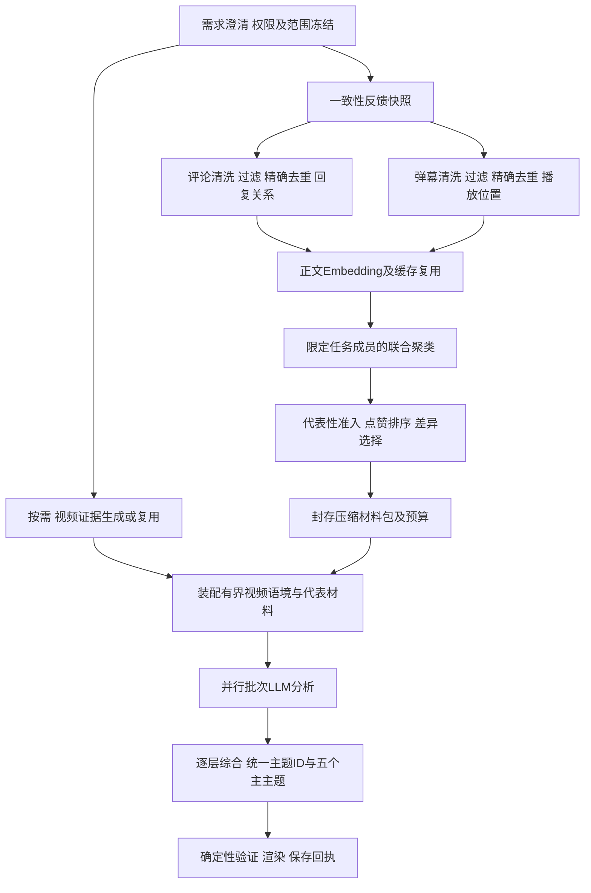

# 反馈报告向量压缩与三工具设计

日期：2026-11-08。分类：模块目标设计。状态：初版已部署，真实报告验收失败，统计契约待修订；本文不是上线验收记录。文件名保留早期四工具版本路径以兼容已有链接，当前目标已按用户最新对齐调整为三工具。

跨模块职责遵循[工程治理技术设计](Agent架构与工程治理技术设计.md)。本文承接用户本次对齐的报告方案，替代[大规模反馈增量报告技术方案](大规模反馈增量报告技术方案.md)中“分来源候选排序、读取全部唯一单元、报告工具同时承担模型分析”的目标选择；旧文保留历史事实和与本文兼容的权限、快照、恢复机制。

> **2026-11-08 口径更新：** 本文后续章节保留早期“微簇逐簇选代表”的设计记录，其固定60条必须覆盖每个微簇的规则已被真实数据否定。用户最新确认的是：评论与弹幕共同进入向量池，满足相似度要求的反馈形成最多五个桶，每桶选择少量代表；不能可靠成桶的反馈单独计数。数据很少时不凑五桶。新协议和当前实现/验收状态见[代表材料三工具实施与验收](代表材料三工具实施与验收.md)，不得把旧方案的覆盖与计数承诺用于新协议。

## 1. 已对齐目标与尚需校准的参数

目标是使用相对低成本的向量计算，先归并相似表达，每簇只选择少量代表进入生成模型，降低报告耗时和Token成本。聚类不能只给全量原文换个顺序，再让LLM逐批读完。主Agent也不能从工具结果中收到全量原文。

已对齐：视频独立处理；评论、弹幕基础处理并行；本次两来源联合向量聚类；代表内容优先考虑点赞，同时满足代表性和差异性；材料压缩与模型分析分开；模型分析按预算分批，之后全局统一五个主主题并输出完整报告JSON；保存由宿主自动完成，不暴露独立保存Tool。清洗、去重、过滤、Embedding、聚类和调度作为内部模块，不由LLM逐个选择是否执行。

五个指主区域最多五个主主题；有效主题不足五个时展示实际数量，不捏造话题。次要主题和限制可折叠展示。五个不是向量簇数量，每批也不各自产生五个最终主题。此口径保持现有报告展示方式。

本文的短文本阈值、相似度、每簇名额和预算数值为建议初值，尚未通过质量评测。用户确认了方向，没有指定这些数值；实施时必须在配置中明确，不把建议数字当作已经批准的质量结论。

## 2. 当前事实和缺口

核对源码基线：`61bf7e53cc4c1f56d5b6c0db40e2dfd1e63fff28`。工作区另有未发布的混合工具批次纠正补丁，不属于本文已实现能力。线上状态依据2026-11-07末次检查，不保证之后外部状态未变化。

| 部位 | 当前事实 | 本方案需要改变 |
|---|---|---|
| FeedbackClusters | 精确分组保留所有成员；向量开启后仍主要做候选排序；按Source隔离Namespace | 联合候选集合、成员归属、代表选择、硬预算压缩 |
| 向量部署 | 当次线上Agent未加载向量overlay；Milvus容器和凭据文件已存在 | 核对连通性、collection、维度、索引和有效配置，真实证明模型调用及压缩消费 |
| 短文本 | 没有按长度过滤 | 规则配置、排除清单、数量对账及披露 |
| Unit与业务桥接 | FeedbackAnalysis.Unit和BusinessFeedbackSnapshot.Unit没有点赞字段 | 新快照协议携带点赞快照及可用性，业务查询、Adapter、模型对象全链路接通 |
| 阅读 | FeedbackPlanner/FeedbackAnalysisService按所有唯一输入分批阅读 | 改为仅消费不可变代表材料包 |
| Tool | analyze_comments/analyze_danmaku准备来源，create_feedback_report启动综合并保存 | 改为本文三工具职责；保留内部来源模块 |
| 五主题 | FeedbackReportDocument.MAIN_TOPIC_LIMIT=5，内部结果可以多于五个 | 保持主展示上限，增加全局语义合并与稳定主题ID |
| 覆盖 | 原有语义要求读取全部成员 | 新协议区分全量成员映射、代表材料阅读、推断归属，不能沿用“逐条读完”声明 |

源码依据：`feedback/FeedbackClusters.java`、`feedback/FeedbackPlanner.java`、`feedback/FeedbackAnalysisService.java`、`core/FeedbackAnalysis.java`、`src/main/java/com/orangecode/tianmu/agentbridge/BusinessFeedbackSnapshot.java`。当前“五主题”只限制展示，不能倒推模型已经学到一致主题。

## 3. 执行图和并行边界



有两种并发：来源处理并行、独立模型批次有界并行。统一快照在两来源处理之前；联合聚类等待两路清单；全局汇总等待所有所需批次；保存等待有效结构化结果。

视频与反馈基础处理没有必然计算依赖，可以同时开始。第一版由业务领域编排服务协调视频任务与材料任务，使用独立持久操作记录和就绪屏障；不把不兼容的原生工具调用强行塞进同一批次。材料工具即使视频尚未完成也可封存文本代表包；分析工具在VIDEO被选择时必须等待匹配视频证据，然后在有限上下文预算内装配时间关联信息。文本向量不依赖完整视频描述，因此不会因为视频未就绪阻断基础Embedding。

如果实施批次暂不具备上述多操作调度，先顺序取得视频证据，再准备材料；必须把三路并发标为未完成，不能靠Skill提示词冒充程序调度。视频失败不自动改成纯反馈成功；仅反馈任务直接跳过视频支路。

## 4. 三个Tool与Skill契约

所有工具由服务端绑定当前Run、主体、冻结范围和策略，客户端或LLM不得传入任意tenant、user、对象路径或放宽权限。下表为目标契约，具体JSON Schema在实现时版本化。

| Tool | 输入 | 内部职责 | 有界输出与副作用 |
|---|---|---|---|
| analyze_video_content | 授权video_id，可选成对播放起止、分析重点 | 视频版本校验、缓存、采样和配置支持的画面/字幕/音频理解 | video_evidence_id、概要、覆盖；私有视频派生证据 |
| prepare_feedback_materials | 当前冻结任务引用；可选强制重算意图，由宿主检查预算 | 共享快照、两路预处理、Embedding、联合聚类、代表排序、预算封装 | materials_id、状态、原始/排除/表达/簇/代表数量、限制；原文不返回主模型 |
| generate_feedback_report | materials_id；VIDEO任务所需video_evidence_id | 程序汇合输入JSON、校验材料协议、分包、预算并行、全局统一主题、生成报告JSON、宿主校验并自动保存 | report_id、完整JSON读取地址、HTML兼容地址、摘要及统计；持久后台作业，主Agent不收全量正文 |

慢工具返回PENDING及不透明operation_id；宿主持久等待、完成后绑定结果并续接，不让模型轮询。相同操作幂等键返回同一资产；“强制重算”创建新修订，不能覆盖已被消费的材料。

报告Skill负责澄清、来源选择、证据需求、分析目标和交付表达。领域服务掌握依赖与并发，Harness提供通用调用/预算/操作恢复机制。AgentRuntime不新增具体业务工具名switch。工具错误、结构化结果和原生call ID保持完整配对；不因等待中止而重放已成功副作用。

通用read_result不得成为全量原文回灌入口。新analysis_id的模型投影只开放结构化主题及封存证据。第一版禁止模型读取正文白名单外原文；用户自行打开原文下钻使用独立鉴权接口，不把正文自动带回模型。未来需要模型定向扩读时，必须新建材料修订、重新封存白名单并重做预算和授权，不在旧资产上临时扩读。

## 5. 快照、清洗、过滤与精确去重

### 5.1 一致性快照与点赞

快照固定video、来源、反馈创建时间半开区间、数据读取时刻、原始成员和记录版本。评论的父评论可超出时间区间作为语境，只能在同视频及权限内读取，标记context_only，不参与本次反馈计数。弹幕区分创建时间与播放位置，非法播放位置记为未知，不编造定位。

新UnitV2增加`likeCount: Long|null`、`likeState: KNOWN|UNAVAILABLE`、`engagementAsOf`及`sourceVersion`。点赞在与内容导出兼容的一致性事务中取得；先核实业务真实字段/点赞表及撤赞语义，再实现批量查询，避免每条一次SQL。当前Unit不含该信息，禁止仅改排序代码就宣称按赞生效。

源码核对还显示Comment/Bullet实体没有点赞字段，现有`like`表关联video_id，不能拿视频赞数充当每条评论赞数。实施先核对实际业务库：若确无反馈点赞记录，需要新增按`source + item_id + actor_id`唯一的有效反应记录及批量聚合，点赞/撤赞具备事务和幂等语义，再让快照读取；新增业务点赞入口和UI另行明确范围。未接入真实来源时likeState保持UNAVAILABLE、允许有披露的频次回退，但“按点赞排序”仍标记未验收，不能把该依赖静默关闭后宣布完整交付。

缺失不是0；负数拒绝或按明确业务纠错规则归为UNAVAILABLE并记账。后续点赞变化不改变本次快照中的代表选择。内容向量可复用；代表选择缓存必须包含互动指标摘要、快照及排序版本，不能用旧点赞结果冒充新排序。

### 5.2 基础清洗与短文本

原文留在私有存储，另生成可追溯cleanText。第一版仅做Unicode规范化、换行/空白规整和已知展示标记处理；保留否定词、数字、语义标点和原始引用定位，不用生成模型做清洗。

短文本按配置的有效字符规则过滤。建议有效字符为Unicode Letter/Number，低于3个视为SHORT_TEXT；空内容为EMPTY、纯格式为NO_TEXT。此建议会排除“太吵”“好看”和纯表情，是明确的质量取舍；若要点赞豁免或业务词保留，应单独配置并做对照，第一版不隐含这些规则。

过滤仅影响本次报告材料，不删除业务原始数据。每条排除记录保存唯一原因、规则版本和原始ID。统计分别显示原始、排除、纳入数量；报告不能把筛选后分析称作全量原文语义分析。安全脱敏沿用业务桥接，输入中的指令全部视为不可信反馈内容。

### 5.3 精确分组

精确Key包含来源、规范化正文、上下文指纹、作者角色和适用的播放语境桶。第一版弹幕桶建议15秒，相同文本不同桶保留独立单元；评论用回复链/父上下文指纹。原始ID、次数、各来源计数、成员点赞快照始终保留；不同来源不会在精确阶段直接丢掉其中一条，后续可在联合簇内汇合。

每个精确组的代表原文取组内已知点赞最高成员，按创建时间和原始ID稳定破同分；组内人均或点赞总和不作为同一条反馈的点赞。原始频次是成员数量，作者发言另记，不计为观众认可。

## 6. 向量复用和联合聚类

### 6.1 一个任务候选池

“一个池”表示本次COMMENT和DANMAKU同时参与聚类，不要求所有用户、视频共用无过滤检索空间。向量存储可以继续按来源隔离，候选层合并两个合法分区结果；也可以使用新collection及source元数据，但必须相同Embedding模型、维度、模板和距离定义。旧版带reply输入的向量不能与新版正文向量直接混比。

建议第一版主向量编码cleanText，统一模板，不把用户ID、点赞、来源名或完整视频描述塞进正文向量。回复和视频时间语境作为分组准入与代表上下文。对“这里不对”等强指代单元，无法用确定规则确认兼容语境时保持独立候选，交给有限的代表阅读解释，不强行跨场景合并。

缓存指纹包含正文、清洗版本、模板、Embedding provider/model/revision/dimension。安全Namespace包含租户、账号和视频。点赞不改变向量，但改变选代表所需的快照摘要。私有索引不可因内容相同而跨账号直接复用敏感向量。

### 6.2 第一版可复现聚类

采用确定种子顺序的星形候选聚类：精确组按稳定ID排序；未分配组成为seed；ANN召回相近合法成员，检查与seed的实际余弦相似度和上下文兼容性，再加入该簇。禁止传递闭包造成A像B、B像C就把A/C强行合并。未召回、孤立或语境不兼容的表达形成独立簇。

topK必须在本次合法成员集合内选取。不能先从同视频全历史取32条，再求交集，否则窗口外相似记录会挤掉本次有效邻居。当前FeedbackVectorIndex.search没有task成员过滤能力，因此第一版新增TaskCandidateIndex端口：从按版本精确fetch的本次两来源向量构建临时有界候选索引，搜索域只有这些合法成员；持久Milvus承担向量复用与存储，不直接把全历史ANN topK作为本次聚类结果。后续若持久索引支持版本成员预过滤，可以替换端口实现，但必须通过等价性/隔离验收。临时索引预估内存、限制并发并释放资源，不能复制历史全库到内存；具体索引实现需有本次上限内的耗时和内存测量。

ANN命中必须与本次快照成员版本求交集，过滤越权、旧版本、已删除或窗口外记录；相似度只是候选资格，不能推断相同立场。每个纳入精确组有且只有一个primaryClusterId，保证频次不重复；跨簇关系是非计数关联。

建议相似度初值0.90、每seed召回32，均需评测。ANN本身可能不确定，因此重试/恢复使用已封存的assignment和成员hash，不重新聚类；算法版本、种子顺序、检索参数及结果摘要进入材料协议。需要重建时产生新修订，不覆盖原资产。

## 7. 每簇代表排序与全局压缩

### 7.1 候选资格和排序

先过滤非法成员、无正文以及不满足簇代表性门槛的候选；代表性取候选到该簇归一化质心的余弦相似度，单成员簇为1。质心只在当前簇合法向量上计算。

目标每簇2条、最多3条、至少1条。已知点赞候选按点赞降序，其次中心性降序、创建时间升序、稳定ID升序。完全缺失点赞的簇按精确组频次降序，再中心性和稳定ID排序；混合来源缺赞时不把null伪造成0排名。

可执行排序在每个来源配额内进行：先已知点赞候选按上述规则，再未知点赞候选按频次/中心性/稳定ID；两种可用性记录各自数量，明确缺失偏差。后续剩余名额先比较代表的差异增益，再在相同可用性类别内比较上述排序；不直接把评论点赞与弹幕频次当同单位相加。点赞再高也不能绕过代表性和来源合法性准入。

混合来源簇先为每个有合格表达的来源预留1个名额，再在剩余名额中按上述规则选择，避免评论有点赞而弹幕无点赞时弹幕全部消失。候选与已选表达相似度高于建议0.96时跳过同义复读，选择仍然有差异的内容；差异只能保证表达多样，不能宣称已识别反对或反讽。语义立场由后续LLM判断。

来源预留优先于跨来源近重复抑制；预留时只在同来源去掉复读，后续额外名额才与所有已选代表比较。若非空观众簇没有任何候选达到中心性门槛，返回REPRESENTATIVE_SELECTION_FAILED并保留清单，不直接跳过该簇；阈值调整创建新材料修订。

仅一个来源有合格候选时可以只留1条，并记录选择原因；两个来源都有合格候选时必须至少2条。某来源确有观众成员却因门槛没有合格候选时显式标记该来源代表缺口并返回REPRESENTATIVE_SELECTION_FAILED，不能靠忽略该来源绕过预留。作者发言仅作为有标记的语境，不占观众代表名额；没有观众表达的簇进入作者语境清单，单独受上下文预算控制。

### 7.2 小输入是硬约束

压缩包只包含代表正文、必要上下文、精确组频次、簇总量及来源分布、已知点赞、证据引用、选取理由、限制。成员ID全清单存储在sidecar，不在模型输入里展开。引用使用短别名，服务端映射真实ID。

允许的正文输入严格分为representativeRefs和contextOnlyRefs两张不可变白名单。后者仅包含所选代表所需父评论片段、明确相关的作者说明或视频证据片段，每项保存来源、版本、范围、关联代表ID和截取offset；受单条上下文上限、全包字节和请求Token预算共同约束。作者清单不能整份注入；未选为代表的普通反馈不能仅因“可能有用”升级成上下文。过滤/未纳入的父评论若作为context_only使用，仍不计反馈成员，报告单列语境数量及字节。材料封存后禁止读取器临时扩大这两张白名单。

建议总代表上限60、代表正文最多300个Unicode码点、单条上下文最多600个Unicode码点、全部代表正文及上下文最多32KiB，并独立受实际模型Token预算控制。超长原文优先选择可定位的完整句窗口，标记excerpt及offset；原文保留。不能无标记截断后声称完整引用。

先计算每簇mandatory(c)：启用来源预留时为该簇合格观众来源数（单源1，双源2），关闭预留时为1。全局先分配全部mandatory，再按簇频次及当前差异增益分配目标/上限内额外名额；不能为了固定60条删除小簇或把双源预留降成可选第二名。若`sum mandatory(c)>maxTotalRepresentatives`或全部mandatory的最小包超预算，返回MATERIAL_BUDGET_EXCEEDED并建议缩小范围或经用户确认提高预算，不偷偷全量送LLM或静默省略簇。例如40个双源簇至少需要80条，默认60预算直接拒绝，不宣称覆盖。若包没有实际减少模型输入，记录压缩比；小数据允许无压缩，但不得宣称节省。

本文不承诺仅凭少量代表得出每个非代表成员的准确语义。可以确定的是原始成员归簇、频次和代表选择；主题归属属于代表驱动推断，报告必须披露这种方法。

## 8. 模型分批分析、全局主题与纯保存

### 8.1 分批与预算

generate_feedback_report只接收已封存、状态READY、属于当前任务且协议兼容的materials_id。输入为目标、压缩包分片和有界视频证据；分包尽量不拆开一个簇的代表，确需拆开时保留clusterId并在汇总去重。

按完整请求估算Token，计入system、schema、视频语境、代表材料和输出预留；发送前再检查真实序列化字节。当前每批groups生产投影默认最多12000 UTF-8字节；完整请求使用既有上下文检查，并行度建议2。限制属于可调执行策略，不能突破模型上下文和已有安全字节上限。

每批输出局部观察、支持的代表ID、涉及的clusterId、不同表达及不确定性，不自行决定最终五主题、不生成总量和占比、不读取白名单外全文。结构纠正只使用原有代表和封存context_only、上一轮有界输出和验证问题；任何纠正、摘要、回退或审计模型都不能绕过压缩入口读取全量。

### 8.2 全局统一主题

综合所有局部结果，建立稳定topicId、名称、边界和代表证据；先合并同义话题、保留同话题下相反观点，再排序选最多五个主主题。主题排序建议按宿主计算的观众成员量降序，点赞作为同量时的辅助指标，不用模型生成频次。其他主题保留折叠入口，有效主题不足五个时不强凑。

计数采用每簇一个primaryTopicId，允许nonCountingRelatedTopicIds展示相关讨论；一条反馈谈多个方面时可以呈现多个观察，但总体和主分布不能重复加总。批次局部clusterId重复先去重，再按权威成员集合计算；作者及context_only不混进观众分母。

超出一次综合输入预算时逐层归并结构化局部观察，层间有依赖，同层可并行。所有层计入同一模型调用/Token/截止时间预算。综合只读取有界观察和代表引用，不通过补读全量获得“覆盖”。

### 8.3 保存、披露与完成

报告JSON是权威结构，包含主题、代表阅读清单、成员映射引用、方法版本、统计口径、视频证据和不确定性。generate_feedback_report内部在模型分析后由宿主检查引用完整、成员无重计、所选来源齐备、必需视频证据匹配，先持久保存JSON，再根据JSON生成兼容HTML；返回实际保存回执才允许完成，不新增保存Tool或让模型决定是否保存。

报告同时给出原始数量、过滤数量、纳入数量、代表数量、抽样/压缩方式、主题推断限制。可展示“声音问题簇覆盖若干条反馈”，不能改写成“逐条确认这些人都认为声音有问题”。原文下钻在权限和预算内供用户查看，用户打开详情不触发隐藏LLM调用。

## 9. 数据、资产与统计不变量

| 资产 | 必需内容 |
|---|---|
| FeedbackSnapshotV2 | 冻结范围、成员版本、创建/播放时间、作者角色、点赞可用性和快照时刻、counts、内容hash |
| PreparationManifest | 清洗/过滤规则、每条排除原因、精确组及成员、向量revision、联合簇assignment、选择计划 |
| RepresentativePackageV1 | 本轮materials_id、快照hash、排序及压缩版本、代表和短别名、sidecar引用、字节/Token估算、覆盖限制 |
| FeedbackAnalysisV3 | materials_id/hash、视频引用、模型revision、局部观察、全局主题、实际已读代表ID及模型用量 |
| ReportReceiptV2 | analysis_id/hash、报告ID、归属、保存版本、方法披露和私有产物引用 |

必须成立：原始成员=排除成员+纳入成员；纳入成员通过精确组和primaryCluster完整映射且不重计；代表是纳入成员的子集；正文输入仅来自代表及封存context_only白名单；已分析代表最终可追到主题或明确标记无法判断；主题分布以纳入观众成员为分母并单列其他/未判定，不包含过滤和作者语境。跨来源观众人数使用合法用户标识去重，仅在宿主计算，不向模型暴露账号标识。

“完整”的新含义是材料映射完整、所有代表被处理、结构对账通过，并非每条原文都经生成模型阅读。CompletionEvaluator/Delivery必须识别新协议，不能沿用全量阅读检查后假造已读成员。

每个输入/资产在读取时复验owner、任务范围、来源和当前权限；引用不等于授权。来源删除或撤权后停止新增调用并拒绝详情/缓存读取；缓存和Trace不提供授权事实。保留和删除沿用既有对象生命周期，不宣称撤权即物理删除所有对象。

### 9.1 模块归属和持久数据

建议`feedback.preparation`拥有TextPreparation、ExactGrouping、JointClusters、RepresentativeSelector及MaterialPacker；`feedback.analysis`拥有AnalysisPlanner、BatchReader、TopicSynthesizer；`feedback.report`拥有纯ReportValidator/Renderer。复用现有FeedbackEmbedding/FeedbackVectorIndex端口和对象存储，新增接口优先为`FeedbackMaterialStore`、`FeedbackMaterialReader`及`FeedbackAnalysisReader`，调用者只获取所需只读能力。

SQL账本保存job/work、父操作、输入hash、policyHash、claim/fence、阶段状态、取消/授权状态、输出引用和预算结算；大正文、向量派生清单及代表包保存在私有对象存储。唯一索引至少约束同Run/阶段/输入/策略的逻辑操作，以及同operation/work/version的结算。Redis用于缓存与进度，Milvus用于版本隔离的向量缓存，本任务候选在本地合法成员集合内计算，二者不拥有任务完成或权限事实。具体DDL作为实施批次交付并验证实际事务，不在设计阶段伪造已迁移Schema。

目标对模型投影示例：

```json
{
  "materials_id": "fm_example",
  "version": "representatives-v1",
  "stats": {"raw": 1000, "excluded": 200, "eligible": 800, "exact": 300, "clusters": 30, "representatives": 60},
  "clusters": [{"id": "K1", "messages": 100, "comments": 40, "danmaku": 60, "representatives": [
    {"id": "R1", "text": "背景音乐盖住人声，建议降低配乐。", "source": "COMMENT", "likes": 120, "like_state": "KNOWN", "exact_messages": 15}
  ]}],
  "limitations": ["Representative-based interpretation; originals are retained outside model input."]
}
```

以上为分析worker读取的包结构示意；主Agent仅看到materials_id、stats及限制，不看到clusters正文。示例数字、赞数和ID不是线上证据；真实Schema还要包含完整校验字段及服务端成员sidecar引用。

### 9.2 可追溯例子

假设快照300条评论、700条弹幕：排除200条后800条，精确分为300组，向量联合成30簇，平均每簇选2条共60条代表。LLM按Token预算分3批理解这60条，而非重读1000条；综合消费局部观察，输出五个主主题。假设“音频”簇100条，选择高赞主要表达及不同使用场景，只能说该簇依据代表被归为音频问题，不能声称100条逐一经LLM确认。若有400个孤立簇无法在60条预算下覆盖，必须明确预算不满足，不能假装仍完成同等语义分析。

## 10. 配置设计

以下配置已实现，前缀为`agent.feedback.compression`。精确环境变量、默认值和消费检查见自动生成的[配置目录](配置目录.md)。此表描述当前实现，不含未实现的嵌套别名。

| 后缀 | 默认值 | 范围/单位 |
|---|---:|---|
| enabled | false | 布尔，新Run显式选择协议 |
| min-effective-chars | 3 | 0..20，Unicode Letter/Number数量 |
| playback-bucket-ms | 15000 | 1000..120000，毫秒 |
| min-similarity | 0.90 | (0,1]，归一化余弦 |
| neighbors | 32 | 1..256，本任务星形簇最多邻居数；不是全历史ANN topK |
| vector-bytes | 67108864 | 1048576..268435456，向量数组含三倍开销准入估算 |
| min-centrality | 0.75 | [-1,1] |
| representatives-per-cluster | 2 | 2..5 |
| max-per-cluster | 3 | target..10 |
| near-duplicate-similarity | 0.96 | [min-similarity,1] |
| max-representatives | 60 | 1..500 |
| text-chars | 300 | 50..2000，Unicode码点 |
| context-chars | 600 | 0..2000，Unicode码点 |
| package-bytes | 32768 | 4096..131072，生产groups投影UTF-8字节，含组元数据 |
| batch-bytes | 12000 | 1024..24000，单批groups投影UTF-8字节 |
| embedding-calls | 512 | 1..2048，持久账本预留次数 |

来源预留为协议必需条件，没有关闭开关；过滤可通过min-effective-chars=0降低长度门槛，空文本仍排除。没有实现`analysis.batch-input-tokens`配置：当前按真实groups投影字节分批，完整模型请求另经过现有上下文额度检查，视频及系统提示不计作代表包字节。

短文本计数字符与原文窗口截取字符分别定义，不能混用Java UTF-16 length。目标2/最多3在启用两来源预留时必须满足target≥2、max≥2；总代表数不能容纳所有簇mandatory之和时按预算错误处理。所有浮点值必须finite。主主题上限5为产品契约；后续若开放配置，应同时调整Schema、渲染和验收，不与向量簇数量绑定。

复用并实际消费现有Embedding/Milvus连接参数、readParallelism、反馈总调用/Token/deadline、模型单次timeout和输出额度；旧readParallelism与新参数避免双重取值，第一版保留现有readParallelism为唯一并发入口，建议有效值2。Embedding另有调用/输入字节/记录数预算；向量计算不能绕过总deadline或跨任务无限回填。

读取时点：新Run绑定预处理策略，新job冻结算法、排序、包和模型策略hash；连接配置重启生效，密钥不入快照。恢复使用冻结策略及当前授权，压缩参数、Embedding版本/维度、输入模板或距离算法revision改变时拒绝旧任务续跑，不重算已封存材料冒充旧结果。配置版本、Schema版本和模型revision变化须兼容reader先行；不能用当前配置伪装历史策略。

## 11. 持久状态、故障和幂等

新压缩任务启用时，Embedding和向量端口必须成对存在且模型/维度匹配；启动检查与任务就绪检查共同验证依赖。缺少配置或服务不可用时明确失败，不能沿用当前EXACT_ONLY分支生成看似成功的向量压缩材料。生产验收必须有实际调用或有效版本缓存命中证据，单纯配置为true不充分。

材料阶段：QUEUED → SNAPSHOTTING → PREPARING_SOURCES → EMBEDDING → CLUSTERING → SELECTING → MATERIAL_READY。分析阶段：QUEUED → WAITING_INPUTS → ANALYZING → SYNTHESIZING → ANALYSIS_READY。报告阶段：VALIDATING → SAVING → SAVED。每阶段可进入WAITING_AUTH、FAILED或CANCELLED，具体状态由领域job拥有，不向RunState复制第二套权威状态机。

操作键由Run、阶段、输入hash、策略hash组成。领域work使用已有claim/lease/fence模式，网络调用在数据库事务外；结果提交检查版本、当前权限、取消和deadline。取消Future不能提前释放未退出worker容量，晚到结果不能提交。Embedding/ANN临时失败可有界退避；预算超限、协议不兼容、非法引用直接明确失败，不能静默回退全量LLM路径。

材料/分析READY只表示阶段完成，最终Run成功需要报告保存回执。阶段PENDING通过OperationRegistry注册对应handler，Continuation记录操作、已配对exchanges和剩余预算。WAITING可恢复；普通RUNNING进程崩溃仍按既有RUNNER_LOST处理，除非某一领域work具备已验收的幂等恢复。不得把本方案当作任意副作用自动重放保证。

保存结果未知时先读权威回执再决定重试；同analysis_id及渲染版本只产生一份逻辑报告。输出额度耗尽明确MODEL_OUTPUT_LIMIT，先结算已报告usage，不做相同输入的无效自动循环。认证失效暂停并请求重新授权，不自动切换账号或用旧令牌继续。

## 12. Trace与用户进度

建议阶段span：feedback.snapshot、feedback.prepare.comment、feedback.prepare.danmaku、feedback.embedding、feedback.cluster.joint、feedback.select、feedback.material.ready、feedback.analyze.batch、feedback.synthesize、feedback.report.save。实际开始/结束时间绘图，依赖边来自真实asset/operation关系；两来源汇合在材料就绪之后，最终主题汇合在批次分析之后。

导出白名单只包含阶段、算法版本、数量、字节、Token估算/实际、缓存状态、排除原因计数、代表排名理由枚举和受控资产引用；不导出原始全文、账号标识、令牌或完整向量。私有详情继续归属/来源复验，按实际model.request收集返回的思考，禁止混进聊天正文。

必要指标：N_raw、N_excluded、N_eligible、N_exact、N_clusters、N_representatives、按来源及作者分组的数量；向量命中/缺失/实际Embedding用量；representativeBytes、实际模型输入Token、每阶段耗时和最大实际并发。条数压缩率`1-N_representatives/N_eligible`，分母为0显示N/A；重复分组另报`1-N_exact/N_eligible`。Token节省必须用同范围真实对照或同模板可复现估算，不能从条数压缩比直接推算。

前端进度可显示“正在整理评论和弹幕”“相似内容归到一起啦”“正在挑选代表反馈”“分批理解代表观点”“整理五个主主题”“报告已保存”。细粒度次数放展开区域，正常正文持续保留。材料READY不显示报告完成；短文本过滤和代表推断方法在最终报告可见。

## 13. 迁移与发布

1. **锁定契约与基线**：保留当前真实报告、运行配置和失败Trace；记录样本数据与有界全量基线，明确旧协议仍为全量唯一表达阅读。
2. **点赞与资产reader**：业务快照UnitV2、Agent Adapter和新资产兼容reader先上线；旧字段缺失明确UNAVAILABLE，新阶段未启用。点赞相关SQL及事务需要业务服务随迁移部署，不能只发Agent。
3. **内部压缩模块**：实现清洗/过滤账本、联合聚类、排序、包封存和纯材料验收；开发/受控环境显式启用向量，禁止生产默默全库回填。
4. **分析与纯渲染拆分**：新analysis仅读压缩包，Completion/Delivery识别新完成语义，恢复和缓存隔离；Tool Schema、Skill、任务allowedTools和资源版本同步更新。主Agent接收材料引用和小摘要，前端通过鉴权端点读取完整报告JSON。
5. **受控真实验收**：两账号、真实点赞、两个来源、VIDEO可选、至少一个高重复和一个高差异样本；记录实际向量及LLM用量，关闭确定缺陷。
6. **生产切换**：暂停受影响入口并排空旧在途操作，再显式开启新协议、Embedding和Milvus有效配置；查运行容器、凭据挂载、维度、collection、网络连通及Trace。安装了Milvus不等于Agent已使用。
7. **稳定与回退**：关闭新任务writer仍用兼容reader读取已生成材料、分析和报告；旧job按旧版本完成或明确取消，禁止把半程旧资产当新材料。回退到旧全量路径只能针对明确选择旧协议的新任务并披露成本，不在新任务失败后静默回退。不能回滚到不识别新资产的旧二进制。

旧analyze_comments/analyze_danmaku等工具在新任务暴露集合中移除，旧协议reader/handler保留到在途与保留期策略允许清理。旧工具名不能直接alias到新返回结构。新增资源进入运行策略指纹，旧Run不因新Schema突然恢复执行不同流程。已有无关上传、业务对象存储工作区改动不纳入本设计实施。

Canal增量预计算、十万级扩容和跨账号向量共享不属于本次交付；先把请求侧压缩闭环做实，再独立论证异步成本与生命周期。

## 14. 验收与独立审查标准

| 范围 | 必须证明 |
|---|---|
| 纯处理 | Unicode短文本边界、排除原因、精确Key语境、作者/context_only计数、原始成员可追溯 |
| 点赞 | 同一快照真实赞数、撤赞/缺失/0/同分、评论有赞弹幕无赞、更新不复用旧排名、无N+1查询 |
| 向量 | 真实provider/collection、模型/维度拒绝、跨来源候选同池、跨账号/视频/窗口和旧版本命中拒绝、窗口外相似记录不挤占本次topK、ANN恢复不改变已封存assignment、临时索引内存准入 |
| 代表 | 每簇小名额、点赞优先、差异选择、混合来源预留、孤立簇、超长引用、簇数超预算明确失败 |
| 模型边界 | 抓取真实HTTP输入，正文逐项匹配代表及context_only白名单，白名单外正文和全成员清单不出现；上下文有引用/范围/独立记账；纠正/汇总/回退均不能回灌；模型真实使用的是包而非旧planner全量 |
| 并行 | 真实Trace时间重叠、并行上限、层间屏障、取消不提前放容量、未齐备不能报告成功 |
| 主题 | 全局共享ID、最多五主主题、不足不凑、相反观点可区分、跨批簇不重复计数、其他主题及限制保留 |
| 恢复 | 真实SQL WAITING重启、已执行Embedding/分析不重复收费意图、剩余预算、资源版本、fence及保存未知回执查询 |
| 权限 | 匿名/另一账号拒绝、运行中撤权、来源删除、缓存命中仍重验、详情和报告不能绕过 |
| 发布 | 有效开关、实际调用/用量、旧Run读取、reader/writer回退、制品hash、配置及Trace对应同一版本 |

质量对照用固定高重复、低重复、讽刺、短负反馈、长回复、低赞关键反馈、弹幕时序歧义样本。对同快照比较旧有界全量基线与新代表方案：主题召回、证据正确性、不同观点保留、遗漏类型、时间及实际总成本；Embedding、视觉调用和失败重试也计成本。真实付费对照控制在授权范围和有界样本，不能给每个线上报告自动增加全量影子阅读。

建议首轮门槛：高重复样本代表输入条数压缩≥80%，抓包确认白名单外正文零泄漏，关键预标注观点无遗漏、引用及统计错误为0；一般样本以质量对照为准，不保证所有数据都能同幅度压缩。上下文和视频材料同样计实际输入Token，不能靠把大量原文改名context_only来满足压缩指标。质量指标和通过阈值是候选验收标准，实际固定样本集及评分必须落盘；样本未通过不能仅靠抬高并发宣布完成。

设计审查与验证记录写入[独立审查记录](反馈报告向量压缩设计独立审查.md)。设计已进入实施；实际代码、迁移、门控测试及真实验收以新增实施记录和发布记录为准，不把本节验收要求当作已通过证据。
