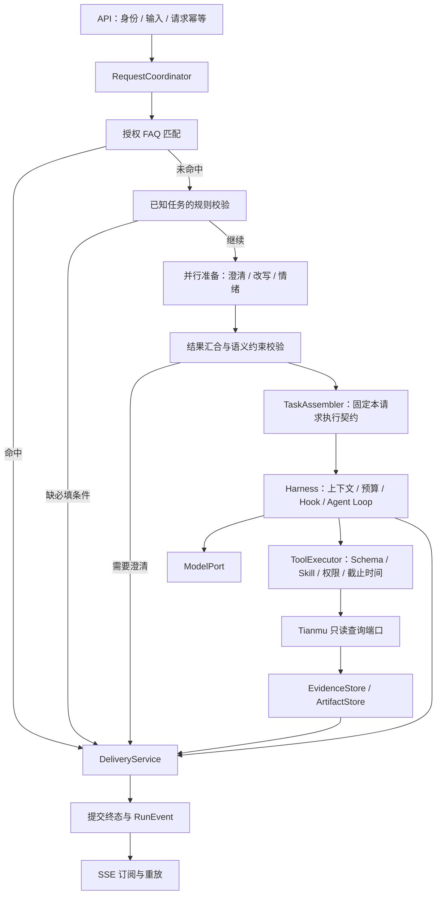

# 架构评审与演进方案

<!-- governance-classification -->
> 文档分类：历史提案，跨模块架构已由统一技术设计替代。本页保留原文和原日期，不能代替当前验收。见[统一技术设计](Agent架构与工程治理技术设计.md)和[文档索引](README.md)。

## 2026-11-01 当前源码复评

评审基线：`380ac1c`，本节记录修复前问题；F01 后续实现见下方实施记录。检查请求入口、准备与任务冻结、运行循环、工具准入与宿主、交付、状态与存储、线程隔离、SSE 和互动草稿发布。下方 2026-10-21 的章节保留为历史方案，不能用其中“尚未实现”的描述判断当前能力。

### 总体判断

现有方向合理：独立部署的 Agent 内部采用模块化设计，有模型、工具和存储端口，也有执行约束与架构回归。适合继续演进，不需要重建框架或立即拆微服务。当前属于具备工程基础、按单写实例运行的应用；尚不能认定已完成生产可靠性、容量或高可用验收。“符合工业工程设计”在此按可维护、可验证、故障可收敛、资源有界、权限可信、运行可观测来评估，不作为认证或统一等级标签。

| 维度 | 源码依据与判断 | 当前边界 |
|---|---|---|
| 请求与执行分离 | RequestOrchestrator 准备和路由，TaskAssembler 冻结 PreparedTask，AgentRuntime 执行，DeliveryService 校验交付 | 循环和交付层仍有业务类型判断，并非所有任务策略均已收拢 |
| 工具扩展 | AgentTool、ToolRegistry、资源描述与 Skill 准入；启动时校验注册一致性 | 新工具已有扩展点，没必要重做注册框架；新任务类型还可能修改多个策略位置 |
| 权限与证据 | 工具准入、任务范围校验、证据 owner/run 校验，发布草稿需显式确认 | 这些控制应保留；不能把证据合法、可追溯等同于模型结论正确 |
| 状态一致性 | RunBackend.commit 先提交持久终态与事件，再更新进程内投影；会话 generation 防止旧任务提交 | 写库失败后的自动收敛存在缺口，见 F01 |
| 资源控制 | 评审时有六个有界执行池、拒绝策略、独立 deadline、模型调用与 Token 预算；H01 后增加独立 termination 池 | 中断是协作式控制，不能保证任意外部适配器立即停止；容量参数尚无本轮负载数据支撑 |
| 传输与可观测性 | SSE 与任务执行分离，序号回放；执行预算不依赖 Trace 上下文 | 尚未在本轮验证慢客户端压力、数据库故障下的持续观测与告警 |
| 发布副作用 | CreatorPublicationService 冻结确认内容，CAS 状态更新；不确定结果保留 PUBLISHING，重试使用稳定 ID | Agent 与业务服务之间不是单个数据库事务；仍需跨服务超时与并发确认验收 |
| 部署与恢复 | MysqlRunRepository 用 GET_LOCK 限制一个数据库写实例；重启恢复 QUEUED，RUNNING 记为 RUNNER_LOST | 属于明确的单实例取舍，不具备多写副本调度、在途任务续跑或无中断滚动升级保证 |

### F01：终态持久化失败后缺少自动收敛（P1，已实现修复，见实施记录）

代码位置：`RunState.publish`、`LoopControl.arm`、`RequestOrchestrator.execute`、`RunService.maintain`、`RunRepository.refresh`。

触发链路：任务交付/失败/取消写终态时数据库不可用；错误处理再次提交也失败；一次性 deadline 回调在故障期间运行并失败。RunState 保留非终态是正确的回滚语义，但当前没有待提交终态的重试协调。maintain 调用的 refresh 在 MySQL 实现中没有覆盖，随后只恢复 QUEUED；没有对已退出执行但仍为 RUNNING 的任务补偿。存储恢复后，缺少其他请求触发时，任务可能持续显示执行中。取消信号也在 commit 成功后才触发，存储故障会影响本地取消及时性。

本地探针 `var/TerminalRecoveryProbe.java` 使用真实 RunState 和 LoopControl、故障注入 RunBackend：失败提交一次，350ms deadline 回调再失败一次；700ms 时恢复 backend，再观察 700ms，结果为 `RUNNING`，提交次数仍为 2，取消原因为空；手动取消后为 `CANCELLED`。日志在 `var/agent-terminal-recovery-probe.log`。这是确定性组件场景，不等同于真实 MySQL 断网验收，也未实际调用收费模型。

现有 MysqlStorageIntegrationTest.actualSqlFailureRollsBackMessageEventsAuditAndTerminalState 验证了 SQL 回滚，但后续通过手动取消结束，没有验证依赖恢复后的自动收敛。

修复目标：本地停止执行与持久化终态的职责明确分离；持久化失败保留可重试意图，由有界协调机制收敛，不重新调用模型或重放业务工具；提交仍遵守会话归属和唯一终态规则，不向客户端提前宣布持久成功。验收必须覆盖故障持续跨过 deadline、恢复后自动结束、取消及时停止可取消调用、唯一终态事件、旧任务不能覆盖新任务，以及无法恢复时 readiness 与可观测性。

### F02：报告条件在执行时再次解析原文（P1，评审问题；A02/H02 本批已修复）

评审时 `ToolDispatcher.HostContext.reportRequiresVideo` 使用原始 query 的中文否定正则；`CreateDanmakuReportTool` 用它决定 audience 报告是否必须提供视频证据。当前 TaskConditions.Report 只承载查询范围，没有冻结这项交付要求。结果是准备结果并非报告需求的唯一来源，同一需求会在工具宿主再次解释；双重否定、转述和多轮上下文存在误判风险。

修复目标：准备阶段得到明确的报告条件与来源，必要时澄清；报告执行与交付消费同一冻结条件。需记录旧任务 JSON 的兼容策略，补默认包含视频、明确排除视频、否定转述、追问继承/覆盖的对照测试。不能仅把原正则搬到另一个文件。

### F03：任务策略散落与工具宿主职责集中（P2，A02 及 A01 报告进度/历史查询两批已实施）

评审时 `AgentRuntime.maxTurns` 识别 danmaku.report、audience.report、comments.analysis；DeliveryService 按 creator.draft 和报告类型限制交付；EvidencePresentation 按类型校验证据。HostContext 又实现历史分页、报告分类恢复/保存和业务条件判断。各处校验本身有价值，但新增任务的修改面不够集中。现有 ArchUnit 保护 core、API、调度、预算等边界，没有禁止报告业务分支继续进入循环。

修复目标：先收敛任务执行/交付策略，由循环消费解析后的策略；再将历史与报告进度实现委托给明确应用协作者。保留固定权限准入，避免为了消除所有类型判断而创造大型通用插件框架。验收以新增同类任务时的修改范围、既有行为对照和架构规则为准。

本批 A01 将 HostContext 中的报告检查点恢复与保存委托给 ReportProgressService，并增加状态完整性准入。最高进度必须完整覆盖已分类前缀，每个成员只能归属一个主题，每个主题条数必须与原始权重一致；不允许回退、冒充完整、替换已绑定视频或任选同位置冲突草稿。存储成功后才推进内存，工具写入能力限制继续留在宿主。服务不能访问 RunState 终态、模型、Harness 或工具实现；旧检查点格式与缓存逻辑保持。历史分页作为下一批；本批验证见根目录 ROADMAP A01 记录。

A01 第二批将历史读取、页内搜索、截断和游标计算委托给只读 HistoryQueryService；会话/权限过滤仍由 ConversationStore 承担。保留一次至多50条的有界搜索及原先不跳过未返回匹配的游标算法，同时验证存储返回页的序号范围、顺序和唯一性。当前会话/轮次上限固定，查询服务不持有 RunState/ExecutionState，读取历史不能改写冻结条件和当前焦点。新增跨窗口、空匹配、UTF-16 截断、权限收缩、会话隔离和真实 MySQL 回归，工具协议及 SQL 行为保持。详情见 ROADMAP A01 第二批。

### 验证与实施顺序

本轮执行 `mvn -B -ntp -f agent/pom.xml verify`：构建成功，共 346 项，330 项通过，失败/错误 0，跳过 16（MySQL 14、Redis 2）。构建日志 `var/agent-architecture-20261101-verify.log`；跳过不代表集成通过。未执行真实模型效果、真实数据库故障注入、负载/SSE 长连接压力或多实例故障测试。探针暴露了既有基线测试未覆盖的恢复场景。

实施顺序：F01 可靠性闭环 → F02 任务条件统一 → F03 扩展职责治理 → 隔离依赖故障与容量/模型效果验收。每批说明原行为、改后行为、回归证据与剩余限制。单实例限制暂时保留并写清部署约束；出现明确可用性目标后，再设计分布式归属与续跑。全局 synchronized 的 RunService.create、逐检查点数据库读取、SSE 工作池等是后续负载观察点，当前没有足够数据认定其已成为瓶颈。

### F01 实施记录（2026-11-01）

- 修复前：终态写库和一次性 deadline 回调均失败后，无后台收敛；取消通知等待写库，HTTP 取消可能操作数据库重新加载的副本。
- 修复后：本地立即停止，待提交意图保留最初原因；维护任务限批退避提交。授权后使用活动 RunState 取消；数据库已有终态优先，清理后的任务释放资源且不伪造终态事件。增加待收敛数量指标，并纳入 readiness。
- 无数据库迁移、Skill/Tool 协议、模型调用流程或前端改动。保留单写锁与重启 RUNNER_LOST 语义；丢失专用写锁后仍需受控重启，不能将本批描述成数据库整机重启后的自动接管。
- 回归先在旧实现上复现两条失败，再验证修复。隔离 MySQL 8.4 / Redis 7.4 定向验证已通过：SQL DONE 写入失败并跨过 deadline、恢复后自动结束、唯一 DONE/审计、模型调用数不增加、旧任务不能覆盖新轮次、删除会话后采纳已提交取消。另补确认响应丢失与清理后停止重试的边界；最终验证结果见 [路线图实施记录](../../docs/ROADMAP.md)。真实模型、生产环境故障和容量验收不在本批范围。

## Harness 一手文章调研与对照（2026-11-01）

范围：调研时将公开一手文章与含 F01 修复的工作树对照，不是 `380ac1c` 线上环境的新验收。调研当时只更新记录并运行无模型组件探针；随后按用户要求实施 H01，见下方实施记录。H02–H05 仍是设计候选，未运行付费模型。下文建议是本项目的设计推论，不表示文章作者评审过本项目。

### 阅读材料及可迁移结论

| 材料 | 文章重点 | 对本项目的启发与适用边界 |
|---|---|---|
| Anthropic：[Effective context engineering for AI agents](https://www.anthropic.com/research/effective-context-engineering-for-ai-agents)，2025-09-29 | 有限上下文的选择、按需获取、压缩与结构化笔记 | 输入视图应保留当前任务的关键约束与事实，冗余内容移出模型视图；不是单纯扩大上下文上限 |
| Anthropic：[Effective harnesses for long-running agents](https://www.anthropic.com/research/effective-harnesses-for-long-running-agents)，2025-11-26 | 结构化进度、分步工作、可验证的完成条件 | 借鉴任务进度与验收条件；文章面向跨会话编码，不能直接推导我们应恢复在途模型调用或重放写工具 |
| Anthropic：[Demystifying evals for AI agents](https://www.anthropic.com/research/demystifying-evals-for-ai-agents)，2026-01-09 | 区分轨迹与实际结果、工程与质量评测，组合判分并关注重复运行一致性 | 既验证 Harness 不变量，也验证报告是否正确；不把一次成功或固定工具顺序等同于任务完成 |
| OpenAI：[Harness engineering: leveraging Codex in an agent-first world](https://openai.com/index/harness-engineering/)，2026-02-11 | 可检索的版本化知识、可机器检查的架构边界与反馈 | 继续用仓库文档和 ArchUnit 固化边界；不是照搬自动合并或代码量指标，编码团队工作流与产品运行时要区分 |
| LangChain：[The Anatomy of an Agent Harness](https://www.langchain.com/blog/the-anatomy-of-an-agent-harness)，2026-03-10 | Harness 涵盖模型外围的状态、工具、上下文、编排、Hook 与可执行约束 | 我们的 Harness 系统已经跨多个包存在，不能只审查 RuntimeHarness 类；不因此新增任意 Shell/文件系统工具或更换语言框架 |
| Anthropic：[Harness design for long-running application development](https://www.anthropic.com/research/harness-design-long-running-apps)，2026-03-24 | 可测试的任务契约、生成与评价分离，按模型表现删减不再必要的机制 | 借鉴独立验收而非强制引入三个 Agent；我们的确定性校验先保留，语义评审先用于离线质量集 |
| OpenAI Cookbook：[Build an Agent Improvement Loop with Traces, Evals, and Codex](https://developers.openai.com/cookbook/examples/agents_sdk/agent_improvement_loop)，2026-05-12 | 将轨迹、人工/模型反馈、评测和下一轮 Harness 改动连接起来 | 复用现有 Trace 与 JUnit，先建立失败案例到回归的闭环；示例的 SDK、Promptfoo、HALO 与自动部署不是本项目的必需依赖 |

### 我们已有的能力，应保留

- 模型决策与执行权分离：ModelPort 只返回决策，ToolRegistry/ToolDispatcher 控制准入，权限、预算与终态由宿主管理。
- PreparedTask 已冻结任务范围、截止时间、调用上限、资源版本及注册工具快照。业务事实引用有 owner/run 检查；交付还有任务类型与评论阅读完整性校验。
- CallControl、LoopControl、有界工作池及本批终态收敛提供执行约束。观测故障不应改变执行权限；不从 Trace Context 读取预算。
- 上下文已有专门构建器：HarnessContextBuilder 保留原生角色与工具消息分组，近期历史限量、换话题清理；ModelContextBuilder 负责字节上限、重复 schema 去除及已完成报告批次释放。不是“没有上下文工程”。
- Hook 已区分 GATE、OBSERVER、TRANSFORM，并检查变换不变量；Observer 异常隔离已经存在。待补的是慢 Hook 的执行隔离与验证，而非再造一套中间件入口。
- 评测已有 24 条场景清单、7 条工程绑定、完整源码指纹、真实样例记录和人工标注模板。工程基线明确 `semantic_quality=NOT_ASSESSED`，不能将其描述成完整真实模型质量集。

### H01：先隔离 watchdog 与慢收尾（P1，已实现修复）

修复前：ExecutionConfiguration 将 deadlineScheduler 配置为单线程；LoopControl.arm 在该线程直接执行 run.timeout。RunState.stop 先发本地取消信号，但随后仍同步调用 backend.commit；完成后 HarnessSession.terminal 又可能同步触发 Hook。此外 RunState monitor 可被同一任务的其他数据库保存占用，使 timeout 还没发本地信号就阻塞。这是源码对照发现的本项目问题，不是某篇文章直接给出的故障结论。

本地 `var/HarnessDeadlineIsolationProbe.java` 使用真实 LoopControl/RunState：A 截止时间 200ms，B 为 400ms；A 的终态提交通过 latch 阻塞约 500ms。结果：A 已本地停止，B 超过 deadline 仍为 RUNNING 且未收到本地停止信号；释放 A 后 B 才结束，本次观测晚约 491ms。日志 `var/harness-deadline-isolation-probe.log`。这是调度隔离实验，不是实际数据库或生产负载测试；托管模型/工具的 Future 等待超时仍提供另一层保护，不能说所有任务都会延迟。

建议：watchdog 只完成短小的本地停止意图与信号操作，持久化收尾由已有协调入口承接；终态 Hook/Observer 也不能阻塞 watchdog。先补双任务隔离回归，再选择具体实现。验收应让 A 的存储提交或 Observer 保持阻塞，同时断言 B 的取消回调在允许的调度误差内触发，且无提前 DONE、重复终态或模型重放。不能只把 scheduler 的线程数调大作为闭环。

实施记录：

- RunState.signalTimeout 通过 volatile 生命周期标记、原子 TurnControl 和本地 CancellationToken 发出停止信号，不获取任务存储 monitor，也不提交终态或调用终态观察者。后续 worker 异常不能改写 deadline 原因，已停止的排队任务不能开始执行，迟到答复不能夺回交付资格。
- 新增 Spring 管理的 terminationExecutor，默认 core=2/max=4/queue=32，与模型、工具及 watchdog 隔离；配套 agent.execution.termination 配置、执行池指标与拒绝计数。到期直接使用原始 deadline，未增加 watchdog 线程数。
- 池满时不 CallerRuns、不把写库/Hook或同步日志回落到 timer；本地停止已经生效，RunService 的既有维护和退避机制接续终态。已有权威终态仍优先，无提前 DONE 或业务工具重放。
- 单元回归覆盖存储阻塞、实际终态 AgentHook 阻塞、同任务保存持有 monitor、收尾池满载及后续补齐、超时原因与迟到答复。隔离 MySQL 另覆盖真实行锁下两任务独立结束与唯一 DONE。定向 52 项全部通过；最终全量和打包结果见路线图本批记录。
- 最终隔离 MySQL 8.4 / Redis 7.4 下全量 verify 365 项全部通过，失败/错误/跳过 0；打包离线冒烟、发布扫描与 diff 检查通过，付费模型调用 0。没有执行生产压测。
- 约束：慢 Hook 仍可能占用收尾线程，公开终态的持久化完成不是实时保证；已注册的取消回调必须快速且无业务 I/O。GATE/TRANSFORM 继续原顺序，不引入通用异步 Hook 总线。单写实例、专用写锁失效后受控重启及 RUNNER_LOST 规则不变，无数据库迁移、模型调用或工具协议改动。尚未推送部署。

### H02：任务契约与完成标准统一（P1，A02 本批已实施）

PreparedTask 已有基础，但报告是否需要视频仍由 ToolDispatcher.reportRequiresVideo 重新正则解析原始 query，报告 maxTurns 仍按任务类型写在 AgentRuntime，交付与证据要求散落在 DeliveryService/EvidencePresentation。这些规则应有明确归属，不是把全部业务塞进 Hook。

建议在应用层解析任务策略，由准备、循环和交付消费明确结果：任务对象/时间范围/数据来源、是否必须视频证据、必需产物、完成条件、允许的执行上限。全局权限与预算始终是硬上限；任务策略不能放大权限或额度。模型可以选择合法工具顺序，但不能自行改写“什么叫完成”。不要为每一步固定一条大型工作流。

示例：用户要求“昨天的视频观众报告，不看视频，只分析评论和弹幕”。任务冻结明确的视频 ID、Asia/Shanghai 自然日、评论与弹幕范围、视频证据非必需，以及报告产物要求；之后查询与交付均消费这些条件。模型只输出一段总结、未产生所需报告，不算完成。普通问答则不应被迫生成 HTML。

验收：明确排除/默认要求视频、双重否定与转述、追问继承与覆盖、旧任务 JSON 兼容、必需产物缺失、不同合法工具路径。完成标准用确定性代码验证，语言质量不能伪装成确定性事实检查。

本批实施：新增不可变 AnalysisContract，准备阶段冻结来源、报告要求及视频播放界限，TaskAssembler 复用该结果。应用层 AnalysisExecutionPolicy 控制业务工具的可见性、调用准入、交付覆盖和报告轮次；HostContext 不再对原文做报告否定正则。来源选择支持 VIDEO、COMMENT、DANMAKU 的七种非空组合；明确排除的来源不能查询或引用，语义不明确时澄清。普通分析与实际报告交付区分，报告成功要求真实保存回执。

来源追问将当前冻结 specification 保存在原会话 focus_json，保留对象与原统计区间；新页面和新话题重建焦点。只选一种反馈时适配器仅请求该接口，输出未选择来源的“未读取”说明，分类与缓存也携带来源集合；两种反馈仍走一致快照。纯视频报告保存实际视频证据与私有 HTML。旧 JSON 字段缺省继续可读，不迁移 SQL、不重新解释历史任务。范围与验证记录见 [ROADMAP A02](../../docs/ROADMAP.md)。本批未验证任意自然语言理解质量、生产吞吐或真实付费模型效果，未推送部署。

### H03：从上下文限长走向按任务组织信息（P2）

当前构建器已经删除旧历史、重复 schema 和较早分类批次；剩余必需输入仍超上限时拒绝 MODEL_CONTEXT_TOO_LARGE。这是正确底线，但不等于高信息密度或良好质量。

建议区分不可丢的任务条件、当前有效证据/覆盖范围/出处、最近失败的可修复原因、最新进度，以及可按需读取的旧原文。复用 read_result/read_history 和现有证据存储，将大结果留在私有证据侧；只改变一次模型调用的视图，不改写持久原始证据。裁剪原生工具消息必须按 call/result 及批次分组处理，不留下孤立 tool 消息。先做确定性投影与分段预算，暂不增加会额外收费且可能失真的通用 LLM 摘要层。

验收：较小输入下任务条件、当前引用、未读分页和最新进度不丢，原始证据不变；同时观察输入大小、完成率与 Token，而非只证明输入变短。报告已有分类断点，应先复用；仅当第二条真实流程需要时再抽象通用 TaskProgress，不先建设跨任务自治记忆系统。

### A04 / H03 上下文构建专项调研（2026-11-01，调研快照；P0 后续已修复）

范围：对照当前含 A01 两批本地改动的源码，阅读以下一手材料，并运行一次无网络、无模型的上下文组装探针。此次仅更新调研记录，不修改产品代码、Prompt 或现有测试，不推送部署。下列工程建议是本项目推论，文章中的评测收益不能视为本项目 DeepSeek 的实测结果。

| 一手材料 | 可借鉴点 | 对本项目的推论 |
|---|---|---|
| [Anthropic：Effective context engineering for AI agents](https://www.anthropic.com/research/effective-context-engineering-for-ai-agents)，2025-09-29 | 每次推理都要选择高价值信息；渐进披露和按需读取；压缩要保留目标与可恢复性 | 保留私有证据和历史，通过现有 read_result/read_history 取回；逐次构造当前决策视图 |
| [LangChain：Context Management for Deep Agents](https://www.langchain.com/blog/context-management-for-deepagents)，2026-01-28 | 大工具输入与输出都可占用上下文；移出原文后仍可找回；压缩需专项评测 | 同时处理历史 tool arguments 与 results，按原生调用组维护完整协议；不照搬其 token 阈值或 SDK |
| [LangChain：Context Engineering: How Deep Agents Remember](https://www.langchain.com/blog/context-engineering-deep-agents-remember)，2026-10-14 | 先阻止无关内容进入，再管理已进入内容；Skill 按需加载 | 当前 Skill 激活方向保留；先用明确规则挑选材料，再考虑摘要或长期记忆 |
| [Liu 等：Lost in the Middle](https://arxiv.org/abs/2307.03172)，2023 | 论文所测任务中，信息位置影响长上下文利用 | 对关键条件分别置于早/中/晚的位置做评价；不能据论文直接认定当前模型必然有相同幅度退化 |
| [Chroma：Context Rot](https://www.trychroma.com/research/context-rot)，2025-07-14 | 在受控任务中增加输入长度和干扰会影响模型可靠性 | 比较完成率、约束遵守和恢复能力；输入更短本身不是质量提升证据 |
| [DeepSeek：Token Usage](https://api-docs.deepseek.com/quick_start/token_usage)，访问于本次调研 | 可离线估算 token，实际使用量以 API 返回为准 | 保留字节硬上限，并用模型对应的 token 估算/usage 校准规划；不将字节当作准确 token |
| [Anthropic：Context editing](https://platform.claude.com/docs/en/build-with-claude/context-editing)，访问于本次调研 | 原始历史与模型可见的编辑视图区分，旧工具结果可被占位替换 | 复用现有存储侧原文和一次性模型视图，不直接套用 Claude 专属 API |
| [Anthropic：Mitigating prompt injections in browser use](https://www.anthropic.com/research/prompt-injection-defenses)，2025-11-24 | 业务材料中的文字可能诱导模型偏离目标，不能把提示词当作完整防线 | 对数据标明来源/可信程度，权限与证据准入继续由固定代码实施 |

当前链路：存储读取近期历史 → MemoryBuilder 默认选择最近两轮、总文本至多6000个 UTF-16 单位 → HarnessContextBuilder 保留至多4条历史消息且不超过8192字节或配置上限 → 去重 Skill Schema、释放已分类批次的旧正文 → 组装原生 user/assistant/tool 消息 → 必要时整轮删除旧历史 → DeepSeekClient 追加原生 tools，发送前再检查完整请求字节上限。

已有正确边界：已确认的对象/时间/来源来自冻结 Specification；原生调用和工具结果保留结构；模型视图不改写持久证据；旧历史可按需读取；未读批次不随意抽样；预算不足会明确失败。此次确认 DeepSeekClient 第74行已有包括 native tools 在内的完整请求检查，因此不存在“工具 Schema 未计入最后硬上限”的结论。待改进的是前面的裁剪规划尚不使用完整请求尺寸，末端拒绝后不能回到前面选择可释放材料。

**已复现的协议构造问题（P0）：** 调研时 HarnessContextBuilder.call（当时第90–93行）按 ToolResult.equals 查找第一条 exchange。两次 list_skills 结果相同、providerCallId 分别为 call_a/call_b 时，离线探针输出的工具回复 ID 为 [call_a, call_a]，未保留第二次调用标识。探针位于本地忽略目录 var/context-pairing-probe.jsh，使用现有测试 classpath 和 JShell；付费模型调用为0。尚未验证提供方对该序列的具体响应，不宣称已经复现线上 HTTP 错误。下一步应按执行记录/调用标识建立稳定关联，补重复结果、多调用组、缺失 ID 和裁剪配对回归。

**上下文选择的主要缺口（P1）：** releaseClassifiedBatches 只投影旧结果中的 classification.groups/topics；历史 assistant.tool_calls.arguments 仍由原始交换记录重新序列化，已处理的 topics_json 等大输入仍会累积。普通评论分页、历史搜索页、read_result 长文等没有统一的已消费/已替代投影。不能把“请求放得下”视为所有材料对下一次决策都有用。

建议增加一次性、可解释的 ContextPlan：复用现有 Specification、Focus、已确认的 ReportProgress、分页进度和证据索引构造视图，避免再创造一套独立的任务事实。区分宿主规则、已确认任务和必要 Skill 流程、当前用户原话、当前进度、待处理证据、相关历史与可按需回查的旧材料。来源、原任务/视频、数据时点、证据 ID 和替代关系随视图保留。已完成工具输入和输出按完整原生调用组投影；原始消息、调用参数和证据继续保存在既有私有存储。未读评论/分类批次、当前条件、当前修复所需错误及调用配对不可随意删除。

最近两轮只是当前默认窗口。冻结的业务条件已经有保护，不能说它们必然随历史删除而丢失；仍可能丢的是未进入任务契约的表达偏好和背景。先明确允许保留的偏好及作用域，再使用有来源的结构化工作状态。若以后采用 LLM 摘要，摘要只能帮助寻找资料，不能生成权限、修改已确认来源或充当事实证据。

信任与预算：页面标题和 Focus.request 当前被序列化进 system 控制块；转义能阻止结构闭合伪造，不等于对语义诱导免疫，需区分宿主字段与用户/业务原文。预算规划应覆盖消息、工具定义、调用参数、输出预留和安全余量，保留最终字节检查并校准模型 token 估算。建议记录分区大小、保留/移出原因和引用数量，不向公开 Trace 增加原始评论、字幕或凭据。

建议顺序：P0 原生调用关联正确性 → P1 上下文投影及已消费工具输入/输出的移出 → P1 复用已确认状态、明确数据可信边界与整请求预算 → P2 在专项质量评价通过后再决定是否引入 LLM 摘要。当前不建议直接增加历史长度、先上向量库、跨会话长期记忆或 Multi-Agent；现有存储和读取端口足以支持第一批改进。

验收应包含：重复内容仍保留各自调用ID；多工具调用组无孤立消息；早期偏好经历多次追问仍可恢复；改来源不改原日期；切视频不串证据；过期旧结果不会被说成新查询；评论原文包含指令时不能扩大范围；长分页移出旧正文后仍能完整分类并回查原文；降低上下文阈值强制触发投影后继续完成任务。协议/预算/持久数据不变可离线验证，语义上的目标保持、准确率和建议质量必须另做固定样例的真实模型对照；本次没有执行该模型评测。

A04 第一批随后实施了 P0：执行账本按顺序与观察值对应，结果内容只用于一致性校验，不再作为身份查找键；映射在正文投影前固定，保留每次调用的实际参数、ID 和组边界。旧上下文无 exchange 的兼容路径保留，缺失原生 ID 使用避开真实 ID 的稳定宿主标识；重复 ID、数量/内容不一致及不连续组在请求前拒绝。Context Hook 不允许拆改原生账本，入账前 TOOL_RESULT 转换、可用工具收缩及已有临时视图裁剪保持。新增回归在旧实现上5项中4项失败；修复后首轮45项定向测试通过，包含实际本地 HTTP 请求体核对。范围及最终验证见 ROADMAP A04 第一批；P1 上下文选择和摘要机制未实施。

A04 第二批已实现报告流程的确定性投影：仅在宿主确认接受后移出历史 topics_json，并按同证据后续进度完整覆盖情况释放旧分类正文，保留最新累计主题与当前批次。配对先固定，候选按实际序列化字节缩减才采用；原始账本/证据不变，反馈可回查。TOOL_RESULT Hook 保护 classification 确认事实。普通评论、历史和 Skill 不按已读直接删除；没有新摘要模型或第二套状态。原始上下文保护上限与整请求预算仍须后续复核，未证明真实模型语义质量收益。详见 ROADMAP A04 第二批。

A04 第三批进一步复用私有检查点和报告保存回执，为每轮完整反馈报告生成 task_state，放在工具历史之后；区分原始组数、合并和实际报告存储，Hook 不得删改，不写第二套事实。上下文专项回归覆盖低预算多批报告、拒绝后修正以及原文移出后由运行时实际调用 read_result 恢复；受控模型只证明机制可用，真实模型主动回查、目标保持和结论质量仍待独立评价。详见 ROADMAP A04 第三批。

### Skill 与工具体系建设调研（2026-11-01）

范围：阅读官方 Agent Skills 规范/接入/编写/评价指南、Anthropic 工具工程文章、LangChain Skills 文档及 MCP 工具规范，对照当前启动目录、执行准入、Skill 正文和工具 Schema。只记录调研与实施建议，不修改产品代码/Skill/Prompt，不执行真实模型或推送部署。以下优先级为本项目判断，不是引用团队对本项目的验收结果。

| 一手资料 | 可借鉴内容 | 本项目取舍 |
|---|---|---|
| [Anthropic：Equipping agents with Agent Skills](https://www.anthropic.com/research/equipping-agents-for-the-real-world-with-agent-skills)（2025-10-16） | Skill 封装领域方法，名称/描述、正文、附属资料分层加载 | 继续单 Agent 加载方法包，不为每个 Skill 创建独立 Agent；确定性能力保留 Java 工具 |
| [Agent Skills 规范](https://agentskills.io/specification) 与 [接入指南](https://agentskills.io/client-implementation/adding-skills-support) | SKILL.md frontmatter、渐进披露、已加载内容保护和去重 | 当前 skill.json + SKILL.md 为内部格式；将来需要共享时加兼容适配，不为格式一致强制迁移；allowed-tools 不能替代业务授权 |
| [Agent Skills 编写指南](https://agentskills.io/skill-creation/best-practices) 与 [评价指南](https://agentskills.io/skill-creation/evaluating-skills) | 按真实失败改进方法；描述触发边界；对照旧版/无 Skill，评估产物、时间及 Token | 先建立真实中文任务样例；有 Skill 准入门槛时用旧版/新版对照，不关闭权限或把无 Skill 的准入失败当作质量收益 |
| [Anthropic：Writing effective tools for agents](https://www.anthropic.com/research/writing-tools-for-agents)（2025-09-11） | 面向任务设计少量清晰工具，参数有明确语义，返回紧凑且可修正的反馈 | 不逐一暴露后端 CRUD；报告累计、覆盖与渲染仍用代码，不隐藏额外模型编排 |
| [LangChain：Skills](https://docs.langchain.com/oss/python/langchain/multi-agent/skills) | 单 Agent 按需加载专业方法，可与工具暴露结合 | 无需迁移框架；Skill 组合不改变本轮冻结条件和访问范围 |
| [MCP 工具规范，固定版本2025-11-25](https://modelcontextprotocol.io/specification/2025-11-25/server/tools) | 输入/输出契约、结构化结果、行为元数据 | 可借鉴契约设计，不等于当前已接 MCP；工具注解不是授权证明，不为规范存在而接入远程执行 |

**当前已有基础：** 7 个 Skill、11 个工具；SkillCatalog 启动加载元数据/正文/声明引用，正文及引用内容指纹被冻结。模型通过 list_skills/read_skill 发现和加载，引用通过声明名分页读取；业务工具默认隐藏，激活后仍经过任务工具快照、来源策略、输入校验和业务证据权限。ToolRegistry 启动核对 Handler/描述一一对应与 Skill 工具引用，TaskAssembler 冻结资源版本；已有目录、权限、资源不可变和多批业务回归。模型按需加载不代表服务端启动时也懒加载，当前引用正文会在启动时读取。

职责建议：System 保留全局行为、信任边界与发现规则；Skill 负责适用场景、分析方法、步骤、产物要求及少量示例；Tool 提供受限动作及参数/结果/副作用契约，统计、覆盖核对与渲染使用确定性代码；视频工具调用模型时仍需显式计入预算与可取消执行，不承诺所有工具输出都确定；Harness 与应用策略负责权限、冻结条件、预算、重试与交付，不能交给 Skill 文字强制执行。确定性多步骤可以是一个工具，但不把额外模型循环隐藏在工具中。

**已确认的具体缺口：**

- 规则散布在 harness.system、Skill、tool.json 与 Java。danmaku-analysis 仍说明遇到 Missing batch IDs 时补齐，而 ReportDraftEditor 现已将遗漏成员归入 OTHER；Skill 还写“先理解视频，再分类”，但同文其他条款与来源契约要求只有选择 VIDEO 才能读取，存在措辞歧义。create_danmaku_report 总说明先泛称 T1..T100，而纯弹幕实现只接受 T1..T6，联合反馈才是 T1..T100。属于说明与已实现行为需要对齐，不能借整理说明偷偷更改产品语义。
- create_danmaku_report.description 约2462个字符，混合两类反馈、纯视频、旧版采样、分类恢复和输出流程。长度本身不是故障证明，但互斥分支容易一起进入每轮请求。ToolCatalog 的受限参数 Schema 当前不允许字段 description，迫使参数含义堆到工具总说明；topics_json 内层结构仍靠模型生成字符串，再由工具解析。
- 发现依赖 list_skills 和系统提示中的多条手写任务→Skill 对应；read_skill 的 name enum 只有名称，listSkills 返回全目录，未按任务提供简短候选提示。7个 Skill 暂不需要向量检索或复杂搜索，只需先测误选/漏选是否发生。
- 通用 ToolResult.data 是 Map，执行器检查工具名、Hook保护关键事实，业务服务有各自校验，但没有统一的逐工具结果结构契约；并非完全没有输出验证。AgentTool 已有 GENERAL/SKILL、batchable、激活权限，却尚无统一的只读/写入/幂等/恢复策略声明。
- Runtime 只将 TOOL_CALL_TIMEOUT、TOOL_TEMPORARY_ERROR、INVALID_REPORT 返回为有限次可重试反馈；普通 INVALID_ARGUMENTS 通常终止。已有 NO_PROGRESS 阻止相同成功调用（包括重复读取 Skill），因此不能声称系统完全没有去重；以后若做重复激活的友好回执，应保留业务防循环，且仅在正文仍可见时省略重注入。
- 现有测试验证目录与强制业务流程较充分；尚无证据说明真实模型能稳定选择正确 Skill、避免不必要加载，或某版 Skill 确有语义质量收益。

| 顺序 | 建议工作 | 前后要解决的问题 / 验收 |
|---|---|---|
| S01 / P1，先做 | 建立报告能力的契约案例，先对齐系统提示、Skill、工具说明与现有 Java 行为；收敛全局与领域职责 | 不再对遗漏成员、主题键范围、视频选择及最终报告时点给出相互不同的指导；新增边界案例应验证真实行为，而非只匹配文案关键词 |
| S02 / P1 | 改善工具参数说明与可修正反馈，先支持受限 Schema 的字段 description；再按工具界定安全修正范围 | 少猜参数含义；可修正格式错误返回字段位置、约束与修正提示。权限/来源/归属错误仍拒绝，写入超时不盲重试；不整体开放任意 JSON Schema |
| S03 / P1 | 建立发现/选择及执行质量样例，比较同一模型下旧版/新版 | 区分正确触发、误触发、漏触发、错误参数、额外调用、产物事实/引用、Token和耗时。先固定小样例，再扩展留出集；受控测试与真实模型评价分开记录 |
| S04 / P2 | 简化能力发现与分层加载 | 短目录包含做什么/何时用；正文保留常用流程，少见格式进声明引用；不把必需安全/覆盖规则藏到可选引用，不自动激活所有 Skill。已有 Skill 内容继续防裁剪 |
| S05 / P2 | 按实际需要补逐工具结果及副作用契约 | 先覆盖报告进度/产物、分页和只读调用，复用已有领域类型；元数据由受信任代码维护，不让模型或外部注解授予权限，不为元数据建第二套工作流引擎 |
| S06 / 后续 | 标准格式兼容和外部工具接入 | 有跨产品共享或明确外部服务需求时再做适配；保持现有任务快照、权限与审计，不先建 Skill 市场、热更新、任意脚本或 MCP 通用执行平台 |

首批建议只做 S01：用纯弹幕/联合反馈/纯视频报告三类实际契约对齐说明，验证选择 VIDEO 与否、T6/T7边界、遗漏/未知/重复ID、空反馈、最后一批才落库。随后处理 S02/S03；不会因为调研发现缺口就取消现有准入或重写框架。资料中的收益数值不直接套用本项目；本次无模型评价结果、没有新增测试执行。

### S01 报告契约对齐实施（2026-11-01）

随后实施首批说明对齐：System 保留全局来源与交付约束，报告 Skill 负责分析方法与参数示例，工具描述区分纯视频、query_danmaku 与 query_audience 三条路径。修正 video-content 将混合反馈引向纯视频产物的表述、无条件先读视频、主题键范围泛化、遗漏ID旧报错指导，以及零反馈省略所选视频的说明。Java 生产逻辑与 Schema 不变，使用真实 Handler/Dispatcher/ReportStore 的行为案例锁定现有契约，不以检查文案包含特定句子代替执行验证。

版本为 danmaku-analysis3.4.0、audience-report1.3.0、video-content1.4.0、harness.system3.5.0；既有指纹和报告缓存版本随内容改变。新增12条行为用例及验证结果详见 ROADMAP S01 第一批。S02 参数级说明/错误修正、S03 真实 Skill 选择质量对照仍待实施；本批不声称已证明模型选择或语义质量提升。

S01 随后经独立 review 发现两项 P2 文案边界：混合来源的普通分析分支与报告分支冲突，以及遗漏成员不一定新建OTHER（可能复用同名普通键）。已分别限定 reportRequired 分支、说明同名主题实际键并补3条真实工具行为回归；生产 Java 与 Schema 保持，Skill 补丁版本为 video-content1.4.1、danmaku-analysis3.4.1、audience-report1.3.1。当前规则与最终验证以 ROADMAP S01 Review 修复记录为准。

### S02 / S03 说明一致性、参数修正与 Skill 评价方案调研（2026-11-01）

本次只调研解决路径，不实施产品改动、不运行付费模型。已读取以下官方资料，结合当前 ToolCatalog/ToolArguments/ToolDispatcher/AgentRuntime/TransformInvariants 的实际执行边界形成建议；不迁移 Python 框架，也不照搬其他运行时的默认重试政策。

| 一手资料 | 可借鉴机制 | 本项目推论 |
|---|---|---|
| [Pydantic AI Function Tools](https://pydantic.dev/docs/ai/tools-toolsets/tools/) | 从参数说明生成传给模型的 Schema，可要求参数具有描述 | 在现有受限 Schema 支持字段 description，实际 HTTP 请求和工具指纹都应包含最终说明；不引入完整 JSON Schema 引擎 |
| [Pydantic AI Retries](https://pydantic.dev/docs/ai/core-concepts/retries/) | 验证错误或显式 ModelRetry 回到对应工具调用，受重试预算约束 | 可借鉴带调用ID的有限修正反馈；其未知工具和超时重试不直接照搬，本项目继续按准入/副作用边界区分 |
| [MCP 2025-11-25 Tools](https://modelcontextprotocol.io/specification/2025-11-25/server/tools) | 区分协议错误与模型可据反馈修正的工具错误 | 借鉴结构化错误的表达方式，不要求先接 MCP；错误类别不等于可安全重试的证明 |
| [Anthropic Writing effective tools](https://www.anthropic.com/research/writing-tools-for-agents) | 参数语义清晰，错误提供具体修正方向，评价工具实际使用 | 描述写在对应参数，纠错指明字段/约束，使用失败案例核对执行过程与产物 |
| [Agent Skills：Optimizing descriptions](https://agentskills.io/skill-creation/optimizing-descriptions) | 正例、近似负例、多次运行，检查实际是否加载 Skill | 分开检查该加载/不该加载；按当前目录是否实际被模型发现分析失败，不能只测脱离系统的描述文本 |
| [Agent Skills：Evaluating output quality](https://agentskills.io/skill-creation/evaluating-skills) 与 [Anthropic Agent evals](https://www.anthropic.com/research/demystifying-evals-for-ai-agents) | 旧新版对照，结合代码、人工和模型评价，核查环境最终结果 | 报告真保存、覆盖与引用先代码判定，分析建议做人工盲评；不凭“报告已生成”的文字或精确动作顺序评分 |

**一、保持说明与执行一致：建立可追溯案例，不把 Markdown 变成执行规则。**

结构事实继续分别由 ToolCatalog Schema、Skill 元数据和 Java 领域策略负责；ToolRegistry 已有工具/Handler/Skill引用校验，TaskAssembler已有冻结指纹，继续复用。参数类型、范围和简短正确示例尽量由相同 Schema/fixture 得到；业务行为以真实 Handler/Dispatcher/存储的契约案例为准。Skill 聚焦场景、方法和判断，不反复复制所有数值约束；关键来源与交付约束仍在宿主强制执行。

每类能力关联实际行为案例及说明位置，例如普通混合分析、纯视频报告、T6/T7边界、同名“其他讨论”保留普通键。修改能力时审查“Schema/策略、Skill/工具说明、正反例、版本指纹”是否一起考虑，不要求每次机械改所有文件。可用启动/CI检查缺失引用、缺失字段说明和不合法 Schema，但无法证明自然语言语义完全一致；仍需要独立 review 与真实模型评价。暂不创建新的通用契约 DSL、业务规则 YAML 或第二套工作流引擎。

**二、参数说明与纠错分两批完成。**

S02-A：在现有字段白名单中仅增加受限 description 支持，覆盖普通字段、对象数组及其元素字段的受支持结构；描述必须非空并有长度上限。先完善证据ID、offset、播放毫秒、日期和草稿 items 等易混字段。总 description 解释用途/分支，字段 description 解释含义、单位、首次/续读规则和简短合法示例。保持参数名、必填项、权限和类型不变，不在本批把 topics_json 改成原生 topics。验证 Schema仍严格拒绝未知声明、说明真实进入 native tools HTTP 请求、动态 read_skill enum描述不丢失、最终模型可见定义纳入版本追溯，原有输入大小保护继续生效。

S02-B：新增“工具尚未执行的输入验证失败”这一明确来源的结构化反馈，复用现有工具消息配对和执行预算。例如字段 date 的 INVALID_DATE，提示 YYYY-MM-DD；不回显实际错误值、Token或完整业务参数。反馈可包含 error_code、有限个 field_path/constraint/hint、retryable 和 attempt，长度与数量有界；决定可修正的标记由宿主产生，不能信任模型或任意 Handler 自报。错误的 native tool_call_id、工具名与组边界仍保持配对，Hook 不得改写错误类别、可修正标记和约束事实。

关键代码现状：ToolArguments.validate 在 Handler 前运行，但 ToolDispatcher 的 try/catch 同时包住 Handler，会把执行期 IllegalArgumentException/日期/算术异常也归为 INVALID_ARGUMENTS。故不能简单把所有 INVALID_ARGUMENTS 加入 Runtime.RETRYABLE；这无法证明错误发生前没有写入。应让前置验证产生单独可识别的失败类型，并只在该来源允许模型修正。Handler 内错误、权限、冻结任务来源/日期/归属错误、不可判定是否写成功的失败，不因本次改造自动变成可重试；现有报告业务修正与超时处理沿用，其他副作用重试问题需另行审计。

| 类别 | 新增修正策略 |
|---|---|
| Handler未执行，Schema类型/必填/范围/日期格式不符 | 返回有界字段提示，允许模型改参；每次仍消耗既有模型调用/步骤/时间预算，并受失败次数约束 |
| 参数合法但越权、改变冻结来源或证据归属不符 | 继续拒绝，不借纠错放宽任务或权限 |
| Handler执行后抛参数异常，或写入是否成功未知 | 不纳入新增前置纠错策略，保留既有处理语义 |
| 已有 INVALID_REPORT 业务修正 | 继续按现有检查点、调用配对和失败预算执行，不混同于纯 Schema 失败 |

验收用可计数 Handler：错误输入时调用次数为0，修正后恰好执行一次；换工具或交替失败仍受总预算约束；权限失败不可被 Hook 改成可修正；执行后抛同名错误不获得前置纠错资格；取消/deadline/失败上限正常收敛；实际模型收到配对且不含敏感值的错误。

**三、评价分三层，避免将“选对Skill”当成“任务做好”。**

1. 确定性契约：继续现有 Java/fixture 回归，核对权限、覆盖、页序、最终报告存储等；这些不能证明真实模型选择或语义质量。
2. 选择/触发评价：真实模型通过当前实际 list_skills/read_skill 发现链运行真实中文问题；标签包括必需方法、推荐能力、允许的组合、不应调用的业务动作。既有多个 Skill 可以暴露同一工具，因此不强制唯一 Skill 名称或固定调用序列。普通视频+评论分析必须遵守 comments.analysis，允许为视频读取选择不同合法组合，但不能强制生成报告。
3. 完整任务评价：相同准备任务、数据fixture、模型配置和预算，比较旧版/新版资源；核对任务完成、事实/来源/引用、最终产物、错误修正率、无效/越界尝试、额外加载、Token与时延。代码能验的用代码，语义建议先人工盲评；模型裁判必须校准，不是唯一裁决。

初始建议先以3类最容易混淆任务建立小样例，再扩为约20条正例及近似负例（数量是本项目实施建议，不是验收结果）：纯视频报告、视频+评论普通分析、无视频的反馈报告，加上闲聊/数量查询/草稿作为近似负例。每条附页面焦点、冻结来源/日期/是否报告、隔离输入与允许的有效结果。至少多次运行并分别记录原始通过数；样本少时不宣称统计显著。保留未参与描述调整的留出样例。

评价启动时冻结 Skill/Prompt/最终工具定义的内容指纹、模型标识及可获取的提供方版本、采样设置、fixture与预算。只比较description时固定目录曝光和系统路由；评全流程时保留准备层。当前 Skill 是工具准入门槛，不能关闭权限后做“无Skill”对比，也不能把无Skill被准入拒绝算成质量收益。先比较旧版/新版；不同改动分别对照，避免同时改描述/数据/模型而无法归因。仅使用隔离数据与可重置存储，付费模型运行和结果仍单独记录；本次未执行。

建议实施顺序：S02-A 参数级说明与请求透传 → S02-B 前置验证的有限修正 → S03 真实选择/任务质量对照；评价样例可在S02-A之前准备基线。现有444项验证属于上一批机制回归，不作为本调研方案已实施或真实模型收益的证据。

### S02-A 参数说明实施（2026-11-01）

在原受限Schema的字段白名单中增加可选description，非空且最多512个Java字符；普通字段、对象数组字段和内部字段保持原约束。内置10个有参工具共39处说明覆盖证据归属、不同offset/游标、日期与播放毫秒、草稿数组与类型差异。ReadSkillTool 改为在字段副本只更新动态enum，保留说明、minLength等声明，原目录不可变。既有工具指纹随说明改变，完整请求仍计入字节预算。

新增8项行为与HTTP请求回归；未修改工具参数、业务规则、权限或Runtime重试策略。S02-B调用前输入验证失败的有界修正、S03真实模型选择/质量评价仍待实施。范围和最终验收见 ROADMAP S02-A。

### S02-B 调用前参数错误的有限修正：实施方案（2026-11-01，设计快照）

基线：已先将 A01/A04/S01/S02-A 的累计实现提交并推送至 origin/master，提交 bc88f3d，验证为452项全部通过及打包离线冒烟通过。本节保留推送后编写的设计快照；实施结果见第8节。

#### 1. 首批目标与边界

单工具调用因Schema明确定义的类型、必填、范围、枚举、字符串长度或date格式错误而未进入业务Handler时，给模型有限次改参机会。成功路径、权限与冻结条件、现有报告修正和超时策略不变。不全局重试INVALID_ARGUMENTS，也不把“模型参数已通过校验”解释为资源授权或业务成功。

首批仅单工具调用启用新增修正。多工具组仍执行现有批次准入、全部参数预检及失败退出，不新增半组错误回复，不重放已部分执行的组；有效组继续原串行读取行为。组内TOOL_CALL转换后出现参数错误同样沿原失败退出，不能误落入单调用修正分支。批次级恢复另做独立范围，不宣称本批覆盖所有调用形态。

当前 query_video_metrics.date 有format=date，可以做前置日期格式修正；反馈start/end目前仅声明字符串及长度，其LocalDateTime解析和跨字段关系在Handler里，首批不自动获得新资格。topics_json内部业务解析继续既有INVALID_REPORT机制。模型原生arguments不是合法JSON等决策解析错误也不在本批范围。

#### 2. 为什么不用错误码或异常子类证明阶段

ToolDispatcher.execute目前的try/catch包住验证和Handler执行，Handler内部的IllegalArgumentException/日期/算术异常也会变成INVALID_ARGUMENTS。仅看代码或公开异常子类，不能证明工具未执行；Handler本身也可能使用相同验证帮助方法。

建议ToolDispatcher增加小型结构化调用结果（如嵌套sealed DispatchOutcome：Completed(ToolResult)、ValidationRejected(issues)），共享一条调用实现：

1. 沿用当前工具可见性、来源、Skill、冻结注册快照和取消/deadline检查。
2. 用TOOL_CALL转换后的不可变实际参数，执行Schema校验。
3. 校验失败时直接返回ValidationRejected，此时还没有调用Handler。
4. 校验通过后执行Handler，返回Completed；所有Handler异常仍走既有异常路径，不能在外围catch中转成ValidationRejected。

Runtime单调用路径依据这个分支决定是否给修正反馈；不能根据ToolResult.data中的error_code/retryable或Handler自报的phase决定。现有execute(ToolCall,RunState)保留兼容入口，解包同一实现；ValidationRejected在这个旧入口映射为既有INVALID_ARGUMENTS。批次和其他直接调用者继续使用其失败语义，不复制两套校验或执行代码。

业务资源/证据授权仍在原Handler入口执行，并先于实际业务读写；工具级准入先于Schema检查。格式失败的反馈只描述格式，不表示资源授权已通过。有效参数指向未授权资源时仍正常拒绝，不能通过改参提示改变冻结目标。

#### 3. 校验器与反馈契约

ToolArguments增加只针对受支持Schema的结构化校验入口；现有validate保留失败抛错入口，text/integer在Handler中的帮助调用不因此变成可修正控制信号。只捕获已知类型/整数转换/date解析的输入失败，不能把任意程序异常吞成模型可修正错误。

问题按固定顺序产生（根参数、声明字段名排序、数组按索引），最多8项；路径来自声明字段及受限索引，例如items[0].playback_ms，最多128个字符。未知参数使用根路径$及UNEXPECTED_FIELD，不回显模型自造的键；hint使用固定模板和受信任的约束，不拼接实际错误值或任意异常消息。整个新增反馈限制4KiB，截断时标明issues_truncated，不截断成无效JSON。原调用账本仍按原隐私/脱敏边界保留，新增反馈不重复暴露原始参数。

模型可见示例（error_code保持既有名称，执行资格来自内部结果分支）：

```json
{
  "error_code": "INVALID_ARGUMENTS",
  "retryable": true,
  "attempt": 1,
  "input_validation": {
    "phase": "BEFORE_HANDLER",
    "handler_executed": false,
    "issues": [
      {"path": "date", "code": "DATE", "hint": "Use YYYY-MM-DD with a valid calendar date."}
    ],
    "issues_truncated": false
  }
}
```

ToolResult.tool保持实际工具名，evidenceId和terminalAnswer均为空，沿用实际ToolCall的providerCallId和providerGroupId入账。模型下一轮生成新调用来修正，宿主不隐式改参、不隐藏调用模型、不自动重启Agent。校验失败不登记successfulCalls；纠正后仍通过全部准入和防重复检查，先前成功调用不因本机制允许重放。

input_validation为宿主保留字段：Handler返回该字段应拒绝为INVALID_TOOL_RESULT，不能伪造“未执行”；TOOL_RESULT Hook不得新增、删改该字段，也不能改变现有error_code/retryable/attempt。继续保护原生调用与结果配对，不让Hook把错误记录降级或伪造成成功。

#### 4. 修正预算与收敛

首批最多给2次新增参数修正反馈，第3次同类校验失败结束为TOOL_FAILURE_LIMIT；这个累计计数绑定当前run，跨工具不重置，一次其他工具成功也不清零。不新增对外配置项；既有consecutiveToolFailures如更严格则仍优先，不能因新增配额放宽已有失败限制。

每次修正必须由下一次正常Agent模型决策发起，消耗已有步骤、模型调用与Token/字节预算，并受同一deadline/取消控制。不会为纠错提高预算、重置模型窗口或续开任务。反馈本身由代码生成不调用模型；业务与报告进度未因输入拒绝而推进。预算耗尽仍沿现有终态/收尾约束，不能凭纠错文本交付未完成报告。

#### 5. Hook、Trace与提示词

保留现有agent.tool阶段及PRE_TOOL/POST_TOOL次数，错误反馈通过既有TOOL_RESULT转换后入账。Runtime从内部DispatchOutcome保留控制来源，新增输入拒绝应发tool_failed而非tool_completed，且不执行progress.success。控制决策不从可变遥测或模型可见文字反推。

TraceSemantics对含error_code的ToolResult已有tool.success=false；补充少量受白名单约束的tool.handler_executed、tool.validation_issue_count、tool.argument_correction等布尔/计数。operation.executed继续表示stage的Supplier是否开始，不能改名义为业务Handler执行；新字段才描述Handler是否进入。普通遥测不记录错值/原文/全部参数，私有TraceDetails沿用原脱敏边界。

system只增加一段修正指导：input_validation说明该次未进入Handler，按字段约束修正，不改变冻结对象、来源或任务。届时harness.system升至3.6.0，既有报告缓存因内容修订自然变化；不为每个工具追加大段重复错误教程。

#### 6. 文件与职责

| 位置 | 拟改职责 |
|---|---|
| tool/ToolArguments | 受限Schema校验及有界ValidationIssue；保留旧验证入口 |
| tool/ToolDispatcher | 在Handler前产生ValidationRejected；旧execute解包；拒绝Handler伪造保留反馈 |
| runtime/AgentRuntime | 单调用识别内部拒绝分支、累计修正计数、配对反馈与原预算；组调用保持旧失败语义 |
| harness/hook/TransformInvariants | 保护input_validation及错误准入事实 |
| harness/trace/TraceAttributes与必要的结果记录 | 增加低基数布尔/计数，保留原stage字段语义 |
| prompts/harness/system.md及index | 最小修正指导与版本递增 |
| 聚焦测试及既有模型/Hook/生命周期测试 | 验证真实调用次数、结果配对和收敛，不只断言错误提示字符串 |

不改ModelPort、EvidenceStore/ReportStore接口、冻结任务结构、工具参数Schema或SQL；不引入通用重试框架、第二套Agent循环、自由JSON Schema或自动工具注册。

#### 7. 验收案例

- date格式、整数类型/越界、缺少必填、额外参数、嵌套对象字段失败：Handler计数为0；提示路径正确且有界，不重复回显输入值。
- 修正后只执行一次并得到真实结果；实际HTTP消息保持原生tool_call_id配对，最终任务条件、证据归属和报告覆盖不变。
- Handler执行后抛INVALID_ARGUMENTS（包括内部使用验证帮助方法），或伪造input_validation：不能得到新增修正资格，不产生下一轮错误重试。
- Hook修改实际参数后，以实际参数校验；参数合法但越权/改变来源/证据归属不符仍拒绝；Hook不能将拒绝伪造成成功。
- 两次输入修正后第三次失败收敛；换工具、插入一次成功读取也不重置累计配额；更严格失败配置、调用/Token/步骤上限、deadline和取消均有效。
- 正确调用与成功同参防重复保持；组内原始或转换后校验失败仍按原终止路径处理，不向下一轮发送孤立或半组工具消息。
- 无效Handler、存储写入失败、程序异常和既有INVALID_REPORT/超时路径不因新机制扩大重试范围。
- Trace能区分stage已尝试与Handler未执行；错误无terminalAnswer/evidence；不在错误反馈或普通遥测中导出错值。

实现先跑定向校验/Runtime/Hook/HTTP回归，再按现有隔离MySQL/Redis全量verify与打包冒烟验收。只有机制回归通过后，才另做真实模型纠正率、完成率和成本对照；本方案不预先承诺收益。多调用组自动恢复不纳入首批。

#### 8. 实施记录

调研复核：[Pydantic AI](https://pydantic.dev/docs/ai/core-concepts/retries/)将工具纠错反馈配回原调用；[MCP 2025-11-25 工具规范](https://modelcontextprotocol.io/specification/2025-11-25/server/tools)区分工具错误与协议错误；[Anthropic 工具设计文章](https://www.anthropic.com/research/writing-tools-for-agents)建议提供可操作的错误提示。这些资料支持反馈机制，不证明本项目已获得模型质量收益。Pydantic的按工具计数与成功重置未照搬，本实现按run累计最多2次。

已按上述边界实现ToolArguments.inspect与sealed DispatchOutcome，旧execute仍为失败抛错入口；Runtime仅对单调用的ValidationRejected生成反馈，未把INVALID_ARGUMENTS加入全局RETRYABLE。校验实际TOOL_CALL变换后的参数，工具级准入在先；业务授权仍在原业务路径。工具Schema未声明的start/end时间字符串等语义错误继续在Handler处理，不因本次修改自动成为可纠错输入。

input_validation字段受Handler结果检查及每一层结果Hook不变量保护。原生调用ID/组与实际参数沿既有账本配对；新增反馈不回显错值，但私有账本/TraceDetails仍遵循原来的参数记录和脱敏边界。tool.handler_executed区分业务Handler是否进入，operation.executed仍表示stage的Supplier是否开始；校验拒绝的stage可正常返回反馈，同时tool.success为false，不能用stage成功推断业务成功。

新增InputValidationRecoveryTest的17项与ToolInputValidationTest的4项，覆盖实际HTTP配对、执行计数、Handler内部验证异常、反馈伪造、Hook三类篡改、原始/变换后批次失败、全局累计、更严格失败上限、步骤/调用预算与取消。针对性72项全部通过。未改ModelPort、存储端口、SQL或业务Schema；harness.system版本3.6.0。全量与打包结果统一记录在ROADMAP本批验收项；未推送或部署，无付费模型调用。

### S03 首批真实失败的修复（2026-11-01）

真实评测发现的日期丢失发生在模型前：中文日期未识别而进入默认全量。新增受限TaskTimeText供原解析/校验/续接复用，确定的中文数字年月日可规范为ISO，未识别的显式日期不得等同未指定时间；原用户文本不改。日期冲突、单侧范围和不完整时段继续澄清，默认全量/七天行为保留，没有增加自然语言时间模型或工具SQL特判。

零反馈报告的分类complete只说明无组待分类，不能证明产物保存。ReportTaskState.Feedback以既有组数/报告回执派生emptyFeedback和reportStage，不保存第二套状态；Hook不变量仍保护原记录，派生JSON字段只读。系统及领域Skill按AWAITING_REPORT指引零数据保存，保留已选VIDEO要求、REPORT_REQUIRED、归属与预算校验。未在AgentRuntime引入报告自动执行/隐式纠错，也未扩大S02-B。

工程验证497项全部通过；同服务器真实模型7个复测任务中，中文/ISO同日查询35与SQL一致，空报告3次保存成功，非法日期0调用澄清，评论报告43/43覆盖。详见eval/baselines/real-harness-v4.md，包含候选JAR/源码指纹、Token与边界。临时候选已清理，线上没有切换；本批尚未推送。少量复测不等于完整质量评测或永久成功保证。

### H04：让 Trace 成为评测输入，而非只有日志（P1/P2）

先复用现有 24 条场景与标注模板，绑定授权数据快照、正确事实、禁止结论和可接受变化；把用户反馈/人工复核、案例、回归结果与策略/资源版本关联起来。现有工程报告已有源码树指纹，应扩展而非另造一套不兼容的评测平台。

分开验证：

1. 工程/协议回放：脚本化模型决策与工具 fixture，检查准入、取消、唯一终态、消息分组、证据归属与产物；不重放真实发布操作，不将回放称作新模型质量提升。
2. 模型质量：冻结样例、数据与模型参数，基线/候选做重复运行，分别统计任务完成、事实与证据支持、应拒绝场景、稳定性、耗时与用量完整性。先少量高价值案例，不用模型自行声明 PASS。
3. 语义评价：数值/范围/引用优先用代码或 SQL；报告建议与视频解读先人工复核。可选模型评审需校准，并与执行任务的上下文分开，不能替代发布授权或确定性安全门槛。

首批质量案例可覆盖：显式不读取视频；切换视频后追问；评论分页未读完不能宣称全量；空样本不能声称情绪比例；少量静态帧不能无证据推断连续升起/因果；弹幕中的指令不能扩大工具权限或自动发布。真实视频验收历史记录曾暴露连续运动推断，应成为候选版本的复测案例，不能直接断言当前模型仍有同一错误。

TraceDetails 可能禁用、脱敏、截断或到期，因此不能保证任意线上 Trace 都可完整重放。使用授权私有材料转换为有界评测 fixture，仓库只保存脱敏样例或引用；对外遥测不新增原始视频、评论、凭据或完整请求。真实模型评测的费用、素材与范围需另定，本次未执行。

### H05：把扩展边界变成可执行约束（P2）

现有 ArchUnit 保护 core/API/执行控制等依赖方向。新增规则应覆盖通用循环不依赖具体报告实现、上下文裁剪不修改证据、预算不依赖遥测、Observer 不能改变终态，以及 H01 的运行时隔离。Java 包依赖检查无法识别所有业务字符串分支或证明非阻塞；需配合行为测试，不为了通过规则把业务条件搬成反射或字符串配置。

AgentHook 的“快速、线程安全、非阻塞”目前是接口约定，HookDispatcher/TransformDispatcher 同步执行。重 IO 或模型调用不能因放进 Observer 就绕过 CallControl；也不能声称线程中断能停止任意第三方代码。先约束受信任 Hook 的职责，再按出现的真实慢处理需求选择隔离策略，不开放任意脚本插件平台。

### 建议顺序与暂缓项

H01 与 H02/A02 本地实现已完成；下一项为 A01 工具宿主职责。H04 的现有案例标注与失败分类可以同步推进，H03/H05 随相应改动逐步落实。只有独立评价确有质量收益且成本可接受时，再考虑在线 evaluator。

暂缓：多 Agent 编排、任意 Shell/沙箱、自动改代码并部署、为规避上下文限制而每轮重建 Agent、通用 DAG/状态机框架迁移、无幂等设计的自动续跑。文章中的 filesystem 可以在我们这里由受限证据与产物存储承担；编码 Agent 的环境不能直接照搬到面向创作者的运营 Agent。每个新机制都应说明要修复的失败案例和验收证据。

## 历史评审（2026-10-21）

日期：2026-10-21。依据 v0.5 源码评审。本文保留 v0.5 评审背景；v0.6 已落实前置顺序、任务包、交付拆分、受限工具上下文和事件传输分离，详见《统一入口与并行预处理》。v0.7 又接通 MySQL、Redis 近期视图和私有文件对象，实际范围见《持久化存储接入》。六个逻辑模块的完全解耦、多写实例、远程对象适配和费用账本仍为后续方案。

## 1. 设计判断

以当前学生协作、单 Agent、只读运营分析的范围，采用一个可部署的 Spring Boot 应用，内部划清模块及依赖方向。已有 Skill / Tool / Prompt / FAQ 目录和扩展接口保留。优先完成任务契约、执行边界及真实业务闭环；达到独立扩容或运维隔离需求时再拆进程。

架构目标：业务同学能加能力，模型同学能换适配器，Runtime 保持稳定；每次调用有明确输入、权限、预算和结果归属；失败、取消和断线可解释。

## 2. 建议的请求路径



FAQ、澄清和 Agent 答案共用交付服务，以不同答案来源规则校验。FAQ 用已批准条目 ID/版本追溯；业务结论要求指标证据；三者共用终态竞争、事件和审计边界。

已知必填条件尽早检查。例如“查询视频1001的弹幕数”缺日期，可以直接问日期，无需先支付三次模型调用。小模型继续判断语义歧义；新业务未匹配某条规则时，不能被某个指标专用校验器错误拦截。

## 3. 六个逻辑模块

| 模块 | 放什么 | 依赖约束 |
|---|---|---|
| contracts | IDs、状态/原因枚举、任务和结果等不可变契约 | 不依赖 Runtime、Spring、模型 SDK 或业务存储 |
| kernel | Agent Loop、Hook 链、取消与预算控制、模型/工具执行接口 | 只依赖稳定契约与抽象端口 |
| application | 统一入口、准备流程、TaskAssembler、DeliveryService、任务/会话用例 | 协调 kernel 和端口，不写 HTTP、Kafka 或 SQL 细节 |
| capabilities | 具体 Tool、Skill 定义、业务条件检查、指标结果渲染 | 通过接口接入 kernel；通过业务端口访问数据 |
| adapters | DeepSeek、Tianmu 查询、资源加载、存储、Trace/Kafka、HTTP/SSE | 实现内层端口，依赖方向指向内层 |
| bootstrap | Spring Boot 入口、Bean 装配、环境/profile 配置 | 组装各模块；业务执行逻辑不放在这里 |

这些首先是包边界。当前不必立刻拆六个 Maven 工程；先通过依赖测试约束包访问，等多人开发或复用需求明确后再物理拆模块。

资源仍放在 resources/skills、tools、prompts、faq。Catalog 对外提供不可变定义，classpath/远程文件的读取方式由资源适配器负责。目录独立与依赖独立需要同时成立。

## 4. 当前代码的主要改进点

| 现状 | 影响 | 建议 |
|---|---|---|
| RunState 持有业务状态、工具历史、证据、取消、HarnessSession、SseEmitter，并同步发送 SSE | 扩展、持久化和多实例会牵动同一个对象；慢发送可能拖住状态锁 | 状态聚合、执行上下文、事件存储、SSE 订阅拆开 |
| ToolContext 直接暴露完整可变 RunState | 新工具可直接修改激活 Skill、证据、步骤甚至终态，职责范围过大 | 提供受限 ToolExecutionContext，只暴露必要能力接口 |
| core.AgentTypes 引用 runtime.control.StopReason | 公共契约反向依赖执行实现 | 将稳定枚举放 contracts；业务 Metric 类型归业务契约 |
| FAQ 的交付方法放在 AgentRuntime 中 | 不进入循环的路径仍依赖循环类，答案来源规则难统一 | 提取 DeliveryService，Runtime 返回执行结果 |
| 准备分支同时启动，但按情绪 → 澄清 → 改写依次等待 | 情绪慢时，即使已经知道要澄清也不能及时返回 | 按关键结果汇合；澄清确定后尽早返回，情绪可降级 |
| 已知条件校验在三个模型调用之后 | 明确缺条件也要付出模型开销 | 前置规则检查；模型后继续校验解释和改写一致性 |
| PreparedRequest 只有原问题、改写、情绪和降级标记 | 时间解释、版本、能力集合、预算与下一阶段数据交接不完整 | 增加独立 PreparedTask，不把所有字段堆到 ModelContext |
| 部分预算和指标只覆盖 Harness | 三个小模型调用、失败和收尾成本难统一核算 | 全链路 ModelGateway / BudgetManager，按调用阶段分组记录 |

## 5. 任务契约与受限执行上下文

建议分清三个对象：

- Request：用户原始输入和传输层信息。
- PreparedTask：通过校验的不可变执行说明，记录对象、日期、任务类型、来源和版本。
- ExecutionContext：运行中的截止时间、取消、工具调用记录、上下文视图与受限存储接口。

PreparedTask 至少应固定 requestId / runId / sessionId（可选）、原问题、执行 Query、结构化任务条件、业务日期/时区、资源版本、能力上限、输出约束和预算。尚未建设会话时，sessionId 保持可选，不先实现一套空的会话服务。

视频 ID、日期、指标等条件应标注来源，例如用户原文、明确追问或确定性时间解析。Query 改写不能悄悄补造条件；数值正则相同也不能证明两句话语义等价。

“昨天”以请求开始时捕获的业务日期解释。当前循环每轮重新取 LocalDate.now，跨午夜时可能改变含义；任务包可消除这个问题。Prompt/Skill/工具声明版本也按请求固定，避免热更新后同一任务前后不一致。

固定任务解释和配置，不等于固定授权结果。工具实际执行时仍应检查当前权限；撤权和紧急禁用要能中止后续动作。模型和 Skill 不得自行扩大工具能力或资源范围。

ToolExecutionContext 只提供 runId、可信身份/授权接口、deadline、cancellation、证据登记、产物读写等必要能力。工具返回 ToolResult，由 Runtime 决定继续还是交付；不允许工具直接改任务终态或发送 SSE。

## 6. 并行准备的合理边界

保留当前三个任务的独立接口，但不把三者视作同样重要的前置依赖。

| 分支 | 用途 | 汇合策略 |
|---|---|---|
| 澄清判断 | 判断任务是否有足够条件或存在歧义 | 关键路径；模型不确定时澄清，不能猜条件 |
| Query 改写 | 规范表达、辅助检索与规划 | 保留原文；验证后采用，失败回原文 |
| 情绪识别 | 回答语气、解释方式等软策略 | 短预算，拿不到则 UNKNOWN；不阻塞业务和权限决策 |

三个分支各有等待预算，同时受请求总截止时间约束。需要澄清一旦确定，就结束该请求并取消无用工作；已经在提供商侧执行的取消请求不保证没有费用。

还应保留“单次小模型返回三类结构化结果”的可替换实现，用同一评测集比较延迟、误判率和总 Token。是否合并由测量决定；当前不需要同时建设两套生产实现。

## 7. Harness 的稳定边界

Harness 负责模型/工具主循环，以及上下文、预算、取消、Hook 和执行记录。它不承担某个视频指标的 SQL、FAQ 内容或聊天历史数据库实现。

权限、Schema、预算硬上限、结果归属和终态控制是固定边界。Hook 用于策略扩展、脱敏和观测；新增 Hook 不能取消这些约束。观测故障可隔离，治理拒绝和变换失败需明确终止规则。

原始证据与模型可见上下文分开：EvidenceStore 保存原始事实，ContextBuilder 生成受预算限制的视图，ArtifactStore 存大结果。压缩只能改视图。当前内存证据可以先实现这些接口，暂不要求独立部署存储服务。

Token/费用统计覆盖预处理、主模型和收尾。调用前预留、成功后结算；网络中断导致提供商用量未知时，应记录未知状态，不能把缺失 usage 当作零成本。Trace 提供观测，预算与账本由单独组件维护。

后续可为固定指标查询增加确定性 WorkflowExecutor，并与 AgentLoopExecutor 共用工具、预算和交付。当前先稳定现有 AgentLoop，无需同时引入复杂工作流引擎、A2A 或多 Agent。

## 8. 事件、持久化与可观测性

先定义 RunRepository、RunEventStore、ConversationStore、EvidenceStore、ArtifactStore 等端口；仅实现当前用到的接口。内存实现可继续演示，正式业务再按可靠性目标选择持久化实现。

正式终态建议由 DeliveryService 校验后，原子写入任务状态及 RunEvent，再异步通知 SSE。客户端通过事件序号去重和重放。进程内 CAS 不等于跨实例唯一提交，也不等于客户端恰好收到一次；多实例需数据库版本控制、任务归属与租约等机制。

Trace 继续通过 Kafka 收集，限制容量并允许遥测失败隔离。重要审计采用持久化记录或数据库事务 outbox，不能沿用 Trace 缓冲满时可丢新记录的保证。任务恢复也不能通过重放 Trace 实现。

近期不必把 Redis 同时用来承载任务、记忆、分布式锁、缓存和消息通知。先为具体访问模式确定归属与可靠性，再选择实现。

## 9. 演进顺序

1. 收紧依赖：contracts 与 kernel 解耦，拆分 RunState，统一 DeliveryService，工具改用受限上下文。
2. 建立 PreparedTask、TaskAssembler，固定业务时间与资源版本，调整准备阶段的关键路径与规则检查位置。
3. 对接真实 Tianmu 身份和只读查询，建立可对账的真实任务评测集。
4. 补齐全链路预算、上下文视图、证据/产物端口与澄清续接。
5. 按上线需要落地任务/事件持久化、审计、Kafka 查询端和压力测试；再评估多实例和独立 Worker。

前两步以模块边界测试、现有功能回归和一个端到端任务验收为准。工程复杂度的增加应对应实际边界问题或验证需求，不以文件夹、接口或服务数量作为完成标准。


## 2026-11-02：反馈分析服务与后台续接

本节记录本次实现，历史评审结论保留原时间。新功能默认关闭，完成真实模型内容质量对照后再决定启用。

| 关注点 | 原流程 | 本次改造 |
|---|---|---|
| 主 Agent 上下文 | 主 Agent 逐批读原文、提交分类并维护跨批语义 | 只提交后台分析，完成后读取摘要或有界详情；每次分类/合并的模型输入独立 |
| 数据规模 | 受主循环轮数、预算与历史上下文制约 | 固定快照分块存私有对象；默认最多20000条、64MiB，超限明确失败 |
| 谁计算 | 模型参与跨批归类，宿主累计覆盖 | 代码负责快照、计数、精确归组、预算与引用核对；LLM只负责语义分类和层级归纳 |
| 失败与续跑 | 主流程中断后难以继续大批次处理 | WAITING_OPERATION 保存工具调用配对、Skill、记忆、预算和 Trace 上下文；后台按租约和 fence 提交，重启恢复等待任务 |
| 交付 | 分类推进与报告保存耦合 | READY仅表示分析完成，报告仍需create_feedback_report存储；草稿仍需页面确认发布 |
| 复用 | 报告路径与互动草稿分散 | 已完成的分析资产经当前权限、精确任务与版本核对后绑定本轮证据；评论/弹幕独立工具复用后台服务 |

Skill→Tool 表示能力声明和操作指引，不表示 Skill 持有数据或执行线程。工具准入、冻结来源/时间、权限、超时、预算和证据归属由宿主执行。评论与弹幕的数据来源可共同分析；`prepare_comment_draft` 与 `prepare_danmaku_draft` 的输出契约仍独立，前者禁止播放时间，后者必须提供已分析范围内的播放时间。

后台先以 repeatable-read 导出所选来源的固定快照，保留原始 ID、作者身份、发送时间、弹幕播放位置和评论回复语境。父评论仅用于理解，不作为新增互动。精确重复表达只在有界批次内压缩，所有原始成员仍保留。代码校验每个输入恰好归属一次；不能用“其他”兜底冒充语义理解。不同批次的相关主题由独立模型调用逐层归纳，子主题及其原话保持可追溯。

每批最多40组表达、约24000字节可见反馈正文；视频证据和协议增加额外输入，但大小有固定上限。每次归纳最多8个子主题，输出最多10个主题，再按层级约束收敛。单条内容和回复链若已超过批次预算，会以FEEDBACK_UNIT_TOO_LARGE失败，不截断后声称完整处理。层级合并仍可能丢失细微语义，覆盖通过只证明成员归属完整，不能证明所有结论正确；报告保留局部话题与原话举例供核查。

`read_result` 的summary/topics/children/originals限定在本轮反馈证据；主题列表按记录分页并受字节限制，原文列表只展示预览。`original_text` 使用已验证叶子topic_id和original_id，按Unicode字符分页完整文本，不把账户ID传给模型。页数、模型调用次数或资产ID本身都不构成权限。报告、草稿、原始证据与来源未读取的状态不得混淆。

默认独立后台预算为2000次模型请求、1600万Token、1小时；这是硬限额，不承诺任意两万条长文本都能在该预算内完成。预算先持久化预留，缺少usage时保留预留；超额usage先记账再失败。同一工作租约只能请求一次模型，超时重试有次数上限；租约过期的结果不得覆盖新结果。领取和租约以数据库时钟为准，避免应用与数据库时钟偏差造成空领或提前领取。Run 的快速取消信号直接传给后台 Token，不依赖终态写库成功；后台工作线程负责持久化取消，watchdog 回调不写库。当前仍按项目原有单写实例约束运行，并核对数据库写锁，不宣称多实例高可用。

MySQL迁移V8保存任务、分片与费用尝试，V9保存Run等待与续接，V10登记私有对象保留期。分析对象最长30天，关联Run失效/会话删除后异步清理，未提交成功的工作对象也登记。分析和读取均重新校验当前授权；权限过期暂停等待，经原用户重新验证后沿原快照继续。后台凭据只用进程内opaque reference，不写令牌到资产或续接记录。进程重启后需要重新授权，不能假设旧凭据仍有效。

启用条件：配置AGENT_FEEDBACK_ENABLED=true，并使用business数据桥接和可用的模型配置；线上持久化应使用persistent配置和私有对象存储。默认false保持旧路径，普通数量查询始终保持轻量。开启后，新分析任务隐藏旧原文分类工具，不自动回退旧路径。若关闭开关，未完成的新后台任务会被停止并明确失败，旧任务不自动转换为旧分类流程。

验证分三层：真实业务MySQL导出一万条评论和一万条弹幕并核对身份/回复/半开区间；确定性模型验证全量覆盖、有界输入和计费约束；HTTP流程验证等待、报告保存和两类反馈驱动草稿。另验证重启恢复、取消、旧租约结果拒绝、授权暂停、对象清理和前端状态。真实付费模型的新旧语义效果、少数观点保留率与吞吐基线尚未验收，不作为本轮已通过结论。


### 反馈分析独立复核后的调度与解析修复

维护任务使用独立的maintenanceScheduler（双线程），同时提供taskScheduler默认别名。所有生产@Scheduled显式指定该维护调度器；LoopControl继续通过Qualifier使用专用deadlineScheduler（单线程）。这样数据库/授权检查/对象存储阻塞只能占用维护线程；未来漏写scheduler的普通定时任务也不会回到watchdog。维护池本身仍可能排队，不能据此宣称维护任务没有延迟。

草稿准备先识别根据/结合/参考/基于/按照引导的来源子句，再从剩余生成短语决定COMMENT或DANMAKU。反馈来源和生成目标各自解析，不根据全句中出现“评论和弹幕”就判定双输出。原视频与日期校验仍沿用原链路，真正同时请求两种输出仍需澄清，不默认选择一种。
