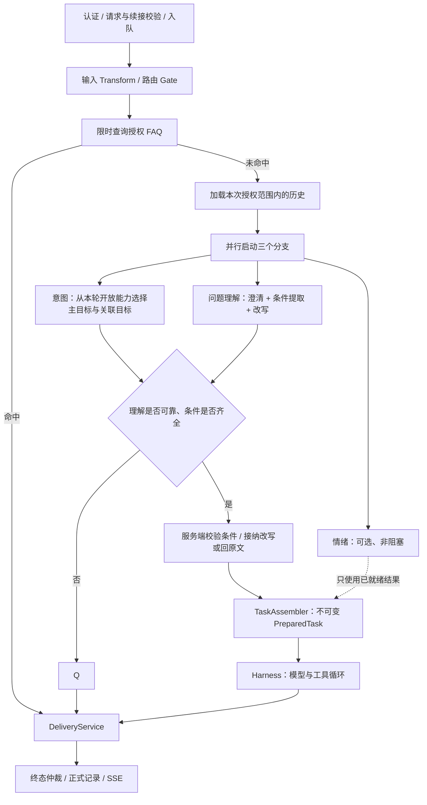

# 统一入口与问题理解

<!-- governance-classification -->
> 文档分类：历史提案，跨模块架构已由统一技术设计替代。本页保留原文和原日期，不能代替当前验收。见[统一技术设计](Agent架构与工程治理技术设计.md)和[文档索引](README.md)。

更新：2026-11-07。本页描述当前实现：FAQ 短路 → 历史与页面上下文 → 意图、问题理解、情绪三路并行 → 服务端汇合校验与默认补齐 → PreparedTask → Harness。改写仍是理解分支的一项可选输出，不新增节点或模型调用。

## 执行顺序



所有问题提交 `POST /api/agent/runs`，统一返回 202 和任务快照。FAQ 表示绕过模型和工具循环，不改变异步响应协议。

## 为什么这样安排

| 阶段 | 执行方式与原因 |
| --- | --- |
| 身份、输入、会话与续接 | 串行前置，先固定可信身份与原始任务范围 |
| FAQ | 模型调用前查询；命中则不启动三个识别分支 |
| 历史 | FAQ 未命中后加载授权历史，三个分支读取同一份不可变快照 |
| 意图 | 独立关键分支，只分类当前任务；不能授予权限或提供执行条件 |
| 问题理解 | 一次小模型调用完成澄清判断、条件提取、Query 改写，避免重复理解与判断冲突 |
| 情绪 | 与问题理解并行，汇合时只取已完成结果，不额外等待 |
| 校验与组装 | 汇合后运行确定性规则、意图一致性和条件校验，再固定任务；模型候选不能成为授权依据 |

意图与问题理解是关键路径，分别使用独立截止时间；并行耗时取决于较慢的关键分支，而不是三次时延之和。原文规则已确定的任务优先于模型分类；规则未识别不等于条件冲突。任务目标确实未知时澄清，识别服务故障以系统错误结束，不要求用户补充不存在的缺失条件。视频指标意图缺乏可验证条件时不直接放行。结束时取消未完成分支。条件可靠但改写无效时使用原文。

三个并发请求仍按三次模型尝试计入预算和提供方用量。本项目没有 kflow 老链路；本次不增加虚构回退、账户尾号灰度或外部 FAQ 检索评分阈值。

## 模型输出与条件边界

`PreparationModelPort` 提供三个方法：

- `understand(Input, CallControl)` → `Understanding`。
- `emotion(Input, CallControl)` → `Emotion`。
- `recognizeIntent(Input, CallControl)` → `IntentRecognition`，从本轮真实开放能力选择 primary / related。兼容接口 `intent` 返回粗分类。

三个分支读取相同的规范化问题、业务日期和受限历史，不读取另一分支的结果。模型适配器仅发送必要输入，不发送完整身份范围。理解分支继续合并澄清、条件提取和改写，不增加第四次改写模型调用。

```json
{
  "needsClarification": false,
  "clarificationQuestion": null,
  "conditions": {
    "video_id": 1001,
    "date": "2026-10-22",
    "metric": "bullet_count"
  },
  "rewrittenQuery": null,
  "issue": "NONE",
  "missingFields": []
}
```

要求澄清时，必须提供问题，conditions 为 {}，rewrittenQuery 为 null。结构化字段、布尔类型、条件标量和载荷边界由适配器与契约校验。

候选条件只能是服务端确认条件的子集。数字允许 JSON 整数类型差异，但字符串 ID 不能替代数字。已知任务中模型遗漏的字段由宿主补齐；多余字段或不一致值被舍弃，不能替换宿主条件。未知任务不能凭模型字段获得执行条件。

### 默认补齐与必要澄清

条件来源顺序：用户明确要求 → 已校验页面上下文 → 现有 Skill 默认值。默认值单独记来源，不写成用户原话。

- 原句“生成个视频的报告我看看”：已开放报告能力、存在唯一可读当前视频时，复用现有报告解析、来源选择与时间规则。自己的视频采用现有观众报告模板；他人的公开视频采用纯视频内容模板，不获得评论或弹幕读取权限。
- 未指定反馈时间范围时复用现有全量保留区间（1970 起至本次请求时间），不另设“最近七天”。明确日期、排除来源或片段范围继续保留。
- 模型要求澄清时，只有 `issue=MISSING_FIELDS` 且列出的每个缺失字段都能由宿主确认，才继续执行。目标歧义、约束冲突、必要确认和旧协议未说明原因的澄清保持阻断。无视频、多视频候选、只有开始时间、无法识别的来源限制均不能用模板覆盖。
- 权限拒绝是硬失败。理解服务不可用，或意图服务不可用且原文规则无法确定任务时，返回 `MODEL_UNAVAILABLE`。

安全改写检查长度、数字、时间、来源、排除与写操作词，并用同一时间、页面和权限重新解析，要求任务类型、执行条件和读取合同等价。无法验证时保留原文；未知任务、资源选择不接纳改写。空改写是正常情况，不计降级。当前是保守的任务等价校验，不是通用自然语言等价证明。

`TaskAssembler` 使用服务端解析的 Specification 固定条件与来源，不直接保存模型候选作为执行条件。PreparedTask 同时固定权限、资源版本、工具上限、截止时间和模型尝试次数预算。

## 超时与失败

| 阶段 | 默认 Demo | DeepSeek profile | 失败处理 |
| --- | --- | --- | --- |
| FAQ | 300ms | 300ms | 普通故障降级到并行识别；权限或策略拒绝为硬失败 |
| 意图 | 2s | 10s | 原文规则可确定则保留规则；否则系统失败 |
| 问题理解 | 2s | 10s | 系统失败；已有确定性缺条件问题可直接澄清 |
| 候选条件 | 同步校验 | 同步校验 | 已知任务舍弃不一致候选，保留宿主条件；未知任务不放行 |
| 改写 | 随理解结果返回 | 随理解结果返回 | 空值正常跳过；不合格或语义变化回原文，记录 rewrite 降级 |
| 情绪 | 300ms 上限 | 3s 上限 | 汇合时未完成：UNKNOWN / skipped；已观测普通故障：UNKNOWN / degraded |
| 请求总时限 | 30s | 120s | 从创建起计算，统一取消所有分支 |

三路截止时间都从提交前计算，包含排队时间，并受总时限约束。等待一个关键分支不延长另一个的截止时间，已经在截止前完成的兄弟分支仍可使用。Future 中断不能强制停止不合作的客户端，真实适配器必须落实 CallControl。

`AgentException` 表达权限、预算等硬拒绝，不按普通故障忽略。取消和硬拒绝会通知其他分支；晚到结果不能覆盖终态。

阶段标记：

- `understanding`：合并后的理解调用。
- `intent`：独立意图调用。
- `emotion`：可选情绪调用。
- `rewrite`：理解结果中的逻辑子阶段，不代表独立模型调用。

FAQ 短路时，skippedStages 包含 intent、understanding 和 emotion。原文与准备规则在启动三路前检查，结果由汇合节点统一处理。理解要求追问时 rewrite 被标记跳过；仅改写无效时 degradedStages 包含 rewrite。

### Trace 核验

三路节点保持原位置。理解节点记录模型建议；汇合节点记录最终宿主决策，二者允许不同。汇合详情展示规则任务、最终任务、默认字段、合并原因和改写采用／舍弃／跳过；原始正文仍依现有权限查询载荷。字段来源保存在冻结的 Specification 中，采用改写也不覆盖来源。

`PreparationDefaultsTest` 复现原始 Trace 请求，覆盖三次前置调用、作者与公开页面模板、必要澄清、排除来源、明确日期、改写等价及无效改写回原文。前端回归校验汇合摘要和改写状态，历史 Trace 缺少新属性时不伪造结果。

本轮验证：后端执行 `mvn -f agent/pom.xml '-Dtest=*,!CompactionOnlyIntegrationTest' test`；该压缩数据库用例及其继承用例需要专用 `_it` 数据库，本地未配置，未将它们计作通过。其他带环境开关的集成／付费模型用例按原条件跳过。新增边界补充后再执行准备、适配器、任务契约、Trace、HTTP 评估定向回归。前端 `npm run test:agent` 85 项通过，构建通过。本轮为本地代码验证，尚未进行服务器真实模型验收或部署。

### 实现借鉴

已阅读 [LangChain history-aware retriever](https://github.com/langchain-ai/langchain/blob/d9caf083577c43a91c5bf6bd1f7dfc289581184d/libs/langchain/langchain_classic/chains/history_aware_retriever.py)、Spring AI 的 `RewriteQueryTransformer` / `CompressionQueryTransformer` / `RetrievalAugmentationAdvisor`（提交 `9993102c830c132b88cb6857c0cdf41a22747432`）和 LlamaIndex 的 `condense_plus_context`（提交 `444fdf0684707de62ebb447d658dba137dd9cb99`）。借鉴条件触发、原问题与派生问题分离、无效结果回原文；本项目在现有 Java 准备链内实现，不引入这些框架。检索专用改写仍应留在将来的检索边界，不能用其替换全局用户指令。

## 调用预算与观测

`preparationCalls` 统计实际启动的意图 / 理解 / 情绪调用，正常上限为 3；分支在启动前被取消时可能更少。FAQ 短路为 0，不按固定值补记调用。

`modelCalls` 统计 Harness 与收尾，`totalModelCalls` 是两者之和，默认共用 16 次上限。该计数是请求内尝试次数，不是 Token 或费用账本。

Trace 包含 `agent.prepare.intent`（span.type=intent_recognition）、`agent.prepare.understanding` 与 `agent.prepare.emotion`。`preparation.intent` 记录枚举分类；候选能力与主／关联目标另列属性。汇合节点记录最终分类，不把模型的原始分类误当最终决策。这些属性不保存问题正文。意图 Prompt 为 `preparation.intent`，理解 Prompt 为 `preparation.understanding`；内容与版本纳入任务资源快照。

## 配置迁移

使用 `agent.preparation.intent-timeout` 配置新增意图时限；understanding-timeout 与 emotion-timeout 保持各自语义。单独改写不是网络阶段，没有独立超时。

Java 自定义 PreparationModelPort 实现需新增 intent 方法。PreparedRequest 新增 intent 字段，旧记录缺失时读取为 UNKNOWN；保留旧构造器用于已有调用点。HTTP 输入不变，输出增加 preparation.intent，严格校验客户端需同步适配。历史终态读取不会因 UNKNOWN 重新执行任务。

执行器、SSE、存储和恢复边界保持既有约定，参见[持久化存储接入](持久化存储接入.md)和[接口契约](接口契约.md)。
