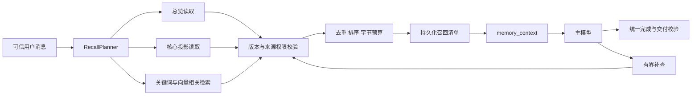
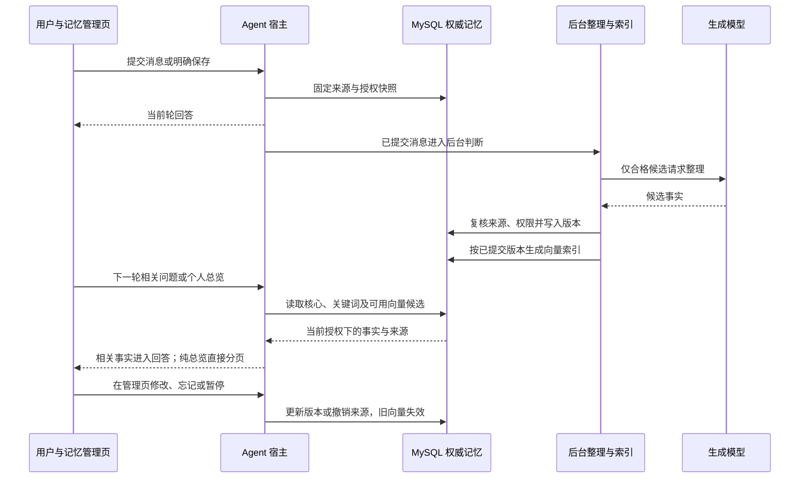

# 记忆召回重构技术方案

状态：已按用户随后确认的“移除模型记忆Tool”方案完成本地实现，独立实现审查通过；最终行为见第18节，验收见第19节。设计日期：2026-11-08，实施收尾：2026-11-09。前文为原目标设计，不代表已经部署。遵循[架构治理入口](Agent架构与工程治理技术设计.md)，既有发布证据见[记忆机制改造与验收](记忆机制改造与验收.md)。

## 1. 问题与交付目标

Trace `527cf5b179e40743fcbb537d686b7cbd` 在两次记忆搜索的批次准入阶段报 INVALID_ARGUMENTS；空查询按工具声明合法，却被统一校验拒绝。Trace `c1aedec32a64f084540db0fe3b759534` 最终成功，但普通的“你了解我吗”产生空查询失败、搜索“用户”、分别搜索“偏好”和“目标”四次工具尝试，主模型调用4次。两条链路的自动召回候选均为0。

深层原因是记忆总览与相关检索没有区分、关键词匹配不能识别宽泛总览请求、核心索引只覆盖部分新写入偏好、工具结果缺少检索覆盖范围说明，以及批量校验与单次校验的纠错语义不一致。单纯允许空字符串不能完成此改造。

完成后必须满足：

1. 普通记忆总览由宿主一次准备本人可读记忆，在正常材料预算内主模型只调用1次，不调用记忆搜索工具，不读取记忆 Skill。
2. 普通个性化回答由宿主提供核心偏好与相关记忆；允许复杂追问有界补查，不能无上限换关键词搜索。
3. 内部检索可分多路执行，但不会形成主模型逐类搜索的多轮循环；内部数据库查询次数与模型工具调用次数分别计账。
4. 所有记忆必须能追溯到用户来源、真实版本及读取权限；模型不能根据两个独立事实补造关系。
5. 首次、重复、跨会话、重启、撤权、降级路径均有可验收行为。错误、部分材料和无记忆必须能够区分。

## 2. 调研证据与采用决定

调研日期为2026-11-08，以下链接为当日 main/官方文档，实施前记录实际采用的 commit SHA；可变 main 链接不能作为精确版本兼容证明。

| 来源 | 观察到的机制 | 本项目采用与取舍 |
|---|---|---|
| [Mem0 search/get_all 源码](https://github.com/mem0ai/mem0/blob/main/mem0/memory/main.py) | 搜索与按身份过滤列出分开；search 内部向量检索，可选 rerank | 分开总览与相关检索；权限过滤由宿主固定。无需为了总览强制做向量相似度搜索 |
| [Mem0 搜索说明](https://github.com/mem0ai/mem0/blob/main/docs/core-concepts/memory-operations/search.mdx) | user 范围、top_k、threshold、可选 rerank | 使用有界候选、范围过滤、结构化覆盖信息；不将其阈值直接移植为本地默认 |
| [Claude Code 官方记忆文档](https://code.claude.com/docs/en/memory) | MEMORY.md 索引有行数/字节上限；主题文件按需读取 | 先提供有限索引与常用事实，详细历史按需补查。数据库用户系统不照搬本地文件存储 |
| [richstav/claude-code 相关选择源码](https://github.com/richstav/claude-code/blob/main/src/memdir/findRelevantMemories.ts) | 根据记忆目录旁路模型选择，结构化返回，失败返回空列表 | 参考宿主先组织材料的边界；此仓库为社区源码整理，不是官方产品行为保证。本项目首版不新增每轮旁路生成模型 |
| [CRAM](https://github.com/ZichKoding/claude-memory-engine) | 每轮 hook 检索注入，深查另外提供入口 | 自动召回与主动深查分开。借鉴方式，不引入其本地账户/授权模型 |

确定使用现有 MySQL 权威记忆库、事务 Outbox、后台整理与 Dream、受控 memory_context。新增受预算约束的向量相关检索作为完整目标的一部分，与关键词融合；总览不依赖 embedding 服务。rerank 定义扩展接口并通过离线样本决定启用，不作为总览正确性的前提。现有反馈 embedding 通道只有在身份隔离、模型标识、维度与数据生命周期验证后才能复用客户端；不混用反馈向量集合。

## 3. 当前与目标的边界

| 项目 | 当前事实 | 目标 |
|---|---|---|
| 触发 | 关键词相关召回；模型再调用通用记忆工具 | 宿主分类为 NONE / RELATED / OVERVIEW，一次生成记忆包 |
| 总览 | 依赖模型猜搜索词 | 独立按账户读取、类型配额与完整性声明 |
| 核心 | 部分后台新偏好的 is_core | 有版本的身份/响应偏好投影，旧数据可重建 |
| 相关 | 精确关键词 | 关键词与语义候选融合，源与权限校验后排序 |
| 补查 | 普通工具循环 | 相同计划复用、每轮有限请求及明确覆盖信息 |
| 写入 | 增量整理与 Dream 已发布 | 保持事务边界，补齐投影更新、关系证据与分类修复 |
| Trace | 已有召回/后台任务节点 | 增加计划、通道、覆盖、失败原因和补查决策 |

## 4. 模块与调用顺序



`memory` 模块拥有 RecallPlanner、OverviewReader、CoreProjection、RelatedRetriever、RecallAssembler、RecallManifestStore、RecallSupplementPolicy。runtime 通过宿主的显式召回入口和工具准入 SPI 调用，AgentRuntime 不包含记忆工具名、总览正则或用户分类逻辑。

顺序：身份认证 → 建立记忆边界快照 → 装载必要近期可信用户文本 → 规划召回 → 独立准备节点与召回按依赖执行 → 原子保存记忆包清单 → 上下文组装 → 主模型。规划不依赖主模型先回答，也不依赖读取 Skill。总览与相关召回共享同一账户快照 sequence、consentEpoch、eraseEpoch。

核心与相关查询可并行；总览不额外运行语义搜索。召回具有独立有界执行池、队列、账户/全局并发上限、deadline；取消后的真实 worker 退出前不释放容量。检索超时不改变任务总 deadline。

## 5. 召回计划与意图

`RecallPlan` 字段：version、mode、normalizedQuery、scope、categoryFilters、reason、snapshotSequence、policyVersion、queryFingerprint、deadline。scope 中 tenant/user 来自认证；VIDEO 只在当前请求明确关联已授权视频时使用，页面环境本身不授权扩大检索范围。

- OVERVIEW：用户询问已记住的信息、身份、偏好或目标概览。支持“你了解我吗”“我的信息你知道多少”“你记得我的什么偏好”等同义表达及承接语。类型问题映射分类过滤，不把“偏好”作为正文查询词。
- RELATED：当前任务需要历史偏好/事实或默认轻量个性化。只补充短指代请求所需的近期用户消息，禁止把助手推测和视频正文用作本人记忆查询意图。
- NONE：模式关闭、明确本轮不要使用记忆、无需个性化且预算不允许。显式保存/遗忘走既有管理流程；混合请求分别规划回答和写入。

规划器先采用可测试的规则与现有结构化意图结果，无额外生成模型。疑似总览但不确定时使用个人小型摘要，不自动扫描视频记忆。规则覆盖中文口语、否定、引用和询问“记忆功能是什么”；引号中的指令不变成管理动作。规则不能无限扩展：维护固定意图样本，错误归类必须进入回归集。

## 6. 总览读取与规模控制

OverviewReader 从当前快照下的可读条目读取，不要求 query。使用真实 kind/attribute 分类，不能匹配正文包含“偏好”来判断其类型。

先取各类别候选，按明确声明优先、重要度、最近确认排序，身份/偏好/目标之间有独立配额；同一记忆只出现一次。小于条数和字节预算的全部可读记忆直接提供；超限时提供各类代表与覆盖状态，允许用户要求继续。不能通过截断单个 UTF-8 字节序列满足预算；单条正文过大时提供已持久化且带版本的摘要，尚无摘要则标记 omitted，并保留读取引用。

读取采用 keyset 分页与单轮扫描上限，不做无界 COUNT/全库扫。`complete=true` 仅表示当前明确 scope、分类、快照下已读完全部可读结果；预算或扫描上限触发则 false，hasMore=true。无法在预算内精确计算总数时返回 total=null、lowerBound，不把候选数当总数。分页游标由服务签名，绑定身份、run_id、manifest_id、consentEpoch、eraseEpoch、scope、sequence、policy、过滤条件、完整排序末键和过期时间，防止改账户或扩大读取。

历史失效、当前撤权、来源到期均排除；权限拒绝与缺少记忆分别内部计数，用户端不泄露无权限条目是否存在。

## 7. 核心投影与相关召回

核心投影包含用户明确提供且适合长期使用的基础身份与稳定响应偏好。姓名属于 PROFILE，不属于 PREFERENCE；“来自某大学”保存原关系，不自动转成在读、学历或专业。仅“用户是一名学生”和“用户来自天津大学”不能由整理器合成就读关系。

核心是读取优化标签，不产生新事实；原记忆版本与来源仍是权威。投影由后台按原子更新的版本维护；手工写入、旧数据、显式写入都能进入重建队列。分类不确定就进入普通候选，不能为了提高命中率强行设 core。

RelatedRetriever 在相同权限范围内并行取得关键词与向量候选，通过 RRF 融合后去重，最后以来源可读、时间有效、版本一致、相关性、重要度确定顺序。核心与相关复用同一 id/version 去重。使用当前问题向量，不让主模型循环生成搜索词。弱相关不强塞；无候选合法返回 EMPTY。

检索结果中的“学生”等分类标签可检索，不能取代原始证据。向量不能用于证明事实，不能绕过 MySQL 的撤权。语义阈值按固定 embedding 版本的标注集校准，不沿用反馈聚类阈值。rerank 输入仅为已授权有限候选，失败回到融合排序；主模型调用和检索/重排计费分别统计。

## 8. 数据与索引契约

复用 item/revision/source/dependency/account/index；新增字段/表通过下一未占用的 Flyway migration 引入，实施时分配编号，不覆盖 V26。

| 数据 | 关键字段与唯一性 | 用途 |
|---|---|---|
| 读取投影 | tenant,user,memory_id,revision,projection_version；kind,attribute,summary,importance,is_core,status | 对每个版本生成可重建的有界摘要/分类 |
| 语义索引记录 | tenant,user,memory_id,revision,embedding_model,dimension,content_hash；state,error,generated_at | 明确 PENDING/READY/FAILED/OBSOLETE，不把缺向量视为无记忆 |
| 召回清单 | run_id,manifest_version,plan,selected_refs,source_refs,coverage,policy_hash,input_hash,created_at | 原子恢复及受保护 Trace 的输入依据 |
| 补查账本 | run_id,request_fingerprint,call_id,state,manifest_delta,attempts | 幂等复用、预算恢复及配对 |

向量按独立 collection/index 命名空间及 tenant/user 过滤；查询后逐条 MySQL 重新授权。embedding 文本只能来自已经提交的版本。记忆提交事务同时写投影/向量更新 Outbox；消费者按 id/version/model/hash 幂等，晚到旧任务不覆盖新版。删除/撤权立即由 MySQL 禁读，同时发删除事件；向量物理清理失败不允许被重新召回。来源文本和向量保留/备份/清理期限进入既有隐私清理流程。

模型或维度升级新建索引并后台回填、校验覆盖率后切读；同一查询不能混合不同维度的向量。索引缺失时用关键词/核心降级，禁止前台同步补算所有记忆。Redis只可缓存投影或计量，key包含sequence/epoch/版本；每次使用仍校验权威边界。

## 9. 记忆包与回答契约

记忆包采用独立数据槽位，不作为系统指令。示例（数字仅说明格式）：

```json
{
  "schemaVersion": "2.0",
  "mode": "OVERVIEW",
  "scope": "USER",
  "snapshotSequence": 15,
  "status": "READY",
  "coverage": {"complete": true, "selected": 3, "total": 3, "hasMore": false},
  "items": [
    {"id": "真实UUID", "version": 1, "kind": "PROFILE", "text": "用户来自天津大学。", "relation": "affiliation_unspecified", "sourceRefs": ["受保护来源引用"]}
  ],
  "limitations": []
}
```

items 条目必须是真实 id/version；relation 仅在原来源支持时提供，不能为了补字段生成。来源引用不包含会话令牌/裸 API 地址。READY/EMPTY/PARTIAL/UNAVAILABLE/DISABLED为不同状态；EMPTY 仅在查询成功且确实没有可读结果时返回。缓存命中同样返回 coverage 和版本。

回答要求：只陈述包内可支持事实；部分总览表述“目前查到”；无匹配只能说“本次没找到相关记录”；来源不可用不能说“我不记得你”；不同事实不能自动合成身份关系；后台未提交不能承诺保存成功。总览本身不触发记忆新写入，后台依然可以记录 observation，但 NOOP 不产生新记忆。

## 10. 工具与 Skill 重整

普通回答已收到足够记忆包时不暴露 search_memory/read_memory；写入/删除工具按当前用户明确授权单独准入。总览超限或用户要求深入检索时暴露单一 `recall_memory` 补查工具，支持 mode=RELATED/OVERVIEW、query、categories、cursor；scope由宿主固定，工具不能指定user_id。一次响应带可用正文、来源引用和覆盖状态，避免搜索后必须再逐条 read。

如用户明确要求原始来源，提供独立的受保护详情读取，不在普通回答中自动展开整段聊天历史。Skill 只解释记忆管理能力和特殊操作，删除“先读Skill再召回”的默认路径及旧写入成功承诺；旧 search/read 工具退出新Run目录，保留持久旧Run的冻结目录到生命周期结束，不凭空将新工具结果配给旧call_id。

补查限制：每轮默认最多1次成功补查、1次参数纠正；相同 plan/query/cursor/version 请求复用账本，不重复执行；补查后仅允许回答或告知材料限制，不能继续轮换同义关键词。用户明确要求下一页构成下一轮请求。精确预算在 policy 中持久化，重启不归零；安全授权失败不可通过纠错重试放行。

通用工具校验按声明的 minLength、type、enum 校验；禁止所有字符串隐含 nonblank。需要非空的字段由目录明确声明并验证消费处一致。单调用和批量准入统一返回结构化 ValidationRejected，指出 call_id、字段、可信错误码；在任何handler执行前完成整批校验，参数错误允许同样的有限纠正。混组/授权失败保持独立语义，不能笼统 catch 所有异常后继续。保留原生 tool_use/tool_result 配对，每个无效call也有结果；hook变换后重新校验且共用本轮纠错预算。

## 11. 写入、Dream 与恢复

保留“消息落库与Outbox同事务 → debounce窗口 → 有界后台提取 → 来源校验 → 提交/投影事件”的可靠流程。明确保存走DIRECT确认入队，普通消息按账户开关判断；读取与自动写入开关独立，旧账号关闭设置不被迁移覆盖。UI清楚显示自动整理状态。

每个候选标记事实类型、attribute、关系证据、来源用户消息及处理结果；姓名等旧错分进入可审计修复队列，不能无来源自动补身份。Dream只处理有依据的重复/失效关系，不能把并列事实写成新关系；手工来源的保护规则保留。

召回清单提交前异常，不发布半个记忆包；提交后重启按相同manifest恢复，不悄悄换成最新快照。恢复前校验每个引用和当前epoch，撤权则取消或重新建立受控上下文；禁止继续使用旧私有正文。已经开始的普通RUNNING崩溃维持既有失败语义，不引入无幂等证明的模型重放。

若读取服务故障，普通通用问题可跳过记忆继续回答并在Trace标记UNAVAILABLE；身份/记忆总览问题明确说明当前无法读取，不编造空结果。来源授权拒绝不能被降级成直接注入缓存。物理对象存储503采用有限退避，仍失败就区分“详情不可用”与“主任务失败”。

## 12. 配置与资源预算

以下为拟新增或重整的启动配置，归 `agent.memory.recall` 所有；实施时与现有 policy/runtime 重复项合并，禁止两个生效入口。Run建立时保存有效策略；实时权限/撤权不被冻结。调整需重启，新Run生效，旧Run用保存的预算；未知旧策略采用明确legacy标识。

| 配置 | 默认 | 合法范围 | 消费点 |
|---|---:|---|---|
| overview-max-items | 20条 | 1–32 | 总览装配，仍受Run累计引用余额限制 |
| overview-max-bytes | 8192 B | 1024–32768 | 总览UTF-8正文预算 |
| overview-scan-limit | 200条 | max-items–2000 | 分页扫描上限 |
| core-max-items | 4条 | 0–12 | 核心装配 |
| core-max-bytes | 1536 B | 0–6144 | 核心装配；为0时禁用核心 |
| related-max-items | 6条 | 0–20 | 融合结果装配 |
| related-max-bytes | 4096 B | 512–16384 | 相关正文预算 |
| keyword-candidates / vector-candidates | 各20条 | 1–100 | 有界候选检索 |
| timeout-millis | 800 ms | 100–5000 | 每轮整体召回deadline |
| supplement-max-calls | 1次 | 0–2 | 本轮补查账本 |
| supplement-max-corrections | 1次 | 0–2 | 参数纠错；归通用预算同时约束 |
| vector-enabled / rerank-enabled | true / false | 布尔 | RELATED；失败有降级 |
| cache-ttl-seconds | 60 s | 0–300 | 已授权查询缓存；0禁用 |

线程池/全局并发复用memory运行治理的强类型配置并明确上限；队满返回UNAVAILABLE，不无限排队。记忆包仍服从总上下文Token预算，Token估算后预留当前用户输入与回答额度；两个预算先耗尽者生效。数量、字节、token和时间分别计量。语义阈值、embedding模型/维度及rerank版本由检索profile管理，配置缺失或维度冲突启动失败，不能悄悄使用供应商默认模型。

## 13. Trace 与监控

主Run内真实父子：memory.plan → memory.overview 或 memory.core + memory.related（并发）→ memory.authorize → memory.assemble → memory.commit_manifest。仅实际存在的span才连接，不靠时间推测因果。额外工具补查作为 agent.tool 子树，引用初始manifest；后台 consolidation/Dream 保持独立任务Trace，通过sourceRunId/trace links关联，不伪装成前台串行节点。

记录 plan.mode/reason、scope、policyHash、snapshotSequence、各路候选/耗时、权限过滤/失效/重复/预算排除数量、selected/core/related数量、coverage.complete/hasMore、index版本及覆盖状态、降级原因、补查次数和重复复用。不将私有正文放到可搜索span属性；详情走既有source guard，记录完整输入清单以支持后续撤销。

图上应看出“本轮自动提供3条记忆”而非重复的“正在搜索”；详情展示本次为何选择这些记忆及是否还有更多。后台统计区分本次同步模型、embedding/rerank、后台提取和历史缓存成本。监控补查率、重复查询率、空召回率、降级率、延迟、权限拒绝、索引滞后，不以命中条数越多越好。

## 14. 迁移与清理

1. 建立schema、双读兼容和召回清单格式；默认维持旧行为。迁移数据库前备份并验证旧worker排空。
2. 后台对有效版本回填投影/索引；来源不明不补造来源，标记不可读原因。修正旧类型需保留原版本/审计及幂等记录。
3. shadow运行新计划但不向模型重复注入、不扩大原权限；比较固定样本，记录额外成本。shadow只读，不改变消费清单或提交状态。
4. 按隔离账号启用新版上下文和工具目录，完成验收后切新Run默认。一个Run只用一个召回版本，不能同时跑两套搜索与注入。
5. 旧Run到期后移除旧search/read工具、重复配置和过时Skill段落；清理必须基于仍在使用的持久资源引用，而不是只看运行中数量。

回滚分别处理代码、策略、索引：新Run可切回旧策略；已有V2 Run需由兼容读取器处理，不能由不能识别V2的旧二进制直接接管。schema采用扩展式迁移，索引可停写但权限与删除事件继续消费。不得自动恢复数据库备份覆盖期间的用户数据。明确哪些降级仅影响相关召回，哪些必须停止私有详情读取。

## 15. 验收矩阵与发布门槛

| 场景 | 必须证明的结果 |
|---|---|
| 原两条Trace的同义输入 | 自动生成OVERVIEW；正常预算内主模型1次、记忆搜索工具0次，直接回答已有事实 |
| 无记忆/关闭/服务故障 | EMPTY、DISABLED、UNAVAILABLE清晰区分，不假装读取成功 |
| 多于20条或超字节预算 | 有类型覆盖、不无界读库、complete=false、可继续；不说已经知道全部 |
| 新老/手工/自动条目 | 均能总览；核心分类来源明确，历史偏好不会因缺新索引永久消失 |
| 同义相关提问 | 固定人工标注样本评估Recall@k、无关注入和证据准确率；关键词、向量、融合分别对照 |
| 姓名、学校、学生身份 | 分类正确；不得合成未被原话支持的就读关系 |
| 复杂历史追问 | 至多1次补查成功，重复请求复用、参数纠错受限，无连续换词循环 |
| 单次与批量空query | 工具声明允许就成功；真正无效字段均有可纠正的配对结果，不崩整轮 |
| 非法scope/跨账户/删除来源 | 在缓存命中、向量命中、恢复、补查及Trace详情路径均不可读取 |
| 后台停机、晚到事件、模型升级 | 幂等恢复、旧版本不覆写新版本、不混维度，删除不复活 |
| 索引故障/超时/容量满 | 有界降级，总览仍可用，相关问题不捏造个人事实 |
| 重启与取消 | 相同manifest恢复、补查预算不重置、真实worker退出后释放资源 |
| SSE与界面 | 正文保留且只交付校验后的事实；进度与Trace一致，无私有ID/API路径直出 |

真实服务器按“已有历史记忆、新账号自动学习、自动开关关闭但仍允许读取、明确保存、删除及撤销、总览分页、语义索引故障”验收，记录代码SHA、配置、账户隔离方式、主/后台Trace和报告结果。至少连续20次总览无重复搜索；这只证明固定集稳定性，不作为普遍准确率声明。

上线门槛：契约、权限/恢复和原生调用配对测试全过；固定真实表达样本无身份事实扩展；定向和完整运行时测试有当次零失败记录；非默认配置消费测试通过；独立设计与实现审查P0/P1关闭；生产真实验证及Trace证据落档。没有完成索引回填、故障/撤权验证或完整测试时标记未完成，不用“已有基本功能”作为交付终点。

## 16. 实施拆分与完成记录

按可独立审查的模块推进：A 契约与统一校验；B 计划/总览/核心投影和历史回填；C 语义索引与融合检索；D 记忆包/补查预算/旧工具退役；E 来源关系与写入分类；F Trace/UI/迁移/真实验收。各阶段都要有代码、测试和文档，不将A阶段当完整方案交付。底层schema和权限先完成，再接模型可见行为。

本节为原设计阶段的拆分记录；独立设计审查修订见第17节，用户后续确认的无Tool实现和实际验收见第18、19节。实现与发布状态必须按最新验收记录判断。


## 17. 独立设计审查后的约束补全

2026-11-08独立审查发现容量、接入点、分页恢复和SSE事实校验四项阻塞，以下为必须实施的约束，优先于前文概述，修订后需复核。

### 17.1 真实接入点与累计预算

当前 ContextAuthority 仅有 verify，不具备prepare/recall入口。保留宿主对MemoryRecallService.begin/recall/restore的显式调用，在recall内部消费计划与新检索器；上下文装配只消费生成包，ToolDispatcher准入消费补查策略。若新增SPI，必须同时接入应用工厂、Spring装配及手工构造路径测试，禁止未消费接口。

每Run累计根引用硬上限32，初始召回、继承、详情与补查共享，按id/version去重。配置绑定强制core-max-items+related-max-items<=32，overview-max-items<=32。每次新增引用仍按权威账本余额裁剪，不能以字节预算取代引用上限。无余额返回BUDGET_EXHAUSTED、hasMore=true，禁止complete=true；下一用户轮建立新边界继续，不在同Run偷偷重置额度。

### 17.2 分页与跨轮继续

游标签名绑定tenant/user、run、manifest、epochs、scope、快照、策略、分类过滤、完整稳定排序末键（重要度、确认时间、sequence、UUID）和期限。同Run恢复复用manifest及预算；epochs改变游标失效。过滤不可读条目后继续有界扫描，耗尽扫描预算则PARTIAL，不误报已穷尽。

下一轮“继续”由宿主验证旧游标的归属与授权，创建新Run快照后重新签发游标，不直接跨Run复用旧令牌。若账户sequence变化，返回SNAPSHOT_CHANGED并从新总览开始，明确不保证跨快照页间无重排；如sequence不变，允许在新Run新清单下沿原稳定末键继续。任何授权变化均重新校验来源，不从旧游标释放正文。

游标同时绑定账户projectionVersion/排序版本，投影重建会原子增加该版本。即使memory_seq未变化，投影版本变化也返回SNAPSHOT_CHANGED，防止页间排序漂移。分页查询在固定投影版本上执行；版本保留不可用则重新开始，不回退到当前排序继续。

### 17.3 总览事实输出与SSE

总览采用结构化ResponsePlan：facts数组只允许引用memory_id/version与投影事实单元ID，另有覆盖提示枚举、问候枚举；不允许模型自由生成新的身份关系正文。宿主校验引用在本轮包内、当前来源仍可读、事实单元hash一致，最终以固定自然语言模板渲染已有原文事实。类似“天津大学学生”只有对应原始事实单元存在才可呈现；“来自天津大学”和“学生”分别渲染，禁止模型通过自由合并产生新关系。

总览的主模型负责选择事实与组织顺序，不能改写事实语义。未知事实ID、超预算、重复引用或不符合schema时允许最多一次受预算约束的输出修正；仍失败使用宿主已验证事实模板回答并记录fallback，不输出未验证文本。正常路径仍是主模型1次。

总览正文在结构化输出完成并经统一完成策略/来源复核之前缓冲，不向SSE推送模型临时正文；进度、心跳可流式。校验通过后发布唯一最终正文，前端不得把provisional文本当最终事实。混合普通问题允许自由回答段，但身份事实采用同样的引用模板块；自由段不得重述未经引用的个人身份关系，不能用关键词过滤证明所有自由文本语义正确。若要对此做硬保证，个人总览任务全程使用模板事实输出，不开放自由段。

普通相关回答的语义忠实度以固定事实回归集与审查衡量，不宣称可由通用schema校验彻底证明。SSE策略在应用ResponseDelivery与模型文本事件投影处实现，runtime不识别记忆工具名。

独立复核结论：四项原设计阻塞已明确解决，设计通过、待实现验证；另已采纳投影版本绑定建议。该结论仅覆盖本文设计，不等同实现或生产验收通过。


## 18. 用户确认后的无Tool实现

用户在原方案审查后明确选择删除模型侧全部记忆Tool和Skill。本节替代第10节的补查工具方案：模型不再暴露search_memory/read_memory/remember_memory/forget_memory，也不再有personal-memory Skill。复杂问题由下一轮宿主重新规划；修改、删除由已有记忆管理API/界面执行，不能让模型暗中改变记忆。

个人总览由MemoryHostService在PreparationService的宿主生命周期中处理，走DIRECT交付：以真实可读记忆原文作为事实单元，宿主逐条渲染，不调用主模型、前置模型或搜索工具。相比原“1次主模型”目标，该路径固定为0次生成模型，彻底排除模型合成身份关系和未校验SSE正文。记忆总览正文来自现有版本，来源依赖仍原子登记并在交付时复查。

V27新增召回清单与独立语义索引表。总览按不可变valid_from_seq和UUID排序，因此不依赖可重建投影的重要度；页游标只存服务器清单，不作为可篡改客户端参数。游标绑定租户/用户/会话/Run及sequence/epochs、过滤kind、版本与末键；下一轮通过最近assistant的同会话Run引用接续，sequence或epoch变化时重新总览。总览每轮有条数、UTF-8字节、最终转义字符、32条累计引用及整体时限约束；未读完明确hasMore。普通“继续”只有确认前一页hasMore才接管，否则历史依赖仍完整继承。

RELATED保留宿主一次召回：关键词与独立记忆语义候选按RRF融合，核心索引优先，并让旧/手工PROFILE记忆能参与核心候选；仅用户明确关联当前视频时读取VIDEO。向量查询在没有READY索引时不外发空查询；局部超时降级，真实Run超时/撤权不能降级绕过。rerank暂不启用，没有额外旁路生成模型。

记忆向量存MySQL专用表，账户最多1000条的现有配额下采用有界精确余弦排序，不共用反馈Milvus集合。异步索引以已提交revision的可靠扫描代替新增Outbox目的地：崩溃不会丢失待生成版本，READY/FAILED及重试时间持久化，按模型版本幂等。独立单worker有界池与整批deadline隔离记忆提取/Dream。每条外发前重新读取正文、核对当前来源与epochs；适配器执行beforeDispatch，返回后和写回SQL再次检查epochs；删除/来源清理同步移除向量，晚到结果不能复活。

启用语义服务须显式配置agent.memory.embedding.enabled=true、endpoint、token-file、revision；模型默认qwen3.7-text-embedding，dimension默认2560，非法模型/维度在适配器初始化时拒绝。未配置时Trace明确标记DISABLED，仍可运行总览与关键词召回，不把本地降级验证当成真实供应商语义效果验收。0.45默认阈值只是可配置初值，启用生产前必须通过固定样本校准。

参数由MemoryRecallPolicy和MemorySemanticPolicy启动绑定并进入配置目录；每个已提交总览清单保存实际kind、snapshot与分页结果，不在恢复时重新挑选。索引provider版本切换新建对应记录，查询只选当前provider版本与维度；旧索引由受控维护清理，不允许跨模型混合比较。

旧工具的物理目录和handler已删除；不保留偷偷可调用的兼容入口。发布时必须排空旧Run，已冻结旧资源目录的未完成Run保持RESOURCE_VERSION_MISMATCH，不重新解释旧调用或重放副作用。不可识别V27协议的二进制不得接管新Run。历史compat清单作为审计证据保留，不注册任何旧能力。

纯总览、续页和转到管理界面的请求在消息事务内标记为不参与自动提取，不额外建立后台生成模型任务。明确保存仍有独立授权路径；这不意味着从未来会话历史中永久移除这些用户消息。

记忆管理页面同步重整：三种模式分段选择，自动整理独立开关，条目卡片与日期，按需展开编辑，按UTF-8上限检查长度；修改保留原类型，忘记/全范围清空有界面确认；跨账户清空私有视图，外部变更立即移除旧列表并保留用户草稿。清空幂等意图绑定sequence和eraseEpoch，避免响应丢失后误重放旧回执。

本轮尚未推送或部署；以下本地验证与供应商合成检查不能替代发布后真实账户链路验收。

### 当前实现的写入、召回与失效关系



这张图表示依赖与安全边界，并不保证后台整理每轮都调用模型；未满足条件或关闭自动整理时不会生成候选。向量索引是可重建派生数据，查询和交付都重新检查当前授权。纯个人总览不经过生成模型。

## 19. 实现审查与执行证据

独立实现审查经过逐项复核，已关闭普通“继续”的依赖继承、最终正文长度、意图误截取、清理生命周期、总览N+1与时限、向量外发前授权、局部超时降级、工作池隔离、晚到epoch fence，以及UI清空幂等回执等发现。最终审查结论为已审代码无未关闭P0/P1；实现审查不替代测试/部署验收。

已执行：前端113项测试通过；记忆管理页用合成数据进行12项浏览器交互验证（包括丢失清空响应后外部新增、背景刷新保留编辑、退出登录清理），桌面与390px窄屏截图已检查。生产前端从HEAD干净副本叠加本轮3个源文件构建，不带入工作区上传功能。

真实供应商合成检查：使用既有配置的qwen3.7-text-embedding，一次请求5条合成文本，返回2560维；“结合实际案例讲技术”的查询与两条例子偏好相似度为0.7041/0.6080，与英文回答、视频剪辑目标为0.3555/0.2947。未读取或外发实际用户记忆。该小样本只验证协议和基本语义排序，不代表正式效果基准，也不是新版本线上链路验收。

完整verify与开启MySQL门控的最终汇总另记录在[记忆机制改造与验收](记忆机制改造与验收.md)末节。可复现的测试入口包括MemoryHostTest、MemoryHostIntegrationTest、MemoryLearningIntegrationTest、MemoryRuntimeIntegrationTest、NativeToolBatchTest和ToolInputValidationTest；MySQL测试强制使用独立的_it数据库。执行原始日志与合成UI截图位于本机忽略的var/governance-release目录，不作为CI必需输入。
