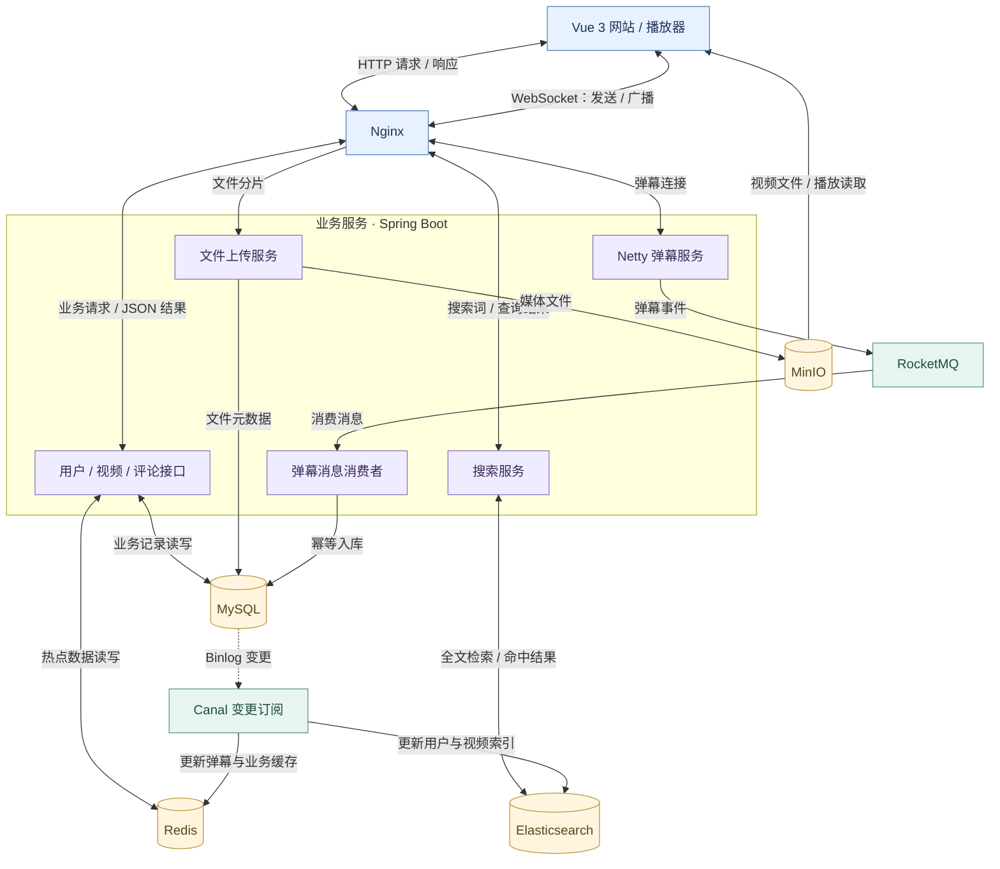
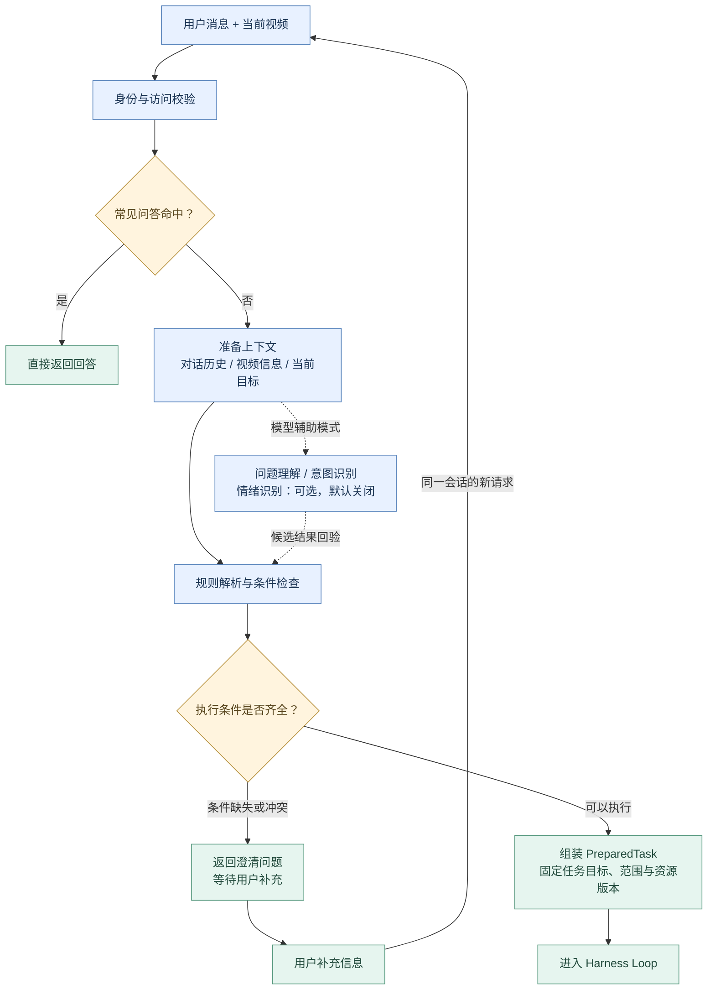
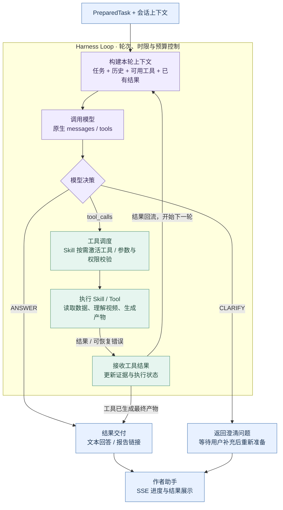

# EchoFrame 架构说明

[返回项目首页](../README.md) · [运行与接入](QUICKSTART.md)

本文说明网站和Agent的整体关系。Agent跨模块职责、配置治理、迁移及实际验收以[统一技术设计](../agent/docs/Agent架构与工程治理技术设计.md)为准，文档导航见[Agent文档索引](../agent/docs/README.md)。

## 后端架构

视频后端采用模块化单体结构。网站通过 HTTP 读写业务数据，通过 WebSocket 收发弹幕；媒体文件、业务记录、缓存与搜索索引分别流向对应的存储服务。

| 层次 | 技术与职责 |
| --- | --- |
| 业务请求 | 网站 → Nginx → 业务接口 → MySQL / Redis，查询结果返回网站 |
| 视频上传与播放 | 上传服务写入 MinIO，并保存文件元数据；播放器读取媒体文件 |
| 弹幕发送 | WebSocket → Netty → RocketMQ → 消费者 → MySQL；Netty 同时负责连接与广播 |
| 数据同步与搜索 | MySQL 变更经 Canal 更新 Redis 与 Elasticsearch，搜索服务读取索引返回结果 |

业务后端代码位于 [`src/`](../src/)，部署说明见[完整网站部署](../deploy/site/README.md)。

## Agent 架构

本次升级的统一实施入口为 [Agent 执行与记忆体系升级技术方案](../agent/docs/Agent执行与记忆体系升级技术方案.md)，涵盖一次召回与恢复、参考成熟源码的原生工具并行和多轮自动记忆。实现沿用本站 Java Harness，不接入外部 Agent 框架。该方案尚待实施，不能据文档推定已部署。

### 动态上下文协议

Agent 输入统一采用 [ContextEnvelope 1.0](../agent/docs/动态上下文架构.md)：固定槽位依次为 system_prompt、tool_catalog、skill_catalog、agent_catalog、execution_context、focus、memory_context、environment_context、reference_context、current_context、runtime_state、output_contract。不存在的模块省略，其余相对顺序保持不变；agent_catalog 当前是可选扩展位，不代表已具备 A2A 调用能力。

ContextAssembler 将已授权的目录、记忆、页面、会话与执行结果归位，NativeContextProjector 投影到模型原生 messages/tools，统一预算门控检查真实请求。current_context 包含压缩摘要与未压缩消息，原生工具调用和结果保持关联；长期记忆单独归入 memory_context。记忆召回独立于装配，权限与来源失效检查覆盖所有消费副本。该协议正在逐步接入，具体状态见专题方案。

会话摘要与长期记忆采用不同作用域，共用来源失效与可靠派生任务机制。[上下文压缩方案](../agent/docs/上下文压缩调研与实施方案.md)规定先精简可回源工具结果，再压缩旧的完整消息前缀，近期原文与当前任务由宿主保留；摘要放入 current_context.compaction。实现已接入可靠后台摘要、固定范围及删除失效；配置默认关闭，部署环境可显式开启。审查与验收边界见[审查记录](../agent/docs/记忆压缩与上下文审查记录.md)。

Agent 是独立的 Spring Boot 服务，分为**前置处理**和 **Harness Loop** 两个阶段。前置处理确定“用户要做什么、能访问什么、执行条件是否齐全”；Harness 根据准备好的任务，组织模型与工具协作完成工作。

### 前置处理：从用户请求到执行任务

请求先经过身份与访问校验。常见问答可以直接返回；其他请求加载会话历史、补全当前视频信息，再解析任务和检查条件。按配置也可以启用模型辅助的问题理解、意图识别和情绪识别。条件不足或存在冲突时向用户澄清，条件齐全时组装执行任务。

默认优先采用规则解析；无法明确解析的请求可进入模型理解与意图识别。情绪识别可选且默认关闭。模型辅助准备的结果仍须经过条件校验，不会直接改变用户权限或任务范围。

### Harness Loop：模型决策与工具结果形成闭环

每轮重新组织上下文，将用户需求、历史信息、可用工具和已有结果交给模型。模型可以直接回答、请求澄清，也可以调用工具；工具结果返回后，更新证据与执行状态，再进入下一轮。

| 组件 | 职责 |
| --- | --- |
| 前置处理 | 完成身份校验、FAQ 路由、上下文准备与任务条件检查；按配置启用意图、理解和情绪识别 |
| 澄清 | 在准备阶段或模型决策中发现需要补充的信息，返回问题，待用户回复后继续处理 |
| PreparedTask | 将准备结果固定为明确的执行目标、数据范围和资源版本 |
| Harness | 组织每轮上下文、模型决策、工具调用与结果反馈，控制执行边界 |
| 模型适配器 | 文本模型负责决策，视觉模型提供采样画面事实 |
| Skill / Tool | Skill 组织能力，Tool 通过业务接口读取数据或执行操作 |
| 存储与追踪 | 保存对话、任务和产物，记录调用过程，支持恢复与排查 |

这套设计将三件事分开：**前置处理明确任务，模型决定下一步，Harness 组织受控执行。** 统计计算、权限校验和报告渲染由代码完成；工具结果作为后续推理和最终交付的依据。达到执行限制、发生不可恢复错误或用户取消时，请求终止，不会无限循环。

Agent 不直接修改业务数据库，发布操作由用户确认后交给业务后端执行。详细开发与配置说明见 [`agent/README.md`](../agent/README.md)。

## 观众反馈的处理边界

反馈分析通过 `analyze_feedback` 提交到后台服务：读取有界快照，保留来源、原始成员与统计信息，按已有主题分批分类并由代码累计。主对话按需通过 `read_result` 读取结果，或通过 `create_feedback_report` 生成报告，不把全量弹幕、评论直接塞入主对话上下文。

代码负责快照、去重、计数、权限、成员覆盖校验和报告渲染；模型负责理解表达、归纳主题和提出建议。后台处理仍受记录数、快照体积、模型调用、Token 与时限约束，超限明确失败，不自动把抽样结果当成全量结论。

纯视频报告使用 `create_video_report`，与观众反馈报告分别校验来源。画面事实来自采样帧；弹幕播放位置不能作为采样画面存在的证明。

普通文本分析交付前，宿主会校验本轮证据对应的全部上层主题已从 offset=0 连续读完；仅有 READY、统计摘要或最后一页不能作为已阅读的证明。读取进度从已记录的工具调用与结果中重建，恢复任务时沿用相同规则。报告由代码读取完整资产并渲染，不要求主模型逐页阅读后再生成。

后台模型纠错保留完整原文、子主题与视频事实，不重复发送被拒绝的主题正文。请求超出上下文预算时，先缩减可选的纠错诊断，必要时以完整原始输入重新生成；不会截断证据或跳过成员覆盖校验。上下文检查在网络请求前执行，后台原有的重试次数和调用预算不变。

当前默认最多处理 5000 条原始反馈，每批最多 80 组，并保留独立的字节上限。分类时携带已有主题标题目录，沿用 T1–T100 稳定编号；最终汇总只按编号累计成员与次数，不再调用模型逐层归并。相同授权主体、请求范围、快照内容、视频事实及模型规则可复用一小时内的进程内分类缓存；重启后需要重新分析。

澄清作为通用 `ask_clarification` 工具开放，宿主负责终态、事件与后续重新准备；准备阶段与工具阶段复用交付机制，工具本身不持有可变任务状态。批次观点采用追加保留，后批模型不再重写旧观点；长度不足时明确提示查看完整记录，HTML 不再截去第 60 个之后的批次话题。

资源查找是共享业务能力：`resource-discovery` 和声明相同能力的业务 Skill 按需开放 `search_my_videos`、`search_feedback`、`read_report`。视频查找由业务桥接层按当前作者查询元数据，唯一目标在准备阶段授权并冻结，多候选进入只读 `resource.lookup` 后澄清。候选本身不授予分析权限。
准备阶段区分单纯列举资源和必须选定目标的后续任务。后者在目标未确定时带有 `selection_required`；交付边界强制进入 `NEEDS_INPUT`，不能因为模型用普通正文追问或直接宣称完成而标记成功。用户明确视频编号后，重新授权并保留原请求的分析来源；查找工具仍保持只读。
资源查找尚未取得本轮证据时，非思考模型请求使用原生 `tool_choice=required`；历史报告任务必须先取得本轮 `read_report` 引用，不能将历史聊天或视频候选当作报告证据。取得引用后恢复 `auto`，普通对话与无工具收尾不强制调用。参数依据 [DeepSeek Chat Completions](https://api-docs.deepseek.com/api/create-chat-completion/)，工具仍遵守原有逐步开放、权限和预算边界。

反馈搜索在已完成资产的保留快照中执行字面匹配、分页和原文引用，不调用模型。历史报告通过产物对应的来源证据读取结构化内容，不解析 HTML 也不重跑分析；每次读取重新校验作者和当前资源权限，保留原数据时间、报告生成时间与历史标记。历史证据在本轮登记只读引用，可由 `read_result` 继续分页，不作为本轮重新分析的完成凭据。MySQL V11 为报告增加来源证据字段；缺少可靠来源的旧报告拒绝读取。
搜索结果中的回复语境只代表父评论链，子回复存在性明确标记为未查询；父语境为空不能证明没有收到回复。
