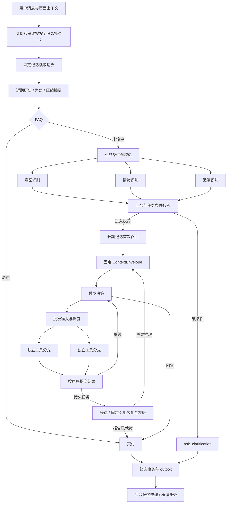

# EchoFrame Agent 执行与记忆体系升级技术方案

日期：2026-11-07。版本：1.2。状态：原生实现与本地验收中，尚未发布。基线代码：`2dffbf5`。本文整合一次召回、工具真正并行、自然对话自动记忆及主题归档，承接已有独立审查，不将公开项目功能声明当作本站验收结果。实现方式已按用户要求确定为：读懂成熟源码，在现有 Java Harness 中复现相同机制；不接入这些项目的框架或运行时。

## 1. 目标与交付范围

用户正常交流即可逐步形成有来源、可查看、可更正、可遗忘的长期记忆；一个请求只进行一次基础召回；独立工具能真正并行；异步任务恢复不重复检索或执行已成功操作；Trace 能解释实际发生的事。

本期交付：

1. 分离首次召回、固定结果恢复、有效性校验，修复报告任务中重复“召回”的流程与展示。
2. 在已有原生多工具调用协议上，增加有限并发、结果按序提交和可恢复批次。
3. 将单轮原文摘取升级为受预算控制的多轮记忆整理，支持去重、版本化更正及主题归档。
4. 补齐来源 manifest、水位、乱序和撤销控制，并同步管理界面、SSE 与 Trace。

不在本期引入完整 A2A 平台、通用代码执行沙箱、图数据库、自修改系统提示词或自动发布权限。向量索引是后续可插拔召回能力，不作为上述正确性改造的前置条件。

## 2. 现状与问题

| 模块 | 已有能力 | 本次改造 |
| --- | --- | --- |
| RequestOrchestrator | 前置处理、HARNESS 分支、异步恢复 | 恢复不再进入召回流程；直接交付避免无用装配 |
| MemoryRecallService / Ledger | 固定读取边界、个人/视频/主题候选、来源检查、12 条/6 KiB 投影 | 一次召回原子提交；按固定 ID/版本恢复；补充执行模式指标 |
| AgentRuntime / ToolDispatcher | 一轮 2–4 个工具调用、权限/参数检查、串行执行 | 增加原生批次执行器；区分 batchable 与 parallel-safe |
| ToolContext / ExecutionState | 受限能力接口；部分同步方法；证据与 exchanges | 分支只读快照、局部增量，协调器统一提交 |
| PendingOperation / outbox | 持久后台来源准备、报告等待、恢复及幂等 | 保留现有任务类型，批次引用真实 operation group |
| MemoryBackground | 成功回答后可靠任务、租约/重试、单轮 PREFERENCE/GOAL | 多轮来源、整理水位、候选决策、时序与主题提交 |
| 记忆管理与工具 | 手工 CRUD；search/read/remember/forget；自动提取开关 | 保留入口，增加整理状态、来源和更正/冲突呈现 |
| CompactionService | 旧完整历史异步压缩、来源传播、固定槽位 | 继续独立运行，补齐新记忆支持来源的传播；不复制压缩引擎 |

实际 Trace `78efea1319e97c586a0f69a6b3dbc0f0`：首次召回 7 条/1,820 B，后两次为异步恢复按引用重读，三次却都叫 memory.recall。修复不能只改名称，还要分开检索、正文恢复与撤销校验。

当前 Java 17 / Spring Boot 3.5.4，直接使用模型适配器和自有 Harness。本方案不增加 Spring AI、LangChain4j、DeepAgents 或外部 Harness 依赖；它们是实现参考，已有 Spring/JDK、存储、预算和 Trace 设施继续直接复用。

## 3. 源码参考与原生实现路线

### 3.1 已实际阅读的实现

| 来源及固定版本 | 阅读文件与观察 | 采用方式 |
| --- | --- | --- |
| DeepSeek Harness `fcc0ad462172522aaf5c93a7b2e01f6b9f0b0159` | `packages/core/tools/src/batch.ts`、`executor.ts`、`packages/core/agent-loop/src/agent.ts`：分支 dispatch 与按序 complete 分离，parallel/exclusive，有界池，取消停止补位并收敛 | 在 Java 中复现有界调度、原序提交及取消收敛，不复制插件、终端和整个 Loop |
| Pi `7a6bd5a97cb64766c9ebbf30e9c0ad7c88a00c47` | `packages/agent/src/agent-loop.ts`：prepare/execute/finalize 分段，结果按请求顺序；遇 sequential 工具整批串行 | 第一期采取整批保守回退，减少混合屏障调度复杂度 |
| OpenCode `ec53c3b3cbc532fae065d74b418b589366c7d60f` | `packages/ai/src/tool-runtime.ts`、`loop.ts`：并发结果回填、调用 ID 配对、错误结果；该层并发为 unbounded | 参考协议兼容，不照搬无界并发 |
| Spring AI Alibaba 发布版 `v1.1.2.2` | `AgentToolNode.java`、示例及 POM：Semaphore、AtomicReferenceArray、ToolStateCollector、超时和协作取消；state.snapShot 为浅拷贝；POM 为 Java 17、Spring AI 1.1.2、Boot 3.5.8 | 学习 Java 结果槽、并发限流和分支状态收集，在现有类型上实现；不依赖 AgentToolNode 或它的图状态 |
| LangChain4j 发布版 `1.23.0` | `service/tool/ToolService.java`：并发 Executor、startTool、完整错误收集；类上标有 `@Internal` | 参考全部分支收敛与错误按序收集的实现，不绑定 ToolService，也不启用 AiServices 接管 Loop |
| DeepAgents `798e78a4eb8de8238d8ab25d07c59820d0499b2a` | `middleware/memory.py`、`summarization.py`、`subagents.py`：中间件职责分离；MemoryMiddleware 默认加载规则文件并注入 system | 参考扩展点，不把文件规则加载等同自动用户记忆，不改变本站 memory_context 信任边界 |
| claude-mem `1158762a51f6ff797738d2cb21f7ddf304b84411` | `ProgressiveMemorySearch.ts`、`ResponseProcessor.ts`：观察与摘要处理、索引/时间线/详情读取 | 借鉴渐进读取和整理机制，本站用户事实、权限及多来源撤销仍由现有 Ledger 管理 |

源码已下载只读检查；未安装运行这些外部工程。后续验证对象是本站原生实现是否满足相同执行契约，不是第三方组件能否接入。源码阅读结论与实测结论分别记录。

### 3.2 最小新增代码边界

| 能力 | 优先复用 | 允许新增的本站逻辑 |
| --- | --- | --- |
| 执行器、限流、取消 | Spring ThreadPoolTaskExecutor、JDK Future、现有 CallControl / CancellationToken | 业务资源额度、超时前后准入和批次状态适配 |
| 工具批次引擎 | 现有 ToolDispatcher、RuntimeHarness、Spring 执行器 | 按已读源码实现 ToolBatchExecutor；只负责准备、调度、收敛和按序提交，不另建通用图引擎 |
| 状态、事务、队列 | ExecutionState、MySQL、TransactionTemplate、outbox、现有 job lease | 分支增量提交、水位和事实时序；不再建一套队列系统 |
| 模型与流式 | 现有 RuntimeModelCatalog、DeepSeek 适配器、SSE 事件存储 | 批次事件映射；不再包装一套 provider SDK |
| 记忆整理 | MemoryBackground、MemoryModelPort、PersonalMemoryStore、MemoryLedger | 多轮候选判定、主题关联和支持来源；不引入第二个记忆权威库 |
| 索引和缓存 | 现有关键词表、Redis、Caffeine、后续现有向量基础设施 | 版本与生命周期过滤；不自行编写向量数据库 |
| 可观测 | RuntimeHarness.contextual、OTel、TraceUsage、已有前端图 | 批次和记忆业务语义；不搭另一套追踪后端 |

实施 P0 先把所读源码整理为行为契约和本站测试夹具：并行资格、准备/执行/提交顺序、原调用 ID、反向完成、部分失败、取消停止补位及迟到丢弃。每个拟实现行为标注来源和本站差异，再在 P2 用本站 ToolCall/ToolResult/ToolContext 实现，不为这些机制发明新的工具协议。

只保留一个原生批次执行器；串行是同一执行器的降级模式，不另维护 SDK、框架适配层和第二个 Loop。“少造轮子”落实为直接复用本站现有基础设施，按成熟源码复现已验证的协调方法，仅为业务权限、证据、来源和持久恢复编写必要逻辑。若直接复用代码片段，保留来源、版本、许可证及修改说明。

### 3.3 机制对应与本期实现深度

| 成熟机制 | 本站原生落点 | 本期范围 |
| --- | --- | --- |
| DeepSeek prepare / dispatch / complete | ToolDispatcher 准备最终调用，ToolBatchExecutor 调度，AgentRuntime 协调提交 | 三阶段职责分开，hooks 和状态不在工作线程无序写入 |
| DeepSeek 有界池与原序结果槽 | 现有 Spring 线程池 + 固定 call_index 结果槽 | 完成即释放实际执行位置，提交按原始调用顺序；取消停止新调度 |
| Pi 遇独占工具整批串行 | 工具执行策略与批次计划 | 第一阶段保守回退，后续再做连续并行组/独占屏障 |
| Spring AI Alibaba 的局部状态收集 | 受限分支 ToolContext + 分支增量 | 使用本站证据/记忆引用类型，并补足深层不可变与迟到写入屏障 |
| claude-mem 后台整理与分层检索 | 扩展现有 MemoryBackground / MemoryLedger | 复现整理和按需读取流程，保留用户事实证据、主题、版本及撤销语义 |
| 运行恢复与上下文重用 | 现有 run/continuation 和 MemoryRecallService | 同 run 首次召回一次，缺失时固定引用恢复，不复制一套外部 checkpoint 系统 |

## 4. 统一执行架构



ContextEnvelope 1.0 的 12 个槽位顺序保持不变。长期记忆进入 memory_context；摘要、用户/助手消息与工具调用进入 current_context；不存在的模块省略。数据不升级成 system 指令，初始记忆不在每一轮复制追加。

前置识别仍在首次长期召回之前，使用已授权会话历史和压缩摘要。召回条件可使用识别结果帮助检索，但不得用记忆改变任务授权或凭空增加视频对象。

## 5. 一次召回、恢复与校验

### 5.1 生命周期和接口职责

在现有 MemoryRecallService 中拆职责，不另建记忆服务：

```text
beginBoundary(run)                 创建或恢复固定读取边界
recallOnce(run, retrievalContext)  首次检索、选择并固定引用
restoreIfMissing(run)             仅按固定引用补齐缺失模块
validate(run, phase)              检查模式、epochs、来源及权限
```

retrievalContext 包含用户原文、经校验的能力候选、当前视频和可确认主题；原文仍是检索依据，不将模型改写当授权证据。基础策略先保留现有 12 条/6 KiB，核心偏好与任务相关记忆分别设可配置份额，避免前一类别耗尽预算。相关性排序优化分阶段上线，与恢复修复分开验证。

`agent_memory_run` 继续保存快照序列与引用，不保存另一份无生命周期约束的正文。新增明确 recall_state 和 packet_schema_version；初始状态 UNRECALLED，固定空列表也是 RECALLED，不能因没选中记忆而重复检索。

首次候选查询可在事务外执行；提交前在短事务锁定 run 的记忆边界，重验状态/epochs/来源，原子写入初始引用与 RECALLED。竞争者读取胜出的引用，不覆盖；若进程在提交前崩溃可重试检索，但只产生一个已提交的初始集合。事务不跨模型或网络调用，不能承诺外部副作用的 exactly-once。

### 5.2 恢复规则

- 同进程、模块版本匹配且正文仍在内存：复用 immutable memory_context，保留撤销校验。
- 进程重启或模块缺失：按固定 ID、version、snapshot sequence 和 source refs 回源；失败明确报失效，不查询最新候选替换旧项。
- 主 Loop 后续轮次：同一模块参与装配，不再次执行召回。
- Agent 主动 search_memory/read_memory：属于新工具读取，结果进入工具消息，依赖和预算由协调器追加；不覆盖初始召回集合。
- 新用户消息建立新 run，可以产生新的初始召回集合。

模型 dispatch 前及最终结果提交前继续强校验，不能用 100 ms 本地检查节流代替发送屏障。若用户遗忘、暂停、清空或资源撤权使实际依赖失效，终止该次使用并告知重新提问，不静默删掉条目后沿用已经受它影响的答案。

### 5.3 直接交付优化

PendingOperation 恢复先判断结果是否已经是可交付的最终报告。该分支只恢复证据/依赖引用并校验，沿用 DeliveryService，不装配供下一次模型调用的完整记忆正文。权限校验与依赖检查仍必须执行；普通中间结果恢复则进入 restoreIfMissing 后继续 Loop。

## 6. 工具真正并行

### 6.1 执行分类

新增宿主执行策略，与模型 Schema 和 batchable 分离：

| 模式 | 含义 | 第一期处理 |
| --- | --- | --- |
| PARALLEL_READ | 无同批依赖、返回增量、无未受控副作用 | 白名单有限并发 |
| EXCLUSIVE | 激活 Skill、记忆写入、发布、创建产物等 | 保持串行 |
| DURABLE_SUBMIT | 提交已幂等、可恢复的后台工作 | 沿用 operation group，由专门适配器处理 |

缺少策略、无法解析参数或安全性取决于兄弟调用时，默认 EXCLUSIVE。第一期批次混入独占调用则整批顺序执行；不自动重排，不自动补依赖，不让模型声明“安全”取代宿主判断。后续可采用 DeepSeek 的连续并行组与独占屏障。

当前 batchable 只实际开放三个分析处理器。首批应逐个审查现有纯读取候选及 `analyze_video_content`；没有完成状态隔离的工具继续串行，不能仅增加 parallelSafe=true。对 read_history/search_memory 等会增加来源依赖的读取，也必须先改为分支增量。

### 6.2 批次执行契约

```text
模型完整输出（含原 tool_call_id）
→ 全批次预检查工具暴露、权限、Schema、重复调用和调用上限
→ 固定本轮只读输入与工具版本
→ 顺序执行 pre-tool hooks 与 TOOL_CALL transform
→ 对最终调用再做全批准入和并行分类，固定最终执行计划
→ 在有限执行器中运行独立 handler
→ 按 call_index 顺序执行 post-tool hooks 并提交增量
→ 生成全部对应 tool 结果
→ 交给下一轮模型或持久等待
```

ToolBatchExecutor 是本站原生批次执行器，只接收已准入调用与只读快照，返回批次结果；它不拥有 run 终态、模型调用、会话持久化或 SSE 提交权。pre/post hooks 沿用 RuntimeHarness，每个调用只执行一次，不再引入框架 hooks。

第一次检查不能替代 transform 后的检查。所有 pre-hook 和 TOOL_CALL transform 必须在任一 handler 开始前顺序完成；对最终 name/args 重新检查暴露集合、任务权限、Schema、去重、预算和执行模式，call_id 不允许改变或凭空新增。出现 EXCLUSIVE 则整批串行回退，变为未授权调用则拒绝整批。handler 只执行已经固定的 prepared call，不在分支内部再次运行可修改调用的 transform。post-hook 改变的结果、证据及来源也必须在协调器提交前通过原业务准入。

每个分支使用受限 ToolContext：注册证据、读取记忆依赖等先写分支局部增量；activateSkill、saveReport、修改记忆、waitFor、answer 等不进入并行上下文。浅拷贝不够，嵌套列表/集合/证据视图必须不可变，不能暴露 parent RunState 或可修改集合。

协调器在主执行路径重验来源后统一提交：ToolExchange、EvidenceStore 变更、memory/projection 依赖、progress 和交付决策。分支失败不提交其局部增量。已完成的外部读取不代表其数据可以跳过权限重验。

### 6.3 顺序、失败、超时和资源

- 一个调用 ID 只有一个协议结果；反向完成不能造成 call/result 错配。未调度、失败、超时均保留可区分的结果，不冒充空成功数据。
- 独立读取可部分成功，模型据成功和错误结果决定重试或解释限制。权限撤销、身份切换或请求取消属于全批终止；不能把这些错误降为普通工具文本后继续访问数据。
- pre/post hooks 的顺序、模型工具结果顺序稳定；流式进度可按真实完成时间发出，但带 batch_id/call_id，不能改变最终消息顺序。
- 每 run 初始并发建议 2、最多沿用 4 调用批次；全局活跃数和队列单独设上限，最终值经服务器容量测试确定。业务工具池与模型/后台记忆池隔离，避免嵌套提交到同池后同步等待造成死锁。
- 排队也计入 run 剩余截止时间；handler 开始前再次检查取消、期限、授权、lease。不能以 CompletableFuture.orTimeout 代替停止底层 IO，已超时的排队任务不得晚启动业务调用。
- 超时分支的迟到结果不能提交状态；未真正停止的 IO 仍计入实际占用，采用有界隔离和告警，不能释放逻辑配额后无限堆积后台请求。
- 复用 ModelBudget 的并发预留和实际结算，一次真实 provider 请求只计一次用量；分支不能各自获得完整 run 预算。

### 6.4 持久化与恢复

批次记录至少保存 batch_id、run_id、step、原始调用 ID、call_index、参数 hash、可恢复的受保护参数或其持久引用、工具版本、执行模式、状态、结果/证据引用；不为此复制大段结果正文。唯一键为 owner + run + step + 原调用 ID。参数引用必须由运行存储管理生命周期，不能只存 hash，也不能把可清理的 Trace 详情当唯一恢复来源。

纯读取分支在崩溃后允许按幂等规则重做；已提交的结果不重复合并。后台提交使用原 operation group 与幂等键，外部工作已创建但本地回执丢失时必须能查回，不能重新创建报告。没有可靠幂等/查回能力的提交不开放并发和自动重放。

一次批次的结果不跨轮拼接；混合 pending 与普通读取的泛化恢复不在首期实现。弹幕/评论来源组继续由现有专门流程收敛，先通过重启恢复测试，再考虑推广。

## 7. 自然对话记忆：触发与来源

### 7.1 两条写入路径

| 路径 | 授权和触发 | 可见性 |
| --- | --- | --- |
| 显式即时保存 | 用户明确要求；remember_memory / 管理 API；继续做动作准入 | 成功回执后可见 |
| 自动后台整理 | 用户一次开启自动记忆；自然对话终态产生可靠待办 | 提交成功后可见，不承诺回答结束即已保存 |

沿用 ON / READ_ONLY / OFF 和 autoExtract：READ_ONLY 只允许使用已有记忆，OFF 不向模型提供记忆；管理界面仍可查看/删除。自动整理只有 ON 且 autoExtract=true 才可调度、发送、提交。默认开关保持现状；如需改为默认开启，另行明确产品告知与账户迁移，不能在技术改造中静默打开。

以用户消息落盘作为事实观察时序，而非 worker 完成时间。自动整理针对 SUCCEEDED 与已完成的 NEEDS_INPUT 用户轮次；FAILED/CANCELLED 默认不生成事实，但记录跳过原因以推进处理范围。当前仅 SUCCEEDED 的实现需显式扩展，不能假装已覆盖澄清轮次。

运行仍在执行时不将它标为已处理；同会话按终态可处理范围调度。不同会话可以分别整理，不因另一会话等待报告而全部阻塞。

### 7.2 有界多轮来源包

复用已有原始消息存储，构造只包含必要字段的 SourceManifest，建议初始上限为 6 个用户轮次、12 条可见消息、32 KiB 序列化输入；超过任一限制按完整消息截取，不裁掉一条消息后把它当完整处理。

```text
manifest_id / schema_version
owner / session_id / job_id
new_source_range: 本次必须处理的用户消息集合
context_source_refs: 用于指代理解的旧消息引用
members[]:
  message_id, run_id, session_id, role, message_seq
  owner_observation_seq, content_hash, content_version
  source_expires_at, consent_epoch, erase_epoch
model_version / prompt_version / policy_version / manifest_hash
```

同一 owner 的 observation_seq 单调分配，不把不同 session 的 message_seq 相互比较。旧消息只作理解背景，不能因为每次都在窗口里而不断新增相同记忆。旧摘要可提供回查线索，但不能成为用户事实唯一依据；需要按引用回读原始证据，原文已不可用则不形成新事实。

AI 消息帮助理解“就按你刚才说的方式”，但不能把助手建议本身当用户偏好；用户的接受必须有可验证原话。隐藏推理链不进入来源。工具事件的经历记忆另走已验证事件类型，本期不把所有工具输出自动升级为用户事实。

自动记忆关闭期间、旧 consent epoch、已删除或过期的消息不进入自动整理；开启后默认只处理新授权范围，不回扫整个历史。历史补整理必须是独立、明确授权的操作，本期不提供隐式回扫。

### 7.3 完整来源校验

现有 extractionBarrier 只检查 job.run_id，多轮改造必须扩展：

1. 加载 manifest 时按 owner/session/run/message/hash 校验全部来源。
2. 实际模型 dispatch 前，检查所有将发送的来源、账户模式、epochs、job lease 和总预算。
3. 模型返回后再次检查；进入短提交事务时最终检查。
4. 每条事实持久化完整必要支持组，联合支持为 AND；任何必要来源失效使该事实、已使用它的派生历史及压缩摘要失效。

只用于理解但不构成事实必要支持的消息也必须在发送前有效。模型不得自行把必要来源降为“仅背景”来绕过依赖；候选证据验证器检查指代所需来源。无法验证则拒绝候选或转冲突，不生成无依据事实。

自动事实的有效期不晚于必要来源最早失效时间。“长期”表示跨会话可用，不代表无限保留；不通过反复归纳延长授权或来源有效期。用户手工/显式声明沿用现有独立来源规则，显式删除仍传播失效。

## 8. 提取、去重、修订与主题

### 8.1 候选结构

```json
{
  "kind": "PREFERENCE",
  "scope": {"type": "TOPIC", "key": "candidate-topic"},
  "subject": "user",
  "attribute": "explanation_style",
  "value": "先举例再说明概念",
  "qualifiers": {"domain": "数据库学习"},
  "normalized_text": "学习数据库时，用户偏好先举例再解释概念。",
  "support": [
    {"message_id": "...", "quote": "以后也按这种方式讲"},
    {"message_id": "...", "quote": "先用银行转账举例，再讲事务"}
  ],
  "temporality": "ONGOING",
  "topic_candidate": "数据库学习"
}
```

此为待校验候选，不能直接作为写入命令。模型不生成可信 owner、权限、版本、观察顺序或删除指令；这些由服务端填入。quote 必须对应原始用户消息的精确片段，规范化描述允许改写，但每项主张必须由支持组覆盖。

示例中的消息 ID 在真实协议中使用有效 ID；JSON 示意不作为可直接发送的完整请求。

提取响应采用外层信封 `schema_version / processed_message_ids / deferred_message_ids / candidates / completeness / overflow`。completeness 为 COMPLETE 或 PARTIAL，overflow 为布尔；两个消息 ID 集合互斥且必须覆盖本窗口新增消息，背景消息不参与处理水位。供应商 finish_reason=length、JSON 不完整、未知/重复消息 ID 或未覆盖输入范围，一律不确认整窗成功。

恰好 8 条且声明 COMPLETE、overflow=false、没有 deferred 消息，才具备进入证据验证的协议条件；超过容量返回 PARTIAL/overflow 或 deferred 范围。超额多消息窗口不提交正式事实，也不推进父范围水位，事务内登记更小的子区间任务与父任务 SPLIT_REQUIRED 结束原因；子区间处理回执用于推进连续水位。拆分深度受原始完整消息数限制，不无限生成任务。单条消息仍超容量或预算不足时，有限重试后标记 DEAD/CANDIDATE_CAPACITY，保留待处理范围和可见错误，不推进该处水位；后续窗口可以独立处理并保存回执，连续水位停在缺口，修复策略后显式重试缺口。

完整性字段只是可验证的协议覆盖声明，不能证明模型没有语义漏提。若模型错误地声明已完整提取，仍需质量集和来源审查发现；不宣传“自动记住所有事实”。

### 8.2 保存判定

| 表达 | 判定 |
| --- | --- |
| 我平时喜欢科技视频 | 有依据的持续偏好，可自动保存 |
| 这次回答短一点 | 当前要求，不写全局偏好 |
| 以后讲代码先举例 | 持续偏好，保存后可跨会话使用 |
| 我不喜欢惊悚片 | 明确否定偏好，可保存 |
| 不要记住这个 | 否定保存授权，本轮候选不提交 |
| 视频里他说喜欢跑步 | 第三方言论，不作为用户偏好 |
| 我不再喜欢简短回答了，之后详细些 | 对应同一事实时进入修订或冲突 |
| 如果我是新手该怎么办 | 假设，不推断用户身份 |

“不要记住”需要在提取之前由用户本轮指令和模型判定共同处理；后续出现更明确的记忆开关变化优先于 job 中保存的旧授权。敏感画像和凭据继续拒绝，不能只靠模型遵守 prompt。

### 8.3 事实身份与时序

事实键采用 `owner + scope + subject + attribute + normalized qualifiers` 的规范化 hash；value 不参与身份，否则“简短”改“详细”会变成两件永不冲突的事实。限定条件保留主题和时间，不把“工作日偏好”与“周末偏好”错误合并。

candidate 保存：fact_key、support_observation_seq、观察时有效时间、比对时目标 memory_id/version、来源类别、policy_version。实际身份判定不可靠时，不依赖模型强行生成的同名 attribute 自动覆盖旧项。

决策类型：ADD、NOOP_DUPLICATE、SUPERSEDE_AUTO、CONFLICT、REJECT_TEMPORARY、REJECT_SOURCE、REJECT_POLICY。每个候选都有持久处理回执，零候选窗口也有回执。

- 文本规范化先解决完全相同或格式差异；有限候选检索后再由结构化判定处理语义重复，后续可替换为混合检索。
- 自动事实只有明确更晚的有效证据才能修订，旧版本保留有效时间和 supersedes 关系，不由 worker 完成顺序决定当前值。
- 人工/显式条目不被自动任务静默覆盖；发现用户自然表达与其冲突时，保留冲突候选供管理确认。本轮当前用户要求仍优先于任何旧偏好。
- 较旧候选晚完成，只能作为历史补充或重复回执，不能改回较新事实。
- CAS 失败后重读事实头、来源与时间顺序重新判断，不盲目把 expectedVersion 改成最新再覆盖。
- 不因用户忘记某条记忆而自动重挖同一批旧消息。对已明确遗忘的事实键保留不含正文的自动重建抑制标记；用户重新显式保存可解除对应抑制。新主题的相似表达不因字面近似自动解除。

归一化/检索用于提出候选，数据库事务负责最后决定。任何 LLM 调用不跨事务持锁。

### 8.4 主题归档

复用 agent_memory_topic 及当前管理 API：先匹配本用户已有主题和别名，再考虑新建主题。匹配须结合对象、限定条件、当前任务或明确项目名，不能只因中文单字重叠就命中。

明确属于某主题的事实保存为 TOPIC 作用域；跨主题偏好才进入 USER。当前视频事实进入 VIDEO 并继续验证读取权限。自动整理响应中的 topic 必须真实绑定主题 ID，不能只存一个未使用的字符串。

主题索引仅保存名称、别名、简短描述及条目引用；详细事实按需召回。主题摘要是派生视图，可重建并继承支持来源，不另立事实权威源。自动主题摘要在基础归档和撤销测试通过后启用，不能通过“摘要再提取”绕开原始证据。

## 9. 可靠调度、水位与并发提交

### 9.1 三类进度

| 字段 | 含义 | 推进时机 |
| --- | --- | --- |
| scheduledThrough | 已被可靠 outbox/job 覆盖的调度范围 | 用户轮次终态事务登记待办时 |
| job.from/through + manifest | 本任务实际处理的固定区间和消息集合 | 创建 job 时固定，截断必须创建明确子区间 |
| committedThrough | 已完整处理且连续的范围 | 候选决策、记忆变更、处理回执及 job 完成同事务成功后 |

水位按 owner/session 维护；跨会话事实先后由 owner_observation_seq 判断。连续提交水位可以越过有持久跳过回执的无效/失败终态消息，但不能越过未决任务、未完成轮次或预算未处理尾段。

### 9.2 提交顺序

1. job 租约领取复用现有 SKIP LOCKED 和 lease_token，领取事务立即结束。
2. 固定来源与版本，事务外完成模型提取、旧条目检索和候选决策。
3. 短事务锁定必要会话（按稳定 ID 排序）、owner 账户、job/cursor、事实头；与现有 session-first 约束保持一致。
4. 重验账户/来源/租约，确认候选依据的事实版本和时序；写入事实修订、支持依赖和候选回执。
5. 窗口全部候选都有结论后，标记 job 完成，推进连续水位，同事务写索引/通知 outbox。
6. 事务提交后再由可靠消费者更新缓存/索引；通知失败不能改变事实成功状态。

原子范围以一个有界整理窗口为单位；窗口过大先拆分，再提取。进程在任一点崩溃，要么整窗未提交可重试，要么通过 job/候选幂等键读到既有回执。回调和内存监听器只用于唤醒，不承担可靠性。

### 9.3 任务和索引状态

job 沿用 PENDING、RUNNING、SUCCEEDED、CANCELLED、DEAD，另外记录 processed_range 和 decision_counts。候选及索引有各自状态，不因为有一个候选被策略拒绝而把 job 判失败。

来源被撤销可生成终止/跳过回执并停止发送，不通过无限重试等待权限恢复；用户重新授权后新请求建立新任务，不自动复活旧来源。暂时性供应商/数据库错误沿用有限重试，格式错误不能无限消耗预算。

关键词索引复用现有表；向量索引后续仅为候选加速。所有命中必须回 MySQL 按当前版本、owner、scope、来源与有效期过滤。索引删除延迟不能使已遗忘记忆重新可读。

## 10. 数据结构与迁移

以下为逻辑结构，字段/索引在实现迁移中精化；不修改已发布 V1–V22，不提前占用可能与并行开发冲突的迁移编号。

| 结构 | 关键字段及约束 | 处理方式 |
| --- | --- | --- |
| agent_memory_run | 原 snapshot、initial refs；增加 recall_state、packet_schema_version、固定引用 hash | 扩展现有表，原子提交初始集合；空集合同样固定 |
| agent_tool_batch / call | owner/run/step/batch/call_index、原 call_id、受保护参数、结果引用、generation、状态 | 新增运行账本；调用唯一键与父 run 一同授权/过期 |
| agent_memory_observation | owner_observation_seq、session/message/run、message_seq、hash、授权 epoch、终态处理资格 | 仅来源引用与时序，不复制整段聊天；分配顺序发生在消息持久化事务 |
| agent_memory_cursor | owner/session、scheduledThrough、committedThrough、version | 新增水位；按精确处理范围确认，不用模型时间戳 |
| agent_memory_job | 现有租约/重试/模型版本；增加 CONSOLIDATE 类型、manifest_ref/hash、from/through、generation_key | 复用现有 job；唯一键覆盖范围/hash/model/policy/epoch |
| agent_memory_candidate / receipt | job/candidate_key、fact_key、规范化候选、support refs、observed seq、target version、decision | 新增候选审计与幂等回执；正文遵循来源删除和保留期限 |
| agent_memory_fact_head | owner/scope/fact_key hash、当前 memory/version、latest observation、authority、revision | 新增事实定位视图；内容仍以 memory revision 为准，不能两份正文各自更新 |
| memory source / dependency | 原来源与依赖；扩展到 message/version/hash、required 标记、支持策略版本 | 复用并扩展权威依赖，不另建一套只用于显示的来源链 |
| topic / alias | topic_id、owner、规范化名称/别名、描述版本 | 扩展已有主题；唯一性只在同 owner 范围内成立 |

联合来源采用版本化支持策略：已有单来源数据按 LEGACY_V1 读取；新多轮事实采用 ALL_REQUIRED_V2，并必须存在至少一个 required 支持来源。禁止仅保留“存在任一有效来源”的旧 SQL 条件就把联合来源标为已支持。sourceRefs、historyAllowed、最终 commit、使用记录 API、删除传播和压缩依赖检查全部使用同一支持策略。

跨表引用全部包含 tenant/owner，不能仅凭 UUID 推定授权。fact_key、hash、alias 索引采用有界字段，避免超大联合索引；候选、job、批次和临时数据有明确 TTL，清理不得先删原始来源再遗漏派生失效。

存量 run recalled=true 映射为 RECALLED，初始引用仍按原版本恢复；未开始的新 run 采用新协议。存量自动记忆不伪造 observation_seq，不依靠当前导入时间将它提升为最新事实。需要与新事实比较时保守保留/冲突处理。

## 11. 上下文与压缩协同

记忆投影保留 id/version/scope/source refs，正文是参考数据。current_context.compaction 继续保留范围、来源与完整性；二者不互相冒充，也不把背景记忆改成本轮 focus。

多工具结果按一个原始 assistant 工具调用组及对应结果进入 current_context。分支耗时或完成时间只属于执行元数据，不能制造额外用户消息。大结果继续复用 ToolResultProjector 和 read_result；不能裁掉错误、待确认信息或孤立 tool_call_id。

压缩任务和记忆整理共用来源校验、模型传输、预算、job/outbox，不共用处理水位或事实判定规则。压缩成功不表示记忆提取成功，自动记忆关闭也不自动关闭会话压缩。

新记忆在后台提交后，对当前正在执行的 run 不原地替换其 memory_context；下一条请求召回可见。原会话近期原文负责短期承接，跨会话在整理未完成时显示整理状态，不能让助手虚报已保存。

## 12. API、SSE 与管理界面

保留已有 /memories、/memory-settings、/memory-topics、/runs/{runId}/memory 和 /memory-jobs。变更只增加版本化字段，现有前端先忽略未知字段。

| 接口/事件 | 拟增加内容 |
| --- | --- |
| run memory 使用记录 | snapshot_id、initial/retrieved_by_tool、available/revoked、restore/reuse 说明；不向无权限用户返回正文 |
| memory-jobs | job_type、范围、整理阶段、decision_counts、trace_id；模型未处理时不显示保存成功 |
| memory 条目 | authority、来源、主题、有效期、修订关系、冲突状态 |
| memory topics | 别名及已有主题绑定结果；主题名称不能跨 owner 查重泄露 |
| SSE TOOL_PROGRESS | batch_id、call_id、call_index、状态与真实进度；沿用现有事件 ID 和重连回放 |
| SSE MEMORY_CHANGED | 仅 revision/run_id 和统计，正文通过已鉴权 API 获取；复用现有跨 tab 失效通知 |

普通成功保存采用轻量反馈，不阻断回答；冲突只有影响实际使用或需确认时才呈现操作。管理界面可以查看自动保存来源、纠正、遗忘、暂停及处理冲突；不能要求用户每轮输入“记住”，也不能默认无限保存一切。

记忆工具和后台写入共享去重/版本/来源服务，但分别保留授权入口。工具不是后台 worker 的唯一写入方式；worker 不伪造一次模型 tool_call 来凑齐 Trace。

## 13. Trace 语义与展示

| 场景 | 节点/指标 | 展示要求 |
| --- | --- | --- |
| 初始召回 | agent.memory.recall；candidate/selected/context_bytes/snapshot | 每 run 一个已提交初始召回集合；重试尝试放在同逻辑阶段下 |
| 缺失模块恢复 | agent.memory.restore；reused/ref_count/reason | 明确写“恢复固定记忆”，不统计为新的检索 |
| 有效性屏障 | memory.validation phase/result 等 | 轻量校验不反复占主图大卡片；失败可定位来源类别，正文受保护 |
| 工具批次 | agent.tool.batch + agent.tool 子节点 | 标记 SERIAL/PARALLEL/DURABLE、实际开始/结束、排队、call_index |
| 自动整理 | agent.memory.extract 根 Trace，关联 source run | 读取范围 → 候选 → 判定 → 提交；按实际阶段记录，不虚构成功 |
| 压缩 | 现有 agent.context.compact / compaction_load | 继续展示范围、输入/输出/节省字节与实际采用片段 |

并行图按同批次分叉汇合，分支围绕中线布局，独占批次不画并行。节点沿用紧凑标题与关键摘要、右上角 xN 聚合、暖色 Claude 风格；模型请求子 span 留在对应操作详情，原始节点始终可查。

记忆统计区分候选、写入、重复、修订、冲突、拒绝，token 统计只来自真实 provider span；主图聚合不丢调用。故障中未发出的请求显示 dispatched=false，不能用一个失败 span 推导为已消耗模型用量。

隐私继续使用 TraceDetails 的保护机制：输入来源、候选和工具结果不能在根 span 留下不受删除传播控制的副本。来源引用和受保护详情通过当前权限回源。

## 14. 配置与容量

以下值是拟议初始值，不是线上已生效配置；全部参数要有单位、下限和上限。

| 参数 | 初始建议 | 说明 |
| --- | --- | --- |
| agent.tools.parallel.enabled | false | 独立灰度；关闭回退原串行路径 |
| agent.tools.parallel.per-run | 2 | 批次仍最多 4 调用；按业务资源可更低 |
| agent.tools.parallel.global | 8 | 单实例上限建议，最终按连接池/供应商额度测定 |
| agent.tools.parallel.queue-capacity | 32 | 满时明确拒绝/降级，不无限排队 |
| agent.memory.recall.max-items | 12 | 当前边界沿用 |
| agent.memory.recall.max-bytes | 6144 | 字节，不冒充 token |
| agent.memory.consolidation.max-turns | 6 | 完整消息截取 |
| agent.memory.consolidation.max-input-bytes | 32768 | 同时服从模型 token 和请求总预算 |
| agent.memory.consolidation.max-candidates | 8 | 超额应拆窗口/重试，不能静默漏候选并推进全部水位 |
| agent.memory.consolidation.merge-delay | 2s | 合并相邻待办的建议延迟，显式保存不等待 |

沿用现有记忆/压缩 executor 隔离和 lease，不因为改造就扩大线程数。线程池、MySQL/Hikari、HTTP 并发、供应商限流应联合压测；全局额度在多实例部署时需要共享限流或按实例分配，不能把单实例 Semaphore 当集群限制。

## 15. 验证计划与完成标准

### 15.1 确定性验证

| 编号 | 场景 | 必须观察到的结果 |
| --- | --- | --- |
| R1 | 同一报告两次等待恢复 | 一个初始集合；两次恢复不改变 ID/版本；直接交付不装载无用正文 |
| R2 | 初始空召回、并发进入、提交前后崩溃 | 空集合固定；只提交一个集合；重试不扩张权限 |
| R3 | 恢复期间遗忘/暂停/撤权 | dispatch 或 commit 被拒绝，旧影响答案不继续交付 |
| T1 | 两个独立阻塞读取 | 屏障证明真实重叠，而非看总耗时猜并行 |
| T2 | 反向完成、一个失败、一个超时 | 调用 ID 和结果按原序完整配对，增量只提交一次 |
| T3 | 队列满、取消、底层迟到、嵌套调用 | 无晚启动、无迟到写入、无无限 IO 和线程池死锁 |
| T4 | Skill 激活/记忆修改/发布混入批次 | 保守串行或准入拒绝，不能并发修改父状态 |
| T4a | pre-hook 将读取改为写入、改视频 ID 或制造重复 | 最终整批再准入，不能进入旧并行计划或绕过权限；post-hook 结果也重验 |
| T5 | 后台提交回执丢失、服务重启 | 按幂等键查回任务，不重复创建操作或报告 |
| M1 | 无“记住”的偏好、多轮指代、否定偏好 | 来源充分时保存，规范化事实可追溯 |
| M2 | 临时要求、假设、第三方、否定保存 | 不形成错误长期事实 |
| M3 | 新旧相反候选逆序、跨会话、人工交错 | 当前事实不被旧证据回退，人工条目不被静默覆盖 |
| M4 | 调度后杀进程、提取失败、部分窗口 | 最终完整补处理；不越过未决水位；重试不重复写入 |
| M5 | 发送前/提交前/保存后删除较早来源 | 全输入屏障和 AND 依赖生效，派生内容被撤销 |
| M6 | 暂停/清空/显式遗忘后旧 job 晚到 | 不发送、不提交、不从旧窗口复活 |
| M7 | 两个主题相似名称、不同视频/owner | 无错误全局化或跨作用域泄露 |
| M8 | 恰好8条、超过8条、length 截断、单消息过密 | 完整性协议可验证；拆窗有界；容量失败不推进缺口；语义漏提另作质量指标 |
| C1 | 记忆与压缩分别关闭/开启、摘要派生自记忆 | 各自功能边界和共同删除传播保持正确 |

### 15.2 真实模型与服务器验收

使用隔离测试账号与虚构偏好，不发布真实互动内容。至少包含：自然对话自动记忆、多轮指代、明确偏好变化、主题限定、独有旧事实压缩承接、完整观众反馈报告等待恢复。

逐项保存 revision、配置、run_id、trace_id、来源/候选/最终事实版本与断言。通过线上 Trace API 与前端实际投影验证分叉、恢复标签、工具详情和用量；浏览器视觉检查另行记录，不以图数据断言冒充截图验收。

记忆质量报告分别列出误记、漏记、来源不完整、错误全局化和冲突误更新；不能只报告“任务 SUCCEEDED”。建议对固定中文样例集追踪精准率/召回率和逐例结果，目标值在基线样本完成后确定，不能把两三个样例等同 95% 质量。

本地相关回归、隔离 MySQL 故障注入、真实模型与服务器验收全部通过，才允许标记对应阶段完成。参考上游测试场景建立本站等价测试，不能因为上游已有实现就省略本站验证。

## 16. 分阶段实施、灰度与回滚

| 阶段 | 交付 | 进入下一阶段的条件 |
| --- | --- | --- |
| P0 源码契约与复现基线 | 对照成熟实现拆解准备/调度/收敛/提交，确定本站接口与等价测试夹具 | 各机制有具体源码依据、本站差异和验收用例；不接入外部 Harness |
| P1 一次召回修复 | recall/restore/validate 拆分、直接交付优化、Trace 标签 | R1–R3 通过及报告场景真实测试 |
| P2 工具有限并行 | 首批白名单、分支增量、原序结果、批次账本 | T1–T5 通过，串行回退可用 |
| P3 多轮自动整理 | 来源 manifest、水位、候选回执、观察顺序、撤销传播 | M1–M6/M8 通过，先 shadow 不写入 |
| P4 主题与修订 | 事实头、topic 绑定、更正/冲突、管理 UI | M3/M7/C1 与质量集通过 |
| P5 扩展与优化 | 增加安全工具、混合召回、主题摘要 | 依据延迟/成本/误记数据扩展，不跨越生命周期约束 |

P0 可与 P1 的设计细化并行，但 P2 不绕过源码契约和状态隔离验证。P1 可先单独上线，不能让整个修复等待新记忆体系。

灰度：串行基线 → 隔离账号 → 小范围用户 → 按真实失败/超时/误记数据扩大。自动整理先输出候选与决策不写正式记忆；shadow 不得发送未授权来源，成本独立计量。用户自动提取开关仍决定是否允许处理。

数据库采用扩展迁移，新字段有兼容默认值；部署回滚以停止新任务、排空或取消新协议工作、切回旧串行/只读路径为主，不能回滚 SQL 删除已保存事实。新多来源事实旧版本若不理解应不可读或禁用记忆读取，不能降为 LEGACY 任一来源有效。

每次发布记录代码 revision、模型/提示词版本、schema 版本、参数和回滚入口。先校验生产无未完成写任务，再切换 worker；只部署本项目相关改动，不夹带独立的视频上传重构。

## 17. 风险、审查结论和实现约束

独立设计 review 已修正：水位提前推进导致漏记（P1）、旧自动事实晚到覆盖新事实（P1）、多轮来源沿用单 run 屏障（P2）。整合稿复核另补齐 transform 后全批再准入（P2）及提取完整性/容量终止协议（P2）。设计复核不等同于原生实现已完成或已测试。

重点风险与处理：

- 过度重建：基于已读源码复现必要机制并复用现有基础设施，不移植整套框架，也不自建第二套模型循环、队列、权限或会话存储。
- 虚假并行安全：只读业务也可能注册证据/增加依赖，必须局部化这些写入。
- 记忆质量：以原话证据、作用域与时序控制自动写入；不以模型置信度替代验证。
- 来源膨胀：输入包和支持组均有预算；超过上限拆窗口或拒绝候选，不丢来源后照常保存。
- 最终一致：明确整理中状态，当前会话由原始历史承接，避免承诺即时跨会话可见。
- 撤销优先：固定快照和缓存均不能延长被用户撤销的信息使用权。

## 18. 原生实现改造清单与资料

| 位置 | 改造职责 |
| --- | --- |
| runtime/RequestOrchestrator.java、AgentRuntime.java | 入口/恢复分支；使用本站 ToolBatchExecutor；协调提交 |
| tool/AgentTool.java、ToolContext.java、ToolDispatcher.java | 执行策略、受限分支上下文、统一准入 |
| runtime/ExecutionState.java、core/PendingOperation.java | 批次恢复引用、增量合并；不另起会话状态机 |
| memory/MemoryRecallService.java、MemoryLedger.java、MemorySources.java | 原子初始集合、固定恢复、联合来源与强校验 |
| memory/MemoryBackground.java、MemoryModelPort.java | 多轮整理和可靠提交；原后台 worker 继续承担调度 |
| memory/MysqlPersonalMemoryStore.java、CompactionService.java | 事实版本/来源生命周期与压缩传播 |
| adapters/storage/MysqlRunRepository.java | 观察顺序、水位/outbox 接入已有持久事务 |
| model/HarnessContextBuilder.java、NativeContextProjector.java | 固定模块、工具协议和预算，避免双份上下文 |
| harness/trace、前端 trace-data/presentation/layout | 真实批次、恢复与记忆整理语义 |
| 前端 MemoryManager、MemoryUsage、memory-events | 整理状态、来源、冲突和跨 tab 失效 |

相关既有设计：[动态上下文架构](动态上下文架构.md)、[多层记忆技术方案](多层记忆技术方案.md)、[压缩方案](上下文压缩调研与实施方案.md)、[报告分析复用与并行](报告分析复用与并行.md)、[审查记录](记忆压缩与上下文审查记录.md)。本方案作为本次升级的统一实施入口；历史文档中与本次待实施设计冲突的条目以本文为准，现有代码行为仍以状态表标明。

固定源码入口：

- [DeepSeek batch.ts](https://github.com/deepseek-ai/deepseek-harness/blob/fcc0ad462172522aaf5c93a7b2e01f6b9f0b0159/packages/core/tools/src/batch.ts)
- [Pi agent-loop.ts](https://github.com/earendil-works/pi/blob/7a6bd5a97cb64766c9ebbf30e9c0ad7c88a00c47/packages/agent/src/agent-loop.ts)
- [OpenCode tool-runtime.ts](https://github.com/anomalyco/opencode/blob/ec53c3b3cbc532fae065d74b418b589366c7d60f/packages/ai/src/tool-runtime.ts)
- [Spring AI Alibaba AgentToolNode 发布版源码](https://github.com/alibaba/spring-ai-alibaba/blob/v1.1.2.2/spring-ai-alibaba-agent-framework/src/main/java/com/alibaba/cloud/ai/graph/agent/node/AgentToolNode.java)
- [LangChain4j ToolService 发布版源码](https://github.com/langchain4j/langchain4j/blob/1.23.0/langchain4j/src/main/java/dev/langchain4j/service/tool/ToolService.java)
- [DeepAgents MemoryMiddleware](https://github.com/langchain-ai/deepagents/blob/798e78a4eb8de8238d8ab25d07c59820d0499b2a/libs/deepagents/deepagents/middleware/memory.py)
- [claude-mem ProgressiveMemorySearch](https://github.com/thedotmack/claude-mem/blob/1158762a51f6ff797738d2cb21f7ddf304b84411/src/services/worker/ProgressiveMemorySearch.ts)

上游源码按锁定版本作为研究依据；直接复用代码片段时核验许可证和保留归属。Java 类中的 `@Internal` 等限制用于理解其封装边界，不作为本站调用内部 API 的理由。本方案不新增这些 Agent 框架依赖。


## 19. 本次实现与验收记录（发布前）

- P1：RunState 区分固定边界和已装载包；初始 refs 与 recalled 标记原子提交（空集合也提交）。恢复只读 initial refs，同进程复用无需产生新的召回 span；报告直接交付只校验依赖。
- P2：ToolBatchExecutor 使用独立有界 Spring 执行器，单 run 默认 2、最多 4；逐分支受限上下文与证据增量，协调线程按原索引提交。Hook 转换后整批再次检查权限、参数、重复调用与已开放工具；混入独占工具整批串行。首批为指标读取、弹幕读取、已存在的普通结果读取、视频内容读取。运行存储持有参数和回执，Trace 仅作观察。
- P3/P4：接受消息时分配 owner 级观察序号；后台在现有 outbox/lease 上执行，多轮来源 manifest 仅存 ID/hash。近期窗口最多 6 轮、32 KiB，优先保留当前用户消息；单条超限和候选超限有界失败，不推进 committed 水位。成功候选与窗口完成在同事务提交。
- 事实身份使用范围、类别、稳定属性和限定词；模型输出规范短值以合并常见同义表达，不声称任意语义等价。较旧观察不能覆盖较新事实，同值确认也推进观察序号；手工/显式改写进入冲突回执而不被后台覆盖。
- 来源策略 ALL_REQUIRED_V2：推导事实的每个必要用户来源都必须有效；助手只帮助理解指代，不能独立证明用户偏好。旧版本保持 LEGACY_V1，不偷换既有来源含义。
- 自动整理仍需用户开启，普通对话无需包含“记住”。临时要求、第三方、推测及敏感信息由提取约束排除，保存仍需原文 quote 与宿主校验。真实模型质量需要单独验收，不把结构校验当成语义正确率保证。
- Trace 区分首次召回、恢复固定记忆、后台整理；后台有来源读取、候选、提交子节点及新增/更新/重复/冲突计数。并行工具保留原调用 ID、索引和真实父批次，详情可回看本轮所有工具。
- P5 混合召回、语义重排、主题摘要属于后续扩展，本次维持 12 条/6 KiB 的基础召回预算。

新增专项：NativeToolBatchTest（屏障证明并行、逆序完成/原序提交、取消停止补位、transform 后再准入、受限结果校验），MemoryConsolidationTest（多来源、助手伪证据、容量终止、冲突属性），NativeMemoryIntegrationTest（真实 MySQL 多轮来源 AND、连续水位、旧值晚到、手改保护、dispatch 前撤销、空窗口/溢出、空召回恢复及受保护批次台账）。最终测试数字、独立代码审查及服务器 Trace 证据在发布后追加。


独立代码审查后的边界说明：旧手工/显式记忆不含规范化 attribute/fact_key，本次不会自动改写它们；只有关联了自动事实头的条目可稳定识别手工修订冲突。旧条目与新自动条目的任意语义冲突识别尚未覆盖，管理页保留人工更正/遗忘。后台自动提取不能宣称已完成通用语义去重。自然过期的 AUTO 事实可用新用户来源重新锚定；显式遗忘的 fact tombstone 则持续阻止自动复活，reset 后新 consent 可重新学习。


独立代码审查（native_memory_batch_code_review）已关闭：旧 worker 失租约跳过水位的 P1、自然过期 AUTO 事实不能再次学习的 P2。修复分别由同事务租约取消与 REANCHOR_AUTO 覆盖，含同值/异值、显式遗忘、旧值晚到故障注入；REANCHOR_AUTO 计入新增/采用统计。复核未发现新的上线阻断项。本地全量 727 项：692 通过、35 条件跳过、0 失败/错误；前端 84 项通过。服务器真实模型/Trace 验收仍是发布后的必做项。
