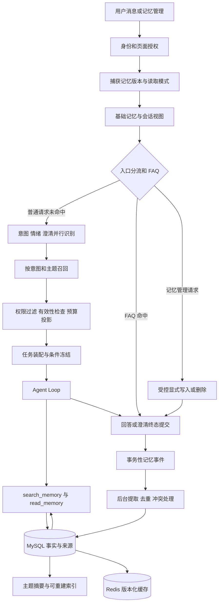

# EchoFrame 多层记忆技术方案

日期：2026-11-07。版本：1.1。状态：独立审查后修订的技术设计，实施状态见阶段交付记录。

面向视频网站全体用户，为 Agent 提供跨会话的偏好承接、主题延续和历史经历检索。核心方案为：MySQL 保存可追溯的记忆事实与版本，Redis 缓存可重建视图，按需增加语义索引；少量核心记忆自动加载，主题摘要按相关性召回，原始记录通过工具读取。当前任务条件、权限和业务证据继续由现有任务及工具体系负责。

上下文装配遵循[动态上下文架构](动态上下文架构.md)的 ContextEnvelope 1.0：长期记忆固定进入独立 memory_context 槽位，压缩摘要和真实 user/assistant/tool 消息属于 current_context；工具、Skill 与可选 A2A Agent 有独立目录槽位。召回服务只生成记忆模块，不能把正文拼进 system_prompt 或改写本轮 focus。以下接入点均服从此协议。

第一期完成记忆的保存、查找、使用、纠正、忘记和 Trace 闭环。后续增加主题归纳、会话摘要和混合检索。本文定义完整目标架构，并按依赖拆分实施，不表示以下能力已经接入。

## 设计目标

用户可以说“以后推荐入门跑步视频”“记住，我更喜欢简短回答”，在新会话中获得适当承接；也可以问“上次那个视频我们分析出了什么”，让 Agent 定位历史经历并按当前权限读取来源。用户能够查看、编辑和删除记忆，知道一次回答是否使用了记忆。

工程目标是让记忆有明确归属、来源、版本、有效期和上下文预算。新消息不能被旧偏好覆盖，旧分析不能冒充当前数据，记忆写入失败不能阻断正常问答，后台重试不能重新生成已被用户删除的内容。

不在第一期引入独立图数据库、自动生成可执行 Skill、跨用户共享记忆或长期任务调度。视频字幕、评论索引和知识库 RAG 保留各自的数据生命周期，记忆通过引用衔接它们。

## 当前实现与接入基础

以下结论以当前工作区代码为准，已有文档中的旧窗口参数不作为本次基线。

| 位置 | 当前行为 | 本方案的处理 |
| --- | --- | --- |
| `core/MemoryTypes.java` | `View` 包含 version、olderSummary、recent、boundary、environment、focus | 保留兼容字段，新增版本化记忆包，避免把所有内容塞入 olderSummary |
| `application/MemoryBuilder.java` | 最近两轮问答，超过 6000 Java 字符时按整轮移除；olderSummary 为空 | 继续作为近期对话投影；摘要单独异步生成 |
| `adapters/storage/MysqlConversationStore.java` | 授权读取会话历史与 focus，Redis 缓存可回源视图 | 扩展记忆读取编排，不改写原始聊天 |
| `runtime/store/ConversationStore.java` | 会话、目标和历史读取边界 | 长期记忆使用新的 MemoryStore 接口，避免接口职责膨胀 |
| `preparation/PreparationService.java` | 加载会话，FAQ 短路，准备上下文，执行意图、情绪和澄清等分支 | 接入小型基础记忆视图及意图完成后的定向召回 |
| `model/HarnessContextBuilder.java` | 原生角色消息；近期历史最多 4 条且受字节预算限制 | 增加受预算管理的结构化记忆数据区 |
| `model/ContextPolicy.java` | 默认总输入 98304 字节、历史上限 16384 字节，实际历史投影还有更小上限 | 所有记忆最终服从真实请求总预算，不把字节当 token |
| `tool/builtin/ReadHistoryTool.java` | 会话内历史按需读回 | 保留原语义；跨会话记忆另设工具 |
| `core/PendingOperation.java` | 持久化 continuation 包含 memory 等运行状态 | 增加记忆快照引用和恢复校验 |
| `adapters/storage/MysqlRunRepository.java` | 已有 outbox；`MEMORY_REFRESH` 用于缓存刷新 | 新增明确的记忆事件处理器，不能把旧事件名称视为已有提取能力 |
| `runtime/RunCompletionListener.java` | 终态提交后的尽力通知 | 用于唤醒 worker；不能作为后台提取任务唯一的可靠来源 |
| Trace | 已有 `agent.memory.load` / MEMORY_LOAD | 增加召回、投影、写入和异步整理的实际节点与详情 |

现有意图候选项仍然来自可用 Skill 和 Tool。记忆只提供辅助上下文，不生成不存在的能力，也不扩大工具授权。

## 现有能力与复用边界

采用“先复用已有实现，其次抽取已经重复的机制，最后新增记忆业务能力”的顺序。下表表示当前工作区中的实现基础，不等于这些能力在所有部署配置中均已启用。

| 已有基础 | 本次如何使用 | 必须补齐或保留的边界 |
| --- | --- | --- |
| MySQL、Hikari、JdbcTemplate、TransactionTemplate、Flyway | 复用 Agent 数据源、连接池、事务和增量迁移；新增记忆业务数据 | 不建第二套数据库连接与迁移服务；新增表与索引仍需验证 |
| `MysqlConversationStore`、`ConversationFocus`、`read_history` | 原样承接近期对话、当前目标及历史原文；来源记录引用已有消息 | 不再复制原始聊天为“记忆聊天表”；跨会话检索和长期事实另行扩展 |
| `RedisMemoryCache` | 复用版本比较、防旧值覆盖、TTL、失败回源机制 | 现类绑定 recent Window 和 session key，长期记忆需单独值类型与命名空间，不能强塞进 Window |
| `agent_outbox` 及现有投递器 | 复用事务落事件、领取租约、claim token、失败重试 | 当前只处理 MEMORY_REFRESH；先扩展 destination 分发，不能直接追加事件后假定可消费 |
| `FeedbackJobStore`、`MysqlFeedbackJobStore` | 复用或小范围抽取 claim、fence、CAS、重试与预算结算模式 | 现有 phase、batch、merge 和报告字段是反馈专用，不往反馈表里写记忆 job，不复制整套反馈流水线 |
| `ExecutionConfiguration`、maintenanceScheduler、Micrometer | 复用受管调度、线程池配置、拒绝策略和监控 | 维护调度器只唤醒 worker；记忆 LLM 用受管隔离额度，不占用 SSE 或 deadline 线程，不新增散落的静态 Executor |
| `CallControl`、`CancellationToken`、`ModelBudget` | 沿用截止时间、取消与调用预算的约束方式 | 后台 job 独立计费；不能错误消耗已结束 run 的预算实例 |
| `RuntimeModelCatalog`、DeepSeekClient、StructuredModelOutput、PromptCatalog | 复用提供商通信、结构化解析、提示词版本与配置快照思路 | ModelPort.decide 是 Agent 决策契约；提取需薄 MemoryExtractionPort，不伪造一次 Agent Loop；目录目前不提供任意旧版本的跨重启恢复 |
| `ContextPolicy`、`ModelContextBuilder`、`HarnessContextBuilder` | 复用最终请求计量、超限门控、历史裁剪及原生工具消息 | 记忆只新增预算分项与数据投影，不建立第二套互相矛盾的总预算 |
| AccessScope、现有业务读取端口、任务授权 | 复用所有者与视频可读性检查，业务产物按已有入口读回 | 当前授权不能被旧 memory snapshot、旧 AccessScope 或向量命中替代；非视频记忆增加作用域检查 |
| SkillCatalog、ToolCatalog、IntentCandidateCatalog | 注册记忆工具后由同一注册表生成可用候选，沿用执行校验 | 不额外维护另一份仅在 prompt 中存在的“记忆能力清单” |
| ObjectStore、MinioObjectStore、现有报告与证据存储 | 引用已有产物；大对象确有需要时使用现有私有存储、哈希和有界读取 | 小条目直接放 MySQL，不为每条记忆再上传一份对象；旧产物引用仍要授权与保留期检查 |
| QwenFeedbackEmbedding、MilvusFeedbackVectorIndex | 后期复用 embedding 通信与 Milvus REST 传输、超时和维度检查机制 | 现接口带反馈数据结构，需薄适配或抽取公共传输；独立 memory collection，不能混用反馈 Schema |
| RuntimeHarness、TraceDetails、OpenTelemetry、现有归档链路 | 扩展实际 span 类型、安全属性、受控详情与现有前端卡片 | 不建另一套记忆日志平台；Kafka、ClickHouse 按现有配置使用，不作为第一期记忆读取的强依赖 |
| agent_audit_event、现有幂等与运行事件机制 | 复用审计基础和 SSE 存储、重连协议 | mutation 账本仍承担记忆版本与幂等结果，不重复充当第二套通用审计；新事件需更新真实客户端契约 |

当前可直接算作已有记忆能力的是：最近问答、会话目标、当前页面环境和按需读回历史。长期用户偏好、主题摘要、自动事实提取、长期记忆管理及其删除依赖尚未实现。现有视频索引、反馈向量搜索属于内容检索基础，不应改名后就视为已有个人长期记忆。

实施中新增的核心业务对象限定为记忆条目与版本、来源依赖、用户设置、请求记忆视图及记忆处理 job；复用现有消息、业务产物、对象存储、outbox、审计、模型调用和 Trace。后文列出的表是目标逻辑模型，投影、关键词及主题能力按对应阶段落地，不要求首轮一次建完。

公共机制只在发现真实复用点时提取最小组件，例如带 fence 的租约值对象或 outbox destination handler。无需先把所有异步业务改造成统一工作流平台，也不引入 LangGraph、Temporal、另一套消息队列或 Redis 向量库作为前提。抽取后必须保留反馈任务和原缓存刷新回归用例。

## 范式选择与依据

“多层”分别描述作用域、信息类型、加载粒度和生命周期，不用一套层号混指四件事。

| 参考 | 借鉴内容 | 在 EchoFrame 的对应 |
| --- | --- | --- |
| Claude Code | 精简索引常驻，主题文件按需读取；人工规则与自动记忆分开 | 小型核心记忆包、主题索引、详情读回；记忆不获得系统规则地位 |
| Claude API Memory tool | 模型请求读写，应用控制存储；长期记忆与上下文压缩分开 | 受控记忆工具及服务端写入策略 |
| claude-mem | 先搜精简索引，再看时间上下文，最后取完整观察 | `search_memory` → 选择条目 → `read_memory` 及授权来源跳转 |
| OpenViking | 摘要、概览、原文逐层读取 | L0 条目索引、L1 主题摘要、L2 来源详情 |
| MemoryOS | 短期互动逐步归纳为中期主题与长期偏好 | 工作记忆、主题记忆、稳定用户记忆的整理流程 |
| Graphiti | 事实带时间有效性和来源，变更保留历史 | 有效期、替代关系和来源依赖；暂不采用图数据库 |

这些是组合设计的依据，不是 Claude 内部架构的复刻。开源项目是范式参考，暂不作为运行依赖；若后续复用代码或服务，需单独锁定版本、评测和核对许可证。

## 记忆模型

### 作用域

所有持久化记录首先属于 `tenant_id + owner_user_id`，再限定以下作用域。

| scope_type | 含义 | 例子 | 自动使用边界 |
| --- | --- | --- | --- |
| USER | 用户稳定偏好或明确背景 | 喜欢简短讲解 | 可跨会话；只选高价值条目 |
| TOPIC | 用户的一项长期主题 | 入门跑步学习计划 | 主题相关时召回 |
| VIDEO | 围绕特定视频的个人记忆 | 对本视频改版的约定 | 视频匹配且当前可读时 |
| SESSION | 会话总结与阶段目标 | 本次正在比较的三个方案 | 当前会话默认可见；跨会话需显式历史检索 |

USER 使用固定非空 scope_key，例如 `self`；其他 scope_key 使用服务端生成或校验的 ID。唯一键不依赖 MySQL 对 NULL 的特殊语义。一个条目默认属于一个主作用域，标签可以辅助检索，但不能把主题条目悄悄提升为全局偏好。

### 内容类型

| kind | 内容 | 写入依据 | 默认有效期策略 |
| --- | --- | --- | --- |
| PREFERENCE | 表达、推荐和工作方式偏好 | 用户明确表达；或后期通过多次可靠互动提炼 | 无固定到期，180 天未确认降低召回优先级 |
| PROFILE | 稳定且有帮助的用户背景 | 用户直接提供，保存最小必要信息 | 动态背景初始 90 天复核；过期不自动注入 |
| GOAL | 持续目标和约束 | 用户主动表达或确认 | 有截止日按截止日；无截止日 30 天后复核 |
| EPISODE | 一次任务或互动的摘要 | 已提交的消息、工具产物与任务元数据 | 默认 90 天，不能长于其必要来源的有效期 |
| EXPERIENCE | 用户确认过的可复用经验 | 多次结果或明确反馈 | 第二阶段启用；不自动生成可执行规则 |
| SESSION_SUMMARY | 已覆盖轮次的会话摘要 | 一段确定的历史消息区间 | 跟随来源与会话保留策略 |

以上期限是初始产品策略，可配置。用户手工设定的期限优先，但不能延长关联业务证据的保留期。`NEEDS_REVIEW` 条目仅在用户主动检查记忆时展示，不自动用于回答。

### 运行状态与长期记忆的边界

本轮视频、数据时间范围、已确认来源、发布草稿和权限属于运行状态。沿用 `PreparedTask`、`Specification`、`ConversationFocus` 和结构化澄清续接，不从长期记忆中直接补齐。

例如记忆中“通常分析最近七天”只允许用于提出建议。当前请求缺少日期且工具需要明确时间范围时，仍由 readiness / `ask_clarification` 完成确认。当前输入指定“今天”时，不受旧偏好影响。

对话数据的取舍顺序为：服务端权限与工具约束 → 当前明确输入及本轮确认条件 → 合法的结构化续接状态 → 适用的用户明确记忆 → 推断记忆与历史摘要。不同维度不硬比较：实时播放量必须查业务工具，偏好条目不能与业务证据争夺权威。

### 加载粒度

| 粒度 | 结构 | 用途 |
| --- | --- | --- |
| L0 | ID、版本、短标题、类型、主题、有效性和来源标识 | 搜索、筛选、展示索引 |
| L1 | 有界事实条目或主题摘要，附成员版本引用 | 初始上下文与定向召回 |
| L2 | 记忆完整详情、来源消息区间或产物引用 | Agent 工具读回、用户检查、纠错 |

L0/L1 是投影，不能反向覆盖 L2。所有摘要必须能追溯到仍有效且当前有权限的来源；不能通过重复总结提高可信度。

## 总体架构



入口分流区分普通业务请求和明确记忆管理请求，后者不能被 FAQ 短路吞掉。FAQ 仍只直答标准问题；用户要求保存或忘记时必须走可核验的管理动作。FAQ 成功也可以发送来源事件，但第一期默认跳过纯标准问答的自动记忆提取。

FAQ 前只做保守的管理请求探测，用于跳过 FAQ，不据此发写权限，也不新增一轮常驻 LLM。疑似包含保存、纠正或遗忘请求时走正常前置识别，等意图分支给出受限 action 后再由服务端校验；误命中只多走完整流程，不能直接造成数据变更。没有足够语义依据的管理请求继续澄清。

## 进入 Loop 前的读取流程

### 基础视图

请求接收时从服务端捕获 `memory_seq`、`consent_epoch`、`erase_epoch` 和本轮模式，连同已有会话 historyVersion / beforeTurn 形成读取上界。不能用客户端传来的用户 ID、权限或版本直接决定归属。

基础视图只读取近期对话、当前 focus、已确认且允许常驻的少量用户偏好。第一期不让 PROFILE、EPISODE 或推断偏好进入意图、情绪、澄清模型，以减少旧信息干扰。身份和访问控制失败时直接拒绝；普通记忆读超时则降级为空记忆。

### 前置识别

意图、情绪和澄清分支读取同一份不可变基础视图，不在分支内写长期记忆。意图候选列表继续来自注册表，记忆不能添加候选能力。情绪基于当前表达和必要近期对话判断，不从历史标签推断本轮情绪。

澄清分支可以识别“用户在接着聊”，但具体视频和业务条件只从当前页面、当前输入及结构化续接中解析。不能用搜索分数替代条件确认。前置澄清识别保持现有职责；实际向用户提问继续使用已有交付流程和 `ask_clarification` 工具语义。

### 定向召回

前置结果合并后，根据当前 query、已识别 capability、明确视频及主题标识生成 RecallPlan，执行一次有界召回。需要澄清的请求只召回有助于解释缺口的记忆，不能绕过澄清直接进入业务执行。

服务端生成 topic 提示时可以查 L0 索引，不增加常驻“主题识别 LLM”。多主题歧义时允许少量并列候选，禁止把相似主题直接合并。普通泛问未命中相关记忆时返回空包。

召回完成后生成 MemorySnapshot，供任务装配和主 Loop 使用。业务任务冻结与记忆快照冻结是两个契约：前者固定本轮业务含义，后者固定辅助上下文的内容版本和来源，便于解释同一任务的行为。

## 召回策略与上下文预算

### 第一阶段召回

M1 只开放 USER、VIDEO 的显式记忆，按版本化作用域、kind、更新时间及规范化关键词筛选；TOPIC、SESSION 和历史经历索引在 M3 开放。中文关键词通过应用层规范化索引支持，不假设默认英文分词能解决中文召回；部署已验证 ngram 全文索引后才启用对应适配器。关键词与条目版本同事务维护，扫描、候选数量和页大小必须有硬上限，不对所有记忆执行无界 LIKE。

核心偏好最多 6 条；候选最多 40 条；最终召回最多 12 条。优先保留明确适用且用户确认的条目，同一事实的相近表述只保留一个当前版本。

排序采用分级规则：先过滤所有权、作用域、有效期、删除和来源权限；再按明确主题或资源匹配、查询匹配、确认程度排序；最后使用时间和稳定 ID 消除并列。未校准的模型 confidence 不作为唯一排序依据。

### 混合检索扩展

M4 为候选召回增加语义通道，按 RRF 融合关键词和向量排名，再按作用域及确认程度重排。初始 RRF 常数取 60，仅作为可配置起点；召回阈值根据中文评测集调整，不复用 FAQ 的阈值。

向量只是候选 ID 索引，返回后必须按 MySQL 中的条目版本、来源和权限再过滤。embedding 模型、维度、规范化策略和索引 generation 必须记录；模型变更新建索引并灰度切换，不在一个集合混用不同向量空间。优先评估已有 Milvus 的独立 collection，不与反馈检索数据混放。

### 初始预算

以下是待压测的配置起点，不是已验证的性能指标。所有尺寸按序列化后 UTF-8 字节计算。

| 项目 | 初始硬上限 |
| --- | --- |
| 前置模型使用的核心偏好正文及元数据 | 1 KiB |
| 主 Loop 的初始长期记忆包 | 6 KiB，其中核心偏好不超过 1 KiB |
| 每条 L0 标题 | 80 个 Unicode 码点，同时不超过 320 字节 |
| 每条 L1 事实正文 | 1 KiB |
| 一份主题摘要 | 2 KiB，且计入 6 KiB 初始总额 |
| `read_memory` 单次返回 | 4 KiB，带分页或明确截断状态 |
| 一轮新增记忆候选 | 8 条，提取输入不超过 16 KiB |
| 单用户活跃长期条目 | 1000 条，超限停止自动增长并提示整理 |

总请求必须通过现有 `ContextPolicy` 门控。上述额度是上限，不是预留占位；已有规则、当前请求、工具 Schema 和必要证据优先。超预算时依次移除低相关主题、推断偏好和最旧可恢复历史，保留必要任务条件；核心输入仍超限则按现有预算错误拒绝模型请求。

模型热切换后重新检查最终请求。若适配器没有可靠 token 计数，明确记录字节计量并保留模型容量余量，不把“6 KiB”标成固定 token 数。工具读回也会消耗同一轮总上下文，不能通过多次调用绕过限制。

## 写入与整理流程

### 显式保存

用户要求“记住这个”时，Agent 可以提交 `remember_memory`。输入只允许包含用户原话对应的 source_message_id、作用域建议和待保存内容；归属、当前消息来源、有效长度及字段合法性由服务端验证。用户手工编辑则产生认证的 MANUAL 来源。

显式保存提交时生成独立的 EXPLICIT_DECLARATION 来源，保存最小声明、认证所有者、发生时间、内容哈希和可选原消息定位；用户主动保存形成的声明不依赖聊天的自然保留期，原 run 自然过期不会使其失效。用户主动删除聊天仍按产品规则级联撤销关联声明。自动派生记忆和业务 EPISODE 必须随原来源自然过期失效。声明不允许携带无独立授权的视频事实，不能将业务证据伪装成用户声明延长保留期。

服务端提交记忆后工具返回真实 memory_id、version 和状态，前端才显示“已记住”。语义不明确时返回待澄清，不保存猜测；请求中同时含保存和业务任务时，保存动作与业务执行分别反馈，不能因保存成功就宣称业务任务完成。

显式保存属于可撤销的个人数据操作，无需额外确认一次。禁止仅凭出现“记住”二字匹配执行，例如“别记住这个”或引用视频中的“记住”不能触发保存。

### 自动提取

仅对已提交且允许参与记忆的用户消息和成功任务产物发出 MEMORY_EXTRACT 事件。用户偏好和画像必须有用户来源；工具结果可形成带来源的 EPISODE，但不能反推出个人事实。模型最终回答不是独立事实来源，不从模型自己的建议中推断用户已接受该建议。

第一期自动提取默认关闭，通过灰度开启；显式保存、查看、编辑、删除和召回仍完整可用。灰度仅允许低风险 PREFERENCE 和用户明确 GOAL；单次不明确行为、单次点击、他人的评论、短时情绪和临床或人格判断均不进入长期画像。

```text
终态与来源提交
  → 同事务登记记忆事件
  → worker 领取持久化 job
  → 读取并复核来源和用户设置
  → 模型输出候选 JSON
  → 服务端 Schema 与引用校验
  → 去重与冲突规划
  → 事务提交记忆新版本
  → 登记摘要和索引刷新事件
```

提取模型只提出候选，不直接执行 SQL，也不能自己决定权限。每个 job 固定提取 prompt、Schema、策略和模型配置版本；运行中的主模型热切换不改变该 job。输出非法、引用不存在或模型超时只使 job 失败，不修改现有记忆。

### 去重与冲突

对明确偏好采用受控 `fact_key`，例如 `response.detail_level`、`recommendation.running.level`。服务端维护键注册表与值约束；开放背景事实使用可追溯文本条目，不让模型随意发明结构化键。去重哈希包括所有者、作用域、kind、fact_key 和规范化值。

| 输入关系 | 处理 |
| --- | --- |
| 同一来源重复投递，同一内容 | 幂等跳过 |
| 同一事实得到更多支持 | 添加来源，更新支持元数据，不重复增加条目 |
| 当前用户明确纠正过去偏好 | 新版本替代旧版本，记录 supersedes 与有效时间 |
| 自动推断与用户明确记忆冲突 | 保留明确版本，候选标为 REJECTED 或待检查 |
| 两个显式请求并发修改同一事实 | CAS 检测冲突；显式编辑返回 409；Agent 结束本轮变更，通过新轮次读取最新版本，不在旧快照内重试 |
| 时间限定不同 | 保存各自有效时间，不把临时偏好提升为永久偏好 |
| 仅表面相似、作用域不同 | 分别保存；不自动跨主题合并 |

不能用“后台提交更晚”判断用户意图更新。记忆来源保留发生时间和来源顺序；旧会话迟到的 job 遇到较新的显式修订不得覆盖。不同会话时间无法可靠判定时宁可保留冲突状态，也不静默覆盖。

### 主题与会话摘要

M3 启用。主题摘要是当前有效条目的可重建投影，保存成员 `(memory_id, version)`；会话摘要保存明确的消息区间和源哈希，不得覆盖尚未处理或未提交的轮次。

会话累计超出近期窗口后，可按连续 8 个已完成轮次或后台整理间隔触发摘要，来源中保留未完成事项、用户约束和出处。摘要基于原始有效消息或结构化条目重建，禁止无限“摘要再摘要”造成来源漂移。NEEDS_INPUT 的缺口保留在结构化任务状态，不仅写进自然语言摘要。

成员删除、失效或撤权时，整个受影响摘要立即从可读视图移除，异步重建完成后再启用。不能继续返回混有已撤权内容的旧摘要。

## 版本快照与并发

### 账户版本头

为每个用户维护 memory_seq、consent_epoch、erase_epoch。每次内容事务递增 memory_seq；暂停或模式变更递增 consent_epoch；清空、来源删除及需要阻断旧任务的遗忘动作递增 erase_epoch。

worker 的模型调用在数据库事务外执行。提交时锁定账户版本头并检查 job 的 epoch、base_seq、来源状态及目标版本；短事务内写条目、来源、审计和 outbox。base_seq 变化时在事务外重新计算受影响冲突，最多重规划 2 次，再退回队列，不持锁等待 LLM。

涉及会话的事务统一采用“session ID 排序 → 账户版本头 → 条目 ID 排序 → 来源关联 → outbox”的加锁顺序；只有账户记忆的事务从账户头开始，禁止持有账户锁后再取 session 锁。worker 在持锁前从来源索引确定所需 session 集合，再按顺序加锁并复核依赖没有变化。删除操作优先提交失效标记，后台任务必须复核，不能依靠单机锁保证正确性。

### 请求读取快照

主请求在开始捕获 memory_seq 上界，同一 Loop 不自动混入后来其他会话新增的记忆。以条目版本的 `[valid_from_seq, valid_to_seq)` 提供稳定读取，不能仅在可变条目表中按 updated_at 模拟快照。

正文、scope_type/key、kind、fact_key、标题、确认等级、有效期及所有影响资格和排序的字段均属于 revision。item 与 fact_slot 仅为当前写入定位，不参与历史快照的资格判定；快照候选 SQL 必须先按 owner 和序号区间选择 revision，再按该 revision 的字段过滤。允许作用域修改时生成新 revision，不能直接改 item 后用旧正文拼装结果。

本轮成功的显式记忆修改可以作为单独的 `run_overlay` 被本轮知晓，并在 Trace 标记来源动作；不隐式重载整个用户记忆。`search_memory` 与 `read_memory` 默认服从快照上界。

快照保证解释一致性，但不延长权限和保留期。删除、撤权、暂停等强制失效始终优先。每次工具读取及模型发送前重新检查 epoch 和已选来源的可读性；发现失效时移除相关辅助数据并记录原因。已经发送给模型的请求无法撤回，响应交付前再校验，对依赖已失效内容的输出丢弃或在预算允许时重新生成。

SSE 已发出的文本无法撤回。流式回答在首个正文增量前检查记忆有效性，运行中订阅失效通知并在后续交付检查点停止相关输出；通知丢失时通过有界轮询补偿。删除成功保证后续授权读取和新模型请求不再使用该内容，不承诺抹除已发往模型或已展示在用户屏幕上的文本。最终回答落盘前再校验，不能将失效内容作为可复用结果发布。

### 异步续接

continuation 保存 snapshot_id、memory_seq、模式、epoch 和版本引用，不复制无期限有效的记忆正文。恢复时先验证任务条件和当前权限，再读取快照版本；仅删除或暂停造成的记忆失效允许降级为空记忆，业务资源失效仍沿用任务失败或重新确认规则。旧 continuation 无新字段时按无长期记忆恢复。

上述降级只适用于尚未消费长期记忆的任务。只要本轮曾消费相关记忆，M1 的保守终止规则优先，不能通过恢复 continuation 清空引用后绕过终止；是否消费以及根依赖必须持久化。旧 continuation 没有新记忆字段时才可按原逻辑恢复。

### 所有正文副本的失效

失效门控必须处理初始记忆包、ExecutionState 的 observations/exchanges、已授权来源的 read_history 结果、模型中间产物和 continuation。记忆工具结果携带 memory_id/version 及根来源引用；失效时用同一 tool_call_id 的 MEMORY_SOURCE_UNAVAILABLE 响应替换原工具结果，保留原生调用与结果配对。continuation 只保存记忆结果引用，恢复时重新投影。

M1 采用保守边界：本轮已经消费过记忆后，只要相关 epoch 发生变化或依赖失效，终止本轮后续模型调用和最终发布，返回 MEMORY_CONTEXT_INVALIDATED，要求新轮次重建；不宣称可从混合生成的文本中可靠删除影响。已发布回答记录 consumed_memory_refs，后续历史投影与 read_history 必须批量复核这些依赖，失效回复显示不可用占位，不再作为模型上下文。原始用户消息仍按自身会话权限管理。

本轮 forget_memory 自己提交 epoch 变化时，允许宿主直接交付不含记忆正文的确定性成功回执；该回执不再经过模型。成功遗忘不应被展示成操作失败，但后续模型生成仍被禁止。

Trace 的 AgentRuntime MODEL_CONTEXT、任务装配、前置输入和工具结果自动 capture 入口统一使用 MemoryTraceProjector；M1 只保存记忆引用及安全统计，不复制记忆正文或其工具结果。查看记忆详情动态回源。受记忆影响的生成输出也附依赖并在读取时门控；若不能跟踪混合正文，就不写入通用 TraceDetails。必须验证 ObjectStore 中没有绕过投影的记忆副本，而不只是扩展安全属性白名单。

## 数据模型

新增表均在 Agent 数据库；时间用 UTC `DATETIME(6)`，API 使用 ISO 8601，用户展示转换到客户端时区。主键和所有者字段沿用现有项目类型，ID 采用 UUID。以下是逻辑表设计，正式 DDL 在实施时由 Flyway 创建并经过 MySQL 集成测试。

### 事实与来源表

| 表 | 关键字段 | 约束与索引 |
| --- | --- | --- |
| `agent_memory_account` | tenant_id、owner_user_id、memory_seq、consent_epoch、erase_epoch、mode、auto_extract、sensitive_opt_in、version | 复合主键为 tenant 和 owner；写事务先锁此行 |
| `agent_memory_topic` | topic_id、owner、name、aliases_json、status、version | 按 owner/status/updated_at 查询；名称不能决定权限 |
| `agent_memory_item` | memory_id、owner、current_version、status、created_at、updated_at | 仅当前入口；受控事实通过单独槽位保证唯一当前值；不用于历史资格过滤 |
| `agent_memory_fact_slot` | owner、scope_type/key、kind、fact_key、memory_id、version | 主键为 owner+scope+kind+fact_key；只供有受控 fact_key 的事实使用 |
| `agent_memory_revision` | memory_id、version、owner、valid_from_seq、valid_to_seq、scope_type/key、kind、fact_key、title、content_json、content_hash、origin、confirmation、valid_from/to、expires_at、supersedes_id/version、policy_version | memory_id/version 唯一；owner/scope/valid_from_seq；序号有效区间不重叠；完整资格字段版本化 |
| `agent_memory_source` | source_id、owner、source_kind、source_ref、source_version/hash、session_id、run_id、message_seq、resource_ref、status、expires_at | 同一 owner/source_kind/ref/version 唯一；owner/resource_ref/status 用于撤权与删除 |
| `agent_memory_dependency` | owner、memory_id/version、source_id、support_group_id、support_type | 版本、支持组与来源复合唯一；source_id 反向索引；跨 owner 关联拒绝 |

`origin` 为 USER_EXPLICIT / USER_EDITED / AUTO_EXTRACTED / TASK_DERIVED；`confirmation` 为 EXPLICIT / INFERRED。模型给出的置信度可存作诊断，不替代来源和确认等级。content_json 保存有类型的值与展示正文，不保存隐藏思维链。

受控 fact_slot 唯一保证同一作用域事实只有一个当前入口；自由文本条目允许多个，但须去重和相关性筛选。来源关联必须同时验证 tenant 和 owner，不能只凭随机 ID 关联。

独立支持组之间为 OR，同组依赖为 AND：同一事实可以由两个独立用户陈述支持，但一次视频分析同时依赖用户请求、源视频版本和产物时，三者必须共同有效。主题摘要依赖全部成员版本，不允许仅因某个成员仍可读就返回整个摘要。来源链必须展开到原始受控资源，不能用新摘要或模型回答洗掉原视频的权限依赖。

### 投影与运行表

| 表 | 关键字段 | 作用 |
| --- | --- | --- |
| `agent_memory_projection` | projection_id、owner、scope、kind、generation、content、dependency_hash、status、through_turn_seq、source_hash | L0/L1、主题摘要、会话摘要；projection_member 保存成员条目版本和直接来源 |
| `agent_memory_projection_member` | projection_id、owner、memory_id/version 或 source_id | 反向失效索引；关联校验由代码及数据库约束共同保证 |
| `agent_memory_keyword` | owner、memory_id/version、normalized_term、term_hash | owner/term_hash/memory_id 索引；支持中文应用层规范化候选查找，更新后按实际版本回源 |
| `agent_memory_snapshot` | snapshot_id、owner、run_id、memory_seq、epochs、mode、policy_version、selected_refs_json、overlay_refs_json、expires_at | run_id 唯一；引用有界，随 run 过期清理 |
| `agent_memory_job` | job_id、owner、kind、source_event_id、base_seq、epochs、state、attempts、available_at、lease_owner/token/until、model_snapshot、prompt_version、policy_version、last_error_code | owner/kind/source_event_id/policy_version 幂等；state/available_at 领取索引 |
| `agent_memory_mutation` | mutation_id、owner、idempotency_key、request_hash、action、target_ref、source_ref、from/to_version、result_code、created_at | owner/idempotency_key 唯一；审计不默认复制记忆正文 |
| `agent_memory_tombstone` | owner、target_kind/ref_hash、erase_epoch、reason、created_at、expires_at | 阻断来源重放与已遗忘事实重建；保留期覆盖可重放来源和 job 的最长生命周期 |

索引字段长度、组合键字节数和 CHECK/FK 在 DDL 阶段验证。原型不直接将上述表简化为一个无作用域的 JSON 文档，否则无法可靠支持纠错、撤权和并发更新。

### 示例记忆

```json
{
  "memory_id": "a4d38321-8fa9-4c1e-bc34-3cd25e170123",
  "version": 2,
  "scope": { "type": "TOPIC", "key": "running-topic-id" },
  "kind": "PREFERENCE",
  "fact_key": "recommendation.running.level",
  "content": { "value": "beginner", "text": "跑步内容优先推荐入门讲解" },
  "origin": "USER_EXPLICIT",
  "confirmation": "EXPLICIT",
  "status": "ACTIVE",
  "valid_from": "2026-11-06T08:00:00Z",
  "expires_at": null,
  "sources": [{ "type": "USER_MESSAGE", "id": "message-id", "version": 1 }]
}
```

owner 等字段在内部存储和服务端上下文中必填；对外响应无需重复暴露 tenant 信息。

## 状态机与可靠事件

### 条目状态

```text
CANDIDATE → ACTIVE / REJECTED / NEEDS_REVIEW
ACTIVE → SUPERSEDED / NEEDS_REVIEW / EXPIRED / INVALIDATED / DELETED
NEEDS_REVIEW → ACTIVE（新确认版本）/ DELETED
```

旧版本保持不可变，当前入口可以指向新版本。DELETED 正文按清理策略移除；重放不会把它恢复，用户再次明确保存必须产生新的认证动作。INVALIDATED 用于来源失效；若用户自行重新提供完整内容，作为新的 MANUAL 或 USER_MESSAGE 来源处理，不能绕过权限恢复旧来源。

### 后台任务状态

```text
PENDING → RUNNING → SUCCEEDED
RUNNING → RETRY_WAIT → RUNNING
RUNNING → DEAD / CANCELLED
```

初始单实例记忆 worker 并发为 1，模型调用超时 15 秒，总 job 时限 60 秒；租约 30 秒，每 10 秒续租，提交检查 lease_token 防旧 worker 写回。失败最多 5 次，指数退避并加抖动，永久 Schema 错误直接 DEAD。数值为初始配置，worker 独立于 HTTP 和 SSE 线程池。

扩展现有 outbox 为按 destination 注册处理器：保留 MEMORY_REFRESH 原缓存语义，新增 MEMORY_EXTRACT、MEMORY_PROJECT 和 MEMORY_INDEX。outbox 领取、处理、确认分离，按 claim token 防过期确认；事件先幂等落成 job，落盘后才确认投递。不能把长 LLM 调用放进 outbox 数据库事务。

终态与 MEMORY_EXTRACT 来源事件必须同事务提交。`RunCompletionListener` 只做及时唤醒，定时扫描持久化事件负责进程崩溃后的恢复。重复投递、worker 重启和提交后丢失响应都不能生成重复记忆。

## 删除 纠正与用户控制

### 运行模式

| 模式 | 读取长期记忆 | 写入长期记忆 | 聊天历史 |
| --- | --- | --- | --- |
| ON | 允许 | 显式允许，自动提取另有开关 | 沿用会话设置 |
| READ_ONLY | 允许 | 不允许 | 沿用会话设置 |
| OFF | 不允许 | 不允许 | 沿用会话设置 |

单次会话可在开始前关闭记忆，不能打开账户层已关闭的能力。暂停立即影响后续发送与写入；已经发给模型的数据无法撤回，按交付门控处理。暂停期间的消息不可在重新开启后被自动补提取。

记忆开关和历史搜索开关分别控制。OFF 不等于无痕；无痕会话不参与长期记忆、历史搜索和自动回填，其基础会话保留由现有产品策略另行约束。界面应明确区分“本次不使用记忆”“暂停记忆”“清空记忆”“删除聊天”。

### 删除语义

1. 删除单条：先标记不可读，递增版本与 erase_epoch，写 tombstone，失效所有相关投影和缓存；随后清理正文与索引。
2. 纠正单条：用户提交 expected_version，保存新 USER_EDITED 版本并替代旧版本，后台旧 job 不得覆盖。
3. 用户主动删除来源聊天：同时撤销该会话关联的显式声明及自动派生记忆；在其他会话或管理页独立重新确认的来源可继续支持条目。自然过期只撤销依赖聊天持续存在的派生来源，显式独立声明继续保留。产品提示中明确主动删除与自然过期的不同语义。
4. 视频删除或撤权：所有依赖该视频内容的 EPISODE、摘要和引用停止读取；混合摘要整体下线后重建。私人偏好只有在存在独立用户来源且不暴露视频私有内容时才可保留。
5. 清空全部：账户事务递增 erase_epoch，全部旧记忆不可读，取消旧 job、失效快照；旧聊天不自动重新提取。清空后只有新消息或用户明确发起的重新导入可形成新记忆。

删除接口成功即表示在线读取已不可见，不表示所有物理副本已擦除。正文、Redis、向量索引和受控 Trace 详情清理目标为 24 小时内；备份按现有保留期自然过期，恢复备份后先重放删除账本再开放读取。若无法满足该目标，应在上线前调整保留配置并展示实际期限。

tombstone 仅存必要的定位哈希、epoch 与动作元数据，避免留下被遗忘正文。用户明确说“不要记这类内容”还形成一个可查看的提取排除设置；单条删除不自动扩大为整个主题永久禁记。

### 删除入口与事务

MysqlRunRepository.deleteSession、会话过期 GC、run 过期 GC 都必须在原事务中调用 MemorySourceLifecycle。主动删除 session 时先取现有 session 锁，再取 memory_account 锁，递增 erase_epoch、登记来源失效及 tombstone；这些步骤和 session=DELETING 同时提交。自然过期 GC 对派生来源登记失效，对显式声明移除原消息正文依赖但保留必要的主动删除定位。实际消息物理删除必须在失效账本持久化之后。

worker 提交前在相同锁顺序下检查源 session 状态、有效期、source 类型和当前 epoch，不能只看 agent_memory_source 中缓存的 status。会话自然过期即使 GC 尚未运行也不可继续作为派生来源。来源失效失败使原删除事务回滚，不能先返回删除成功再补记失效。视频撤权无法跨业务库和 Agent 库做原子事务时，以实时业务授权拒绝读取为即时屏障，事件用于后续清理。

## 工具与 HTTP 契约

### Agent 工具

| 工具 | 输入 | 输出与限制 |
| --- | --- | --- |
| `search_memory` | query、可选 scope/topic/kinds、limit、cursor | L0 条目、版本、匹配理由、more_available；limit 默认 6、最大 12；不能覆盖服务端 owner |
| `read_memory` | memory_id、version、可选 section/cursor | L1/L2 有界详情与允许公开的来源引用；失效返回稳定错误，禁止直接返回 MinIO key |
| `remember_memory` | content、scope 建议、source_message_id、可选 target_id/expected_version | 服务端验证当前用户明确意图，返回保存或更新后的真实版本；不接受模型伪造的 SYSTEM 来源 |
| `forget_memory` | 明确 memory_id、expected_version、支持该请求的 source_message_id | 对明确目标执行可撤销遗忘；模糊目标先 search，再 ask_clarification；不支持一条工具调用清空整个账户 |

第一期这四个工具作为一般能力注册；模式关闭时不暴露对应工具，执行时仍复核。memory Tool 的来源 ID 只是定位信息，引用存在不代表用户授权保存或删除，执行策略还要核对该条当前输入的语义。所有写工具有幂等键，不与发布或其他外部副作用合批。

意图候选目录在这些工具注册并获准使用后，增加对应的记忆查看、保存、纠正和遗忘候选，不能只改提示词。前置识别输出受限的 `memory_action` 建议，携带动作、目标和当前消息引用；服务端构造本轮 MemoryActionGrant，绑定 owner、run、source_message、允许动作及已解析的目标。工具须匹配该 grant，不能以任意历史消息作为写权限。指代或否定解析不确定时只允许查找与澄清，不发修改 grant。用户手动管理 API 使用独立的认证交互来源。grant 是模型语义判断之后的范围约束，不能消除识别误判，因此还需专门的否定、引用和多意图评测。

M1 对未解析目标只发 SEARCH grant。搜索后服务器生成有界候选 token，绑定 owner、原请求、scope、memory_id/version、epochs 与有效期；用户通过结构化澄清或管理页选择确认后，新轮次取得目标级 MUTATE grant。模型自行选择一个搜索结果不能扩大授权。精确点选已有条目的用户动作可以直接取得目标级授权；版本冲突返回 409 并结束变更，不在同轮固定快照内重读最新版本重试。批量遗忘和清空只由管理页执行。

保留 `read_history` 的会话历史契约。`read_memory` 返回历史产物元数据后，实际业务产物由现有 `read_result` 或业务读取工具重新鉴权，不借记忆接口绕过检查。EXPERIENCE 不能自动成为 `read_skill` 可执行能力。

### 管理 API

以下为建议路由，沿用现有认证、响应 envelope、CSRF/同源规则及限流约定。

| 方法和路径 | 用途 |
| --- | --- |
| `GET /api/agent/memories` | 按 scope/topic/kind/state 游标分页，默认 20、最多 50 |
| `GET /api/agent/memories/{id}` | 条目、当前版本、有效性及授权来源 |
| `POST /api/agent/memories` | 用户手工新增，Idempotency-Key 必填 |
| `PATCH /api/agent/memories/{id}` | 编辑正文、作用域或期限，expected_version 必填 |
| `DELETE /api/agent/memories/{id}` | 单条删除，expected_version 必填 |
| `POST /api/agent/memories/reset` | 用户在管理页确认清空全部，幂等请求 |
| `GET /api/agent/memory-settings` | 读取模式、自动提取和排除项 |
| `PATCH /api/agent/memory-settings` | 以 expected_version 修改设置 |
| `GET /api/agent/runs/{runId}/memory` | 查看本轮实际使用的有权限记忆，不展示未选候选正文 |
| `POST /api/agent/memories/backfills` | 第二阶段显式历史导入，限定会话、日期、预览批次 |

条目不存在、跨用户或已删除统一返回不泄漏存在性的 404；自身版本冲突返回 409 `MEMORY_VERSION_CONFLICT`；模式不允许返回 `MEMORY_DISABLED`；超额返回 `MEMORY_QUOTA_EXCEEDED`；内部来源失效使用 `MEMORY_SOURCE_UNAVAILABLE`。搜索结果的 cursor 签名绑定所有者、条件和快照，不允许跨账号复用。

### 与 SSE 的关系

记忆事件不伪装为模型文本增量。新增小型结构化事件 MEMORY_SAVED、MEMORY_UPDATED、MEMORY_FORGOTTEN、MEMORY_DEGRADED，只发送 ID、版本和结果代码。只有动作提交成功才发送 saved/updated。

异步提取发生在 run 结束后，不向已关闭的 SSE 强行追加；管理页轮询或后续账户通知读取状态。通知断线不影响已提交动作，通过版本化 API 恢复。旧客户端忽略未知事件即可，不影响正文流。

## Java 模块与接入改动

新增 `com.tianmu.agent.memory` 模块目录，按职责拆分，不以大型 MemoryService 包办全部规则。

| 组件 | 职责 |
| --- | --- |
| `MemoryStore` / `MysqlMemoryStore` | 所有者隔离、版本读取、CAS 更新、依赖查询 |
| `MemoryPolicy` | 模式、作用域、写入准入、保留与预算策略 |
| `MemoryRecallService` | 基础加载、RecallPlan、候选融合与当前授权过滤 |
| `MemorySnapshotService` | 请求快照、run overlay、恢复与失效校验 |
| `MemoryMutationService` | 显式增删改、幂等、审计与 tombstone |
| `MemoryExtractionWorker` | 可靠 job、模型候选提取、重试和版本校验 |
| `MemoryConsolidator` | 去重、冲突计划与第二阶段主题归纳 |
| `MemoryContextProjector` | 按真实字节预算投影，产生使用清单 |
| `MemoryIndexPort` | 关键词和后续向量候选接口，MySQL 为最终事实来源 |
| `MemoryAccessGate` | 发送前、读回前、交付前的模式与来源复核 |

主要接入点如下。

1. `RunService` 捕获记忆版本头；不增加接收请求时的 LLM 调用。
2. `PreparationService` 加载基础视图，分支合并后执行一次定向召回；所有分支共享同一基础快照。
3. `RequestOrchestrator` 在 assemble 前完成记忆投影；FAQ 和 CLARIFY 保留明确短路路径，明确管理请求先分流。
4. `HarnessContextBuilder` 经 ContextEnvelope 将记忆归入固定的 memory_context 槽位，由提供商投影器作为独立参考消息发送；system_prompt 只放使用规则。工具读回留在 current_context，不重复拼接正文。
5. `AgentRuntime` 执行前校验快照，记忆工具产物纳入已有调用与结果协议；最终交付前检查来源失效。
6. `MysqlRunRepository` 终态事务写新 outbox 事件；重构 destination 分发后保留原 MEMORY_REFRESH 测试。
7. continuation 增加可选 `memorySnapshotRef`，默认缺失兼容；不在长期记忆中保存完整运行对象。
8. `TraceSemantics`、安全属性白名单和详情存储同步增加契约，前端按实际 span 渲染。
9. 修改 deleteSession、会话/run GC 和来源读取，接入上述同事务生命周期；增加锁竞争与删除回滚集成测试。
10. MemoryAccessGate 与 MemoryTraceProjector 同时覆盖工具历史、continuation、派生回答历史及所有 TraceDetails 捕获入口，未通过副本失效验收前不启用模型自动注入。

模型上下文建议为 `memory_context` 数据区，包含 snapshot_id、作用域、条目 ID/版本、正文、来源引用和只作参考的说明。编码沿用已有 JSON 转义方式；记忆中的 XML、Markdown、工具命令都按数据处理，工具端授权才是最终边界。

核心应用接口采用值对象传参：`baseView(ReadBoundary)`、`recall(RecallPlan, ReadBoundary)`、`project(MemorySnapshot, ContextBudget)`、`mutate(MemoryCommand, MemoryActionGrant)`、`invalidate(SourceChange)`。ReadBoundary 必须由宿主构造，包含服务端 owner、版本上界、epochs、run 和截止时间，不能由模型反序列化得到。每个结果携带 applied policy 与退化原因，禁止将异常静默包装成“成功回忆”。

### 配置与容量

新增 `agent.memory` 配置组，至少包括 enabled、mode、auto-extract-enabled、core-bytes、recall-bytes、candidate-limit、selected-limit、read-deadline、item-quota、worker-concurrency、job-timeout、retention、index-provider 和 policy-version。用户设置只能进一步收紧平台允许范围。启动时验证条目上限、各分项预算和 ContextPolicy 的关系；非法配置直接启动失败，不能悄悄扩大范围。

policy-version 固定于请求和 job，新的策略版本通过灰度生效；暂停、删除和撤权作为强制边界实时应用。model_snapshot 引用已有模型注册与运行配置，提取模型与主模型可独立配置，但均不得在数据库或 Trace 中复制明文密钥。现有 RuntimeModelCatalog 仅保留有限的进程内旧版本，重启后旧配置可能不可恢复；记忆 job 遇到这种情况以 MODEL_REVISION_UNAVAILABLE 停止该次尝试，保留来源供显式重建新 job，不能静默换模型继续并声称沿用原快照。持久化不含密钥的版本目录属于后续可复用扩展，不作为现有已实现能力描述。

容量估算采用“用户数 × 活跃条目数 × 平均版本数 × 实测序列化字节 + 来源与关键词索引 + 有效快照与 job”。以 1000 个用户、每人 200 条、平均 2 个版本、每版本 1 KiB 为例，正文约 391 MiB，尚不含任何索引、来源与数据库开销，不能按该值直接确定磁盘大小。上线前用目标数据样本测量实际行与索引增长；过期版本仅在无活跃快照引用且满足保留与删除规则后回收。

## Trace 展示

### 执行图

记忆节点放在实际执行位置，保持现有前置识别并行分叉的居中布局。

```text
请求 → 基础记忆 → FAQ
                   ├─ 命中 → 交付
                   └─ 未命中 → 意图识别 ─┐
                              情绪识别 ─┼→ 合并 → 定向召回 → 上下文 → Loop
                              澄清识别 ─┘
```

图中使用紧凑卡片，主标题“记忆加载”“记忆召回”“读取记忆”“保存记忆”；最多一行关键信息，例如“采用 4 条”“新增 1 条”，不放正文、不展示耗时。后台提取拥有独立 trace，通过原 run 的 span link 关联，不能冒充已经同步完成的子节点。

同一模型轮次里的工具调用仍挂在该轮模型卡片下，详情中列出 `search_memory` / `read_memory` 名称。只聚合同类型且同阶段的重复动作，右上角标 `×N`；不能把保存、删除、搜索合成一个失去语义的大块。

### 样式

页面沿用羊皮纸 `#f5f4ed`、卡片 `#faf9f5`、边框 `#e8e6dc`。记忆读取使用低饱和暖绿 `#e8ede3 / #52674c`，整理使用暖沙 `#eee7d8 / #786346`，写入使用淡陶土 `#f3e2d7 / #b76143`；状态加图标或文字，不能只靠颜色识别。聚焦环遵循现有可访问性规则。

### 安全摘要与详情

新增实际 span：`agent.memory.base_load`、`agent.memory.recall`、`agent.memory.project`、`agent.memory.search/read/mutate`，后台使用 `agent.memory.extract/consolidate/index`。旧 `agent.memory.load` 继续按旧 Trace 展示，不伪造新增步骤。

安全属性仅包含 mode、snapshot_id、policy_version、候选与采用数量、分项字节数、skip/degraded reason 和 job 状态等白名单字段。高基数用户 ID、记忆 ID 不作为 Prometheus 标签；原始正文、向量、完整候选、敏感主题和 source URL 不进入通用 span 属性。

授权详情页显示：实际采用的条目与版本、来源、匹配渠道、作用域、未采用的原因代码、预算裁剪情况以及明确的降级。正文只从受控详情接口读取，随来源删除失效；不能在日志或 Trace 副本里留下绕过删除的第二份永久记忆。

## 用户界面

Agent 仍由右下角图标展开右侧弹窗，左侧历史记录保留，不新增视频播放器。记忆管理从 Agent 菜单或账户设置进入。

回答下方可以有“参考了 3 条记忆”的轻量入口，点击查看本轮采用项；不在每条回答中罗列完整画像。显式保存和纠正用短提示“已记住”“已更新”；自动保存可通过轻提示查看，不能打断正常阅读。

管理页按用户偏好、持续目标、主题和历史经历筛选，条目显示内容、来源、更新时间及适用范围。提供编辑、忘记、暂停和清空；清空页说明会影响跨会话承接，已冻结的业务任务条件不因此自动改变。

中文正文使用现有已统一的无衬线字体栈，记忆正文不使用等宽字体。颜色和间距沿用 Trace 与 Agent 的 Claude 风格，详情保留阅读宽度，移动端采用抽屉或独立面板。

## 安全与数据生命周期

记忆属于用户数据，所有列表、搜索、快照、索引回源、来源跳转和变更均使用服务端所有者。公开视频可读不代表可以读取作者个人记忆；作者身份也不能读取观众的私人记忆。

记忆不能修改系统规则、授权集合、Skill 注册和发布确认。视频文本、弹幕、评论、网页和检索文档均为外部内容，不能据其“请记住用户是管理员”写入个人事实。用户引用别人观点时也必须区分说话者。

第一期不自动保存健康、政治、宗教等敏感画像；显式保存也需要账户敏感记忆选项支持。请求中出现凭证、密钥、会话 cookie 等直接拒绝入库，并避免在诊断中回显。敏感类别控制与一般自动提取开关分离。

偏好和事实最小化保存，不复制整段视频、完整评论集或整份报告。依赖业务内容的条目保留资源版本；源视频更新后将结果标记为历史经历，不能继续作为当前结论。来源权限检查失败一律停止返回，不能以“已有缓存”或“快照已冻结”为理由放行。

## 性能 成本与故障降级

第一期复用 MySQL 和 Redis，不新增常驻数据库。Redis key 包含 tenant、owner、作用域、memory_seq 和策略版本；缓存命中后仍需核验模式及来源状态。TTL 初始 5 分钟；缓存丢失可以回源，不能让 Redis 成为唯一事实来源。

核心元数据与条目批量查询，避免按每个候选单独回源。权限和来源状态优先批量读取；业务服务不可用时移除依赖业务内容的记忆，仅保留不依赖该服务的独立用户偏好。没有身份或账户模式的可靠结果时不使用长期记忆。

| 故障 | 行为 |
| --- | --- |
| Redis 不可用 | 有界回源 MySQL |
| 普通记忆加载超时 | 空记忆继续；Trace 标记超时；不能假称已回忆 |
| 向量索引不可用 | 降级关键词与明确作用域 |
| 提取模型不可用 | job 退避，正常回答不受影响 |
| 显式写入失败 | 工具返回失败，不显示已保存；幂等重试 |
| 快照版本不可读 | 未消费且无派生产物时可空记忆降级；已消费的 M1 请求终止；必要业务条件交由新轮次澄清 |
| 队列积压 | 暂停自动提取与主题整理，保留显式管理能力 |
| 达到用户配额 | 停止自动新增，不静默删除用户明确记忆 |

初始性能目标：缓存基础加载 p95 ≤ 30ms，数据库基础加载 p95 ≤ 100ms，定向召回 p95 ≤ 150ms，普通请求记忆阶段累计等待上限 250ms。超时预算还必须受 run 剩余期限约束。后台显式来源提取的通常完成目标为 30 秒内；真实模型、数据量和单机资源压测后再确定生产承诺。

后台任务有独立模型调用和 token/费用计数，归因至 job 及来源 run，不能假装包含在主回复调用内。监控延迟、队列最旧年龄、失败率、空召回率、采用率、纠正率和删除完成时间；不以“记得越多”作为质量目标。

## 迁移 灰度与回滚

正式实施采用独立 Flyway 增量迁移，当前已存在 V16，具体新版本号以实施时仓库为准。M1 加入账户、事实版本、声明来源、依赖、关键词、快照、变更和 tombstone；M2 再加入 job 与 outbox handler 扩展；M3 加入主题及投影；M4 加入向量索引元数据。不要修改已应用迁移，也不把 `docs/storage-schema.sql` 草稿当部署入口。

默认新能力关闭，按租户或用户稳定灰度；所有者隔离规则不受灰度影响。先 shadow recall，只记录安全统计而不注入正文；再开启显式记忆与召回，最后开启低风险自动提取。旧数据不默认全量回填，避免成本突增和重新处理用户不期望保存的历史。

历史导入必须由用户主动选择会话和时间范围，先预览候选，再提交。导入保留原始发生时间，受删除账本、当前授权和记忆排除设置限制。清空后发起新导入属于新的显式动作，不能由后台自行恢复。

回滚时先关闭自动提取和新召回，再停止 worker，保留只读管理和删除能力。数据库采取向前兼容增量字段；旧客户端忽略新 SSE 类型。涉及删除的新写路径启用后，不能直接回滚到不认识删除账本的旧二进制并恢复记忆读服务，应关闭该服务或发布兼容修复。

## 验收与评测

### 必须通过的工程用例

| 场景 | 预期 |
| --- | --- |
| 用户明确保存后新会话提问 | 召回正确范围与当前版本，能定位来源 |
| “今天详细讲”与旧“喜欢简短”冲突 | 本轮服从当前输入；不擅自改永久偏好 |
| 主题 A 和主题 B 的相似偏好 | 不跨主题自动覆盖 |
| 过去偏好被用户纠正 | 默认只用新版本，旧快照仍受删除/模式门控 |
| 旧 job 在纠正后提交 | 不覆盖较新的显式修订 |
| job 重复投递与宕机恢复 | 一次有效写入，无重复条目 |
| 两个会话并发写同一事实 | CAS 或受控重规划，无丢失更新 |
| 删除后 Redis/向量仍有旧结果 | 回源过滤，模型和前端均不可读 |
| 混合摘要含一条已撤权来源 | 整体退出可读视图，重建前不展示 |
| 暂停、清空时 worker 正在模型调用 | 提交被 epoch 拦截，不会复活 |
| 删除聊天、视频更新与撤权 | 依赖失效传播正确，独立手工偏好按规则保留 |
| 另一用户猜到 memory_id | 不泄漏内容或存在性 |
| 视频正文包含写记忆指令 | 不形成用户事实，不提升工具权限 |
| 情绪、引用、否定、假设表达 | 不误写为稳定画像 |
| FAQ 与显式保存混合请求 | 管理动作不被 FAQ 吞掉，分别反馈 |
| 记忆读超时、模型切换、超长中文 | 可降级，最终请求仍通过预算门控 |
| 新旧 continuation 与历史 Trace | 可兼容恢复，缺失步骤不伪造 |
| 线上删除与备份恢复 | 删除账本先应用，内容不恢复可读 |
| read_memory 后并发删除，再调用模型或恢复 continuation | 不重发旧工具正文；M1 终止本轮并提示重新请求 |
| 明确保存后原 run 自然过期，再主动删除原会话 | 自然过期保留独立声明，主动删除按关联定位撤销 |
| 旧快照运行中条目修改 scope/kind | 资格和排序仍使用旧 revision，强制失效另行门控 |
| worker 与 deleteSession、session/run GC 并发 | 同事务失效、统一锁顺序，无复活、无孤立来源 |
| Trace 自动捕获及派生历史回复读回 | 无记忆正文副本绕过来源授权或遗忘 |

### 模型质量评测

建立不少于 120 组中文场景、每组 4 至 12 轮，覆盖普通用户、创作者、跨视频、跨主题、偏好改变、否定表达、敏感内容和“没有相关记忆”的情况。训练或调 prompt 样本与验收集分离，固定模型和策略版本，与当前无长期记忆基线对比。

初始发布门槛：明确保存/纠正/遗忘语义识别正确率 ≥ 95%，自动写入精确率 ≥ 95%，相关记忆 Recall@6 ≥ 85%，无关记忆被注入比例 ≤ 5%。所有权限、来源伪造、删除复活和任务条件污染用例必须零失败。自动记忆不达标时仅上线显式模式，不通过降低门槛掩盖误记。

指标需人工标注适用范围和标准答案；“调用成功”不算记忆正确，“检索到了”不算用对。额外抽查回答是否错误宣称“你一直喜欢”，以及是否把过去报告说成实时事实。所有比例均为目标，不是当前测量结果。

## 实施顺序与交付

| 阶段 | 内容 | 完成标准 |
| --- | --- | --- |
| M1 记忆基础与显式闭环 | 表与版本、来源、epoch、显式保存纠正删除、关键词召回、MemorySnapshot、4 个工具、预算、管理页、Trace | 用户能跨会话记住与忘记；权限、并发、删除和预算测试通过 |
| M2 可靠自动提取 | 终态事务事件、outbox 分发、worker、候选校验、去重冲突、模型快照与独立成本 | 宕机重试不重写；自动写入精确率达标后灰度 |
| M3 主题与会话整理 | topic、连续区间会话摘要、主题 L0/L1、依赖失效和历史导入 | 摘要可追溯且可重建；跨主题不串；删除传播完整 |
| M4 混合检索与质量迭代 | embedding 独立索引、RRF、评测重排、时效与经验整理 | 中文召回相对基线有收益，延迟和成本满足预算 |

### 阶段交付矩阵

| 阶段 | 新逻辑表与存储 | 对外作用域 | 工具与触发器 |
| --- | --- | --- | --- |
| M1a 存储与管理基础 | account、item、revision、source、dependency、mutation、tombstone、keyword；fact_slot 若实现受控 fact_key 才加入 | USER、VIDEO；仅 PREFERENCE 与 GOAL | 认证管理 API；显式声明；删除/GC 同事务接入与主动删除验收；不自动注入、不开放模型写工具；VIDEO 每次授权 |
| M1b 模型读取与显式动作闭环 | snapshot、现有回答/工具结果依赖引用扩展 | USER、VIDEO | 4 个工具及候选目录、目标确认续接、预算、Trace 投影、管理 UI；全部通过才启用注入 |
| M2 | job；扩展现有 outbox destination，不新建另一套事件表 | 同 M1 | 自动提取默认关闭，质量验收后灰度 |
| M3 | topic、projection、projection_member | 增加 TOPIC、SESSION | 主题与会话摘要、历史经历、显式历史导入 |
| M4 | index generation 元数据，独立 Milvus collection | 沿用授权后的作用域 | embedding 与混合召回 |

上述矩阵是分期的唯一依据。前文主题、经历及自动提取示例属于目标架构，不是 M1 的已交付承诺。M1a 通过后即可继续 M1b，但不单独宣称 Agent 已具备完整长期记忆。

M1a 可以分提交落存储基础，但在来源生命周期接入和授权测试通过前不得对外开启读写。最先落地的管理来源仅允许 MANUAL，不允许客户端指定 session/run/source_message 或业务产物来源；聊天关联声明在宿主校验与生命周期均就绪后启用。

### 当前实施记录

2026-11-07 补充：固定槽位 ContextEnvelope 与 NativeContextProjector 已接入主 Loop/收尾，记忆初始召回进入独立 memory_context。M1b 与 M2 正在开发，新增来源生命周期、运行快照、跨轮依赖继承、显式工具、后台提取与管理 UI；独立复核所发现的主要失效边界问题已经修复，仍需完成全部回归与真实模型质量验收。V18/V19 已在隔离 MySQL 验证，未部署，不应将开发进度当作完整交付。

用户新增要求将上下文压缩与记忆配套建设，已完成[压缩调研与实施设计](上下文压缩调研与实施方案.md)。压缩属于 M3 的会话派生视图，落在 current_context.compaction，长期记忆仍独立召回；两者复用来源与删除失效、projection 存储、任务租约与模型预算。当前仅有窗口裁剪，摘要压缩尚未实现。以下 M1a 记录保留为首批验证记录，不代表最新全部实现状态。

2026-11-07 已开始 M1a 第一批开发：V17 增加手工记忆存储，包含所有者隔离、版本化正文与作用域、独立 MANUAL 来源、依赖、关键词、幂等回执、删除账本和模式设置；提供默认关闭的认证管理 API。管理查看与删除属于用户数据管理，暂停模式下仍允许；ON/READ_ONLY/OFF 对 Agent 读取的规则在后续注入接入时执行。

本批不接收聊天来源，不生成 MemoryActionGrant，不开放模型记忆工具，也不改变前置节点、会话历史或 Trace。MemorySnapshot、来源生命周期接入、派生正文失效及管理 UI 仍属于后续任务。`AGENT_MEMORY_ENABLED` 默认 false，当前只供隔离开发验证；未达到 M1a/M1b 完成标准，不能宣称已上线多层记忆。

本批完成独立代码复核，所发现的过期条目配额/删除与嵌套未知字段问题已修正。验证共 85 项不同测试通过，包括 10 项隔离 MySQL 8.0 集成测试、8 项新契约/HTTP 测试及 67 项现有会话、前置与架构回归；V1 至 V17 全量迁移通过。数据库验证涵盖并发幂等、CAS、事务故障回滚、历史正文与声明清理、过期条目删除以及 1000 条集合清空。未部署，未开启线上读写，模型分类与自动提取质量尚不属于本批验收范围。

各阶段独立提交、验证和部署。M1 的交付目标是完整可用的第一期，不把自动画像或向量数据库作为记忆功能可用的前提。完成 M2 后再考虑将偏好用于推荐排序；收藏、稍后看和调度仍由独立业务能力负责。

## 关键设计决策

1. MySQL 是事实与版本来源，缓存和向量索引可重建。
2. 小型核心记忆常驻，主题摘要相关时加载，详情通过工具读取。
3. 当前任务条件与长期记忆分开；记忆只提供辅助信息。
4. 请求固定记忆读取上界，删除、暂停和撤权优先于快照。
5. 显式记忆先上线，自动提取通过质量门槛后再打开。
6. 可靠事件承担后台任务恢复，终态监听器只负责唤醒。
7. 每条记忆、每份摘要都带来源依赖；来源失效必须传播。
8. Trace 展示真实读取与变更，不制造未发生的节点或虚构识别结果。

## 参考资料

公开机制和项目设计可能更新，实际复用时以锁定版本为准。以下链接用于解释本方案采用的范式，业务规则、表结构、预算和阶段划分均为 EchoFrame 的设计选择。

- [Claude 聊天搜索与记忆](https://support.claude.com/en/articles/11817273-use-claude-s-chat-search-and-memory-to-build-on-previous-context)：用户与项目记忆、历史搜索、管理能力。
- [Claude Code Memory](https://code.claude.com/docs/en/memory)：规则文件、自动记忆索引和按需读取。
- [Claude API Memory tool](https://platform.claude.com/docs/en/agents-and-tools/tool-use/memory-tool)：应用执行记忆工具、按需读取与会话压缩的区别。
- [claude-mem](https://github.com/thedotmack/claude-mem)：观察存储与逐层检索。
- [claude-memory-skill](https://github.com/hanfang/claude-memory-skill)：核心摘要与主题文件。
- [OpenViking 分层说明](https://github.com/volcengine/OpenViking/blob/main/docs/en/faq/faq.md)：目录摘要、概览和原文。
- [MemoryOS](https://github.com/BAI-LAB/MemoryOS)：短期、中期与长期记忆整理。
- [Letta Memory](https://docs.letta.com/v1-sdk/concepts/stateful-agents)：常驻记忆块与可检索消息。
- [mem0](https://github.com/mem0ai/mem0)：用户与会话作用域下的记忆提取、检索和管理。
- [memU 记忆与 Skill 分轨设计](https://github.com/NevaMind-AI/memU/blob/main/docs/adr/0006-from-memory-item-category-to-tracked-workspace-memorization.md)：条目、主题文件和可追踪整理。
- [Graphiti](https://github.com/getzep/graphiti)：有时间有效性和来源的事实管理。

相关仓库文档：[上下文管理实施方案](上下文管理实施方案.md)、[架构评审与演进方案](架构评审与演进方案.md)、[产品与技术迭代方案](产品与技术迭代方案.md)。本方案对当前窗口的核查和新增长期记忆设计补充这些文档，不声称其历史提案均已落地。
